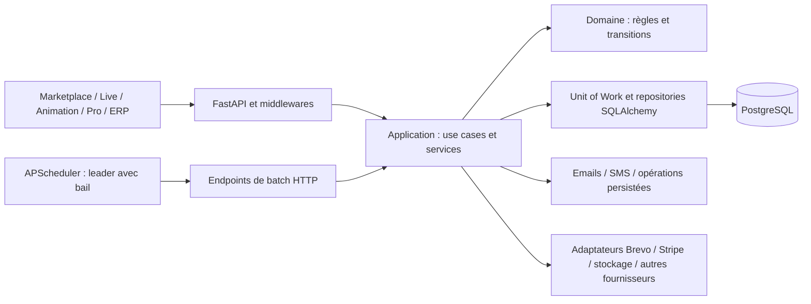

# Architecture observée

Périmètre : backend au commit du [README](../README.md). Cette carte décrit des mécanismes ; elle ne prononce aucun diagnostic de performance.

| Élément | Observation et source |
| --- | --- |
| Entrée et cycle de vie | `app.main:app`, validation runtime et instrumentation avant création ; readiness et ordonnanceur au lifespan : [app/main.py:169](../../../../../../localeo-backend/app/main.py#L169) |
| Exposition | Montage des routeurs `/public`, `/protected`, `/internal`, routes ERP et authentification : [app/main.py:527](../../../../../../localeo-backend/app/main.py#L527) ; catalogue statique séparé. Un préfixe ne prouve pas — lui seul une autorisation. |
| Contrôles communs | Hôte, session, CSRF, contexte/corrélation, taille du corps, garde de restauration : [app/main.py:460](../../../../../../localeo-backend/app/main.py#L460) |
| Application / domaine | Validation de prestation orchestre entités, contrôle QR, persistance et commit : [app/application/exploitation/use_cases/valider_prestation.py:22](../../../../../../localeo-backend/app/application/exploitation/use_cases/valider_prestation.py#L22) ; jeu orchestre le moteur et les projections : [app/application/animation_locale/services/jeu_animation.py:256](../../../../../../localeo-backend/app/application/animation_locale/services/jeu_animation.py#L256) |
| Persistance | Engine synchrone et `SessionLocal` : [app/infrastructure/persistence/db.py:43](../../../../../../localeo-backend/app/infrastructure/persistence/db.py#L43) ; UoW instancie les repositories avec une session, commit explicite, rollback sur exception et fermeture : [app/infrastructure/persistence/uow/sqlalchemy_unit_of_work.py:76](../../../../../../localeo-backend/app/infrastructure/persistence/uow/sqlalchemy_unit_of_work.py#L76), [app/infrastructure/persistence/uow/sqlalchemy_unit_of_work.py:216](../../../../../../localeo-backend/app/infrastructure/persistence/uow/sqlalchemy_unit_of_work.py#L216) |
| Lecture publique | Le catalogue d’animations construit directement ses requêtes SQLAlchemy dans le service, sans repository dédié sur ce chemin : [app/application/animation_locale/services/catalogue_animations_publiques.py:311](../../../../../../localeo-backend/app/application/animation_locale/services/catalogue_animations_publiques.py#L311) |
| Batchs | Définitions et planifications : [app/application/exploitation/services/batchs.py:84](../../../../../../localeo-backend/app/application/exploitation/services/batchs.py#L84) ; élection et exécuteur : [app/infrastructure/scheduler/coordinator.py:74](../../../../../../localeo-backend/app/infrastructure/scheduler/coordinator.py#L74) ; appel HTTP vers les batchs : [app/infrastructure/scheduler/http_client.py:34](../../../../../../localeo-backend/app/infrastructure/scheduler/http_client.py#L34) |
| Documents | Backend local ou S3 sélectionné par factory : [app/infrastructure/storage/document_storage.py:135](../../../../../../localeo-backend/app/infrastructure/storage/document_storage.py#L135) ; rendus QR, PDF et images dans l’infrastructure. |
| ERP | SQLAdmin est assemblé depuis le point d’entrée ; il existe aussi des consoles et API spécifiques : [app/main.py:525](../../../../../../localeo-backend/app/main.py#L525), [app/infrastructure/admin/admin.py:1](../../../../../../localeo-backend/app/infrastructure/admin/admin.py#L1) |

Les quatre frontends sont des consommateurs potentiels ; leurs fréquences effectives d’appel et contrats embarqués n’ont pas été audités — cette étape. Les exports documentaires canoniques ne sont pas régénérés.
