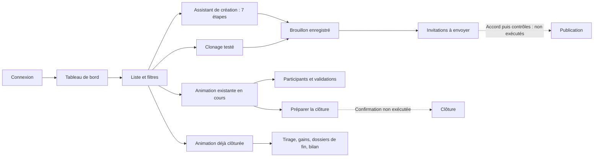

# Cartographie des parcours réellement explorés

Date : 18 novembre 2026. Les chemins sont ceux de l’interface observée sur l’origine TEST fournie. `:id` désigne l’animation ouverte. **OBSERVÉ** désigne une interaction réelle ; **DÉDUIT** une conclusion de lecture des sources ; **HYPOTHÈSE** un effet utilisateur restant à tester.

| # | Mission / parcours | Chemin réel | Résultat et frontière de preuve |
| --- | --- | --- | --- |
| 1 | Accès — première connexion | `/` → formulaire → tableau de bord | OBSERVÉ : authentification réussie avec le seul compte autorisé. Une première connexion de cette session, pas l’activation initiale d’un nouveau compte. Capture 01–02. |
| 2 | E — découverte du tableau de bord | `/tableau-de-bord` (également affiché après connexion à `/`) | OBSERVÉ : alertes, actions à traiter, suivi des animations, filtres et indicateurs. 02, 43–44. |
| 3 | A — tombola simple | `/animations` → `/animations/nouvelle` → 7 étapes → assistant | OBSERVÉ : brouillon créé, lot fictif libre, un commerce sélectionné ; invitation non envoyée. 04–16. |
| 4 | A — passeport commerçant | Même assistant, modèle Passeport | OBSERVÉ : minimum deux commerces puis seuil initial quatre, ramené à deux ; brouillon créé. 17–20. |
| 5 | A — dotation | Étape Dotation puis `?onglet=configuration` | OBSERVÉ : choix coffrets/lots libres, choix de remise, saisie d’un lot libre, persistance. Achat de coffrets et bons numériques non exécutés. 09–10, 16. |
| 6 | A — enregistrer/reprendre | Confirmation → liste → nom du brouillon → Configuration | OBSERVÉ : données de la tombola relues après sortie puis après rechargement direct ; passeport rouvert sur mobile. Pas de sauvegarde intermédiaire observée avant la septième étape. 14–16, 39, 49–51. |
| 7 | A — prévisualisation/publication | Flyer dans l’assistant ; Configuration → Publication | OBSERVÉ : aperçu de flyer et bouton de publication désactivé sur le brouillon faute d’accords. Un flyer publié existant consulté. Publication nouvelle non exécutée. 11–16, 59. |
| 8 | B — ajout individuel | Sélecteur de commerces → Voir les détails | OBSERVÉ : sélection d’une fiche existante et détail en lecture ; aucune entrée de création individuelle trouvée dans les surfaces parcourues. DÉDUIT : le client `api.commercants` lu expose la lecture publique. Ne prouve pas l’absence de cette fonction dans tout Localeo. 07, 57 ; C03. |
| 9 | B — import en masse | `/commercants/imports` → flux → CSV → association des colonnes → aperçu | OBSERVÉ : dépôt et aperçu de deux lignes, deux créations proposées, aucun conflit. Confirmation d’import non exécutée ; aucune fiche commerçant créée. 21–24, 53. |
| 10 | B — invitation/activation | `/animations/:id?onglet=participations` | OBSERVÉ : une invitation à envoyer pour la tombola, deux pour le passeport ; une acceptation préexistante consultée. Envoi et activation de compte non testés. Acceptation d’une participation et activation d’un compte sont distinctes. 15, 51, 58. |
| 11 | C — animation en cours | Liste → Test jeu des vitrines → bilan puis suivi | OBSERVÉ : statut En cours ; « Consulter le suivi » conduit au bilan dans ce cas, puis « Ouvrir le suivi de l’animation » conduit à `?onglet=live`. 25–26. |
| 12 | C — participations | Piloter → Participants / Validations | OBSERVÉ : une inscription, progression 0 %, non qualifiée ; zéro validation dans les filtres. Aucune preuve créée/corrigée. 27–28. |
| 13 | C — communication/notifications | Communiquer → Communication / Messages habitants ; cloche | OBSERVÉ : communication en erreur 500 répétée, messages habitants vides, neuf notifications consultables. Aucune campagne ni notification envoyée, aucun clic de notification marquant une lecture. 29–32, 55. |
| 14 | D — clôture | Animation expirée → Publication et clôture → Clôturer → confirmation | OBSERVÉ : conséquences et case de confirmation, bouton final non actionné ; retour au suivi. Fin de dates et clôture sont distinctes dans cet exemple. 33–34. |
| 15 | D — résultats/gagnants/lots | Animation déjà clôturée → Résultats → Tirage / Gains & remise / Fin | OBSERVÉ : un gagnant confirmé, email historiquement envoyé, remise non renseignée, dossier restant à traiter. Aucun tirage/envoi/remise/archivage exécuté. 35–37, 54. |
| 16 | D/E — bilan | Résultats → Bilan | OBSERVÉ : bilan en cours et bilan d’animation clôturée, définitions, dates de couverture, exports proposés. Export PDF/CSV non téléchargé. 25, 38, 56. |
| 17 | E — duplication | Liste → Cloner l’animation → dates/contenus/dotation → confirmation | OBSERVÉ : clone de notre tombola créé, sans reprise des participants/accords/lots ; nouvelle préparation demandée. 40–42. |
| 18 | E — plusieurs animations | Liste, recherche `UX TEST`, retour depuis un détail | OBSERVÉ : recherche ramène les deux brouillons avant clonage, filtre conservé au retour ; réinitialisation nécessaire pour retrouver les autres animations. 03, 39, 45. |

## Enchaînements

L’ajout de commerçants par import se déroule hors de l’assistant. L’envoi des invitations, leurs réponses et la publication sont des étapes séparées : elles empêchent de déduire un temps de publication complète à partir du seul temps de saisie.
