# Orientations réalisées — recette UX Localeo Animation

Étape 4 préparée le 2026-11-18T12:38:07+01:00 ; actualisée le 18 novembre. **Les neuf orientations P0/P1 sont implémentées et poussées après autorisation globale ; recette UX à valider. D2 conserve sa validation de direction fonctionnelle.**

Version présentée : maquettes **v2** de l’étape 3, neuf orientations P0/P1 adoptées à au moins sept voix simulées sur douze. Les préférences de la revue ne constituent pas votre validation. Les conséquences et bénéfices restent des hypothèses d’usage sauf preuve explicitement indiquée.

Pour la recette UX de chaque ID, choisir **VALIDÉE**, **REFUSÉE**, **À RÉVISER** ou **REPORTÉE**, avec commentaire et conditions. Une recette non évaluée reste **À VALIDER**. Ce statut ne suspend pas l’implémentation déjà réalisée et ne vaut pas report.

[Registre de réalisation et de recette](decisions.md) · [Risques critiques séparés](risques-critiques.md) · [Galerie comparative](../visuels/comparatif-avant-apres.html) · [Backlog réalisé](backlog-implementation-potentiel.md)

Efforts relatifs et provisoires : **S** = ajustement local ; **M** = plusieurs composants ou états ; **L** = parcours ou contrat partagé. Ce ne sont ni des jours ni un engagement de livraison.

## Synthèse

| ID | Parcours | Priorité | Vote simulé POUR /12 | Effort | État courant |
| --- | --- | --- | ---: | --- | --- |
| [A1](#a1) | E — Pilotage global ; première prise en main | P1 | 12 | M | Implémentée et poussée ; recette UX à valider |
| [B1](#b1) | A — Création et reprise | P1 | 12 | L | Implémentée et poussée ; recette UX à valider |
| [B2](#b2) | A — Publication ; B — Préparation des commerçants | P1 | 12 | M | Implémentée et poussée ; recette UX à valider |
| [B3](#b3) | A — Paramétrage du passeport | P1 | 12 | S | Implémentée et poussée ; recette UX à valider |
| [C1](#c1) | B — Ajout individuel | P1 | 9 | L | Implémentée et poussée ; recette UX à valider |
| [C2](#c2) | B — Import et doublons | P1 | 9 | L | Implémentée et poussée ; recette UX à valider |
| [D1](#d1) | C — Suivi et communication | P0 | 12 | M | Implémentée et poussée ; recette UX à valider |
| [D2](#d2) | C — Suivi en cours | P1 | 12 | S | Implémentée et poussée ; direction validée ; recette UX à valider |
| [E1](#e1) | D — Clôture, lots et bilan | P1 | 12 | M | Implémentée et poussée ; recette UX à valider |

## A1 — Donner la priorité aux actions attendues

- **Parcours :** E — Pilotage global ; première prise en main.
- **Priorité :** P1 ; **effort estimé :** M (provisoire).
- **Vote simulé :** 12 POUR, 0 CONTRE, 0 ABSTENTION — ADOPTÉE ; seuil 7/12. [Votes nominatifs](../workshop/votes-et-arbitrages.md).
- **Constat :** OBSERVÉ ; AN-02, AN-19, [observations](../observations/observations-factuelles.md).
- **Problème :** L’accueil place de nombreuses nouvelles jaunes avant les actions ; leur apparence rapproche information positive et alerte.
- **Conséquence pour l’organisateur :** L’action urgente peut être moins facile à repérer. Effet sur les personnes : hypothèse.
- **Proposition soumise à votre décision :** Placer les actions à traiter et l’accès à la création avant les nouvelles ; différencier succès, information et alerte. Conserver le contexte communal, les filtres et l’accès à toutes les notifications. Aucun nouveau moteur d’alertes.
- **Bénéfice attendu :** Identifier ce qui demande une intervention, puis accéder aux nouvelles. Gain non mesuré.
- **Risques et dépendances :** Hiérarchie et sémantique des composants existants ; aucun nouveau calcul métier d’urgence.
- **Confiance et limites :** Élevée sur l’écran ; moyenne sur le gain supposé.

### AVANT — capture réelle

Écran : **Tableau de bord — nouvelles avant les actions**. Les cartes jaunes occupent l’essentiel de la première vue, y compris pour des événements positifs.

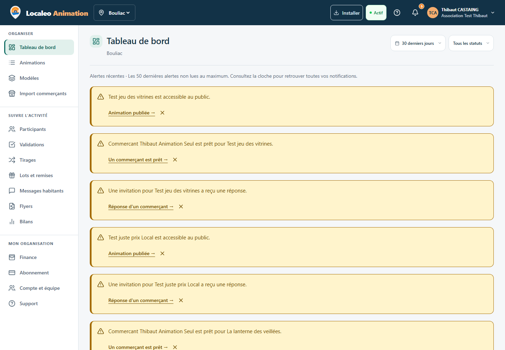

### APRÈS — proposition v2, données fictives

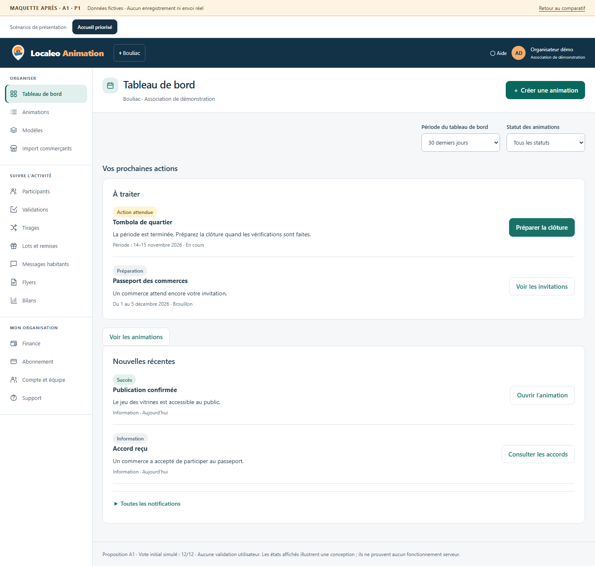

[Maquette interactive et tous ses états](../visuels/maquettes-apres/A1.html) · [Rendu mobile](../visuels/maquettes-apres/A1-accueil-mobile.png) · [Comparatif](../visuels/comparatif-avant-apres.html#A1) · [Critères futurs](../workshop/backlog-ux.md#a1).

**Votre décision : en attente.** Commentaire et conditions non fournis. La date de décision sera renseignée à réception d’un accord ou d’un autre choix explicite.

## B1 — Sauvegarder avant la fin des sept étapes

- **Parcours :** A — Création et reprise.
- **Priorité :** P1 ; **effort estimé :** L (provisoire).
- **Vote simulé :** 12 POUR, 0 CONTRE, 0 ABSTENTION — ADOPTÉE ; seuil 7/12. [Votes nominatifs](../workshop/votes-et-arbitrages.md).
- **Constat :** OBSERVÉ ; AN-03, [observations](../observations/observations-factuelles.md).
- **Problème :** Le premier enregistrement arrive après les sept étapes ; quitter plus tôt propose de perdre la saisie.
- **Conséquence pour l’organisateur :** Risque de ressaisie ou d’abandon lors d’une interruption, non mesuré avec des personnes.
- **Proposition soumise à votre décision :** Enregistrer explicitement un brouillon incomplet dès modèle, nom et commune renseignés ; reprendre les champs réellement enregistrés. Afficher état de sauvegarde et éléments manquants. Aucun envoi ni publication implicite ; les contrôles serveur de publication restent inchangés. Contrat de brouillon partiel à spécifier avant développement.
- **Bénéfice attendu :** Préparer une animation en plusieurs sessions sans prétendre qu’elle est publiable. Gain non mesuré.
- **Risques et dépendances :** Contrat de brouillon partiel à spécifier avec le backend ; droits, validation partielle et reprise. Pas une simple retouche de bouton.
- **Confiance et limites :** Élevée sur le constat ; moyenne sur la solution et son coût.

### AVANT — capture réelle

Écran : **Création — informations et sortie de saisie**. La capture bureau situe l’étape Informations ; la capture mobile montre le choix entre continuer et quitter sans enregistrer. La sauvegarde n’arrive qu’après les sept étapes (AN-03).

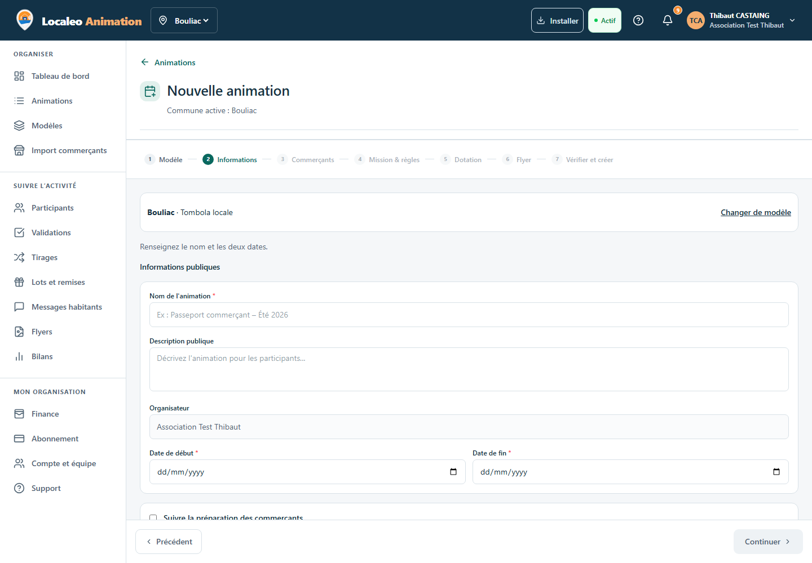

### APRÈS — proposition v2, données fictives

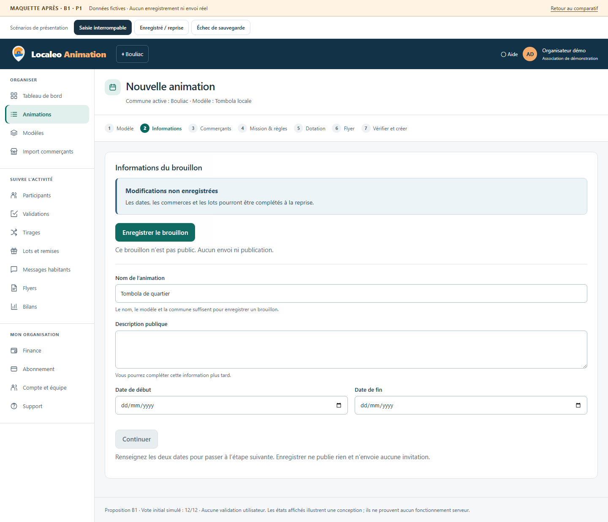

[Maquette interactive et tous ses états](../visuels/maquettes-apres/B1.html) · [Rendu mobile](../visuels/maquettes-apres/B1-saisie-mobile.png) · [Comparatif](../visuels/comparatif-avant-apres.html#B1) · [Critères futurs](../workshop/backlog-ux.md#b1).

**Votre décision : en attente.** Commentaire et conditions non fournis. La date de décision sera renseignée à réception d’un accord ou d’un autre choix explicite.

## B2 — Expliquer préparation, accords et publication

- **Parcours :** A — Publication ; B — Préparation des commerçants.
- **Priorité :** P1 ; **effort estimé :** M (provisoire).
- **Vote simulé :** 12 POUR, 0 CONTRE, 0 ABSTENTION — ADOPTÉE ; seuil 7/12. [Votes nominatifs](../workshop/votes-et-arbitrages.md).
- **Constat :** OBSERVÉ ; AN-06, AN-07, AN-08, AN-09, AN-10, AN-15, [observations](../observations/observations-factuelles.md).
- **Problème :** Les accords conditionnent la publication ; certains diagnostics sont techniques et les étapes du résultat final restent dispersées.
- **Conséquence pour l’organisateur :** L’organisateur peut confondre création du brouillon, accord du commerce, activation d’un compte et publication.
- **Proposition soumise à votre décision :** Expliquer tôt le résultat de la création : brouillon préparé, puis accords, puis publication. Remplacer les diagnostics techniques par action + responsable + raison du blocage + lien ciblé ; préciser les termes de dotation sans changer ses modes. Distinguer sélection, invitation, accord, préparation et activation seulement si cette dernière est connue. Ne promettre aucun délai humain non mesuré.
- **Bénéfice attendu :** Savoir qui doit agir, pourquoi et où, sans promettre le délai de réponse de tiers. Gain non mesuré.
- **Risques et dépendances :** Réutiliser les diagnostics et statuts canoniques ; vérifier les liens et les acteurs disponibles dans le contrat.
- **Confiance et limites :** Élevée sur les libellés et conditions observés ; moyenne sur la compréhension future.

### AVANT — capture réelle

Écran : **Assistant — préparation à compléter**. Le diagnostic « Demandes participation a envoyer » n’indique pas directement le geste à effectuer.

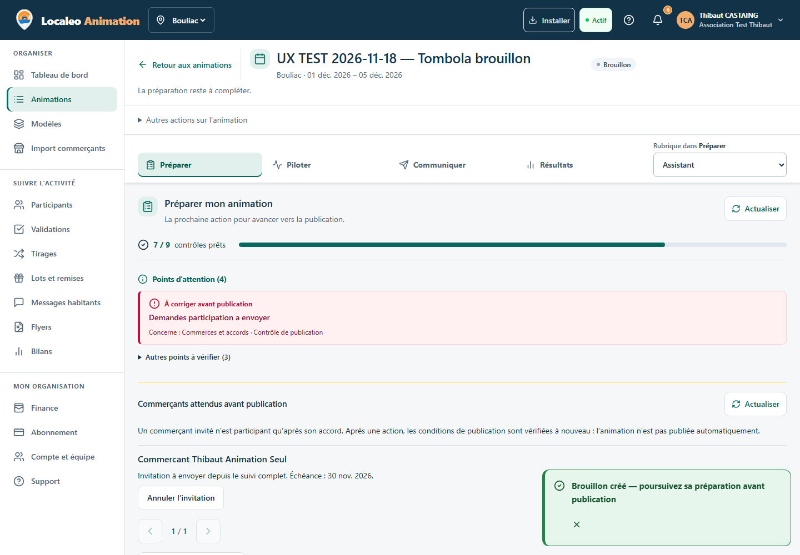

### APRÈS — proposition v2, données fictives

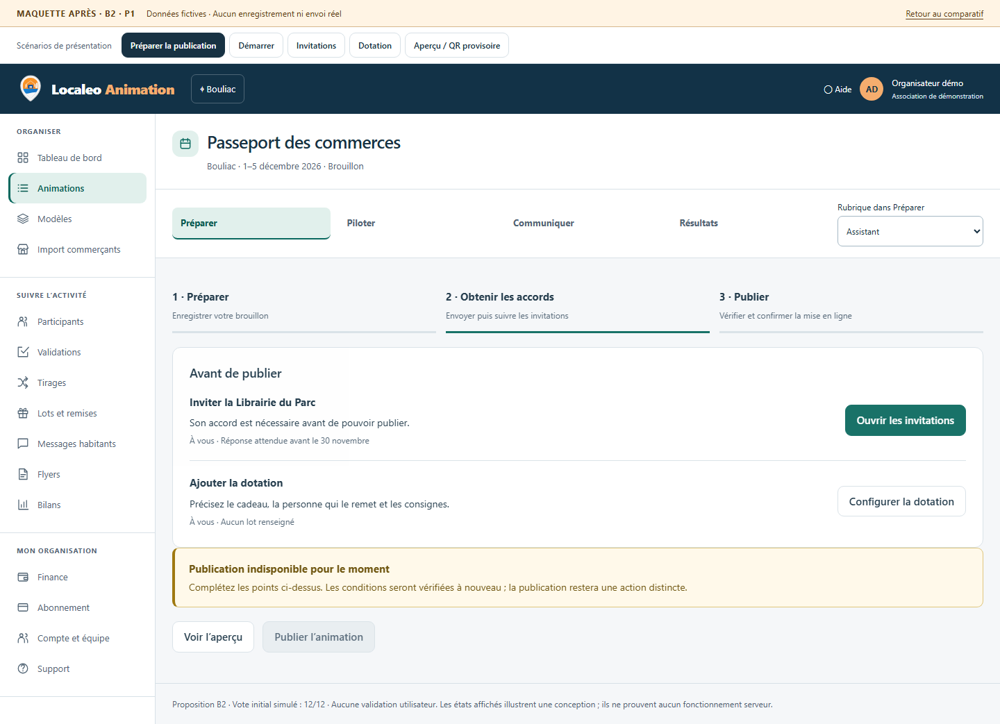

[Maquette interactive et tous ses états](../visuels/maquettes-apres/B2.html) · [Rendu mobile](../visuels/maquettes-apres/B2-publication-mobile.png) · [Comparatif](../visuels/comparatif-avant-apres.html#B2) · [Critères futurs](../workshop/backlog-ux.md#b2).

**Votre décision : en attente.** Commentaire et conditions non fournis. La date de décision sera renseignée à réception d’un accord ou d’un autre choix explicite.

## B3 — Proposer un seuil de passeport cohérent

- **Parcours :** A — Paramétrage du passeport.
- **Priorité :** P1 ; **effort estimé :** S (provisoire).
- **Vote simulé :** 12 POUR, 0 CONTRE, 0 ABSTENTION — ADOPTÉE ; seuil 7/12. [Votes nominatifs](../workshop/votes-et-arbitrages.md).
- **Constat :** OBSERVÉ ; AN-05, [observations](../observations/observations-factuelles.md).
- **Problème :** Après sélection de deux commerces, le seuil proposé reste à quatre et doit être corrigé.
- **Conséquence pour l’organisateur :** Une correction évitable et une incertitude sur le fonctionnement du passeport.
- **Proposition soumise à votre décision :** Proposer au choix du seuil une valeur initiale compatible avec les commerces sélectionnés et expliquer la conséquence. Si la sélection change, signaler l’incompatibilité et demander un ajustement explicite, sans changer silencieusement une règle déjà choisie. Garder le contrôle serveur.
- **Bénéfice attendu :** Démarrer avec une règle compatible et compréhensible. Gain non mesuré.
- **Risques et dépendances :** Bornes du domaine à respecter ; estimation S seulement si le contrat existant suffit. Capture 18 insuffisante pour voir le champ inférieur.
- **Confiance et limites :** Élevée sur le constat DOM ; moyenne sur la règle d’initialisation à confirmer.

### AVANT — capture réelle

Écran : **Passeport — mission et règles**. Capture réelle de l’étape 4 : le champ de seuil se trouve plus bas, hors du cadrage conservé. Le seuil de 4 après sélection de 2 commerces est attesté par AN-05 et le relevé DOM, pas par cette image seule.

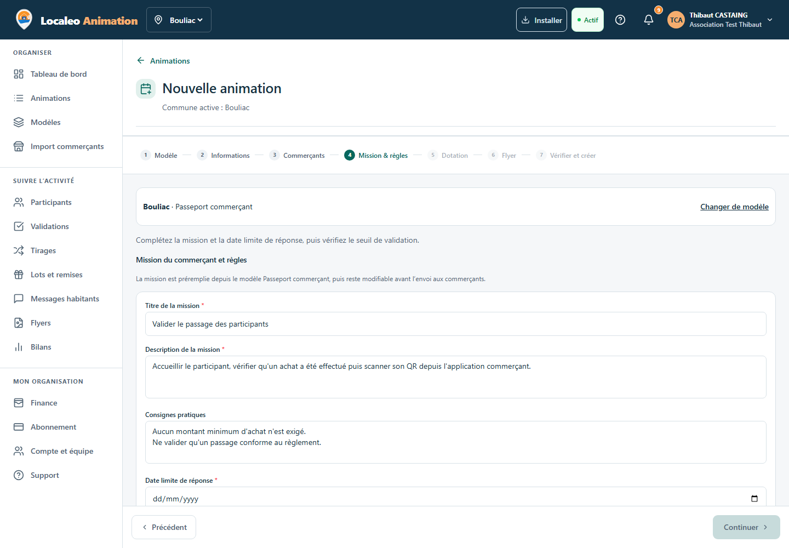

### APRÈS — proposition v2, données fictives

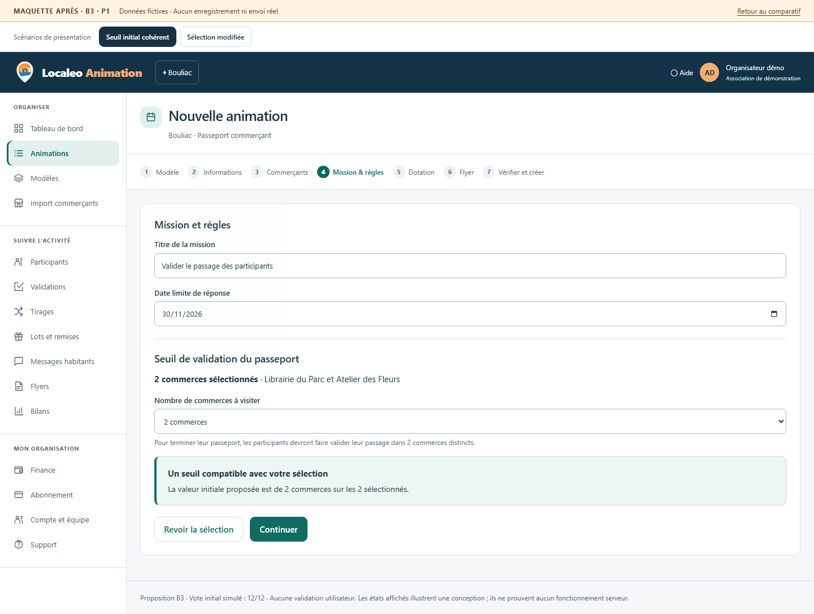

[Maquette interactive et tous ses états](../visuels/maquettes-apres/B3.html) · [Rendu mobile](../visuels/maquettes-apres/B3-compatible-mobile.png) · [Comparatif](../visuels/comparatif-avant-apres.html#B3) · [Critères futurs](../workshop/backlog-ux.md#b3).

**Votre décision : en attente.** Commentaire et conditions non fournis. La date de décision sera renseignée à réception d’un accord ou d’un autre choix explicite.

## C1 — Rendre trouvable l’ajout d’un commerce absent

- **Parcours :** B — Ajout individuel.
- **Priorité :** P1 ; **effort estimé :** L (provisoire).
- **Vote simulé :** 9 POUR, 0 CONTRE, 3 ABSTENTION — ADOPTÉE ; seuil 7/12. [Votes nominatifs](../workshop/votes-et-arbitrages.md).
- **Constat :** OBSERVÉ ; AN-11, [observations](../observations/observations-factuelles.md).
- **Problème :** Aucun accès individuel n’a été trouvé dans les écrans explorés ; cela ne prouve pas l’absence de fonction dans tout Localeo.
- **Conséquence pour l’organisateur :** Un organisateur avec un seul commerce manquant ne sait pas poursuivre.
- **Proposition soumise à votre décision :** Depuis le sélecteur, proposer « Mon commerce n’est pas dans la liste » et un parcours de demande individuelle de référencement avec suivi. Réutiliser la fonction canonique disponible après vérification de sa portée ; une demande ne rend pas le commerce éligible, activé ou participant. Ne pas créer un compte actif ni envoyer d’invitation automatiquement.
- **Bénéfice attendu :** Lui donner un chemin explicite et un suivi de demande sans créer de compte actif implicite. Gain non mesuré.
- **Risques et dépendances :** Référentiel commerçants, droits de référencement et contrat backend ; périmètre à confirmer avant chiffrage ferme.
- **Confiance et limites :** Moyenne : non-accessibilité locale établie, couverture de l’écosystème incomplète.

### AVANT — capture réelle

Écran : **Sélection des commerces**. La sélection existante ne montre pas de chemin individuel trouvé pendant l’exploration pour un commerce absent. Cela ne prouve pas l’absence de fonction dans tout Localeo.

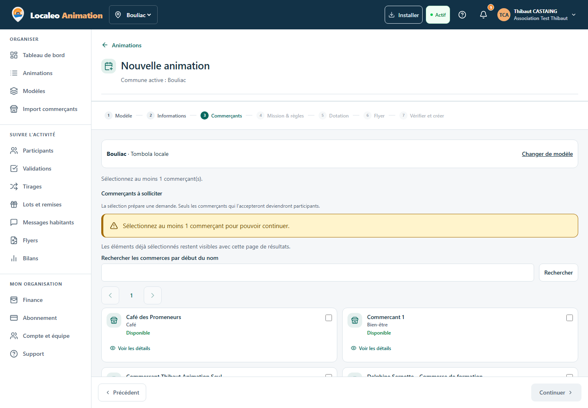

### APRÈS — proposition v2, données fictives

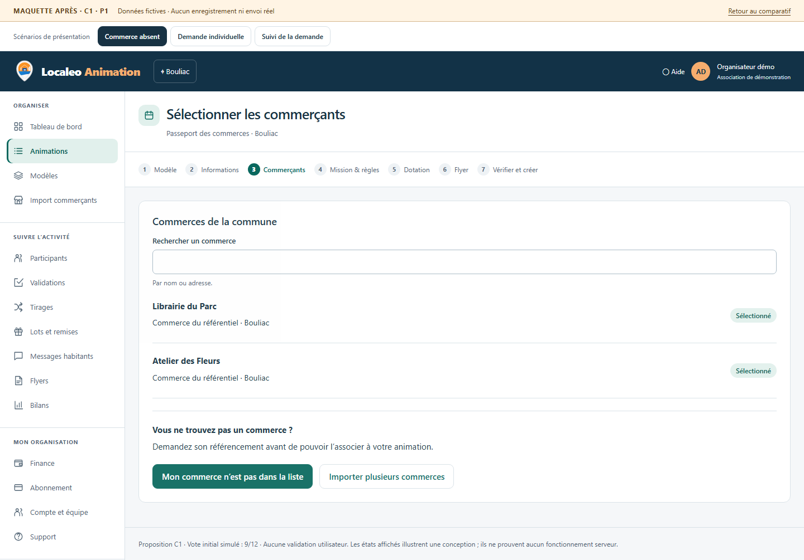

[Maquette interactive et tous ses états](../visuels/maquettes-apres/C1.html) · [Rendu mobile](../visuels/maquettes-apres/C1-selection-mobile.png) · [Comparatif](../visuels/comparatif-avant-apres.html#C1) · [Critères futurs](../workshop/backlog-ux.md#c1).

**Votre décision : en attente.** Commentaire et conditions non fournis. La date de décision sera renseignée à réception d’un accord ou d’un autre choix explicite.

## C2 — Sécuriser la compréhension de l’import

- **Parcours :** B — Import et doublons.
- **Priorité :** P1 ; **effort estimé :** L (provisoire).
- **Vote simulé :** 9 POUR, 0 CONTRE, 3 ABSTENTION — ADOPTÉE ; seuil 7/12. [Votes nominatifs](../workshop/votes-et-arbitrages.md).
- **Constat :** OBSERVÉ / DÉDUIT ; AN-12, AN-13, AN-14, [observations](../observations/observations-factuelles.md).
- **Problème :** Le modèle téléchargé exige un remappage ; les mentions obligatoire sont ambiguës ; deux lignes similaires sans identifiant fort donnent deux créations proposées et zéro conflit.
- **Conséquence pour l’organisateur :** Saisie de mapping évitable et risque de surinterpréter zéro conflit comme absence de doublon. Aucun doublon effectivement créé n’est prouvé.
- **Proposition soumise à votre décision :** Préassocier les colonnes reconnues du modèle fourni, laisser vérifier/corriger ; distinguer colonne requise et cellule requise ; présenter les limites de rapprochement. Signaler la similitude nom/adresse comme doute à examiner, sans fusion ni rejet automatiques, en conservant les conflits forts email/SIRET. Confirmation explicite des lignes.
- **Bénéfice attendu :** Réduire le travail mécanique et permettre une décision informée avant import. Gain non mesuré.
- **Risques et dépendances :** Qualité des adresses, faux positifs, contrats d’aperçu et import ; code déployé non identifié. L vaut pour l’ensemble, pas seulement les libellés.
- **Confiance et limites :** Élevée sur l’aperçu et le code local ; moyenne sur le rapprochement proposé.

### AVANT — capture réelle

Écran : **Import — vérifier les lignes**. Deux créations proposées pour des lignes similaires ; le mapping et ses limites sont documentés dans AN-12 à AN-14. La capture mobile montre l’espace d’import, pas le détail de l’aperçu.

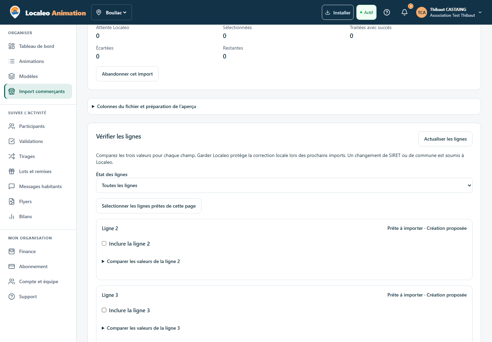

### APRÈS — proposition v2, données fictives

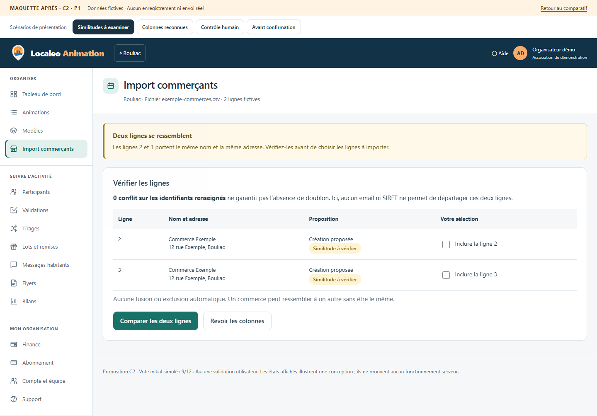

[Maquette interactive et tous ses états](../visuels/maquettes-apres/C2.html) · [Rendu mobile](../visuels/maquettes-apres/C2-apercu-mobile.png) · [Comparatif](../visuels/comparatif-avant-apres.html#C2) · [Critères futurs](../workshop/backlog-ux.md#c2).

**Votre décision : en attente.** Commentaire et conditions non fournis. La date de décision sera renseignée à réception d’un accord ou d’un autre choix explicite.

## D1 — Rétablir et fiabiliser Communication

- **Parcours :** C — Suivi et communication.
- **Priorité :** P0 ; **effort estimé :** M (provisoire).
- **Vote simulé :** 12 POUR, 0 CONTRE, 0 ABSTENTION — ADOPTÉE ; seuil 7/12. [Votes nominatifs](../workshop/votes-et-arbitrages.md).
- **Constat :** OBSERVÉ ; AN-18, [observations](../observations/observations-factuelles.md).
- **Problème :** Deux lectures Communication échouent en HTTP 500, dont une après actualisation, dans la session test.
- **Conséquence pour l’organisateur :** Le parcours de communication n’est pas utilisable dans ce contexte ; autonomie non démontrée si cette capacité est promise au lancement.
- **Proposition soumise à votre décision :** Diagnostiquer et rétablir la lecture Communication en erreur 500, vérifier préparation/aperçu et envoi sur destinataires isolés ; distinguer échec de lecture et envoi incertain, préserver le contexte et proposer une reprise/support. Pas de répétition automatique d’envoi.
- **Bénéfice attendu :** Préparer et suivre une communication fiable, avec une conduite claire en cas d’erreur. Gain non mesuré.
- **Risques et dépendances :** Endpoint campagnes-organisateur et chaîne d’envoi ; P0 pour un lancement autonome incluant Communication, pas une panne globale démontrée.
- **Confiance et limites :** Élevée sur la panne locale ; faible sur sa cause et sa portée ; effort à réestimer après diagnostic.

### AVANT — capture réelle

Écran : **Communication — chargement impossible**. L’actualisation échoue aussi : deux réponses 500 sont consignées dans AN-18.

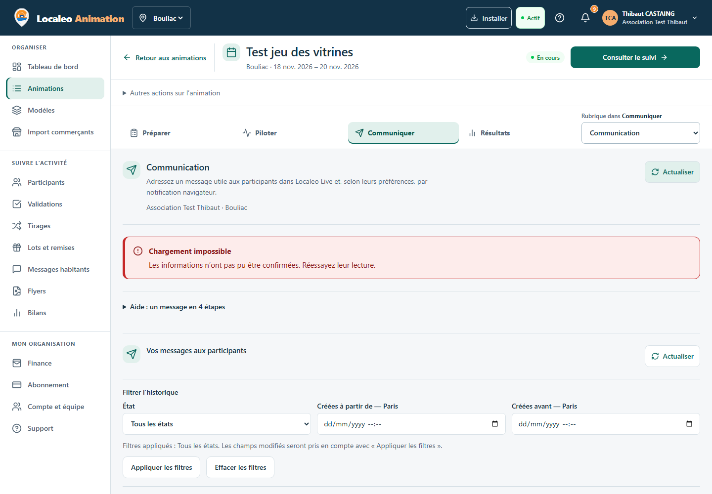

### APRÈS — proposition v2, données fictives

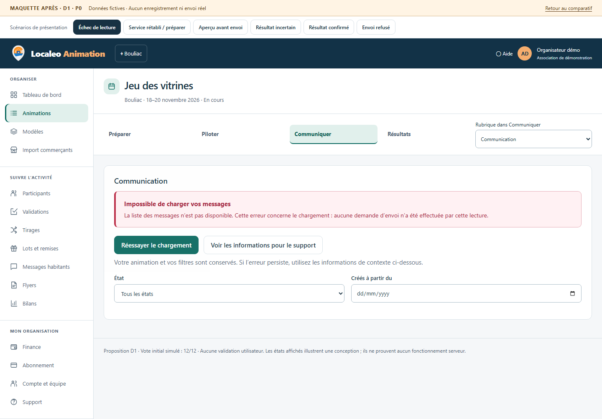

[Maquette interactive et tous ses états](../visuels/maquettes-apres/D1.html) · [Rendu mobile](../visuels/maquettes-apres/D1-lecture-mobile.png) · [Comparatif](../visuels/comparatif-avant-apres.html#D1) · [Critères futurs](../workshop/backlog-ux.md#d1).

**Votre décision : en attente.** Commentaire et conditions non fournis. La date de décision sera renseignée à réception d’un accord ou d’un autre choix explicite.

## D2 — Diriger le suivi vers le suivi opérationnel

- **Parcours :** C — Suivi en cours.
- **Priorité :** P1 ; **effort estimé :** S (provisoire).
- **Vote simulé :** 12 POUR, 0 CONTRE, 0 ABSTENTION — ADOPTÉE ; seuil 7/12. [Votes nominatifs](../workshop/votes-et-arbitrages.md).
- **Constat :** OBSERVÉ ; AN-16, AN-17, [observations](../observations/observations-factuelles.md).
- **Problème :** Consulter le suivi mène au bilan de l’animation en cours ; un autre accès mène au suivi opérationnel.
- **Conséquence pour l’organisateur :** Détour et confusion entre observation en cours et bilan.
- **Proposition soumise à votre décision :** Faire aboutir « Consulter le suivi » au suivi opérationnel, avec accès distinct au bilan. Préserver les définitions, périmètres et dates des indicateurs ; aucun indicateur temps réel inventé.
- **Bénéfice attendu :** Accéder immédiatement à l’espace attendu. Gain non mesuré.
- **Risques et dépendances :** Routes et états existants ; vérifier la navigation retour et les droits.
- **Confiance et limites :** Élevée sur le décalage ; moyenne sur le gain humain.

### AVANT — capture réelle

Écran : **Bilan atteint par « Consulter le suivi »**. AN-16 documente le détour : le bouton aboutit au bilan, puis un second lien ouvre le suivi opérationnel.

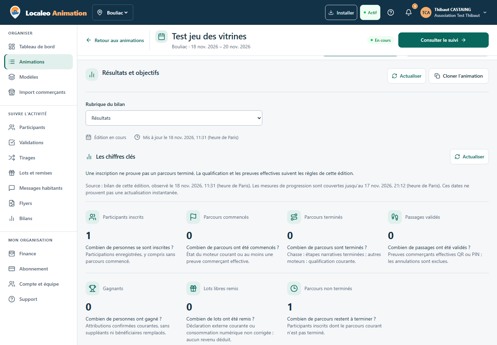

### APRÈS — proposition v2, données fictives

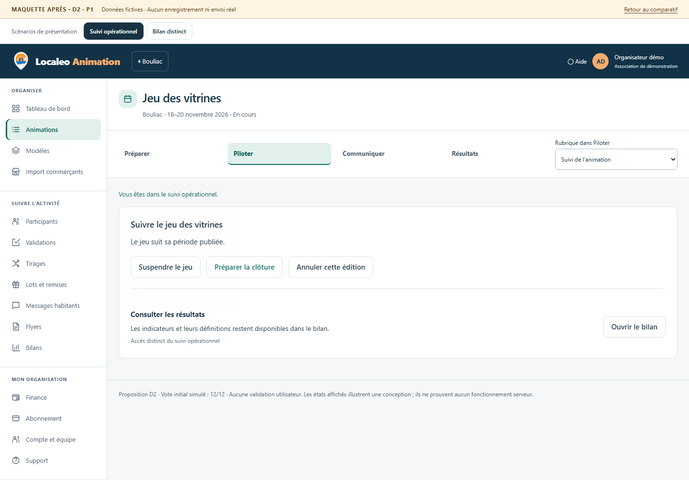

[Maquette interactive et tous ses états](../visuels/maquettes-apres/D2.html) · [Rendu mobile](../visuels/maquettes-apres/D2-suivi-mobile.png) · [Comparatif](../visuels/comparatif-avant-apres.html#D2) · [Critères futurs](../workshop/backlog-ux.md#d2).

**Votre décision : VALIDÉE sur la direction fonctionnelle, le 18 novembre.** Primauté explicite de l’atelier : suivi opérationnel en destination, Bilan distinct. Voir le registre ; aucune recette du code ou approbation détaillée du rendu déduite.

## E1 — Rendre explicite le chemin de fin

- **Parcours :** D — Clôture, lots et bilan.
- **Priorité :** P1 ; **effort estimé :** M (provisoire).
- **Vote simulé :** 12 POUR, 0 CONTRE, 0 ABSTENTION — ADOPTÉE ; seuil 7/12. [Votes nominatifs](../workshop/votes-et-arbitrages.md).
- **Constat :** OBSERVÉ ; AN-20, AN-21, [observations](../observations/observations-factuelles.md).
- **Problème :** Une période terminée peut rester En cours ; clôturée, terminée et archivée sont distinctes ; un email gagnant n’équivaut pas à une remise enregistrée.
- **Conséquence pour l’organisateur :** Risque d’interpréter trop tôt le travail comme terminé ou de mal comprendre une action définitive.
- **Proposition soumise à votre décision :** Expliquer près de l’action les états « période finie », « clôturée », « terminée », « archivée », leurs conséquences et la prochaine tâche. Réutiliser les dossiers à résoudre existants et leur responsable connu ; remplacer le jargon de gel par une explication compréhensible. Conserver confirmation définitive, distinction informer/remettre et droits métier.
- **Bénéfice attendu :** Savoir ce qui est fini, ce qui reste à faire et les effets de la prochaine action. Gain non mesuré.
- **Risques et dépendances :** Transitions du domaine et dossiers existants, droits ; aucune clôture ou remise automatique.
- **Confiance et limites :** Élevée sur les états consultés ; moyenne sur leur compréhension ; exécution de clôture non vérifiée.

### AVANT — capture réelle

Écran : **Fin et archivage — dossier restant**. Clôturée, terminée et archivée sont des étapes distinctes ; un dossier de lot reste à traiter. La confirmation de clôture est également visible dans la capture 62.

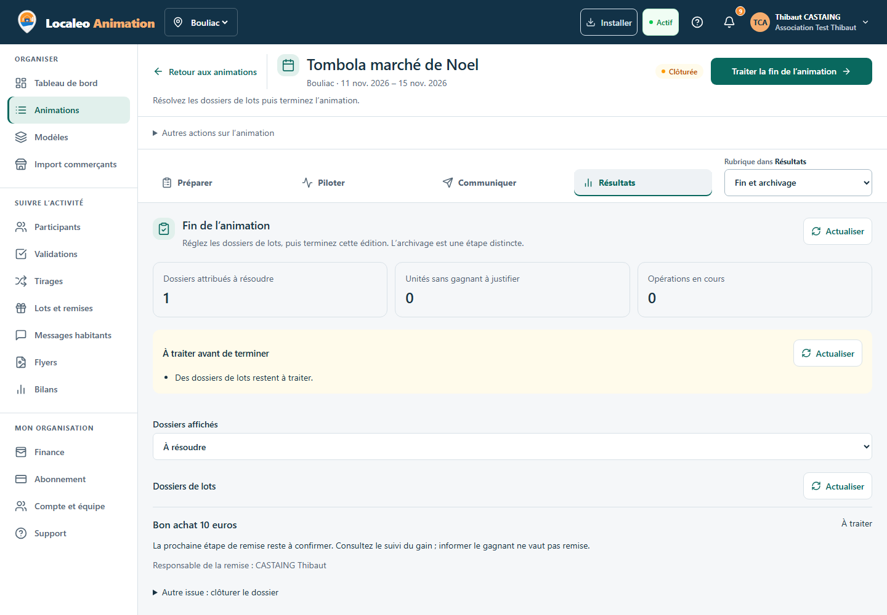

### APRÈS — proposition v2, données fictives

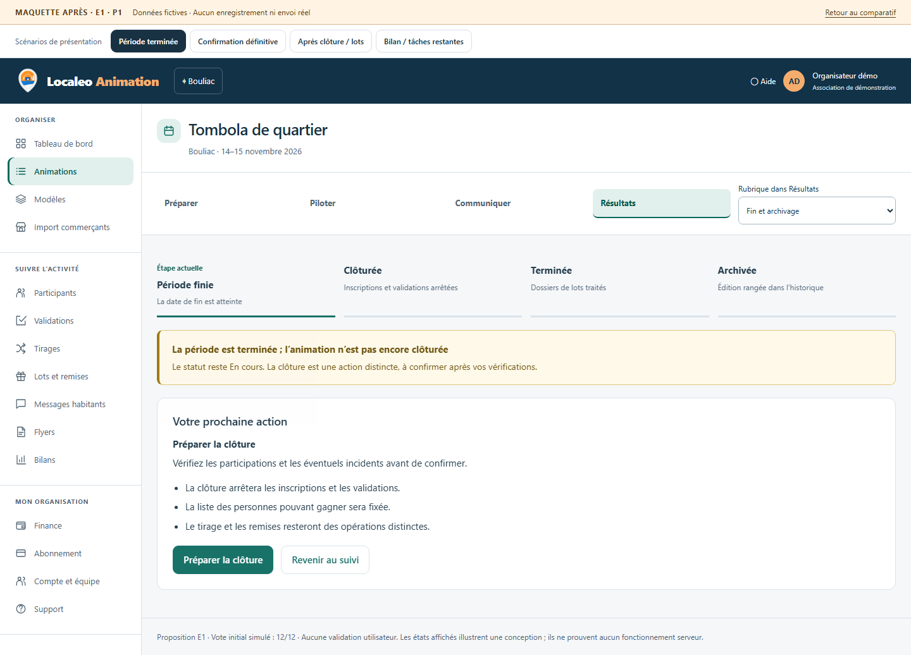

[Maquette interactive et tous ses états](../visuels/maquettes-apres/E1.html) · [Rendu mobile](../visuels/maquettes-apres/E1-periode-mobile.png) · [Comparatif](../visuels/comparatif-avant-apres.html#E1) · [Critères futurs](../workshop/backlog-ux.md#e1).

**Votre décision : en attente.** Commentaire et conditions non fournis. La date de décision sera renseignée à réception d’un accord ou d’un autre choix explicite.
