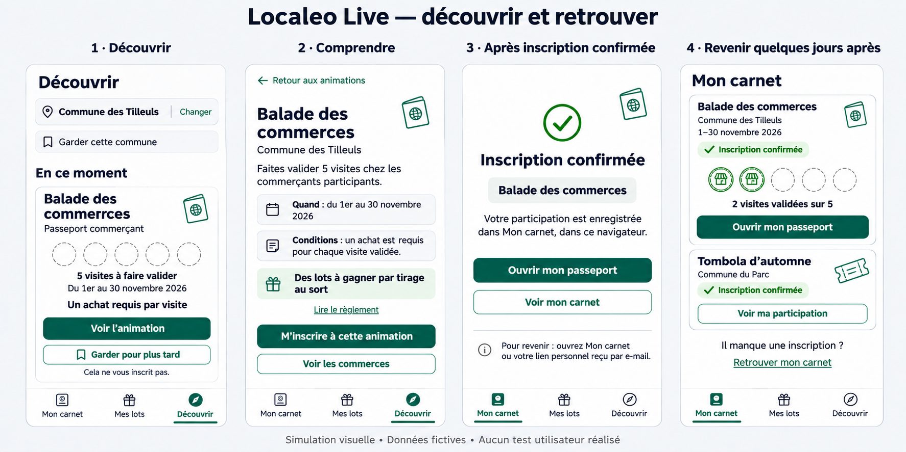
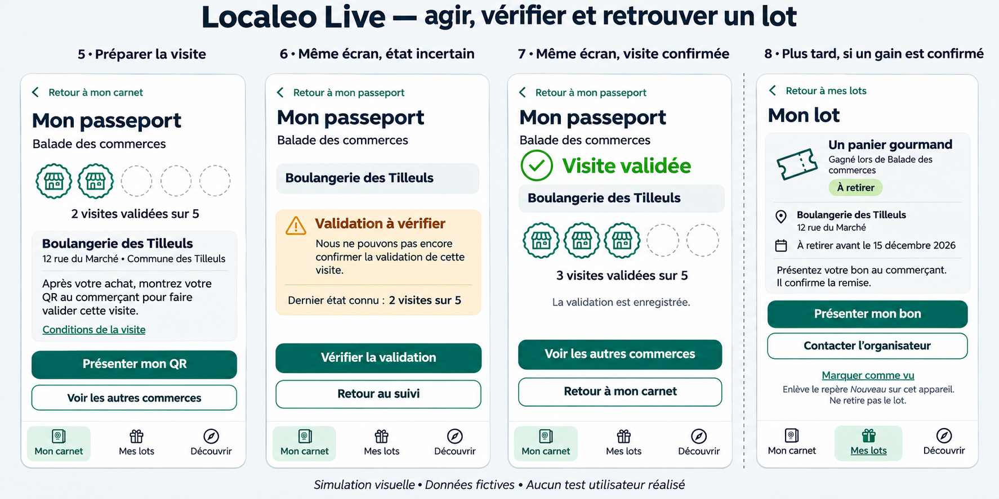

# Localeo Live — audit UX habitant et maquettes de référence

**Date : 17 novembre 2026.** Séance interactive de brainstorming produit et UX, suivie d’une validation des orientations fonctionnelles et de la direction artistique par le demandeur.

**Décision : l’UX de l’application Localeo Live doit être revue pour se conformer strictement aux maquettes validées et conservées dans ce rapport.** Les deux planches constituent la référence de conception pour cette mise en conformité ; elles ne sont pas de simples illustrations d’intention.

**État de la séance du 17 novembre : conception validée, mise en conformité à réaliser.** Le présent travail formalise l’audit et conserve les images. Il ne constitue ni une implémentation, ni une recette applicative, ni une preuve de déploiement.

**Mise en œuvre locale le 18 novembre 2026 :** évolution, spécification et
implémentation rattachées à **E73-EVO-LIVE-MAQUETTES**. Les
[critères LM-01 à LM-11 et le bilan de réalisation](../../specifications/epic-73-animation-et-ou-coffrets/localeo-live-entree-unique.md#évolution-du-17-novembre-2026--maquettes-habitant)
portent les changements, les preuves applicatives et les limites de cette
mise en œuvre, dont l’arbitrage ouvert sur l’en-tête ajouté au-dessus des vues.
Le présent audit conserve les constats et preuves de sa séance
initiale ; les essais habitants et physiques ne sont pas remplacés par la recette automatisée.

## 1. Périmètre, méthode et portée des preuves

L’analyse porte sur un habitant novice utilisant principalement son téléphone, dans un navigateur ou une PWA lorsqu’elle est disponible. Aucune commune ni installation de démonstration n’a été imposée. Le passeport commerçant sert de fil conducteur ; la chasse, les tombolas et les trois natures de lots apportent les différences à préserver.

Les cinq parcours examinés sont : découvrir les animations d’une commune, retrouver ses inscriptions, comprendre sa participation, réaliser une étape, puis retrouver et retirer ou utiliser ses lots. La continuité examinée couvre découverte → inscription → retour personnel → étape → progression → résultat → lot → retrait ou utilisation → retour ultérieur.

| Nature de preuve | Travail réellement réalisé | Limite |
| --- | --- | --- |
| Lecture des sources | Lecture ciblée des spécifications, principes UX et composants Marketplace cités ci-dessous. | Le code décrit un comportement prévu ; il ne prouve pas son rendu déployé ni sa compréhension. |
| Simulation | Situations écrites et deux planches graphiques générées avec imagegen, puis corrigées et validées pendant la séance. | Images statiques, sans navigation ni commande exécutée. |
| Émulation | Non réalisée pendant cette séance. | Aucun résultat responsive ou navigateur automatisé revendiqué. |
| Appareil physique | Non essayé pendant cette séance. | Caméra, réseau mobile, PWA et interaction tactile restent à vérifier. |
| Habitant réel | Aucun essai novice ou habitué réalisé. | Les difficultés d’usage sont des hypothèses ; la validation du demandeur est une décision de conception. |

Repères de lecture : Marketplace au commit `ad5c4d92e1b82d57239e3ca95d7d7ee2ba57f5e6` ; Projet au commit `8b20cf9bd8853270aed0df76b20c0800943794c4`, avec des travaux documentaires locaux préexistants conservés. Ces références ne décrivent pas une version déployée. Aucun gain de temps ou de réussite n’a été mesuré.

Références canoniques : [principes UX Live](../../produit/live/principes-ux.md), [entrée unique et évolutions E73](../../specifications/epic-73-animation-et-ou-coffrets/localeo-live-entree-unique.md), [inscriptions multiples](../../specifications/epic-42-localeo-live/inscriptions-multiples.md), [tombola publique E74](../../specifications/epic-74-tombola-publique/README.md), [moteur et protocole de reprise](../../specifications/moteur-animation/conception-technique.md), [lots et remises](../../specifications/epic-73-animation-et-ou-coffrets/gestion-lots-remises.md). Les décisions récentes de ces sources priment sur leurs compositions historiques.

## 2. Décisions validées et exigence de conformité

Le demandeur a validé successivement les orientations des cinq parcours, le maintien de **Mon carnet / Mes lots / Découvrir**, puis les trois points soumis sur les maquettes : reconnaissance des animations dans le carnet, compréhension de la validation incertaine et informations de préparation du retrait. Il a également validé explicitement la direction artistique, puis demandé sa formalisation et la conformité stricte de l’application aux maquettes.

La future réalisation doit respecter les éléments suivants :

- Composition et hiérarchie des vues représentées : identité de l’objet, état utile, information nécessaire, action principale, puis éléments secondaires.
- Navigation basse stable avec icônes et libellés **Mon carnet / Mes lots / Découvrir**, retours explicites et conservation du contexte.
- Direction artistique : fond clair, surfaces blanches bordées, actions vert profond, texte sombre contrasté, espacement lisible, angles modérés et tampons représentant une progression réelle. Reprendre les couleurs, proportions et rapports visuels des planches ; une palette ou une composition différente n’est pas conforme.
- Libellés, distinction des actions et sens des confirmations représentés. Le passeport et le ticket de tombola restent reconnaissables ; un repère de gain ne représente pas une simple inscription.
- Continuité : un seul écran de participation évolue entre action, état incertain et confirmation. Les vues 5 à 7 ne sont pas un assistant imposant trois pages successives.

**La recette devra comparer les rendus de l’application aux planches, et vérifier le comportement des parcours.** Une conformité fonctionnelle seule ne suffit pas à valider la conformité UX et artistique. Toute divergence de composition, navigation, priorité d’action ou direction graphique doit être identifiée et soumise à un arbitrage explicite avant d’être considérée comme acceptée.

La conformité s’applique avec les données et droits réels. Les noms, dates, coordonnées, nombres de visites et lots figurant dans les images sont fictifs. L’achat requis illustre une condition à rendre visible ; il ne crée pas une obligation d’achat pour tous les modèles. Les modèles, états et écrans non représentés doivent être déclinés dans la même direction et revus avant leur validation. La taille du texte, l’accessibilité et l’adaptation aux petits écrans doivent conserver cette hiérarchie et l’accès à toutes les conditions nécessaires.

## 3. Maquettes finales conservées

Seules les deux versions finales validées sont retenues ici. Elles sont conservées dans le dépôt documentaire, sans dépendance au dossier de génération de la session.

### Planche 1 — découvrir et retrouver

[Ouvrir la planche 1 en taille originale](maquettes/localeo-live-2026-11-17/01-decouvrir-retrouver.png).

| Vue | Intention et critères à conserver |
| --- | --- |
| 1 — Découvrir | Commune identifiable, possibilité de changer, mémorisation distincte, principe, effort, période et condition essentielle avant ouverture. Garder pour plus tard n’inscrit pas. |
| 2 — Comprendre | Fiche correspondant à l’animation du flyer, bénéfice et engagement explicites, règlement accessible et inscription volontaire. |
| 3 — Après inscription confirmée | Confirmation du passeport et de son accès conservé dans ce navigateur, action pour ouvrir la participation, accès au carnet et indication de reprise. |
| 4 — Revenir | Inscriptions de plusieurs communes reconnaissables, progression confirmée, accès exact à chaque objet et récupération visible si une inscription manque. |

La vue 3 illustre le passeport. Pour une tombola publique, l’inscription peut être confirmée avant que le lien reçu par e-mail permette son ajout au carnet : le message et l’action doivent exprimer ce fait, sans prétendre que l’accès local est déjà enregistré.

### Planche 2 — agir, vérifier et retrouver un lot

[Ouvrir la planche 2 en taille originale](maquettes/localeo-live-2026-11-17/02-agir-verifier-lot.png).

| Vue | Intention et critères à conserver |
| --- | --- |
| 5 — Préparer la visite | Progression, commerce, lieu et condition utile ; présenter son QR au commerçant et pouvoir choisir une autre visite lorsque le modèle le permet. |
| 6 — Même écran, état incertain | Incertitude visible, dernier état connu explicitement nommé et vérification proposée. L’habitant ne confirme ni ne renvoie l’opération du commerçant. |
| 7 — Même écran, visite confirmée | Confirmation précise, progression relue et accès à la suite. Trois visites sur cinq ne signifient ni parcours terminé, ni qualification, ni gain. |
| 8 — Plus tard, si un gain est confirmé | Lot et disponibilité, lieu, échéance, consigne et action de présentation du bon. Le marquage comme vu reste secondaire et distinct du retrait. |

La séparation avant la vue 8 est volontaire : le gain est un cas ultérieur, confirmé indépendamment. Les planches ne promettent aucun gain automatique après une visite ou un parcours terminé. Aucun QR personnel, lien d’accès ou secret n’est présent dans les images.

Intégrité des fichiers PNG, vérifiée après copie :

| Fichier | Taille en octets | SHA-256 |
| --- | ---: | --- |
| `01-decouvrir-retrouver.png` | 1 760 310 | `dabbaa48604b6a9234a0e73d2f2d030f5d3a577b353066763b77df63c1517742` |
| `02-agir-verifier-lot.png` | 1 830 675 | `222e75599c1bb81ce64fa09955de9df1ff3fe9ca3306872205b55b89db2e21ba` |

## 4. Reconstitution des cinq parcours

| Parcours | Entrée et objectif habitant | Informations et action principales | Résultat, retour et reprise |
| --- | --- | --- | --- |
| A — Découvrir | Flyer, lien, commerce ou Découvrir : « Qu’est-ce qui m’est proposé ici ? » | Commune, modèle, période, effort, conditions et disponibilité des inscriptions ; consulter puis choisir de s’inscrire. Recherche par nom possible sans géolocalisation. | Fiche de la bonne animation ; retour au programme avec territoire, recherche, position et focus. Changer de commune ne change pas les inscriptions. |
| B — Retrouver | Mon carnet ou lien personnel : « À quoi suis-je déjà inscrit ? » | Identité de l’animation, commune, période, état et accès exact ; ouvrir la participation ou récupérer l’accès par le mécanisme existant. | Accès personnel conservé ou récupéré explicitement ; toutes communes confondues dans la portée des accès retrouvés. Les animations archivées restent exclues de cette vue selon la règle actuelle, sans suppression des gains et accès. |
| C — Comprendre | Participation ouverte : « Où en suis-je et que dois-je faire ? » | Inscription, progression, conditions restantes, éventuelle intervention attendue, qualification et résultat distincts ; prochaine action autorisée. | État compréhensible, informations anciennes ou inconnues signalées ; retour au carnet et reprise au bon objet. |
| D — Participer | Suivi vers une visite ou l’étape autorisée : « Que dois-je faire ou présenter ? » | Mission, lieu public autorisé, conditions, acteur responsable ; scanner le lieu, répondre ou présenter son QR selon le modèle. | Action correcte, incorrecte, refusée, en attente ou incertaine distinguée ; progression relue et suite autorisée accessible sans perte de résultat. |
| E — Utiliser un lot | Résultat, Mes lots ou lien personnel : « Qu’ai-je gagné et comment en profiter ? » | Nature, attribution, disponibilité, lieu, contact, code et échéance utiles ; action de retrait, de présentation du bon ou d’ouverture du coffret. | Remise ou consommation confirmée par son mécanisme autorisé ; historique conservé, aide et retour au contexte d’origine. |

## 5. Constats et cinq améliorations prioritaires

Les constats suivants sont établis dans les sources. Les effets sur un novice restent des hypothèses à tester. Certains mécanismes utiles existent déjà : leur présence n’établit pas que leur visibilité ou leur compréhension sont suffisantes.

### 1 — Découverte communale et fiche publique

**Constat et preuve.** Le sélecteur propose « Suivre », une recherche par nom et une géolocalisation volontaire. La fiche prévoit dates, objectif, conditions essentielles et action d’inscription. Voir [LiveCommunes](../../../../localeo-marketplace/src/live/LiveCommunes.jsx), [LiveExploreTerritory](../../../../localeo-marketplace/src/live/LiveExploreTerritory.jsx), [LivePublicAnimationView](../../../../localeo-marketplace/src/live/LivePublicAnimationView.jsx) et [LiveDiscoveryActions](../../../../localeo-marketplace/src/live/LiveDiscoveryActions.jsx).

**Difficulté ciblée.** Confusion possible entre consultation, suivi d’une commune, favori et inscription ; effort nécessaire mal compris avant engagement.

**Solution minimale retenue.** Arrivée directe sur la fiche depuis le flyer de cette animation. Séparer consultation et mémorisation avec les actions des vues 1 et 2. Présenter principe, effort/conditions et dates/lieux avant inscription ; distinguer gain possible et gain garanti.

**Bénéfice attendu et validation.** Décision éclairée : le novice identifie commune, principe et contraintes, explique que garder n’inscrit pas et revient au programme sans perdre son contexte. Contrôler également les états à venir, inscriptions fermées, terminé et indisponible.

### 2 — Inscription, carnet et récupération

**Constat et preuve.** Le passeport peut être ajouté au carnet après confirmation de l’inscription ; la tombola publique indique une inscription immédiate puis un ajout via son lien e-mail. Le carnet rempli propose « Retrouver mon carnet sur un autre appareil ». Ses cartes examinées n’ont pas de repère dédié à la commune et à la période. Voir [AnimationRegistrationForm](../../../../localeo-marketplace/src/components/AnimationRegistrationForm.jsx), [PublicTombolaRegistration](../../../../localeo-marketplace/src/components/PublicTombolaRegistration.jsx), [LiveSavedConfirmation](../../../../localeo-marketplace/src/live/LiveSavedConfirmation.jsx), [LiveUnifiedCarnet](../../../../localeo-marketplace/src/live/LiveUnifiedCarnet.jsx) et [LiveCarnetRecovery](../../../../localeo-marketplace/src/live/LiveCarnetRecovery.jsx).

**Difficulté ciblée.** Une inscription absente du navigateur peut être interprétée comme un échec d’inscription. Deux animations semblables peuvent être difficiles à distinguer.

**Solution minimale retenue.** Conserver « Mon carnet », expliquer la suite après confirmation selon le modèle, afficher « Il manque une inscription ? Retrouver mon carnet » même dans un carnet rempli, ajouter les repères de commune et période lorsqu’ils sont disponibles. Le carnet ne promet pas une liste exhaustive et automatiquement synchronisée de toutes les inscriptions de la personne.

**Bénéfice attendu et validation.** Retrouver la bonne participation sans nouvelle inscription : essai après interruption, avec plusieurs communes, carnet partiel et accès absent. La récupération respecte l’adresse utilisée, les preuves personnelles, les refus et les limites du mécanisme existant.

### 3 — Suivi de participation

**Constat et preuve.** Dans le rendu du jeu, la frise Inscrit → Qualifié → Tirage → Résultat précède les visites et l’accès au QR. Les états inconnus et validations à régulariser sont prévus. Voir [LiveAnimationGame](../../../../localeo-marketplace/src/live/LiveAnimationGame.jsx), [animationWorkflow](../../../../localeo-marketplace/src/live/animationWorkflow.mjs) et [LiveDrawResult](../../../../localeo-marketplace/src/live/LiveDrawResult.jsx).

**Difficulté ciblée.** Chercher son avancement concret derrière des notions de qualification ou de tirage ; confondre achèvement et gain.

**Solution minimale retenue.** Garder un écran de participation. Pendant le jeu, progression réelle et action utile passent en premier ; après achèvement, qualification et suite ; après résultat, résultat et lot. La frise et l’historique restent accessibles. Préférer un nombre compréhensible, par exemple « 2 visites validées sur 5 », à un pourcentage redondant ; numérateur et objectif doivent provenir de faits fiables.

**Bénéfice attendu et validation.** L’habitant explique ce qu’il a accompli, ce qui reste et sa prochaine action. Il distingue inscription, progression, achèvement, qualification et gain, y compris lorsque le parcours est terminé mais qu’une validation reste nécessaire. Une donnée indisponible ne devient ni zéro ni état rassurant.

### 4 — Étape, confirmation et reprise

**Constat et preuve.** Le code distingue QR du lieu, QR personnel, réponse au défi et attestation commerçante. Après une commande incertaine, il prévoit la lecture du reçu avant un éventuel renvoi explicite de la même commande. Voir [LiveAnimationGame](../../../../localeo-marketplace/src/live/LiveAnimationGame.jsx), [PlaceQrScanner](../../../../localeo-marketplace/src/live/PlaceQrScanner.jsx), [ParticipantQrAction](../../../../localeo-marketplace/src/live/ParticipantQrAction.jsx), [LiveCurrentPlace](../../../../localeo-marketplace/src/live/LiveCurrentPlace.jsx) et [gameProtocol](../../../../localeo-marketplace/src/live/gameProtocol.mjs).

**Difficulté ciblée.** Confondre « bonne réponse » et « étape entièrement validée », ne pas savoir qui scanne quoi ou recommencer après une réponse perdue.

**Solution minimale retenue.** Rapprocher consigne, condition restante, action et résultat dans la même vue. Nommer exactement ce qui est confirmé et ce qui nécessite encore l’intervention du commerçant. Conserver la confirmation visible avec la progression actualisée et la suite autorisée. Les vues 5 à 7 illustrent ce principe pour une visite ; les commandes de chasse gardent leur protocole propre.

**Bénéfice attendu et validation.** Le novice identifie son geste et celui du commerçant, distingue réponse correcte et validation complète, puis reprend après une incertitude sans inventer de succès, d’échec ou de droit. Le suivi est relu après intervention ; la saisie est préservée dans les limites du mécanisme existant.

### 5 — Lots, retrait et utilisation

**Constat et preuve.** Lots externes, bons numériques et coffrets ont des accès distincts. Des consignes sont regroupées dans une zone dépliable. « J’ai vu ce lot » acquitte un repère local sans remise ni consommation. Voir [LiveLots](../../../../localeo-marketplace/src/live/LiveLots.jsx), [LiveRewardAccess](../../../../localeo-marketplace/src/live/LiveRewardAccess.jsx), [LiveAnimationGain](../../../../localeo-marketplace/src/live/LiveAnimationGain.jsx) et [liveRewards](../../../../localeo-marketplace/src/live/liveRewards.mjs).

**Difficulté ciblée.** Confondre attribution et disponibilité, chercher les informations avant déplacement ou assimiler vu, reçu et utilisé.

**Solution minimale retenue.** Appliquer à chaque lot la hiérarchie état → consignes utiles → action concrète → confirmation. Le résultat ouvre le lot concerné. Afficher les informations pratiques essentielles disponibles et signaler les informations manquantes avec l’aide existante. Actions : « Voir les consignes de retrait », « Présenter mon bon » ou « Ouvrir mon coffret », selon nature et droits. Conserver « Marquer comme vu » en action secondaire, avec son effet local expliqué.

**Bénéfice attendu et validation.** Sans aide, l’habitant nomme son gain, sa disponibilité, le lieu, l’échéance et ce qu’il doit présenter, ou identifie l’information manquante. Le lot externe suit la remise par l’organisateur, le bon sa validation, le coffret ses prestations. Historique, expiration, annulation et attribution remplacée restent distincts.

**Ordre conseillé de réalisation :** récupération et carnet ; suivi et étape traités ensemble ; lots ; découverte. Cet ordre ne retire aucun des cinq parcours du périmètre de conformité.

## 6. Continuité et règles à préserver

| Transition | Exigence |
| --- | --- |
| Découverte → inscription | Garder une commune ou une idée n’inscrit pas. L’engagement et les conditions déterminantes sont connus avant validation. |
| Inscription → carnet | Confirmation métier et conservation de l’accès sont deux faits distincts. Une panne de stockage ne déclenche pas une nouvelle inscription. |
| Commune → espace personnel | Changer la commune consultée ne retire ni ne filtre silencieusement les inscriptions personnelles. Les accès retrouvés restent limités à leur portée réelle. |
| Suivi → étape → suivi | Prochaine action autorisée, acteur attendu et résultat explicites ; retour vers la bonne participation, contexte et focus conservés. |
| Action → résultat incertain | Vérifier avant de répéter. Tout renvoi autorisé d’une commande de l’habitant respecte l’idempotence existante. L’habitant ne peut jamais déclencher ou rejouer une validation réservée au commerçant. |
| Achèvement → qualification → gain | Aucun compteur, pourcentage, date passée ou lot absent d’une page ne déduit qualification ou résultat. Les faits confirmés du backend font autorité. |
| Gain → retrait/utilisation → retour | Attribution, disponibilité, remise, réception du coffret et consommation restent distinctes. Les lots demeurent accessibles selon leurs droits après fin ou archivage de l’animation. |

Le domaine backend reste propriétaire des règles. Les écrans présentent les états et actions autorisés sans réimplémentation métier. Les lieux et indices futurs d’une chasse restent masqués. Un accès refusé ne conserve pas de QR ou de commande utilisable. Les compteurs doivent préciser leur sens, leur portée et leur éventuelle couverture incomplète : le badge des lots concerne les gains non vus sur cet appareil, pas les retraits restant à effectuer.

Les maquettes n’imposent ni compte supplémentaire, ni nouvelle notification, ni activation PWA, géolocalisation ou consentement implicite. L’inscription conserve les coordonnées et acceptations requises par les spécifications en vigueur.

## 7. Recette à organiser

Préparer un jeu de démonstration couvrant deux communes, un passeport partiel, une chasse avec condition commerçante restante, une tombola et les trois natures de lots. Prévoir accès absent, lecture indisponible, réponse incertaine, lot expiré et lot déjà utilisé. Les inscriptions, validations et retraits effectifs sont des tests à organiser dans cet environnement ; ils n’ont pas été exécutés pendant la séance.

Première série proposée : deux novices et deux habitués, sur leur téléphone, avec navigateur mobile et PWA lorsque disponible. Utiliser des consignes formulées comme des objectifs, sans citer le bouton à trouver. Chaque participant tente les tâches avant toute assistance.

| Scénario | Point de départ et consigne habitant | Réussite attendue et observation |
| --- | --- | --- |
| T1 — Découverte | Flyer ou lien public : « Trouvez une animation et expliquez ce qu’elle vous demande. » | Bonne commune, principe, dates, conditions et action compris ; retour au programme ; consultation sans géolocalisation. |
| T2 — Retour personnel | Page fermée puis retour, plusieurs participations : « Retrouvez l’animation commencée. » | Bonne participation reconnue ; aucune réinscription ; récupération trouvée dans un second cas où l’accès manque. |
| T3 — Suivi | Passeport partiel, puis parcours accompli avec validation restante : « Expliquez où vous en êtes et ce que vous devez faire. » | Progression et prochaine action correctement décrites ; pas de qualification ou gain supposé. |
| T4 — Étape | Visite chez un commerçant ou chasse : « Réalisez ce qui est demandé ici. » | Lieu et consigne compris, bon usage des deux types de QR, intervention commerçante identifiée et résultat correctement interprété. |
| T5 — Incident et reprise | Réponse perdue après action ou lecture de validation échouée : « Retrouvez ce qui a été enregistré et reprenez. » | Incertitude comprise ; vérification choisie ; renvoi uniquement si pertinent et autorisé ; progression actualisée et absence de répétition aveugle. |
| T6 — Lot | Gain confirmé : « Préparez son retrait ou son utilisation. » Puis lot expiré/déjà utilisé. | Nature, disponibilité, lieu, contact, échéance et preuve à présenter compris ; aide trouvée si nécessaire ; vu, remis et consommé distingués. |

Relever réussite sans assistance, aides données, hésitations, erreurs, changements d’écran, ressaisies et compréhension du résultat par reformulation. Mesurer séparément manipulation et attente technique. Conserver le parcours exact et la donnée manquante lorsqu’une tâche échoue, sans attribuer automatiquement l’échec à l’interface.

La recette de réalisation comprendra aussi les largeurs 320 et 390 px, texte agrandi à 200 %, clavier, focus, cibles tactiles, contraste, mouvement réduit, contenus longs et navigation basse sans recouvrement. Une émulation ne remplace pas l’appareil physique ; un test automatisé ne prouve pas la compréhension d’un habitant. Comparer les captures correspondantes aux maquettes finales et qualifier explicitement les écarts.

## 8. Impacts, points à préciser et livraison documentaire

| Périmètre | Impact |
| --- | --- |
| Projet | Rapport, deux maquettes finales, index des audits et renvoi normatif dans les principes UX. Source de conception commune, sans copie concurrente par application. |
| Marketplace / Localeo Live | Revue et mise en conformité UX à réaliser. Aucun code applicatif modifié par ce rapport. Les variantes chasse, tombola et lots autres que le bon illustré restent à détailler dans la direction validée. |
| Backend et contrats | Règles et contrats inchangés par cette formalisation. Vérifier lors de la préparation la disponibilité de la commune, de la période et des informations de retrait ; tout champ manquant devra suivre le processus de contrat partagé. |
| Animation et Commerçant | Consignes et validations produites par leurs parcours restent des dépendances à tester ; aucune modification demandée ici de leurs droits ou opérations. |
| Critères d’acceptation | Les critères de ce rapport cadrent la prochaine spécification et sa recette. Aucun statut d’epic ni de livraison n’est modifié ; la conformité n’est pas déclarée réalisée. |
| Documentation fonctionnelle et ops | Les principes UX reçoivent la nouvelle référence. Les guides d’usage devront être alignés lors de l’implémentation ; aucune opération d’exploitation ni configuration ne change aujourd’hui. |
| Migrations et générateur | Sans impact immédiat : aucun schéma ni état métier modifié. Le jeu de démonstration devra couvrir les scénarios T1–T6 ; aucune génération ou installation réelle exécutée. |

Les orientations et la direction artistique sont arbitrées. Restent à préciser les déclinaisons non dessinées, les données effectivement disponibles et le rendu responsive. Ces précisions doivent appliquer les maquettes, sans rouvrir implicitement la direction validée. Les hypothèses de compréhension seront confirmées ou corrigées par les essais.

La formalisation concerne uniquement le dépôt `localeo-projet`. Les modifications utilisateur préexistantes sont conservées. Aucun commit, push ou déploiement n’est réalisé par cette rédaction.

Contrôles exécutés le 17 novembre 2026 :

- `py -3.14 -X utf8 scripts/check_guidance.py --document docs/audits/marketplace/localeo-live-ux-habitant-maquettes-2026-11-17.md --document docs/audits/INDEX.md --document docs/produit/live/principes-ux.md` : **réussi**, 102 guides, 1 436 liens locaux, aucune erreur ni avertissement.
- `py -3.14 -X utf8 scripts/sync_documentation.py --check-sources` : **réussi**, 151 documents vérifiés.
- `git diff --check` : **réussi**.
- Deux PNG de **1 774 × 887 pixels** : copies identiques aux versions finales validées, tailles et empreintes SHA-256 conformes au tableau de conservation.
- Relecture indépendante des extraits normatifs, des limites de preuve et des règles préservées : aucun écart bloquant ; formulation précisée sur la séparation entre commande de l’habitant et validation réservée au commerçant. Cette relecture ne constitue pas une revue exhaustive de tous les fichiers.

Sur ce poste Windows, la commande `python` renvoie au raccourci Microsoft Store ; les contrôles ont donc été exécutés avec le lanceur installé `py -3.14`. Les contrôles documentaires ne remplacent pas la recette applicative et les essais habitants ci-dessus, qui restent **non exécutés**.
