# Localeo Animation - Votre guide au quotidien

<!-- Source canonique du PDF. Générateur dans localeo-animation/scripts/generate-animation-guide.py. Édition du 26 novembre 2026. Les captures montrent l’application réelle avec des données fictives. -->

<!-- Sommaire : Prendre en main votre espace -->

## 1 · Vous connecter et choisir votre commune

Prenez l’email d’invitation de votre organisation si vous ouvrez Localeo Animation pour la première fois.

1. Suivez le lien de l’invitation pour activer votre accès. Si votre compte est déjà actif, connectez-vous avec votre compte personnel.
2. Vérifiez le nom de votre organisation et la commune indiquée en haut de l’écran.
3. Si vous gérez plusieurs communes, choisissez celle sur laquelle vous voulez travailler. Vérifiez que son nom s’affiche et que la liste des animations correspond à cette commune.

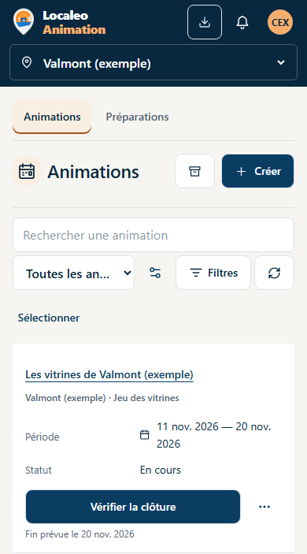

### Si une commune ou une action manque

Les communes et les actions disponibles dépendent de vos autorisations et des services activés pour votre organisation. Demandez au responsable de vérifier votre accès si vous ne trouvez pas ce dont vous avez besoin.

## 2 · Retrouver les tâches à faire aujourd’hui

Sur votre tableau de bord, ouvrez les tâches qui demandent votre attention, comme la vérification d’une animation arrivée à sa date de fin.

1. Dans **Pilotage des animations**, commencez par **À traiter aujourd’hui**. Ce bloc présente jusqu’à trois interventions pour la commune. Il garde les mêmes tâches quand vous changez la période des chiffres.
2. Lisez le nom de l’édition et la raison de l’intervention. Une fin prévue dépassée invite à **Vérifier la clôture**. Si des lots restent à justifier après le tirage, **Ouvrir le dossier** affiche le dossier concerné. Pour retrouver les autres interventions, choisissez **Voir toute la liste À traiter**.
3. Dans la fiche, l’étape reste visible quand vous consultez une autre rubrique. Sur téléphone, ouvrez **Toutes les rubriques** pour les retrouver. Revenez à la liste pour reprendre vos filtres et votre page.

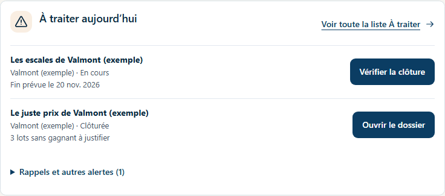

### Masquer un rappel pour vous seul

Dans **Rappels et autres alertes**, choisissez **Supprimer de mon tableau de bord**. La tâche reste dans **À traiter** et vos collègues gardent leur rappel. Pour l’afficher de nouveau, utilisez **Annuler** ou ouvrez **Alertes masquées** et choisissez **Réafficher**. Une nouvelle échéance dépassée peut déclencher un nouveau rappel.

## 3 · Retrouver une animation et réutiliser ses filtres

Dans **Animations**, recherchez le nom d’une édition. Sa ligne indique son statut, le motif d’une intervention éventuelle et la prochaine action disponible. Vous retrouvez le même statut en ouvrant la fiche.

1. Pour restreindre la liste, ouvrez **Filtres** et choisissez vos critères, par exemple le modèle ou la période. Les critères actifs restent visibles. Retirez-en un pour élargir la recherche.
2. Ouvrez l’édition par son nom, ou choisissez sa prochaine action pour rejoindre le dossier concerné. **Retour aux animations** vous ramène à la même page avec vos critères.
3. Pour retrouver une sélection habituelle, choisissez son nom dans **Vue**. **À traiter** affiche les animations qui demandent une intervention.

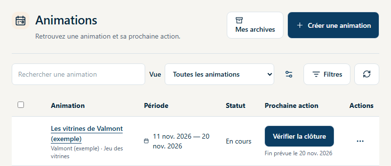

### Enregistrer une vue pour la prochaine fois

Réglez d’abord vos filtres. Ouvrez **Gérer les vues** à côté de **Vue**, choisissez **Nouvelle vue**, donnez-lui un nom, puis choisissez **Enregistrer les filtres actuels**. Si vous la partagez, elle devient accessible aux membres autorisés de votre organisation dans cette commune. Pour la renommer, choisissez-la dans **Choisir une vue**, modifiez son nom et cliquez sur **Mettre à jour cette vue**. Vous retrouvez ensuite son nom dans **Vue**.

## 4 · Ajouter un commerce et lui ouvrir l’accès à Pro

Préparez le nom, l’adresse, le numéro SIRET et l’email de contact du commerce.

1. Dans **Commerçants**, recherchez d’abord l’établissement. S’il manque, choisissez **Ajouter un commerçant Animation**.
2. Renseignez sa fiche et sa catégorie, puis choisissez **Créer le commerce Animation**. Vérifiez que la fiche apparaît dans le réseau de votre commune.
3. Sur la fiche, choisissez **Inviter dans Pro** si l’action est disponible, puis confirmez l’envoi. Suivez l’envoi de l’email et l’ouverture de l’accès. Pour connaître la réponse à une invitation à jouer, consultez le dossier de l’animation.

Le total affiché correspond à votre recherche. Au-dessus de la liste, utilisez **Première page**, **Précédente** ou **Suivante**. « 2 / 2 » indique la deuxième page sur deux.

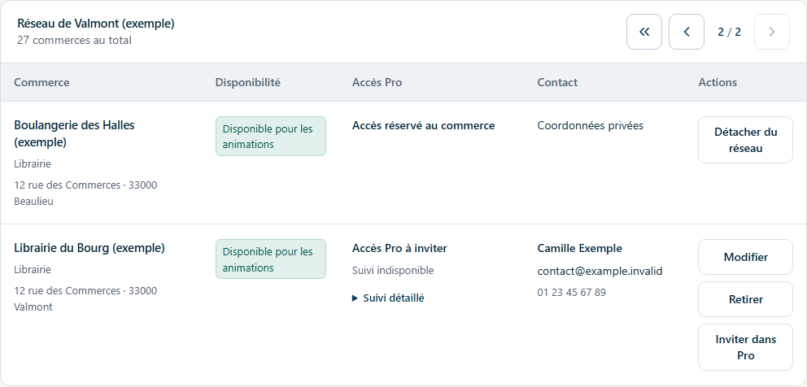

### Pour un commerce d’une autre commune

Choisissez **Choisir une autre commune**, recherchez la ville du magasin par nom ou code postal, puis validez **Ajouter au réseau Animation**. Si la commune, le SIRET et l’email correspondent à une fiche existante, celle-ci rejoint votre réseau. Pour détacher un commerce, relisez les invitations concernées avant de confirmer. Les invitations en attente sont annulées et les participations déjà acceptées se gèrent dans chaque animation.

Pour ajouter plusieurs commerces, utilisez **Import commerçants** si vous y avez accès.

<!-- Sommaire : Préparer et publier une animation -->

## 5 · Créer un brouillon d’animation

Préparez un nom, des dates et le type de jeu que vous souhaitez organiser. Vous pourrez compléter votre projet avant de le publier.

1. Ouvrez **Animations**, puis **Créer** sur téléphone ou **Créer une animation** sur ordinateur. Vérifiez la commune et choisissez le modèle de jeu.
2. Renseignez les informations demandées. Sur téléphone, **Continuer** et **Précédent** permettent de passer d’une étape à l’autre.
3. Choisissez **Créer le brouillon**, puis confirmez. Le brouillon s’ouvre dans **Préparation**. L’assistant montre ce qu’il reste à préparer. Le menu **Actions** de l’en-tête regroupe les opérations disponibles sur cette édition.

### Reprendre plus tard

Utilisez **Enregistrer la préparation** ou **Autres actions**, puis **Enregistrer et quitter**, si ces actions sont proposées. Attendez la confirmation. Pour reprendre, ouvrez **Préparations**, puis **Reprendre la préparation**. Dans un brouillon déjà créé, changez de partie dans **Configuration** et choisissez **Enregistrer** pour garder vos modifications.

### Choisir un jeu

Une tombola publique accepte des inscriptions à distance ou sur place selon le mode choisi. La tombola des commerces s’appuie sur les validations prévues. Le Passeport et la chasse invitent à suivre un parcours. Vitrines et Juste Prix proposent des questions chez les commerçants. Si Léo est proposé, décrivez votre projet, choisissez les commerces et relisez sa proposition avant de l’accepter.

## 6 · Choisir les commerces à solliciter

Pendant la création d’une animation, ouvrez **Commerçants à solliciter**. Vous y retrouvez les commerces de la commune et les adhérents de votre réseau installés ailleurs.

1. Parcourez la liste par ordre alphabétique. La commune figure sous le nom de chaque commerce. Pour une longue liste, faites défiler les résultats ou choisissez **Afficher la suite**. Si vous connaissez le début du nom, saisissez-le puis choisissez **Rechercher**.
2. Cochez les commerces que vous voulez solliciter. Vérifiez le nombre de commerces sélectionnés avant de continuer.

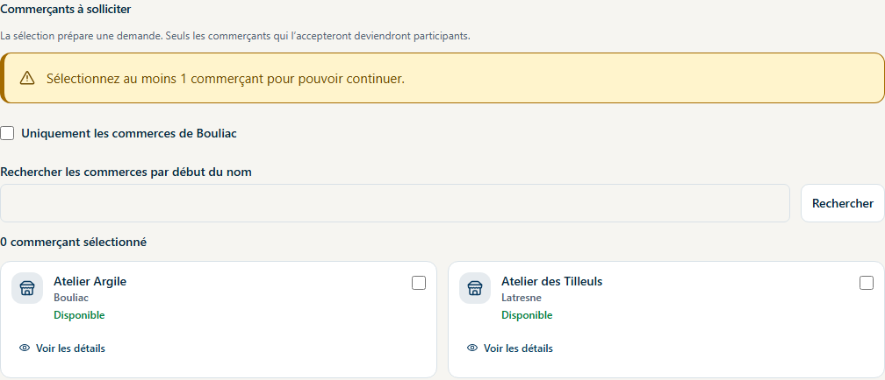

### Afficher seulement les commerces de votre commune

Cochez **Uniquement les commerces de Bouliac** si Bouliac est votre commune. Le compteur indique combien de commerces sélectionnés sont hors commune. Décochez le filtre pour les retrouver avec leur case toujours cochée.

## 7 · Fixer le nombre de visites et choisir si un achat est requis

Pour un Passeport commerçant, un Jeu des vitrines ou un Juste Prix, fixez le nombre de passages à réussir pour pouvoir prétendre aux lots.

1. Sélectionnez les commerces du parcours. À la création, ouvrez **Mission & règles**. Le nom du seuil dépend du jeu. Pour un brouillon déjà créé, ouvrez **Configuration**, puis **Règles** et repérez **Seuil de validation**.
2. Choisissez le nombre de passages à réussir et enregistrez. Par exemple, avec six commerces, vous pouvez demander trois passages sur les six.

3. Si le réglage **Achat pour valider un passage** est proposé, choisissez **Visite sans achat** ou **Achat requis**. Dans les deux cas, le commerçant valide le passage sur place. L’achat requis s’applique sans montant minimum.

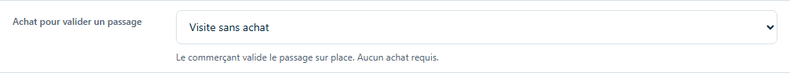

### Si vous changez la liste des commerces ou la règle d’achat

Un seuil trop élevé est marqué **à ajuster** si vous retirez des commerces. Corrigez-le ou ajoutez des commerces. Si vous changez la règle d’achat, renvoyez les invitations pour que les commerces reçoivent la consigne à jour. Le choix est fixé à la publication. Avant de publier, vérifiez que suffisamment de commerces ont accepté de participer.

## 8 · Régler les essais au Jeu des vitrines ou au Juste Prix

Choisissez le nombre d’erreurs permis à chaque étape avant de publier votre jeu.

1. Pendant la création ou dans la configuration du brouillon, ouvrez **Règles** et repérez **Mauvaises réponses maximum par étape**.
2. Choisissez de 1 à 10. Le premier choix proposé est 1.
3. Enregistrez, vérifiez la valeur affichée et indiquez-la dans le règlement. Une fois l’animation publiée, ce choix est fixé.

### Si un joueur atteint le maximum

Localeo Live affiche les réponses restantes. Une bonne réponse termine les essais. Quand le joueur atteint le maximum d’erreurs, Live marque l’étape **invalide** et bloque les essais, le scan et le code commerçant pour cette étape. Le joueur reste qualifié s’il a déjà atteint le seuil. Il peut poursuivre si les autres étapes lui permettent encore de l’atteindre.

## 9 · Inviter les commerces et vérifier leurs préparatifs

Dans le brouillon de l’animation, préparez les consignes que chaque commerce devra suivre avant le lancement.

1. Ouvrez **Invitations**, sélectionnez les commerces de la commune ou les adhérents extérieurs de votre réseau, puis envoyez les invitations.
2. Expliquez la mission de chacun. Par exemple, accueillir les joueurs et valider leur passage, présenter une vitrine, afficher un support ou remettre un lot.
3. Revenez dans **Invitations** pour vérifier les réponses. Si le suivi de préparation est activé, actualisez-le et repérez les commerces indiqués comme **prêts**. Relancez ceux dont vous attendez encore les préparatifs.

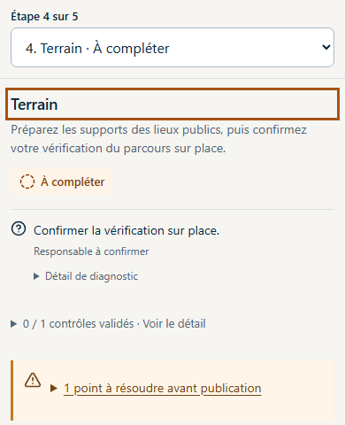

### Pour une chasse ou un passeport préparé avec Léo

Dans **Étape de préparation**, relisez les lieux, le parcours et les contenus proposés. Ouvrez les **points à résoudre avant publication** et traitez-les. Si l’application propose un démarrage forcé, lisez ses conséquences et indiquez le motif demandé avant de confirmer. Pour le Jeu des vitrines, vérifiez aussi les activités préparées par les commerces.

## 10 · Approuver les produits du Juste Prix

Attendez que les commerces aient proposé leurs produits, puis vérifiez-les dans le brouillon.

1. Ouvrez **Produits et prix proposés** et repérez les propositions **À examiner**.
2. Vérifiez le commerce, le produit, sa description, son format ou son unité et le prix toutes taxes comprises (**prix TTC**).
3. Choisissez **Accepter la proposition** si elle est correcte. Attendez la confirmation et le repère **Approuvé** avant de passer à la suivante.

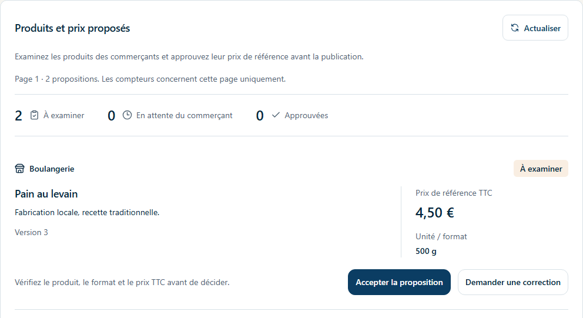

### Si une proposition doit changer

Choisissez **Demander une correction**, donnez le motif et ajoutez des précisions. Avec **Autre motif**, le texte est obligatoire. Le commerçant pourra corriger sa proposition puis la renvoyer. Les états **À compléter** et **À corriger** signalent une action attendue du commerce. Actualisez la rubrique pour vérifier les dernières réponses. Les compteurs sont ceux de la page affichée.

Après publication ou avec un accès en consultation seule, vous pouvez relire les propositions. En cas de doute sur une décision envoyée, vérifiez d’abord son état.

## 11 · Préparer les lots à gagner

Décidez ce que les habitants pourront gagner et qui assurera la remise des lots.

1. Dans **Configuration**, ouvrez **Dotation** sur ordinateur ou **Lots** sur téléphone. Choisissez le mode de remise, puis enregistrez.
2. Pour des **lots libres remis hors Localeo**, indiquez le nom de chaque lot, la quantité, la personne chargée de la remise et les consignes de retrait.
3. Vérifiez que les lots, les quantités et leur ordre sont corrects dans la liste.

### Si vous offrez des bons ou des coffrets

Pour des **bons numériques**, préparez le modèle et le commerce de remise. Créez les bons dans le stock, sélectionnez les exemplaires disponibles dans le bon ordre et confirmez leur affectation. Vérifiez leur durée de validité. Chaque bon s’utilise en une seule fois. Pour des **coffrets**, sélectionnez-les et vérifiez leur financement avant la publication.

Une **Dotation figée** indique qu’un engagement ou une publication a déjà été enregistré. Si vous changez de mode, lisez la confirmation avant d’agir. Certaines descriptions de lots peuvent être retirées.

## 12 · Publier une animation

Ouvrez le brouillon dont vous voulez rendre la présentation accessible aux habitants.

1. Dans la barre des étapes, ouvrez **Publication**, puis **Revue de publication**. Le repère d’état indique où en est l’animation, même lorsque vous consultez une autre étape. Repérez les blocages avant de publier.
2. Dans **Préparer mon animation**, sélectionnez une carte rouge ou orange pour ouvrir la rubrique indiquée. Dépliez **Autres points à vérifier** pour afficher les suivants. Traitez les blocages, puis relisez la présentation destinée aux habitants.
3. Choisissez **Publier l’animation**, puis confirmez. Revenez dans **Revue de publication** pour relire le reçu. Vous y retrouvez l’état et, lorsqu’elle est disponible, la date de publication effective. Pour une animation en cours, choisissez **Ouvrir le suivi de la participation**.

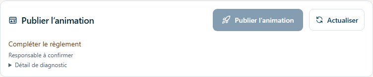

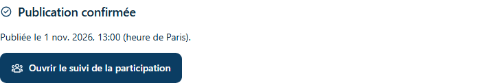

### Si la confirmation tarde

Utilisez **Vérifier l’enregistrement** si l’action est proposée. Tant que le résultat est incertain, vérifiez son état avant de recommencer, surtout si l’action engage une somme. Une fois publiée, l’animation peut aussi apparaître dans l’agenda Live des communes publiées où un commerce participe avec un accord valide.

<!-- Sommaire : Communiquer et suivre l’activité -->

## 13 · Faire connaître votre animation et écrire aux inscrits

Une fois la présentation prête, vérifiez les supports à diffuser. Si votre organisation dispose de **Communication**, vous pouvez aussi écrire aux participants dans Localeo Live.

1. Dans **Flyers**, ouvrez le support de l’animation et vérifiez son contenu, le lien d’inscription et le QR avant de le diffuser. Refaites le support si ses renseignements ont changé et que l’action est proposée.
2. Pour savoir d’où viennent les inscriptions, nommez vos supports dans les sources de diffusion. Par exemple, « Affiche mairie » pourra apparaître dans le bilan.
3. Dans **Communication**, choisissez **Messages aux participants**. Vérifiez les **Crédits disponibles** puis choisissez **Nouveau message**. Dans la fenêtre de rédaction, choisissez les destinataires, rédigez le texte et relisez l’aperçu dans Live.
4. Choisissez **Enregistrer le brouillon**, puis **Calculer l’aperçu des destinataires**. Vérifiez l’audience avant de confirmer l’envoi ou la programmation. Pour en suivre le résultat, ouvrez le message dans l’historique.

### Selon la situation

Pour une tombola publique sur place, affichez aussi le code du jour. Il change à minuit, heure de Paris. La programmation utilise la même heure. Les destinataires reçoivent le message dans Live. L’alerte sur leur appareil dépend de leurs préférences et de leurs accès.

## 14 · Envoyer un message aux abonnés de votre commune

Vérifiez la commune active. Vous devez disposer de l’accès à **Communication communale**.

1. Dans **Suivre l’activité**, ouvrez **Communication communale**, puis créez un message. Renseignez le titre et le texte.
2. Choisissez qui informer et lisez l’aperçu. Celui-ci indique combien d’appareils suivent la commune et ont activé **Infos de mes communes**.
3. Confirmez **Envoyer maintenant**, puis ouvrez le bilan. Vérifiez le nombre de messages déposés dans Live et le nombre d’alertes envoyées aux appareils.

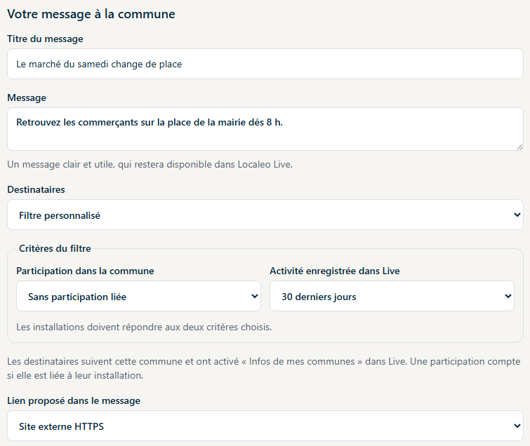

### Si vous voulez préciser le public ou ajouter un lien

Vous pouvez envoyer à tous les abonnés, choisir ceux qui ont ou non une participation liée, ou combiner ce choix avec l’activité récente. Un lien peut mener à une page publique Localeo ou à un site dont l’adresse commence par « https:// ». Vérifiez sa destination dans l’aperçu.

Les envois depuis une animation et depuis la commune utilisent le même crédit, débité dès le premier message déposé dans Live. Si l’envoi reste incertain, vérifiez son enregistrement sur le même écran.

## 15 · Vérifier la progression d’un participant

Ouvrez l’animation concernée dans la bonne commune. Pour aider une personne, munissez-vous du nom ou de la référence de sa participation.

1. Ouvrez **Participation**. Les indicateurs présentent la situation de l’animation. La liste des participants se trouve sur le même écran.
2. Recherchez la personne ou filtrez les résultats. Vérifiez le nom ou la référence et, si besoin, les coordonnées masquées. Choisissez **Voir le participant** pour lire son dossier et sa progression.
3. Pour vérifier un passage en commerce, choisissez **Validations** dans **Suivi de la participation**. Revenez à **Participants** pour retrouver les dossiers. La tombola publique recueille les inscriptions sans passage en commerce.

### Si vous devez intervenir sur le parcours

Vérifiez le commerce et la consigne attendue avant d’agir sur une étape ou un justificatif. Si vous devez supprimer une participation et disposez de ce droit, ouvrez le menu d’actions de la personne concernée. Relisez son identité et les conséquences affichées avant de confirmer.

## 16 · Consulter l’activité de votre commune sur une période

Sur **Pilotage des animations**, suivez l’activité de la commune sélectionnée, y compris les animations clôturées ou archivées.

1. Vérifiez la commune en haut de l’écran. La vue s’ouvre sur les **7 derniers jours**.
2. Choisissez **Aujourd’hui**, **7 derniers jours** ou **30 derniers jours**. Vérifiez la période affichée avant de lire les chiffres.
3. Lisez les **inscriptions confirmées**, les **passages validés**, les **lots retirés** et les **utilisations**. La courbe montre l’évolution des inscriptions et des passages. Les cartes comparent la période à la précédente.

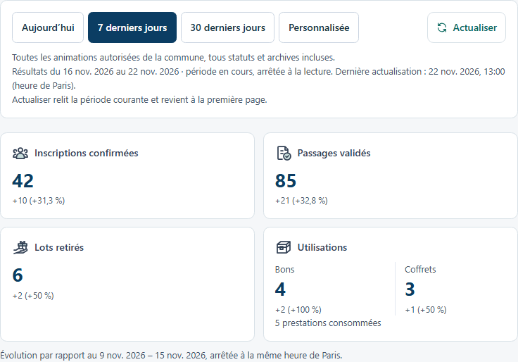

### Choisir d’autres dates

Dans **Personnalisée**, saisissez le début et la fin, sur 366 jours au plus et avec une fin au plus tard aujourd’hui. Les jours suivent l’heure de Paris. **Actualiser** relit la période choisie et revient à la première page de résultats. Le chiffre des coffrets compte chaque coffret une seule fois. Le détail des prestations montre ses utilisations.

## 17 · Télécharger les résultats des animations

Depuis **Pilotage des animations**, vérifiez la période avant de partager les chiffres avec votre équipe.

1. Dans **Résultats par animation**, repérez les animations qui ont eu une activité. Passez à la page suivante si nécessaire. Les résultats apparaissent par groupes de 25 et le total couvre toute la période.
2. Choisissez **Exporter tous les résultats (CSV)**. Le fichier couvre toutes les pages pour la période choisie.
3. Ouvrez le fichier dans votre tableur et vérifiez que vous avez les résultats de la période attendue.

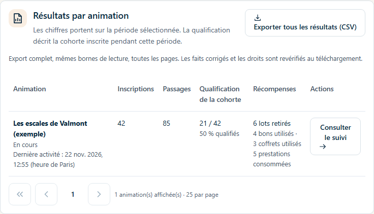

### Lire la colonne Qualification de la cohorte

Elle indique combien de personnes remplissent aujourd’hui les conditions parmi les inscrits ou confirmés de la période. Elle tient compte de leur progression depuis cette période. Pour connaître la situation de l’animation dans son ensemble, ouvrez son suivi. Si la colonne indique **indisponible**, commencez par actualiser.

Au-delà de 10 000 animations, raccourcissez la période pour pouvoir exporter. Si la lecture préparée a expiré après 30 minutes, choisissez **Actualiser** puis demandez de nouveau le fichier.

<!-- Sommaire : Terminer l’animation et remettre les lots -->

## 18 · Clôturer une animation

Clôturez l’animation quand vous souhaitez fermer la participation.

1. Vérifiez les dates et l’activité. Si la fin prévue est dépassée, choisissez **Vérifier la clôture** dans **À traiter aujourd’hui**. Cette action ouvre la revue.
2. Dans **Clôture**, choisissez **Clôture des participations**. Contrôlez le nombre de qualifiés et les conditions de fermeture. Lisez les effets, puis choisissez **Confirmer la clôture** si vous souhaitez fermer le jeu.
3. Vérifiez l’état **Clôturée**. Sous **Clôture**, ouvrez **Fin et archivage** pour retrouver les dossiers à régler. **Clôture des participations** vous ramène directement à la revue.

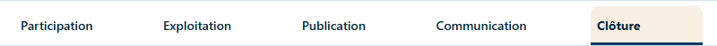

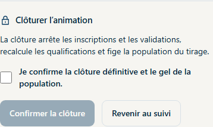

### Quand la date prévue est passée

La date annoncée aux habitants est un repère. Tant que la clôture n’est pas effective, des habitants peuvent encore participer selon les conditions d’accès. Le rappel **Clôture attendue** vous signale la situation. Après l’échéance prévue, il n’est plus possible de modifier les paramètres d’exploitation. Vérifiez les dates avant cette échéance.

## 19 · Tirer au sort et suivre la remise des lots

Attendez la clôture et vérifiez que les lots et les dossiers attendus sont prêts.

1. Dans **Tirage**, choisissez **Tirage au sort**. Si les participations sont encore ouvertes, **Vérifier la clôture** ouvre la revue. Après la clôture, vérifiez le nombre de personnes éligibles et les lots. Vous pouvez encore annuler. **Confirmer le tirage** engage l’attribution. Si personne n’est éligible et que le jeu l’autorise, le bouton indique **Enregistrer un tirage sans gagnant**.
2. Si le tirage est en cours ou si la réponse tarde, vérifiez son état dans cette rubrique. Ouvrez **Gains et remises** pour retrouver les gagnants. **Tirage au sort** permet de revenir au résultat. Pour retrouver les lots de plusieurs éditions, ouvrez **Lots et remises**.
3. Recherchez le bénéficiaire ou filtrez par animation. Vérifiez le lieu, la date limite et l’état du lot, puis utilisez l’action proposée. Après la remise, actualisez et vérifiez l’état enregistré.

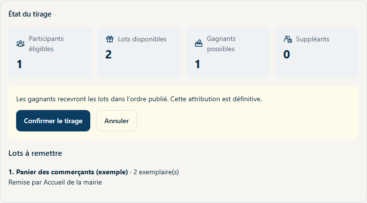

### Suivre les retraits ou envoyer un rappel

Un lot externe se retire au lieu indiqué. Le commerce désigné valide un bon. Pour un coffret, lisez les prestations utilisées et celles qui restent lorsqu’elles sont connues. Pour un rappel, sélectionnez les destinataires et confirmez l’envoi. L’email et la remise sont suivis séparément.

**Tous les lots** enlève le filtre de tâche et garde les autres critères. Après un tirage confirmé sans gagnant, **Fin et archivage** indique combien de lots restent à justifier. Ouvrez le dossier, choisissez **Justifier les lots sans gagnant** et saisissez le motif. Vérifiez la quantité avant de confirmer. Le dossier passe alors à **Justifié**.

## 20 · Faire le bilan et préparer une nouvelle édition

Une fois l’animation passée, retrouvez les chiffres à partager et les éléments à garder pour la prochaine édition.

1. Dans **Bilan**, choisissez **Résultats**. Lisez les inscriptions, les parcours, les passages et les lots remis. Pour un jeu avec tirage, **Tirage à venir** ou **Tirage en cours** indique que le résultat se fait attendre. **Tirage confirmé · 0 gagnant** signifie que le tirage a eu lieu.
2. Vérifiez la période, la date d’observation et les données couvertes. Pour comparer deux éditions, choisissez **Comparaison**. Revenez à **Résultats** pour retrouver les chiffres et **Exporter le bilan**.
3. Après avoir réglé les derniers dossiers, utilisez les actions proposées pour terminer ou archiver l’édition. Vous pourrez relire une archive selon vos droits.

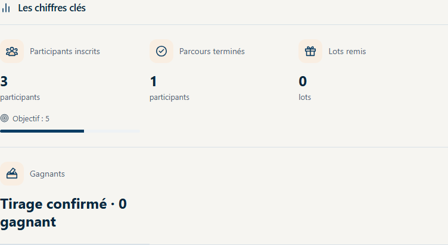

### Repartir de l’édition précédente

Dans la liste **Animations**, ouvrez **Autres actions** sur la ligne de l’édition et choisissez **Cloner l’animation** si cette action est disponible. Relisez les éléments repris avant de créer le nouveau brouillon. Vérifiez ses dates, les accords des commerçants, les préparatifs et les lots avant de publier. Les résultats et les gagnants restent associés à l’édition d’origine. Dans le bilan, **non applicable** indique une mesure sans objet pour ce jeu. **Non collectée** indique que le chiffre est inconnu.

<!-- Sommaire : Importer des commerces et obtenir de l’aide -->

## 21 · Préparer un fichier de commerces à importer

Vérifiez la commune active et assurez-vous d’avoir accès à **Import commerçants**.

1. Ouvrez **Import commerçants** et téléchargez le modèle Excel ou CSV. Préparez un fichier d’au plus 100 lignes de données et 2 Mo. Le modèle CSV utilise des points-virgules et l’encodage UTF-8.
2. Choisissez le type d’import, puis déposez votre fichier. Pour un classeur Excel, indiquez la feuille à utiliser. Vérifiez la ligne qui contient les titres des colonnes et, pour un CSV, le séparateur reconnu.
3. Pour chacun des cinq champs obligatoires, comparez la colonne proposée aux exemples du fichier. Choisissez **Enregistrer l’association des colonnes**, puis **Prévisualiser les changements**. Attendez l’aperçu des lignes.

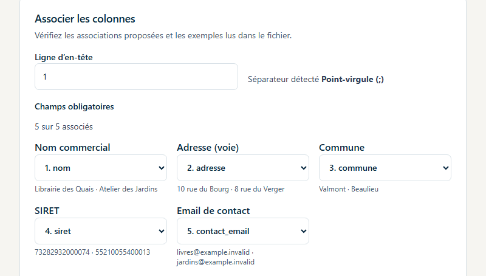

### Ajouter d’autres renseignements

Ouvrez **Champs facultatifs** pour associer des colonnes supplémentaires. Dans **Colonnes ignorées**, vérifiez les renseignements qui ne seront pas repris dans les fiches.

## 22 · Vérifier et confirmer les lignes à importer

Ouvrez l’aperçu. Vérifiez les commerces prêts à être ajoutés ou mis à jour avant de confirmer.

1. Lisez le bilan des lignes prêtes et des erreurs. Si le fichier contient des adhérents de plusieurs communes, vérifiez la commune reconnue pour chaque commerce.
2. Sélectionnez les lignes prêtes, cochez la confirmation de relecture, puis choisissez **Confirmer l’import des lignes choisies**.
3. Vérifiez que le lot indique **En attente de démarrage**. Vous pouvez alors lancer le traitement des lignes confirmées.

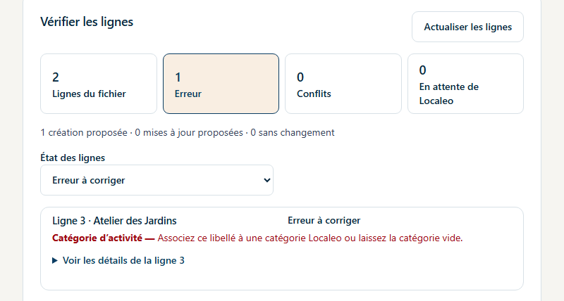

### Si certaines lignes posent problème

Ouvrez une ligne pour lire la valeur et la correction proposée. Dans **Catégories à associer**, choisissez une catégorie Localeo ou **Laisser la catégorie vide**, puis **Enregistrer les équivalences** et refaites l’aperçu. Le même choix vaut pour toutes les lignes du lot portant ce libellé.

Si l’identité d’un commerce est ambiguë, confiez la vérification à Localeo. Vous pouvez confirmer les autres lignes prêtes en acceptant l’import partiel. Les lignes écartées figureront dans le rapport.

## 23 · Lancer l’import et récupérer le rapport

Dans **Historique des imports**, ouvrez le lot qui indique **En attente de démarrage**.

1. Choisissez **Lancer le traitement** pour appliquer les lignes confirmées.
2. Suivez les compteurs. Quand le lot est terminé, ouvrez le bilan et choisissez **Télécharger le rapport CSV**.
3. Vérifiez le résultat des fiches. **Sélectionnable pour une animation** indique que le commerce peut être invité. Pour une fiche **À compléter**, lisez l’action attendue.

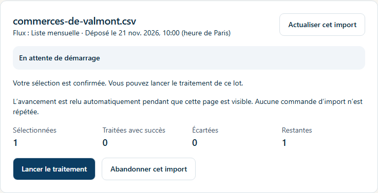

Si le support agit à votre demande, il peut aussi lancer ou poursuivre ce lot en mode intervention. Retrouvez ses actions dans **Interventions de Localeo**.

### Si le traitement semble arrêté

Si le lot affiche encore **Traitement en cours**, choisissez **Poursuivre le traitement**, même lorsque **Restantes** affiche zéro. **Actualiser cet import** relit le résultat. Une fois l’import terminé, utilisez **Inviter dans Pro** depuis **Commerçants** si vous souhaitez envoyer l’email de première connexion d’un commerçant.

## 24 · Gérer votre équipe et demander de l’aide

Dans le menu du compte, ouvrez **Compte et équipe** pour vérifier l’organisation, les accès et la sécurité du compte.

1. Si vous gérez l’équipe, invitez un collaborateur et choisissez les communes et les actions qui lui sont nécessaires. Revenez à l’équipe pour vérifier son accès.
2. Pour connaître les services et le crédit d’envoi de votre organisation, ouvrez **Abonnement**. Les actions proposées dépendent de vos autorisations.
3. Pour retrouver ce PDF, ouvrez **Aide et support** ou **Mon compte et documents**, puis **Guide Animation (PDF)**. Il s’ouvre dans un nouvel onglet.
4. Si vous êtes bloqué, ouvrez une demande dans **Aide et support**. Indiquez l’animation, ce que vous avez observé, l’heure et le résultat attendu. Suivez la réponse dans la même demande.

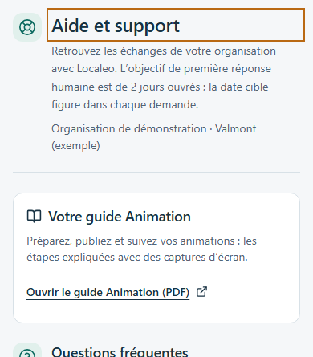

Gardez vos mots de passe, codes et QR secrets pour vous. La demande indique la date cible de la première réponse humaine, en principe sous deux jours ouvrés. La résolution peut prendre plus de temps.

## 25 · Vérifier une intervention de Localeo

Si Localeo est intervenu à votre demande et que la rubrique est disponible, ouvrez **Mon organisation**, puis **Interventions de Localeo**.

1. Après la fin de l’intervention, repérez la date, la commune et le nom de la personne de Localeo. Vérifiez le compte concerné et le résultat indiqué.
2. Ouvrez le dossier concerné pour relire ce qui a été changé. Pour une animation en brouillon, vérifiez son nom, sa description et ses dates dans **Animations**.

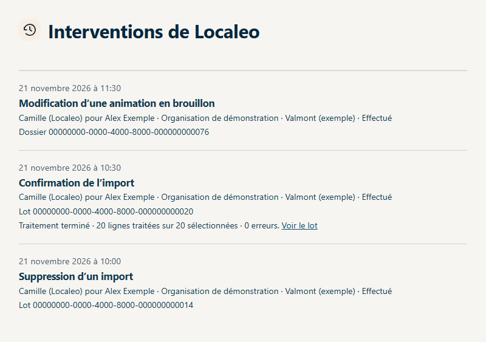

### Si Localeo a confirmé un import ou préparé une actualité

La **Confirmation de l’import** valide les lignes choisies avant traitement. Pour connaître le nombre de lignes appliquées, ouvrez **Voir le lot** dans la commune active si vous disposez du droit d’import. Le fichier et le rapport sont disponibles jusqu’à 30 jours après la fin ou l’abandon du lot. Un gestionnaire habilité peut consulter les opérations d’import de sa propre organisation et commune.

Un brouillon d’actualité est disponible dans **Actualités** de l’animation. Vérifiez son contenu avant de décider de le diffuser. Les interventions restent consultables pendant 180 jours après leur fin.
