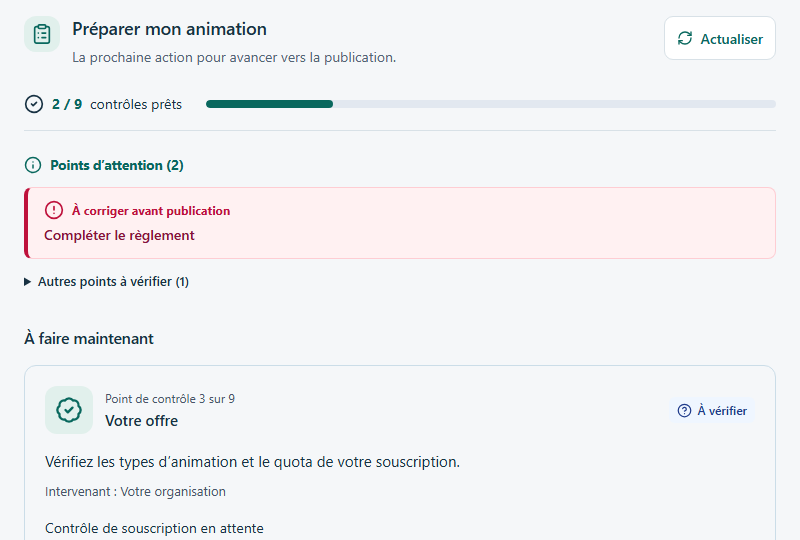
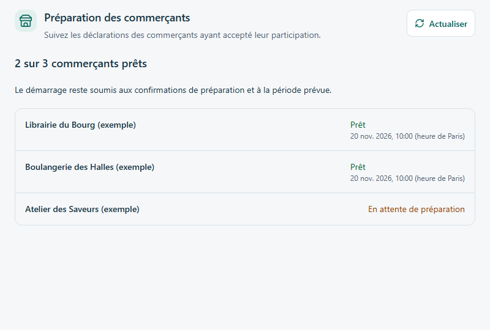
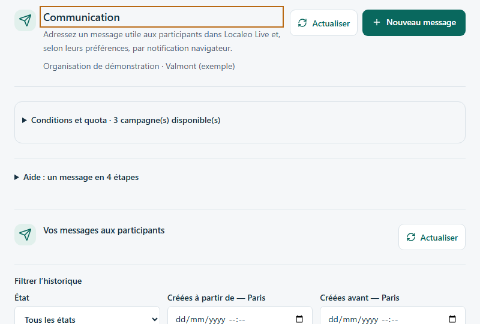
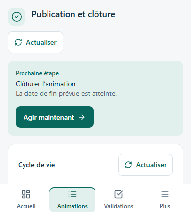
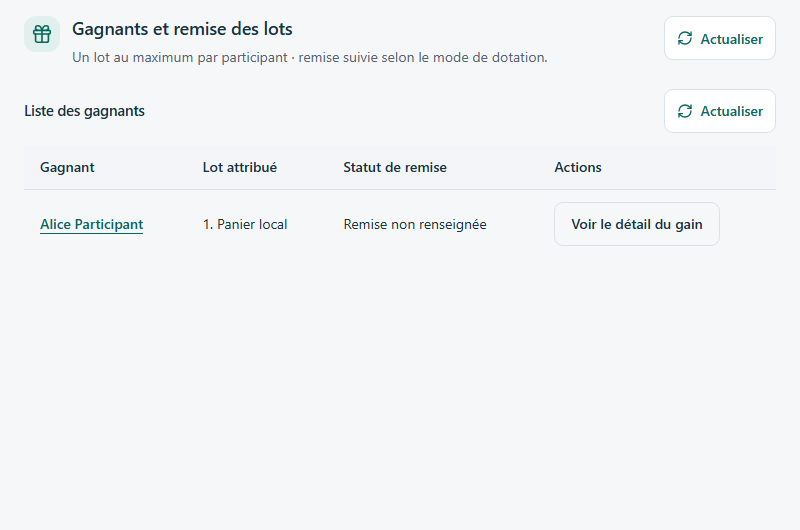

# Localeo Animation - Votre guide au quotidien

<!-- Source canonique du PDF ; générateur dans localeo-animation/scripts/generate-animation-guide.py. Édition du 21 novembre 2026. Les captures montrent l'application réelle avec des données d'exemple, jamais des comptes de production. -->

## 1 · Se repérer dans son espace

**Objectif :** retrouver la bonne commune et les priorités de votre organisation.

1. Connectez-vous avec votre compte personnel. Acceptez, si nécessaire, l'invitation de votre organisation reçue par email.
2. Vérifiez le nom de l'organisation et la **commune active** dans l'en-tête. Le changement de commune renouvelle les informations affichées.
3. Depuis le **Tableau de bord**, ouvrez une action à traiter ou choisissez une rubrique dans la navigation.

### Comprendre les repères

- **À traiter** vous oriente vers l'étape suivante ; les indicateurs présentent l'activité observée.
- **Clôture attendue** signifie que la fin prévue est atteinte et que l'animation est encore ouverte. Ouvrez l'alerte pour savoir comment la traiter.
- Une confirmation de publication n'est pas une alerte organisateur nécessitant une action.

> Les possibilités visibles dépendent de votre rôle, de vos communes autorisées et des modules disponibles. Une action absente ou refusée nécessite une vérification avec le responsable ou le support.

## 2 · Choisir et créer une animation

**Objectif :** passer de votre idée à un brouillon, sans publier par erreur.

1. Ouvrez **Animations**, puis l'action de création. Choisissez un modèle proposé dans votre offre.
2. Renseignez le titre, la présentation, la période et la commune. Préparez le règlement et le mode de dotation.
3. Enregistrez le brouillon puis retrouvez l'**Assistant** : il vous conduit vers les informations et accords encore nécessaires.

### Quel principe de jeu ?

- **Tombola publique :** inscription par email ; selon le mode choisi, à distance ou sur place avec le QR et le code du jour.
- **Tombola des commerces :** participation liée aux validations prévues par l'animation.
- **Passeport commerçant** et **chasse au trésor :** progression dans un parcours de commerces ou de lieux.
- **Jeu des vitrines** et **Juste Prix :** réponses aux activités proposées chez les commerçants.

> Lorsque Léo est proposé pour préparer une chasse ou un passeport, complétez son brief, sélectionnez les commerces et relisez la proposition avant de la valider. Une préparation générée reste à contrôler ; elle ne publie pas l'animation.

## 3 · Constituer son réseau de commerces

**Objectif :** disposer de fiches exploitables et comprendre l'accès de chaque commerce.

1. Ouvrez **Commerçants**. Recherchez un établissement avant de créer une nouvelle fiche.
2. Vérifiez le nom, l'adresse, les coordonnées de contact et la catégorie. Utilisez les actions de la ligne pour compléter la fiche.
3. Invitez le commerçant à rejoindre son espace lorsque cette action est proposée. Suivez séparément l'envoi du mail et l'initialisation de l'accès.
4. Pour un volume important, l'import est proposé uniquement avec l'autorisation et le module correspondants. Contrôlez son résultat avant d'exploiter les fiches.

### Trois notions à distinguer

- La fiche du commerce décrit l'établissement.
- Son **accès Pro** indique sa capacité à se connecter à Localeo Commerçant.
- Son **accord pour une animation** se suit dans le dossier de cette animation.

> Un email envoyé ne prouve ni la création du mot de passe, ni l'accord du commerce pour participer. Ouvrez les détails de suivi avant de relancer une personne.

## 4 · Préparer les commerçants et le parcours

**Objectif :** savoir qui doit agir avant le lancement et vérifier les supports terrain.

1. Dans l'animation, ouvrez la rubrique de **préparation** et vérifiez les commerces sollicités et les réponses reçues.
2. Expliquez à chacun sa mission : accueillir les joueurs, présenter une vitrine ou un prix, valider un passage, installer un support ou remettre un lot selon le modèle.
3. Pour une chasse ou un passeport préparé avec Léo, relisez le contenu, l'ordre des étapes et les lieux. Faites corriger les éléments signalés avant publication.
4. Contrôlez le règlement, les consignes et les supports à diffuser. Les validations de préparation ne remplacent pas la commande de publication.

### Utiliser le suivi de préparation

Lorsque ce suivi est activé, distinguez les commerces **prêts** de ceux encore attendus. Actualisez la section pour lire les dernières réponses. Une éventuelle action de démarrage forcé exige de comprendre et confirmer le motif demandé.

> Pour le jeu des vitrines, vérifiez l'activité et les éléments proposés par chaque commerce. La disponibilité des rubriques et du suivi varie selon le modèle et la configuration choisie.

## 5 · Construire une dotation compréhensible

**Objectif :** décrire ce que les habitants peuvent gagner et qui le remettra.

1. Dans **Configuration**, ouvrez **Dotation** et choisissez un mode disponible. Enregistrez le mode avant de gérer les lots.
2. Pour des **lots libres remis hors Localeo**, ajoutez un intitulé, une quantité, un responsable de remise et des consignes concrètes. Vérifiez l'ordre des lots.
3. Pour des **bons numériques**, préparez le modèle et le commerce de remise, puis créez les exemplaires dans le stock. Choisissez des exemplaires disponibles, leur ordre et confirmez leur affectation. Vérifiez la durée de validité : chaque bon se remet entièrement en une seule fois.
4. Pour des **coffrets**, sélectionnez les coffrets et contrôlez leur financement dans les sections correspondantes avant publication.

### Lire les états avant d'agir

- **Modifiable :** vous pouvez préparer les informations selon vos droits.
- **Dotation figée :** un engagement ou une publication a déjà été enregistré ; seules les actions encore proposées sont possibles.
- **À vérifier :** consultez l'explication et contactez Localeo si nécessaire.

> Changer de mode peut retirer des descriptions de lots déjà enregistrées. Lisez la confirmation. Un lot libre déclaré ne constitue pas un achat ou une remise déjà effectuée.

## 6 · Vérifier puis publier

**Objectif :** ouvrir une animation aux habitants après les contrôles requis.

1. Revenez à l'**Assistant** ou à **Publication et clôture** pour consulter les contrôles à jour.
2. Traitez chaque point bloquant dans la rubrique indiquée : règlement, données du jeu, accords, dotation ou financement selon le cas.
3. Relisez les avertissements et vérifiez la présentation destinée aux habitants. Un contrôle réussi ne publie pas automatiquement.
4. Utilisez **Publier** lorsqu'il est proposé, puis confirmez. Attendez la confirmation à l'écran et vérifiez le nouvel état.

### Suivre les états

**Brouillon / Configurée** : préparation. **Publiée** : publication enregistrée, éventuellement avant le début. **En cours** : animation ouverte. **Clôturée** : participation fermée ; les opérations de fin restent à traiter.

> Si l'envoi est interrompu, utilisez « Vérifier l'enregistrement » lorsqu'il est proposé. Un traitement en cours ou un résultat incertain ne doit pas être interprété comme un succès. Évitez de recommencer une opération financière sans vérifier son résultat.

## 7 · Faire connaître l'animation et écrire aux participants

**Objectif :** distinguer les supports de découverte et les messages aux personnes déjà inscrites.

1. Vérifiez le **flyer**, le lien d'inscription et le QR de l'animation avant de les diffuser. Régénérez un support si les informations ont changé et que l'action est disponible.
2. Dans les sources de diffusion, identifiez vos supports, par exemple « Affiche mairie ». Le bilan pourra distinguer les inscriptions attribuées à ces sources.
3. Ouvrez **Communication**, puis **Nouveau message** si votre module, vos droits et votre quota l'autorisent.
4. Choisissez le groupe de participants, rédigez un message utile, utilisez l'aperçu puis envoyez ou programmez. Contrôlez le résultat dans l'historique.

### Ce que signifie l'envoi

Les messages sont adressés dans Localeo Live. Une notification navigateur dépend aussi des préférences et de l'accès des destinataires. Un message reçu dans Live ne garantit pas une alerte affichée sur chaque téléphone.

Pour une **tombola publique sur place**, affichez aussi le code du jour fourni dans l'animation. Il change à minuit, heure de Paris : le QR seul ne permet pas de s'inscrire.

> Les dates de programmation sont exprimées en heure de Paris. Le quota, la fréquence et la fenêtre d'envoi sont contrôlés avant l'envoi. Relisez l'audience et le statut de la campagne plutôt que de supposer qu'elle a touché tout le monde.

## 8 · Suivre l'activité pendant l'animation

**Objectif :** comprendre la progression et intervenir avec les bonnes informations.

1. Ouvrez **Suivre l'animation** pour consulter l'activité et la progression disponible pour votre modèle.
2. Retrouvez une personne dans **Participants** ; ouvrez son dossier pour comprendre son état, ses réponses ou sa progression selon le jeu.
3. Consultez les **Validations** pour les passages et les éléments disponibles. Un compteur de parcours commencés n'est pas nécessairement un nombre de passages validés.
4. Actualisez la section concernée plutôt que de quitter une saisie ou de recharger toute l'application.

### Réagir à une difficulté terrain

Vérifiez d'abord l'animation, le commerce, l'état du participant et la consigne attendue. Pour les modèles concernés, les outils d'exploitation peuvent proposer des actions sur une étape ou une preuve. Lisez leurs conséquences et les confirmations ; elles dépendent de vos droits et de l'état du jeu.

> Un résultat absent ou « non collecté » n'est pas une valeur zéro. Les statistiques précisent, lorsqu'elle est disponible, leur date d'observation. Les données présentées ici servent d'exemple pédagogique.

## 9 · Clôturer au bon moment

**Objectif :** fermer réellement la participation puis préparer les opérations de fin.

1. Vérifiez la période prévue et l'activité avant de clôturer. Si la date de fin prévue est atteinte, consultez l'alerte **Clôture attendue**.
2. Ouvrez **Publication et clôture**, ou le raccourci donné par l'alerte. Lisez les conditions et les conséquences de l'action proposée.
3. Confirmez la **clôture** lorsque vous souhaitez fermer la participation et que le serveur l'autorise.
4. Contrôlez l'état obtenu puis passez au tirage et aux dossiers de fin selon le modèle.

### Fin prévue et clôture réelle

La date de fin prévue informe les habitants. **Tant que l'animation n'est pas réellement clôturée par l'organisateur ou automatiquement, elle peut rester accessible à la participation**, sous réserve des autres conditions d'accès. Live informe que l'échéance prévue est atteinte.

> L'alerte vous demande de vérifier puis de clôturer ; elle ne le fait pas à votre place. Ne confondez pas une date échue, une inscription fermée explicitement et une clôture effective. Après l'échéance prévue, les paramètres d'exploitation ne sont plus modifiables : vérifiez les dates avant cette échéance.

## 10 · Organiser le tirage et remettre les lots

**Objectif :** suivre les gagnants et les remises jusqu'à leur résolution.

1. Après la clôture, consultez le **tirage** : vérifiez la population éligible, les lots et les éventuels blocages.
2. Lancez ou confirmez l'opération uniquement lorsqu'elle est proposée. Un tirage en préparation n'est pas un tirage confirmé.
3. Dans **Gagnants et remise des lots**, vérifiez chaque gagnant et les consignes associées.
4. Pour un lot externe, organisez la remise hors Localeo puis renseignez le suivi disponible. Pour un bon numérique, le commerce désigné valide la remise dans son espace ; les coffrets suivent leur propre parcours d'utilisation.

### Quand un dossier reste en attente

Une absence de réponse, un échec d'email ou une situation particulière peut laisser un dossier à traiter. Les actions proposées peuvent permettre de reprendre un envoi ou de remplacer un gagnant avec un motif autorisé. Ne considérez pas une attribution ou un email envoyé comme une remise physique accomplie.

> Consultez **Fin de l'animation** pour retrouver les blocages, opérations en cours et unités non résolues. Résolvez-les avant de chercher à terminer ou archiver l'édition.

## 11 · Lire le bilan et préparer une nouvelle édition

**Objectif :** mesurer les résultats sans confondre absence d'information et absence d'activité.

1. Ouvrez **Résultats et objectifs**. Comparez les inscriptions, parcours, passages et lots remis lorsque ces mesures sont disponibles.
2. Lisez la période, la date d'observation et la couverture des données. Consultez les sources de diffusion et les retours recueillis lorsqu'ils sont proposés.
3. Après résolution des dossiers de fin, utilisez les transitions proposées pour terminer ou archiver l'édition. Une archive conserve un accès de consultation selon vos droits.
4. Pour recommencer, utilisez le **clonage / la nouvelle édition** lorsque cette action est disponible. Vérifiez le contenu repris et les points à revalider.

### Réutiliser ne signifie pas republier

Une nouvelle édition est un nouveau brouillon. Les dates, accords des commerçants, préparatifs, dotations et contrôles doivent être vérifiés pour cette édition. Les anciens résultats et gagnants ne constituent pas ceux de la nouvelle animation.

> Les objectifs servent de repères de lecture. Une mesure « non applicable » ou « non collectée » ne doit pas être remplacée mentalement par zéro. Les captures utilisent volontairement un petit jeu de données synthétiques.

## 12 · Gérer son équipe et obtenir de l'aide

**Objectif :** retrouver les accès, les modules et une assistance adaptée à la situation.

1. Dans le menu du compte, ouvrez **Compte et équipe** pour vérifier votre organisation, vos accès et la sécurité du compte. Le responsable peut inviter des collaborateurs et déléguer des communes et autorisations.
2. Consultez **Abonnement** et les modules proposés pour connaître l'offre, les quotas et les possibilités disponibles. Les actions d'achat et de gestion dépendent de droits distincts.
3. Retrouvez ce guide dans **Aide et support** ou **Mon compte et documents → Guide Animation (PDF)**. Le PDF s'ouvre dans un nouvel onglet et peut être téléchargé depuis votre lecteur.
4. Pour une difficulté, ouvrez une demande au support : indiquez l'animation, la situation, l'heure du constat et le résultat attendu. Retrouvez les réponses sur la même demande.

> Ne partagez ni mot de passe, ni PIN, ni QR secret. L'objectif de première réponse humaine du support est de deux jours ouvrés, avec une date cible indiquée dans la demande ; ce délai concerne la prise en charge, pas une promesse de résolution.

Édition du **21 novembre 2026**. Interfaces illustrées sur ordinateur et mobile ; données de démonstration. Les intitulés et les actions peuvent varier selon le modèle, les droits et les modules.
