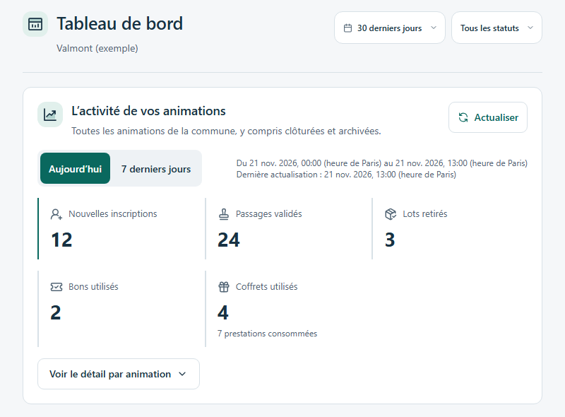
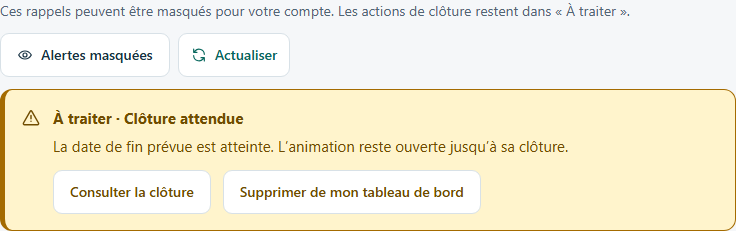
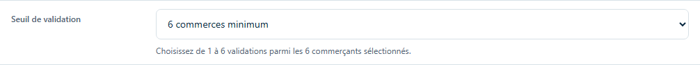
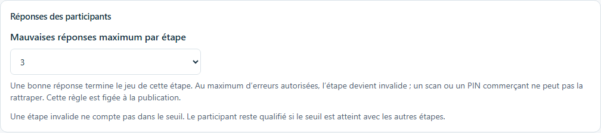
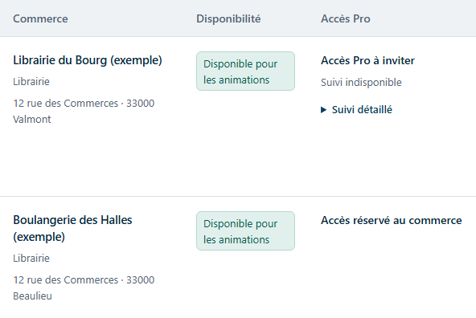
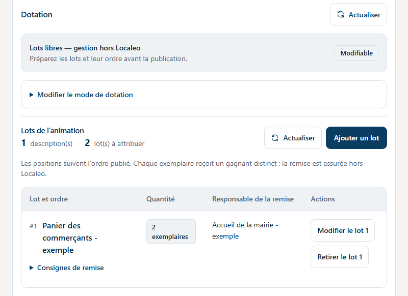
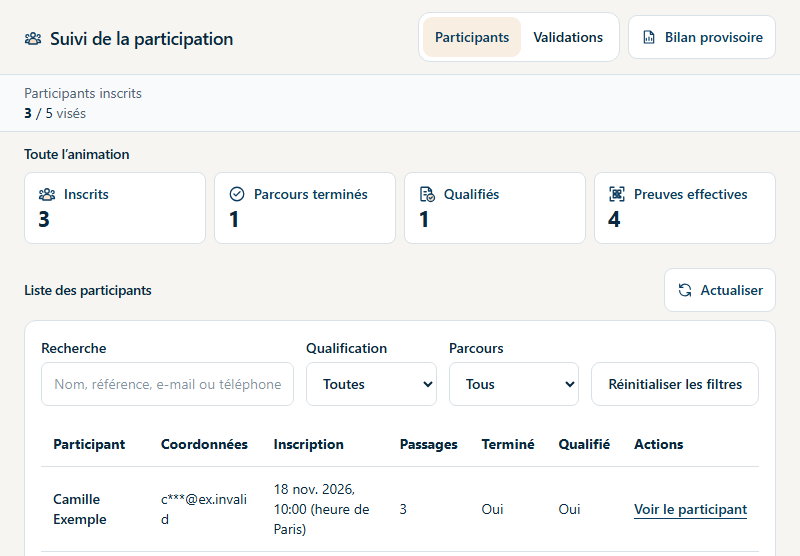
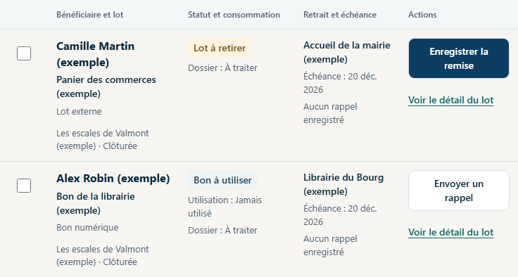

# Localeo Animation - Votre guide au quotidien

<!-- Source canonique du PDF ; générateur dans localeo-animation/scripts/generate-animation-guide.py. Édition du 22 novembre 2026. Les captures montrent l'application réelle avec des données d'exemple, jamais des comptes de production. -->

## 1 · Se repérer dans son espace

**Objectif :** retrouver la bonne commune et les priorités de votre organisation.

1. Connectez-vous avec votre compte personnel. Acceptez, si nécessaire, l'invitation de votre organisation reçue par email.
2. Vérifiez le nom de l'organisation et la **commune active** dans l'en-tête. Le changement de commune renouvelle les informations affichées.
3. Dans **L’activité de vos animations**, choisissez **Aujourd’hui** ou **7 derniers jours**. Les chiffres couvrent toutes vos animations de la commune, même clôturées ou archivées.
4. Ouvrez **Voir le détail par animation**, puis **Consulter le suivi** sur l'animation souhaitée. La pagination change la liste, pas les totaux.
5. Utilisez **Actualiser** pour relire ce bloc. La période et la dernière actualisation indiquent quand les informations ont été relevées, en heure de Paris.

Les indicateurs distinguent inscriptions effectives, passages validés, lots retirés, bons utilisés et coffrets utilisés. Pour les coffrets, lisez aussi le nombre de prestations consommées : un même coffret peut servir plusieurs fois.

## 2 · Lire et organiser ses priorités

**Objectif :** retrouver les actions utiles et garder les rappels de son choix.

1. Dans **À traiter**, ouvrez l'action proposée pour accéder au suivi ou à l'étape concernée de l'animation.
2. Un rappel **Clôture attendue** signifie que la fin prévue est atteinte et que l'animation est encore ouverte. Consultez les conditions de clôture avant d'agir.
3. Pour retirer seulement le bandeau, choisissez **Supprimer de mon tableau de bord**. Le masquage concerne votre compte, sur vos appareils ; les autres membres de l'équipe conservent leur rappel. L'animation reste dans **À traiter**.
4. Pour revenir sur votre choix, utilisez **Annuler**, ou ouvrez **Alertes masquées** puis **Réafficher** sur le rappel souhaité. Utilisez la pagination si nécessaire.

- Une nouvelle échéance dépassée peut produire un nouveau rappel.
- Supprimer le bandeau ne clôture pas l'animation et ne valide aucune étape.
- Une confirmation de publication n'est pas une alerte organisateur nécessitant une action.

> Les possibilités visibles dépendent de votre rôle, de vos communes autorisées et des modules disponibles. Une action absente ou refusée nécessite une vérification avec le responsable ou le support.

## 3 · Choisir et créer une animation

**Objectif :** passer de votre idée à un brouillon, sans publier par erreur.

1. Ouvrez **Animations**, puis **Créer** sur téléphone (**Créer une animation** sur ordinateur). Pour retrouver une saisie enregistrée, choisissez **Préparations**, puis **Reprendre la préparation**. Les préparations plus anciennes restent accessibles avec **Suivant** et **Précédent**.
2. Sur téléphone, avancez une étape à la fois. Le sélecteur nomme l'étape courante ; **Continuer** et **Précédent** permettent de naviguer. La commune active et le modèle restent visibles.
3. Lorsque proposé, utilisez **Enregistrer la préparation** dans le pied d'actions, ou **Autres actions > Enregistrer et quitter**. Attendez la confirmation : continuer ne sauvegarde pas automatiquement et enregistrer ne publie rien.
4. Après **Créer le brouillon**, retrouvez l'**Assistant**, qui indique les informations et accords encore nécessaires. Dans **Configuration**, changez de partie sans perdre votre saisie ; utilisez **Enregistrer** pour la confirmer.

### Régler le seuil de validation

Pour un **Passeport commerçant**, un **Jeu des vitrines** ou un **Juste Prix**, sélectionnez d'abord les commerçants. Le **Seuil de validation** propose ensuite de **1 au nombre de commerçants sélectionnés** : par exemple, de 1 à 6 pour six commerces.

Si vous réduisez la sélection, un seuil devenu incompatible reste affiché **à ajuster**. Choisissez explicitement une nouvelle valeur ou ajoutez des commerçants avant de continuer ; l'application ne remplace pas votre choix en silence.

> Sélectionner un commerce ne vaut pas accord de sa part. À la publication, les contrôles vérifient aussi les commerces ayant accepté de participer. Consultez les blocages indiqués avant de publier.

### Quel principe de jeu ?

- **Tombola publique :** inscription par email ; selon le mode choisi, à distance ou sur place avec le QR et le code du jour.
- **Tombola des commerces :** participation liée aux validations prévues par l'animation.
- **Passeport commerçant** et **chasse au trésor :** progression dans un parcours de commerces ou de lieux.
- **Jeu des vitrines** et **Juste Prix :** réponses aux activités proposées chez les commerçants.

> Lorsque Léo est proposé pour préparer une chasse ou un passeport, complétez son brief, sélectionnez les commerces et relisez la proposition avant de la valider. Une préparation générée reste à contrôler ; elle ne publie pas l'animation.

## 4 · Régler les essais de Vitrines et Juste Prix

**Objectif :** donner une règle claire aux joueurs avant le lancement.

### Choisir le maximum avant de publier

Pour un **Jeu des vitrines** ou un **Juste Prix Local**, réglez **Mauvaises réponses maximum par étape** pendant la création ou dans la configuration du brouillon. Choisissez **1 à 10** ; la valeur initiale est **1**. Vérifiez que le règlement explique cette règle avant de publier.

Une bonne réponse termine les essais de l'étape. Si le joueur atteint le maximum de mauvaises réponses, l'étape devient **invalide** : aucun nouvel essai, scan ou PIN commerçant ne peut la rattraper. Le réglage est **figé à la publication**.

### Comprendre ce que voit le joueur dans Live

Le formulaire indique les réponses restantes. Une étape épuisée porte un **tampon invalide** dans le parcours ; elle ne compte pas parmi les étapes réussies et ne demande plus de passage à valider.

Une étape invalide n'élimine pas automatiquement le joueur. Si le seuil de validation est atteint, sa qualification est conservée. S'il reste assez d'étapes pour l'atteindre, le parcours peut continuer ; sinon, Live indique que la participation est **non qualifiable**.

> Exemple : avec un seuil de trois étapes sur quatre, une étape invalide laisse encore la possibilité de réussir les trois autres. Gardez distincts le maximum d'erreurs par étape et le seuil global de validation.

## 5 · Constituer son réseau de commerces

**Objectif :** disposer de fiches exploitables et comprendre l'accès de chaque commerce.

1. Ouvrez **Commerçants**. Recherchez un établissement avant de créer une nouvelle fiche.
2. Vérifiez le nom, l'adresse, les coordonnées de contact et la catégorie. Utilisez les actions de la ligne pour compléter la fiche.
3. Invitez le commerçant à rejoindre son espace lorsque cette action est proposée. Suivez séparément l'envoi du mail et l'initialisation de l'accès.
4. Pour un volume important, l'import est proposé uniquement avec l'autorisation et le module correspondants. Contrôlez son résultat avant d'exploiter les fiches.

### Trois notions à distinguer

- La fiche du commerce décrit l'établissement.
- Son **accès Pro** indique sa capacité à se connecter à Localeo Commerçant.
- Son **accord pour une animation** se suit dans le dossier de cette animation.

> Un email envoyé ne prouve ni la création du mot de passe, ni l'accord du commerce pour participer. Ouvrez les détails de suivi avant de relancer une personne.

## 6 · Préparer les commerçants et le parcours

**Objectif :** savoir qui doit agir avant le lancement et vérifier les supports terrain.

1. Dans l'animation, le sélecteur **Rubrique de l’animation** donne accès à **Invitations** et **Préparation terrain**. Vérifiez les commerces sollicités et les réponses reçues.
2. Expliquez à chacun sa mission : accueillir les joueurs, présenter une vitrine ou un prix, valider un passage, installer un support ou remettre un lot selon le modèle.
3. Pour une chasse avec Léo, le sélecteur **Étape de préparation** nomme les étapes et leur état. Relisez parcours et lieux, puis contrôlez organisation, commerces, terrain et publication. Dépliez les **points à résoudre avant publication**. Pour un passeport assisté, relisez également les contenus avant de les valider.
4. Contrôlez le règlement, les consignes et les supports à diffuser. Les validations de préparation ne remplacent pas la commande de publication.

### Utiliser le suivi de préparation

Lorsque ce suivi est activé, distinguez les commerces **prêts** de ceux encore attendus. Actualisez la section pour lire les dernières réponses. Une éventuelle action de démarrage forcé exige de comprendre et confirmer le motif demandé.

> Pour le jeu des vitrines, vérifiez l'activité et les éléments proposés par chaque commerce. La disponibilité des rubriques et du suivi varie selon le modèle et la configuration choisie.

## 7 · Approuver les produits du Juste Prix Local

**Objectif :** vérifier et approuver chaque proposition avant publication.

1. Dans **Produits et prix proposés**, repérez les lignes **À examiner**. Vérifiez commerce, produit, description, unité ou format et **prix TTC**.
2. Choisissez **Accepter la proposition** si tout est correct. Attendez la confirmation et le repère **Approuvé**.
3. Sinon, choisissez **Demander une correction**, sélectionnez un motif et ajoutez les précisions utiles. **Autre motif** exige un texte. Envoyez la demande ; le commerce retrouve le motif dans son espace, corrige puis propose à nouveau.

**À compléter** et **À corriger** attendent une action du commerçant. Utilisez l'actualisation de la section pour lire les dernières propositions ; les compteurs décrivent uniquement la page affichée. Une mention de consultation seule explique pourquoi les décisions sont indisponibles, par exemple après publication ou selon vos droits.

> L'accord du commerce pour participer ne vaut pas approbation de son produit. Vous approuvez sa proposition sans modifier son prix à sa place. Si le résultat est incertain, vérifiez les propositions avant de recommencer.

## 8 · Construire une dotation compréhensible

**Objectif :** décrire ce que les habitants peuvent gagner et qui le remettra.

1. Dans **Configuration**, ouvrez **Dotation** sur ordinateur ou **Lots** sur mobile. Choisissez un mode disponible et enregistrez-le avant de gérer les lots.
2. Pour des **lots libres remis hors Localeo**, ajoutez un intitulé, une quantité, un responsable de remise et des consignes concrètes. Vérifiez l'ordre des lots.
3. Pour des **bons numériques**, préparez le modèle et le commerce de remise, puis créez les exemplaires dans le stock. Choisissez des exemplaires disponibles, leur ordre et confirmez leur affectation. Vérifiez la durée de validité : chaque bon se remet entièrement en une seule fois.
4. Pour des **coffrets**, sélectionnez les coffrets et contrôlez leur financement dans les sections correspondantes avant publication.

### Lire les états avant d'agir

- **Modifiable :** vous pouvez préparer les informations selon vos droits.
- **Dotation figée :** un engagement ou une publication a déjà été enregistré ; seules les actions encore proposées sont possibles.
- **À vérifier :** consultez l'explication et contactez Localeo si nécessaire.

> Changer de mode peut retirer des descriptions de lots déjà enregistrées. Lisez la confirmation. Un lot libre déclaré ne constitue pas un achat ou une remise déjà effectuée.

## 9 · Vérifier puis publier

**Objectif :** ouvrir une animation aux habitants après les contrôles requis.

1. Revenez à l'**Assistant** ou à **Publication et clôture** pour consulter les contrôles à jour.
2. Traitez chaque point bloquant dans la rubrique indiquée : règlement, données du jeu, accords, dotation ou financement selon le cas.
3. Relisez les avertissements et vérifiez la présentation destinée aux habitants. Un contrôle réussi ne publie pas automatiquement.
4. Utilisez **Publier** lorsqu'il est proposé, puis confirmez. Attendez la confirmation à l'écran et vérifiez le nouvel état.

### Suivre les états

**Brouillon / Configurée** : préparation. **Publiée** : publication enregistrée, éventuellement avant le début. **En cours** : animation ouverte. **Clôturée** : participation fermée ; les opérations de fin restent à traiter.

> Si l'envoi est interrompu, utilisez « Vérifier l'enregistrement » lorsqu'il est proposé. Un traitement en cours ou un résultat incertain ne doit pas être interprété comme un succès. Évitez de recommencer une opération financière sans vérifier son résultat.

## 10 · Faire connaître l'animation et écrire aux participants

**Objectif :** distinguer les supports de découverte et les messages aux personnes déjà inscrites.

1. Vérifiez le **flyer**, le lien d'inscription et le QR de l'animation avant de les diffuser. Régénérez un support si les informations ont changé et que l'action est disponible.
2. Dans les sources de diffusion, identifiez vos supports, par exemple « Affiche mairie ». Le bilan pourra distinguer les inscriptions attribuées à ces sources.
3. Ouvrez **Communication**, puis **Nouveau message** si votre module, vos droits et votre quota l'autorisent.
4. Choisissez le groupe de participants, rédigez un message utile, utilisez l'aperçu puis envoyez ou programmez. Contrôlez le résultat dans l'historique.

### Ce que signifie l'envoi

Les messages sont adressés dans Localeo Live. Une notification navigateur dépend aussi des préférences et de l'accès des destinataires. Un message reçu dans Live ne garantit pas une alerte affichée sur chaque téléphone.

Pour une **tombola publique sur place**, affichez aussi le code du jour fourni dans l'animation. Il change à minuit, heure de Paris : le QR seul ne permet pas de s'inscrire.

> Les dates de programmation sont exprimées en heure de Paris. Le quota, la fréquence et la fenêtre d'envoi sont contrôlés avant l'envoi. Relisez l'audience et le statut de la campagne plutôt que de supposer qu'elle a touché tout le monde.

## 11 · Suivre l'activité pendant l'animation

**Objectif :** comprendre la progression et intervenir avec les bonnes informations.

1. Ouvrez **Suivre l'animation** pour consulter l'activité et la progression disponible pour votre modèle.
2. Retrouvez une personne dans **Participants** ; ouvrez son dossier pour comprendre son état, ses réponses ou sa progression selon le jeu.
3. Consultez les **Validations** pour les passages et les éléments disponibles. Un compteur de parcours commencés n'est pas nécessairement un nombre de passages validés.
4. Actualisez la section concernée plutôt que de quitter une saisie ou de recharger toute l'application.

### Réagir à une difficulté terrain

Vérifiez d'abord l'animation, le commerce, l'état du participant et la consigne attendue. Pour les modèles concernés, les outils d'exploitation peuvent proposer des actions sur une étape ou une preuve. Lisez leurs conséquences et les confirmations ; elles dépendent de vos droits et de l'état du jeu.

> Un résultat absent ou « non collecté » n'est pas une valeur zéro. Les statistiques précisent, lorsqu'elle est disponible, leur date d'observation. Les données présentées ici servent d'exemple pédagogique.

## 12 · Clôturer au bon moment

**Objectif :** fermer réellement la participation puis préparer les opérations de fin.

1. Vérifiez la période prévue et l'activité avant de clôturer. Si la date de fin prévue est atteinte, consultez l'alerte **Clôture attendue**.
2. Ouvrez **Publication et clôture**, ou le raccourci donné par l'alerte. Lisez les conditions et les conséquences de l'action proposée.
3. Confirmez la **clôture** lorsque vous souhaitez fermer la participation et que le serveur l'autorise.
4. Contrôlez l'état obtenu puis passez au tirage et aux dossiers de fin selon le modèle.

### Fin prévue et clôture réelle

La date de fin prévue informe les habitants. **Tant que l'animation n'est pas réellement clôturée par l'organisateur ou automatiquement, elle peut rester accessible à la participation**, sous réserve des autres conditions d'accès. Live informe que l'échéance prévue est atteinte.

> L'alerte vous demande de vérifier puis de clôturer ; elle ne le fait pas à votre place. Ne confondez pas une date échue, une inscription fermée explicitement et une clôture effective. Après l'échéance prévue, les paramètres d'exploitation ne sont plus modifiables : vérifiez les dates avant cette échéance.

## 13 · Organiser le tirage et les retraits

**Objectif :** préparer les retraits et suivre l'utilisation des bons et coffrets.

1. Après la clôture, vérifiez le **tirage**, les lots et les blocages. Lancez l'opération lorsqu'elle est proposée ; attendez sa confirmation.
2. Ouvrez **Suivre l'activité → Lots et remises**. Choisissez **Lots externes à retirer** ou **Coffrets à distribuer** pour préparer la distribution. Les autres compteurs suivent les bons et coffrets à utiliser.
3. Recherchez le bénéficiaire ou filtrez l'animation. Vérifiez lot, état, **retrait et échéance**, puis utilisez l'action proposée. Le détail présente historique et dossier. Un rappel exige sélection et confirmation explicites.
4. **Tous les lots** quitte le filtre de tâche ; animation, recherche, lieu et échéance sont conservés. Actualisez la section pour lire les derniers états.

### Distinguer retrait et consommation

Un lot externe se retire physiquement ; le commerce désigné valide un bon. Un coffret distribué peut être utilisé en plusieurs fois : lisez les prestations utilisées et restantes lorsqu'elles sont connues. Un email envoyé ne prouve pas une remise.

> Les compteurs couvrent tous les types et états du contexte choisi, indépendamment de la page et du filtre de tâche. Une information indisponible n'est pas zéro. Consultez **Fin de l'animation** pour résoudre les dossiers avant de terminer ou archiver.

## 14 · Lire le bilan et préparer une nouvelle édition

**Objectif :** mesurer les résultats sans confondre absence d'information et absence d'activité.

1. Ouvrez **Résultats et objectifs**. Comparez les inscriptions, parcours, passages et lots remis lorsque ces mesures sont disponibles.
2. Lisez la période, la date d'observation et la couverture des données. Consultez les sources de diffusion et les retours recueillis lorsqu'ils sont proposés.
3. Après résolution des dossiers de fin, utilisez les transitions proposées pour terminer ou archiver l'édition. Une archive conserve un accès de consultation selon vos droits.
4. Pour recommencer, utilisez le **clonage / la nouvelle édition** lorsque cette action est disponible. Vérifiez le contenu repris et les points à revalider.

### Réutiliser ne signifie pas republier

Une nouvelle édition est un nouveau brouillon. Les dates, accords des commerçants, préparatifs, dotations et contrôles doivent être vérifiés pour cette édition. Les anciens résultats et gagnants ne constituent pas ceux de la nouvelle animation.

> Les objectifs servent de repères de lecture. Une mesure « non applicable » ou « non collectée » ne doit pas être remplacée mentalement par zéro. Les captures utilisent volontairement un petit jeu de données synthétiques.

## 15 · Gérer son équipe et obtenir de l'aide

**Objectif :** retrouver les accès, les modules et une assistance adaptée à la situation.

1. Dans le menu du compte, ouvrez **Compte et équipe** pour vérifier votre organisation, vos accès et la sécurité du compte. Le responsable peut inviter des collaborateurs et déléguer des communes et autorisations.
2. Consultez **Abonnement** et les modules proposés pour connaître l'offre, les quotas et les possibilités disponibles. Les actions d'achat et de gestion dépendent de droits distincts.
3. Retrouvez ce guide dans **Aide et support** ou **Mon compte et documents → Guide Animation (PDF)**. Le PDF s'ouvre dans un nouvel onglet et peut être téléchargé depuis votre lecteur.
4. Pour une difficulté, ouvrez une demande au support : indiquez l'animation, la situation, l'heure du constat et le résultat attendu. Retrouvez les réponses sur la même demande.

> Ne partagez ni mot de passe, ni PIN, ni QR secret. L'objectif de première réponse humaine du support est de deux jours ouvrés, avec une date cible indiquée dans la demande ; ce délai concerne la prise en charge, pas une promesse de résolution.

Édition du **22 novembre 2026**. Interfaces illustrées sur ordinateur et mobile ; données de démonstration. Les intitulés et les actions peuvent varier selon le modèle, les droits et les modules.
