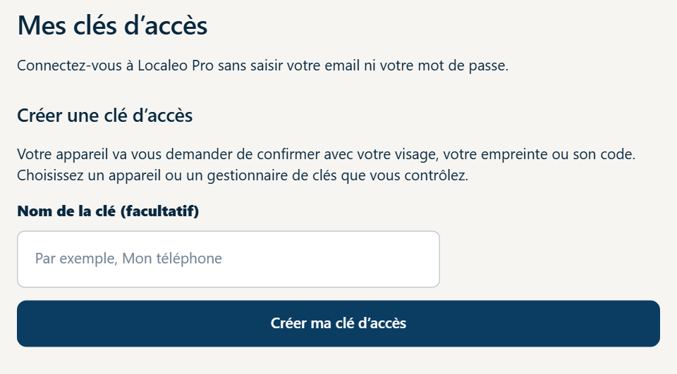
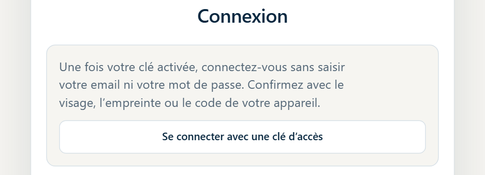
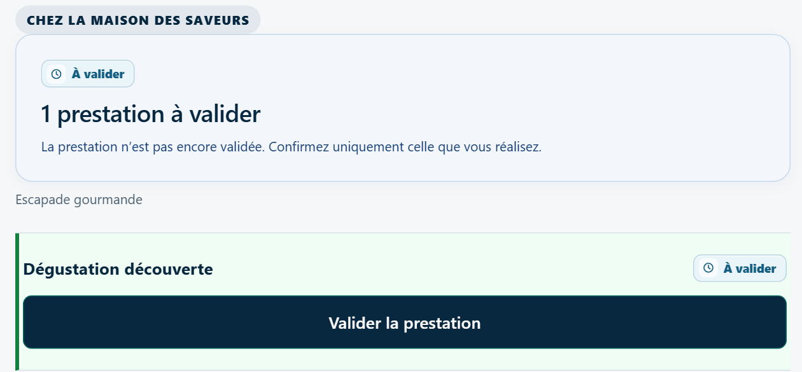
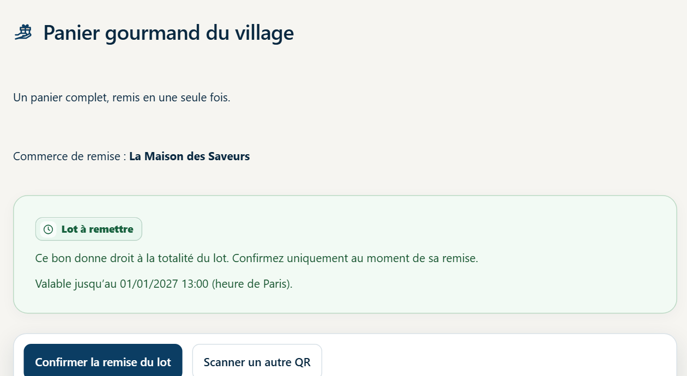
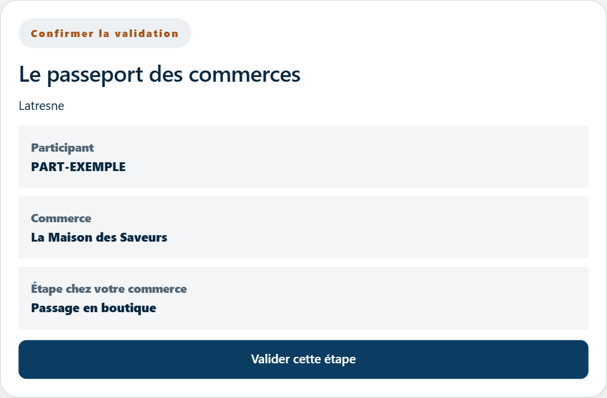
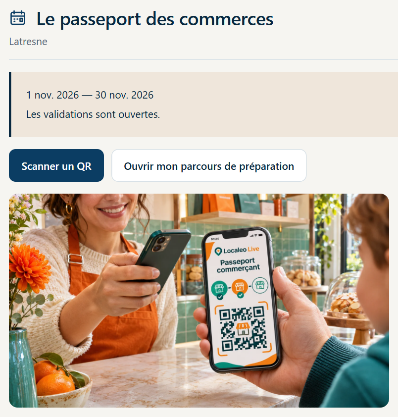
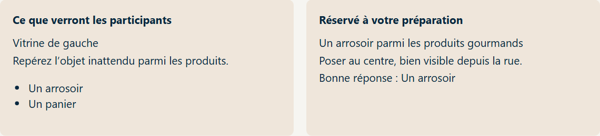
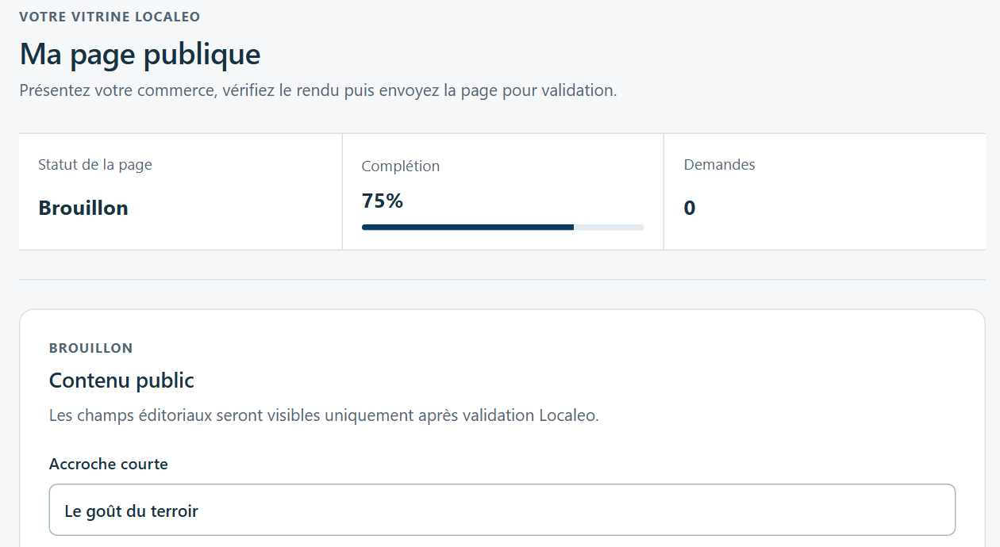
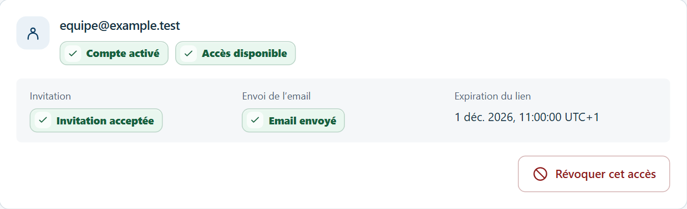
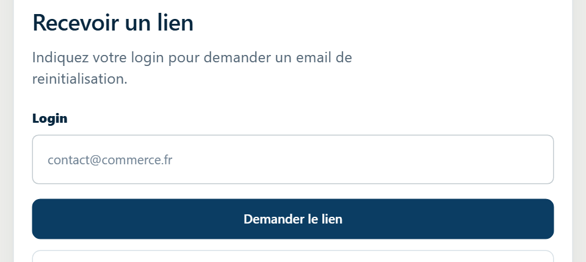

# Localeo Pro · Votre guide au quotidien

<!-- Source canonique du PDF embarqué. Édition du 28 novembre 2026. Chaque section de niveau 2 ouvre une page. Captures de Localeo Pro avec des exemples fictifs. -->

<!-- Sommaire : Prendre en main Localeo Pro -->

## 1 · Ouvrir votre espace et retrouver vos tâches

1. Ouvrez le lien fourni par Localeo. Saisissez votre adresse email et votre mot de passe, puis choisissez **Se connecter**.
2. Vérifiez le nom du commerce en haut de l’écran. Si vous utilisez un accès salarié, vous arrivez au scanner.
3. Depuis **Accueil**, utilisez **Scanner un QR** si un client est devant vous. Ouvrez **À traiter** pour répondre aux invitations.
4. Dans **Préparation des animations**, ouvrez **Mes actions** pour voir ce qui vous revient. **En attente de l’organisateur** vous aide à retrouver les dossiers qu’il doit traiter.

### Retrouver les autres rubriques

Sur ordinateur, ouvrez le menu latéral. Sur téléphone, **Plus** donne accès aux rubriques au-delà d’**Accueil**, **Scanner** et **Activité**. Dans **Animations**, **Rubriques** donne accès aux invitations, aux préparations, à vos animations et aux notifications.

Les rubriques disponibles dépendent des services du commerce et de votre accès. Gardez une connexion Internet pour enregistrer vos actions.

### Installer Localeo Pro sur votre téléphone

Choisissez **Installer** si ce bouton apparaît. Sur iPhone ou iPad, ouvrez Localeo Pro dans Safari, puis **Partager** et **Sur l’écran d’accueil**. Avant de choisir **Mettre à jour**, terminez et enregistrez l’action en cours.

## 2 · Créer une clé d’accès et vous connecter

Si l’option apparaît, votre appareil peut vous reconnaître par votre visage, votre empreinte ou son code. Le titulaire et les salariés peuvent utiliser une clé.

1. Connectez-vous avec votre mot de passe. Choisissez **Activer ma clé d’accès**, ou ouvrez **Mes clés d’accès** dans le menu du compte.
2. Sur un appareil ou dans un gestionnaire de clés que vous contrôlez, choisissez **Créer ma clé d’accès**. Saisissez votre mot de passe si Localeo Pro le demande, puis confirmez sur l’appareil. Attendez le message **Clé d’accès activée**.

3. À la connexion suivante, choisissez **Se connecter avec une clé d’accès** et confirmez sur votre appareil. Votre espace s’ouvre, ou le scanner si vous êtes salarié.

Utilisez votre mot de passe si la clé est indisponible ou perdue. En cas de doute après la création, vérifiez la liste dans **Mes clés d’accès**.

<!-- Sommaire : Accueillir les clients au comptoir -->

## 3 · Valider la prestation d’un client

Demandez au client le QR de son coffret et vérifiez que la prestation concerne votre commerce.

1. Scannez le QR avec l’appareil photo du téléphone. Ouvrez le lien et connectez-vous à Localeo Pro si demandé.
2. Vérifiez le nom du coffret, sa validité et la prestation que vous devez fournir.
3. Choisissez **Valider la prestation**. Attendez le message qui confirme l’enregistrement. Pour traiter un autre QR, choisissez **Scanner un autre QR**. Pour une autre prestation du même coffret, scannez de nouveau le QR du coffret.

### Si le scan ou la connexion pose problème

Pour un ancien QR, ouvrez **Scanner** dans Pro et utilisez sa caméra. Si elle ne démarre pas, vérifiez son autorisation ou utilisez **Réinitialiser l’appareil photo**. Vous pouvez aussi saisir l’**Identifiant du QR code**, puis choisir **Analyser le QR**.

Après une coupure, choisissez **Vérifier le résultat** avant de recommencer. Si l’enregistrement est confirmé et que la fiche tarde à se mettre à jour, choisissez **Actualiser l’état du coffret**.

### Si vous avez validé la mauvaise prestation

Rescannez le coffret et ouvrez **Prestations déjà validées**. Si **Annuler la validation** apparaît, indiquez le motif, cochez la confirmation puis choisissez **Confirmer l’annulation**. Cette possibilité dépend du délai et de vos droits. Sinon, contactez Localeo avec la référence affichée.

## 4 · Remettre un lot à un gagnant

Demandez au gagnant le bon de lot affiché dans Localeo Live, l’espace des participants.

1. Scannez le QR du bon avec l’appareil photo du téléphone ou avec **Scanner** dans Pro. Vérifiez le commerce de remise, le contenu et l’état **Lot à remettre**.
2. Choisissez **Confirmer la remise du lot**. Attendez que **Lot remis** s’affiche, puis remettez le lot entier.

### Si vous ne pouvez pas confirmer la remise

Après une coupure, choisissez **Relire le résultat** et renvoyez la validation uniquement si l’écran le propose après vérification. Si le bon est déjà utilisé, expiré ou indisponible, lisez le message affiché et contactez l’organisateur si besoin. Selon vos droits, la remise apparaît dans l’**Historique des validations**.

## 5 · Valider le passage d’un joueur

Vérifiez que votre mission prévoit la validation du passage. Demandez au joueur son QR personnel dans Localeo Live.

1. Scannez le **QR personnel du participant** avec l’appareil photo du téléphone ou avec **Scanner** dans Pro.
2. Vérifiez le nom de l’animation et de l’étape, puis choisissez **Valider cette étape**.
3. Attendez le message **Étape validée** avant de passer au joueur suivant.

### Si le résultat est incertain ou la validation impossible

Après une coupure, choisissez **Vérifier le résultat**. Renvoyez la validation uniquement si l’écran le propose après vérification. Retrouvez les opérations auxquelles vous avez accès dans l’**Historique des validations**.

Pour Vitrines et Juste Prix, un joueur qui a utilisé tous ses essais doit consulter son parcours dans Live. Cette étape reste fermée au scan et à la validation par PIN. Les validations peuvent rester ouvertes après la fin prévue, jusqu’à la clôture de l’animation.

> Le QR d’une affiche sert au public. Demandez au joueur son QR personnel pour valider un passage.

<!-- Sommaire : Participer aux animations -->

## 6 · Répondre à une invitation

Vous pouvez recevoir une invitation d’une association de votre commune ou d’une commune voisine. Si Localeo Pro est nouveau pour vous, ouvrez d’abord l’email d’accès reçu.

1. Dans **À traiter**, ouvrez l’invitation. Vous pouvez aussi passer par **Animations**, puis **Invitations**. Sur téléphone, ouvrez **Rubriques** pour trouver cette liste.
2. Choisissez **Consulter la demande**. Vérifiez l’organisateur, la commune, les dates et la date limite pour répondre.
3. Lisez **L’animation et votre mission**, puis **Explication détaillée**. Ouvrez **Règlement de l’animation** avant de répondre.
4. Choisissez **Accepter la participation** et attendez la confirmation. Vous retrouvez votre participation dans **Mes animations**.

### Si c’est une chasse au trésor

Choisissez une mission si plusieurs sont proposées. Dans l’explication, lisez les préparatifs et ouvrez **Ce que liront les participants chez vous**. Cochez **Je peux réaliser cette mission et tous les préparatifs ci-dessus.** Choisissez ensuite **Accepter cette mission**.

### Si vous devez refuser ou vous retirer

Confirmez le refus proposé. Pour une chasse, ouvrez **Autres choix > Refuser la participation**. Après acceptation, utilisez **Retirer ma participation** si le bouton apparaît. Après publication, l’organisateur peut devoir traiter votre demande. Vérifiez l’état dans **Mes animations** avant de considérer le retrait effectif.

Après une coupure, choisissez **Vérifier ma décision**. Si le délai de réponse est dépassé, demandez à l’organisateur s’il peut le prolonger.

## 7 · Préparer votre commerce et prévenir l’organisateur

Une fois votre invitation acceptée, ouvrez **Préparation des animations**, puis **Voir la préparation**. En haut, retrouvez l’état de vos préparatifs, votre déclaration et la prochaine action. Touchez une étape dans **Avancement de la préparation** pour la consulter.

1. Dans **Ma mission**, relisez votre rôle. Ouvrez **Explication détaillée** pour consulter les consignes.
2. Dans **Supports et équipe**, téléchargez le kit. Pour un passeport, une tombola ou une chasse, choisissez **J’ai terminé ma préparation** après les préparatifs, si l’action est proposée.
3. Si l’organisateur demande une déclaration, ouvrez **Déclaration**, puis choisissez **Je suis prêt**. Vérifiez que la déclaration est datée et enregistrée.

Pour un passeport, vérifiez si votre mission demande un achat. Lorsqu’il est requis, aucun montant minimum ne s’applique. Pour une tombola, suivez la mission de l’invitation. Pour une vitrine ou un produit, consultez **Préparer votre vitrine ou proposer votre produit**.

### Vérifier ou reprendre votre préparation

Utilisez **Actualiser l’état** pour relire le suivi. Si une tâche doit être reprise, utilisez **Reprendre la préparation**. Une ancienne déclaration peut rester visible. **Non requise** indique qu’aucun préparatif n’est à confirmer. Les animations clôturées ou annulées figurent dans **Historique**.

## 7 bis · Consulter la fiche et choisir un support

Ouvrez la fiche de l’animation. Lorsque l’édition est visible en ligne, la fiche affiche le visuel choisi par l’organisateur s’il en a enregistré un.

Dans **Supports et équipe**, choisissez le document selon votre besoin.

- **Guide privé** pour les consignes de l’équipe, à garder au comptoir.
- **Flyer joueurs** pour faire connaître l’animation ou donner accès à l’inscription.
- **QR de lieu** pour une chasse au trésor, à installer à votre étape. Le joueur le scanne dans Live pour ouvrir le défi.

## 8 · Préparer votre vitrine ou proposer votre produit

Ouvrez la préparation avec le compte principal. Le **Retour de l’organisateur** indique si votre proposition attend son accord, est approuvée ou demande des corrections.

### Pour le Jeu des vitrines

1. Dans **Vitrine**, décrivez l’intrus et son installation. Ces informations restent privées.
2. Dans **Question**, saisissez la consigne, l’emplacement et deux à six choix différents. Cochez **Intrus** en face de la bonne réponse.
3. Dans **Proposition**, relisez les parties publique et privée. Choisissez **Enregistrer mon brouillon**, puis **Proposer à l’organisateur**.
4. Après approbation, ouvrez **Installation** et confirmez la mise en place. L’état **Contrôle sur place** indique si l’organisateur l’a vérifiée.

### Pour le Juste Prix

1. Dans **Produit et supports**, saisissez le nom, la description, le format et le prix TTC. Pour ajouter une image sans prix visible, ouvrez **Ajouter un visuel (facultatif)**.
2. Enregistrez, puis choisissez **Proposer à l’organisateur**. La préparation passe à **Terminée** après son accord.
3. Si l’organisateur vous le demande, utilisez aussi **Je suis prêt** pour lui envoyer votre déclaration.

### Si le contenu doit être corrigé

Lisez le motif en haut de la fiche. Corrigez, enregistrez et proposez de nouveau. Les volets d’aide s’ouvrent à la demande et la frise conserve votre saisie d’une étape à l’autre.

<!-- Sommaire : Gérer votre commerce et votre équipe -->

## 9 · Mettre à jour la page publique de votre commerce

1. Ouvrez **Ma page publique**. Complétez l’accroche, la présentation, l’histoire et le mot du commerçant.
2. Renseignez les informations utiles aux clients, notamment les horaires et les liens. Séparez les spécialités et les ambiances par des virgules.
3. Ajoutez une image principale, un portrait et jusqu’à trois photos d’ambiance. Utilisez JPEG, PNG ou WebP, jusqu’à 5 Mo par image. Attendez la fin du chargement.
4. Vérifiez l’aperçu, puis choisissez **Enregistrer et envoyer en validation**. Suivez la décision dans **Demandes**. Après approbation, vérifiez le résultat sur votre page publique.

**Enregistrer le brouillon** conserve votre travail pour plus tard. Si Localeo a préparé la page avec vous, consultez **Retrouver une intervention de Localeo sur votre page**.

### Mettre à jour l’adresse et vos coordonnées

Dans **Compte**, corrigez le nom, le prénom ou le téléphone, puis choisissez **Enregistrer**. Pour changer l’adresse de connexion, contactez Localeo. Dans **Adresse du commerce**, saisissez la voie ou le lieu-dit, le code postal et la localité, puis choisissez **Enregistrer l’adresse**. En cas de doute, utilisez **Recharger l’adresse enregistrée**.

### Vérifier ou corriger une prestation

Dans **Prestations**, cherchez par nom ou par coffret. Ouvrez la fiche pour lire sa description, son statut et le montant reversé. Si elle est **Modifiable**, changez son nom ou sa description, choisissez **Enregistrer les modifications** et relisez la fiche. Pour une offre en **Lecture seule**, un ajout ou un changement de montant, contactez Localeo.

## 10 · Consulter votre activité et retrouver un versement

1. Ouvrez **Mon activité**, ou **Activité** sur téléphone.
2. Choisissez les dates et un affichage par **Jour**, **Semaine** ou **Mois**. Choisissez une prestation si vous souhaitez l’isoler, puis sélectionnez **Appliquer**.
3. Comparez les prestations achetées, celles à réaliser et celles déjà validées. **Par prestation et version** donne le détail des offres. Pour élargir la recherche, choisissez **Réinitialiser**.

### Retrouver un versement

Dans **Reversements**, ouvrez la somme qui vous intéresse parmi les versements en attente et les mouvements des douze derniers mois. Sur téléphone, choisissez **Détails du mouvement**. Vérifiez si elle attend une campagne de paiement, si elle est bloquée, en cours, versée ou en échec. Le suivi bancaire et les tentatives précédentes, quand ils sont affichés, peuvent expliquer un retard.

**Revenu potentiel restant** estime ce que les prestations encore à réaliser pourraient rapporter. Pour savoir ce qui a effectivement été versé, consultez **Déjà reçu** ou **Reversements**. Localeo organise les campagnes de versement.

### Si vous devez configurer les versements avec Stripe

Dans **Compte > Stripe Connect**, choisissez **Configurer mon compte Stripe** ou **Reprendre la configuration** si proposé. Complétez les informations chez Stripe. À votre retour, choisissez **Synchroniser mon compte** et vérifiez le statut et les autorisations de vente et de reversement.

## 11 · Fournir une facture demandée

Ouvrez **Facturation** si cette rubrique est disponible. Choisissez les demandes unitaires ou groupées. Sur téléphone, vous pouvez déplier **Rechercher et filtrer**.

1. Ouvrez la demande. Vérifiez les prestations, les montants et le statut. Pour un groupe, relisez toutes les lignes.
2. Choisissez **Accuser réception**, puis **Démarrer le traitement** lorsque ces actions sont proposées.
3. Préparez votre facture dans votre outil habituel. Reprenez le montant brut TTC à facturer. Le montant net affiché tient compte de la commission.
4. Dans **Déposer votre facture**, ajoutez le PDF de 10 Mo maximum, son numéro et sa date.
5. Choisissez **Fournir la facture**. Attendez la confirmation et vérifiez l’état **Facture fournie**.

### Corriger la demande ou utiliser une autre option

Avant le dépôt, **Annuler la demande** peut être proposé. Pour une demande groupée déjà fournie, **Créer une correction distincte** permet, si disponible, de créer un avoir ou une facture corrective et de préciser le motif. La facture d’origine reste consultable.

Dans **Factures Localeo**, utilisez **Télécharger le PDF** pour les commissions et avoirs disponibles. L’assistant de facturation permet de préparer un brouillon, de le relire puis de choisir **Émettre la facture**. Si **Chorus Pro** est proposé, lisez et acceptez le mandat avant un dépôt. Une révocation conserve les preuves antérieures.

## 12 · Lire vos messages et activer les alertes

1. Ouvrez **Notifications**. Pour les messages liés à une animation, vous pouvez aussi passer par **Animations > Notifications**.
2. Utilisez les filtres si nécessaire, puis ouvrez le message avec **Voir la demande** ou **Voir l’animation**.
3. Après lecture, choisissez **Marquer comme lue**. Vous pouvez aussi tout marquer comme lu ou supprimer un message après confirmation.

### Recevoir les alertes sur cet appareil

1. Ouvrez **Réglages > Notifications de cet appareil**.
2. Choisissez **Activer les notifications** si proposé, puis donnez l’autorisation dans le navigateur ou sur le téléphone.
3. Vérifiez que **Activées sur cet appareil** s’affiche. Répétez sur chaque appareil sur lequel vous voulez être alerté.

Sur iPhone ou iPad, installez Pro depuis Safari puis ouvrez-le depuis son icône pour activer les notifications. Si l’autorisation est bloquée, corrigez-la dans les réglages de l’appareil ou du navigateur, revenez dans Pro et choisissez **Actualiser l’état**. Vos messages restent disponibles dans Pro.

**Recevoir les alertes d’achat de coffrets**, si proposé, prévient vos appareils abonnés lorsqu’un coffret acheté contient une de vos offres. Lors de la visite, validez la prestation avec le QR du client. Selon vos droits, les validations par PIN sont aussi signalées dans les notifications.

## 13 · Donner un accès à un membre de votre équipe

Si l’option est disponible, chaque salarié peut se connecter avec son propre accès.

1. Ouvrez **Accès salariés** et vérifiez que l’option est activée.
2. Saisissez l’adresse email du salarié et choisissez **Inviter le salarié**.
3. Le salarié ouvre son invitation et crée son mot de passe. Une fois la démarche terminée, vérifiez que **Compte activé** et **Accès disponible** s’affichent sur sa ligne.

Le salarié utilise le scanner, les reçus et son historique selon ses droits. Vous pouvez renvoyer ou annuler l’invitation, ou choisir **Révoquer cet accès** si la personne quitte votre équipe. Vérifiez le nom avant de confirmer, puis utilisez **Actualiser la liste** en cas de doute. Un compte activé peut afficher un accès suspendu.

### Utiliser un PIN au comptoir, si proposé

Dans **Validation par PIN**, vérifiez votre mot de passe, choisissez la durée et sélectionnez **Générer le PIN**. Le code s’affiche une seule fois. Gardez-le à l’abri des regards, puis choisissez **Masquer le PIN**.

Lorsque l’option apparaît sur le téléphone du client, saisissez vous-même le PIN pour la prestation ou le passage autorisé. Attendez la confirmation et vérifiez l’historique si le résultat est incertain. **Remplacer le PIN** rend l’ancien inutilisable. **Invalider le PIN et désactiver** arrête ce mode.

## 14 · Retrouver une intervention de Localeo sur votre page

Si le support a préparé votre page publique, ouvrez **Interventions de Localeo** depuis le menu lorsque la rubrique est disponible. Vous pouvez retrouver chaque intervention pendant 180 jours après sa fin.

1. Repérez le commerce, la date, le nom de la personne qui est intervenue et la référence du dossier.
2. Si vous voyez **Enregistrement du brouillon de la page publique**, ouvrez **Ma page publique** pour retrouver le travail enregistré. Le brouillon reste accessible si l’envoi pour validation a été refusé.
3. Si vous voyez **Soumission de la page publique à modération**, ouvrez **Demandes** dans **Ma page publique** pour suivre la décision. Après approbation, vérifiez votre page publique.

## 15 · Demander de l’aide et suivre la réponse

1. Ouvrez **Aide et contact** et choisissez le motif adapté.
2. Décrivez votre demande. Si une opération vous pose problème, indiquez le geste, l’heure et la référence du coffret ou de la prestation si vous l’avez.
3. Choisissez **Envoyer** une fois et attendez la confirmation. Ouvrez **Mes demandes** pour lire la réponse. Utilisez **Répondre** pour poursuivre l’échange au même endroit.

Pour une question sur une mission, un lot ou les règles d’une animation, contactez son organisateur. Si le formulaire est indisponible, utilisez les coordonnées reçues à l’ouverture de votre compte.

### Retrouver ce guide ou votre contrat

Dans **Aide et contact**, choisissez **Consulter le guide commerçant (PDF)**. Il s’ouvre dans un nouvel onglet, même lorsque la messagerie est indisponible. Téléchargez-le si vous souhaitez le lire sans connexion ou l’imprimer.

Dans **Compte > Mon contrat**, récupérez votre contrat. S’il manque, actualisez la page ou contactez Localeo. Pour une demande au support, le menu du commerce vous permet de copier votre identifiant.

## 16 · Retrouver et protéger votre accès

### Si vous avez oublié votre mot de passe

1. Sur l’écran de connexion, choisissez **Mot de passe oublié**. Saisissez votre adresse email dans **Login** et choisissez **Demander le lien**.
2. Ouvrez le lien reçu, saisissez votre nouveau mot de passe et confirmez-le.
3. Reconnectez-vous pour vérifier que vous retrouvez votre espace. Si **Préparer mon compte commerçant** s’affiche, renseignez les informations demandées. Les fonctions auxquelles vous avez droit apparaîtront après activation.

Si vous êtes salarié, choisissez **Récupérer un accès salarié** sur l’écran de connexion.

### Si vous avez perdu une clé d’accès

Connectez-vous avec votre mot de passe. Dans **Mes clés d’accès**, retirez la clé perdue en confirmant avec votre mot de passe. Les sessions ouvertes avec cette clé sont fermées. Si le résultat est incertain, vérifiez la liste avant de recommencer. Une réinitialisation du mot de passe par email retire toutes vos clés. Vous pouvez en créer une nouvelle ensuite.

### Pour changer votre mot de passe ou quitter un appareil partagé

Utilisez le menu du compte pour changer votre mot de passe ou vous déconnecter. Un changement de mot de passe ferme les sessions ouvertes : reconnectez-vous ensuite. Sur un appareil partagé, déconnectez-vous après chaque utilisation.

> Gardez pour vous votre mot de passe, votre PIN et votre lien de réinitialisation. Gardez aussi confidentiel le QR personnel d’un client.
