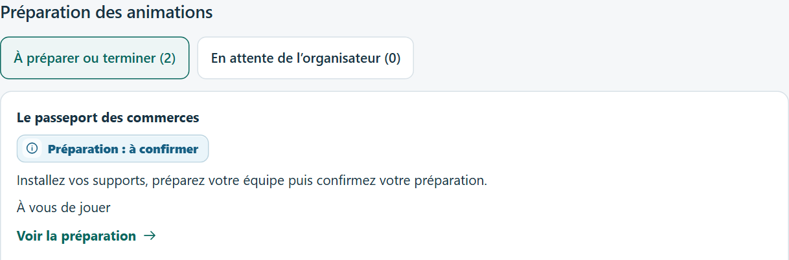
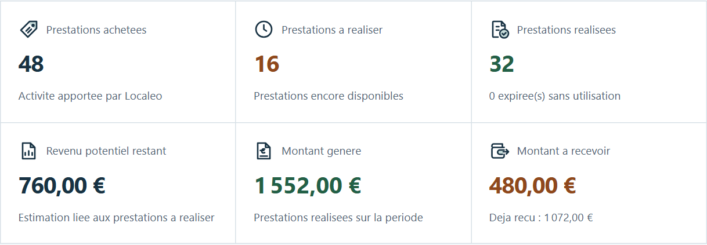
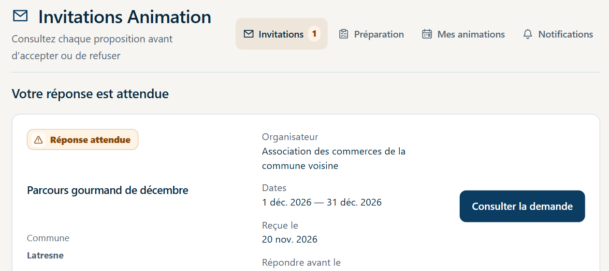
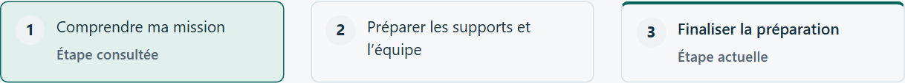
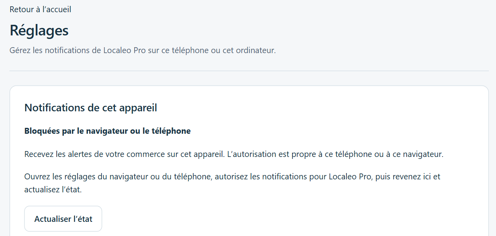
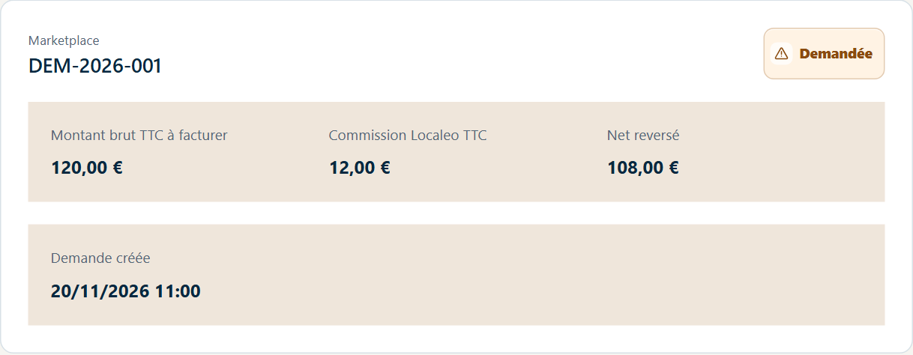
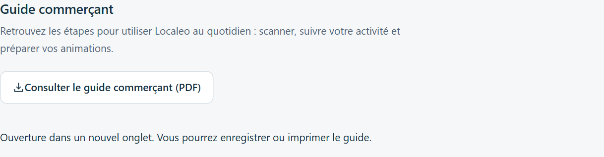
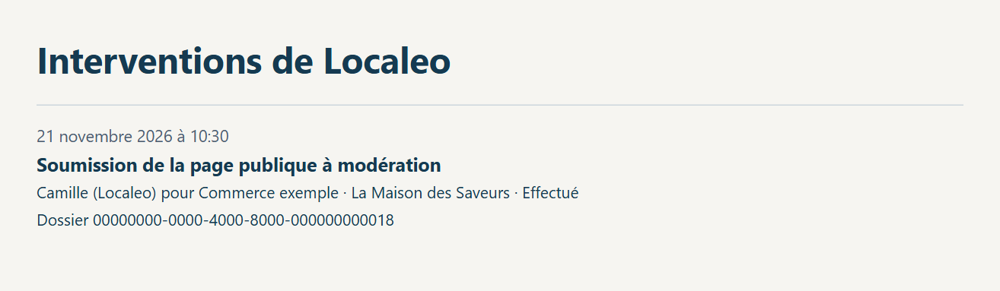

# Localeo Commerçant · Votre guide au quotidien

<!-- Source canonique du PDF embarqué. Édition du 24 novembre 2026. Chaque section de niveau 2 ouvre une page. Captures du frontend actuel, API simulées et exemples fictifs : scripts/capture-merchant-guide.mjs dans localeo-commercant. -->

## 1 · Se connecter et se repérer

Localeo Commerçant, affiché **Localeo Pro** dans l’application, vous accompagne au comptoir et dans le suivi du commerce. Retrouvez ce guide dans **Aide et contact > Consulter le guide commerçant (PDF)**.

### Commencer votre journée

1. Ouvrez le lien fourni par Localeo. Saisissez votre email et votre mot de passe, puis **Se connecter**. Vérifiez le nom du commerce en haut.
2. Utilisez **Scanner un QR** pour une animation, un lot ou un coffret.
3. Dans **À traiter**, répondez aux invitations. Sous le scanner, **Préparation des animations** distingue **Mes actions** et **En attente de l’organisateur**. Les alertes séparent préparation et déclaration ; chaque vue présente cinq éléments par page.

### Retrouver une fonction

- **Votre commerce :** Compte, Ma page publique et Prestations (page 2).
- **Au comptoir :** coffrets (page 3), lots et passages Animation (page 4).
- **Votre suivi :** activité et reversements (page 5), facturation (page 11).
- **Vos animations :** invitations et préparation (pages 6 à 8).
- **Votre équipe :** notifications (page 9), salariés et PIN (page 10), aide (page 12).

Sur ordinateur, utilisez le menu latéral. Sur téléphone, **Accueil**, **Scanner**, **Activité** et **Plus** restent à portée de main ; **Plus** ouvre les autres rubriques. Dans Animations, **Rubriques** déplie Invitations, Préparation, Mes animations et Notifications.

**Installer :** choisissez **Installer** en haut. Sur iPhone/iPad, utilisez Safari > Partager > Sur l’écran d’accueil. Avant **Mettre à jour**, enregistrez votre action : l’application se recharge après votre accord.

> Captures de l’application avec des exemples fictifs. Les rubriques et actions dépendent des produits, options et droits du compte. Une connexion Internet est nécessaire pour enregistrer une action.

## 2 · Présenter votre commerce

Des coordonnées à jour et des informations pratiques fiables facilitent la visite des clients.

### Corriger vos coordonnées

Dans **Compte**, modifiez prénom, nom ou téléphone, puis **Enregistrer**. Pour changer l’email, contactez Localeo. Dans **Adresse du commerce**, renseignez voie ou lieu-dit, code postal et localité, puis **Enregistrer l’adresse**. Si le résultat est incertain, choisissez **Recharger l’adresse enregistrée** avant une nouvelle action.

### Préparer votre page publique

1. Ouvrez **Ma page publique**. Complétez accroche, présentation, histoire du commerce et mot du commerçant.
2. Renseignez spécialités, ambiance, informations pratiques, horaires et liens utiles. Séparez spécialités et ambiances par des virgules.
3. Ajoutez l’image principale, le portrait et jusqu’à trois photos d’ambiance : JPEG, PNG ou WebP, 5 Mo maximum par image. Attendez la fin du chargement.
4. Vérifiez l’aperçu. **Enregistrer le brouillon** conserve votre travail ; **Enregistrer et envoyer en validation** transmet la demande à Localeo.
5. Suivez l’avis de modération dans **Demandes**, le travail du support dans **Interventions de Localeo** (chapitre 13).

### Consulter une prestation

Dans **Prestations**, recherchez par nom ou coffret, puis sélectionnez l’offre. Consultez description, statut et montant reversé. Si elle est **Modifiable**, corrigez nom ou description puis **Enregistrer les modifications**. En **Lecture seule**, contactez Localeo. L’ajout d’une offre et la modification de son montant passent aussi par Localeo.

> Vos changements deviennent publics après validation par Localeo.

## 3 · Valider une prestation de coffret

Les deux méthodes ci-dessous sont aussi valables pour les QR d’animation et de lot.

### Scanner, vérifier, confirmer

1. Scannez avec l’**appareil photo du téléphone**, ouvrez le lien et connectez-vous si demandé. Pour un ancien QR, ouvrez **Scanner** dans Pro et utilisez sa caméra.
2. Vérifiez le coffret, sa validité et la prestation à remettre, puis choisissez **Valider la prestation**. Attendez la confirmation.
3. Utilisez **Scanner un autre QR** pour poursuivre. Pour une autre prestation du même coffret, scannez à nouveau son QR.

### Caméra ou réseau indisponible ?

Dans Pro, vérifiez l’autorisation caméra ou utilisez **Réinitialiser l’appareil photo**. Vous pouvez aussi saisir l’**Identifiant du QR code**, puis choisir **Analyser le QR**.

Après une coupure, privilégiez **Vérifier le résultat** : la validation a pu être enregistrée. Si la réussite est confirmée mais la fiche reste ancienne, **Actualiser l’état du coffret** relit l’état sans valider à nouveau.

### Corriger une erreur

Rescannez le coffret et ouvrez **Prestations déjà validées**. Si **Annuler la validation** apparaît, indiquez le motif, cochez la confirmation puis **Confirmer l’annulation**. Cette action dépend du délai et des droits autorisés. Sinon, contactez Localeo avec la référence affichée.

> Un refus, une erreur ou un résultat à vérifier ne confirme jamais une prestation. Ne répétez pas une validation dont le résultat est incertain.

## 4 · Remettre un lot ou valider un passage

Vérifiez le commerce, le contenu et l’état du QR avant de confirmer.

### Remettre un lot gagné

1. Scannez le QR du lot présenté dans Live avec l’appareil photo du téléphone ou avec **Scanner** dans Pro.
2. Vérifiez lot, commerce et état **Lot à remettre**.
3. Remettez le lot entier, choisissez **Confirmer la remise du lot** et attendez la confirmation.
4. Pour un lot remis, expiré ou indisponible, suivez l’information affichée ou contactez l’organisateur.

Après une coupure, utilisez **Relire le résultat** avant une nouvelle action. L’**Historique des validations** retrouve remises et prestations selon vos droits.

### Valider une étape Animation

Si **Votre mission** demande une validation commerçante, scannez le **QR personnel du participant** avec l’appareil photo du téléphone ou dans Pro. Vérifiez animation et étape, puis **Valider cette étape**. Attendez la confirmation.

Pour **Vitrines** et **Juste Prix**, une étape **invalide** après épuisement des essais ne se rattrape ni par scan ni par PIN. Invitez le joueur à consulter son parcours dans Live.

Après un résultat incertain, **Vérifier le résultat** est prioritaire ; **Renvoyer la même validation** dépend de l’autorisation de reprise. Quitter l’écran n’annule pas une validation enregistrée.

> Le QR public d’une affiche ne remplace ni le QR personnel du joueur ni celui du lot. Après la fin prévue, les validations peuvent rester ouvertes jusqu’à la clôture. Si le raccourci manque, ouvrez Scanner depuis l’accueil ; vos droits sont vérifiés.

## 5 · Suivre votre activité et vos versements

**Mon activité** explique l’utilisation des coffrets. **Reversements** permet de retrouver sommes dues et versements effectués.

### Choisir la bonne période

Ouvrez **Mon activité**, ou **Activité** sur téléphone. Choisissez dates, regroupement **Jour**, **Semaine** ou **Mois**, et éventuellement une prestation. Cliquez sur **Appliquer** ; **Réinitialiser** retrouve une vue plus large.

- **Prestations achetées :** vos offres présentes dans les coffrets achetés.
- **Prestations à réaliser :** celles encore disponibles pour une visite.
- **Prestations réalisées / Montant généré :** ce qui a été validé.
- **Revenu potentiel restant :** une estimation des prestations restant à réaliser.
- **Montant à recevoir / Déjà reçu :** les sommes liées à cette activité.

Le graphique compare achats et consommations. **Par prestation et version** détaille les offres concernées.

### Retrouver ou configurer un versement

Dans **Reversements**, consultez les sommes en attente et les douze derniers mois. Les statuts distinguent attente de campagne, blocage à régulariser, versement en cours, effectué ou en échec. Sur téléphone, ouvrez **Détails du mouvement**. Suivi bancaire et tentatives précédentes, si disponibles, aident à comprendre un retard.

Dans **Compte > Stripe Connect**, si proposé, choisissez **Configurer mon compte Stripe** ou **Reprendre la configuration**. Complétez les informations chez Stripe ; de retour dans Localeo, **Synchroniser mon compte**, puis vérifiez statut et autorisations de ventes et reversements.

> Une prestation achetée n’est pas encore réalisée. Le revenu potentiel n’est pas une somme versée. Les reversements suivent les campagnes Localeo ; cette page ne déclenche pas de paiement.

## 6 · Répondre aux invitations Animation

Une association d’une commune voisine peut vous inviter. Pour votre première connexion, ouvrez l’email d’accès Pro. Vous décidez ensuite pour chaque animation.

### Examiner puis décider

1. Depuis **À traiter**, ouvrez l’invitation, ou choisissez **Animations > Invitations**. Sur mobile, utilisez **Rubriques**.
2. Ouvrez **Consulter la demande**. Vérifiez animation, commune, organisateur, dates, réception et date limite de réponse.
3. Lisez mission et préparatifs ; dépliez **Présentation et règlement**. Vérifiez votre disponibilité et le matériel nécessaire.
4. Pour une invitation classique, **Accepter la participation**, puis attendez la confirmation.

### Pour une chasse au trésor

Choisissez votre mission si plusieurs sont proposées. Lisez **Ce que liront les participants chez vous** et tous les préparatifs. Cochez **Je peux réaliser cette mission et tous les préparatifs ci-dessus.**, puis **Accepter cette mission**. Le kit devient accessible ; le commerce n’est pas encore déclaré prêt.

### Refuser ou signaler un empêchement

Utilisez le refus proposé et confirmez. Pour une chasse : **Autres choix > Refuser la participation** ; le motif est facultatif. Après acceptation, consultez contact et suivi. **Retirer ma participation**, si proposé, peut nécessiter le traitement de l’organisateur après publication. Vérifiez l’état avant de considérer le retrait effectif.

**Mes animations** classe vos participations en **En cours**, **À venir** et **Terminées**. Les catégories restent distinctes des rubriques. Ouvrez le détail pour retrouver mission, scanner et préparation.

> Après une coupure, utilisez **Vérifier ma décision** avant de recommencer. Pour une échéance de réponse dépassée, contactez l’organisateur : lui seul peut la prolonger.

## 7 · Préparer votre commerce pour une animation

**Préparation des animations** affiche **En cours et à venir**. Chaque ligne sépare **Préparation** et **Déclaration à l’organisateur**, avec prochaine tâche et acteur. **Historique** retrouve les animations clôturées ou annulées.

### Les trois gestes essentiels

1. Ouvrez **Voir la préparation**, puis **Comprendre ma mission** pour relire mission et dates. Changer d’étape conserve les saisies sans les enregistrer.
2. À l’étape 2, consultez le kit. Si votre mission comporte des préparatifs, réalisez-les puis choisissez **J’ai terminé ma préparation** pour un passeport, une tombola ou une chasse. **Reprendre la préparation** permet de la remettre à faire.
3. Dans **Informer l’organisateur**, choisissez **Je suis prêt**, si le suivi est actif. La déclaration enregistrée est datée. Elle reste indépendante de la préparation et du statut **En cours** de l’animation.

### Utiliser le bon support

- **Guide privé :** consignes de votre équipe, à garder au comptoir.
- **Flyer joueurs :** accès à l’animation, au support public ou à l’inscription.
- **QR de lieu d’une chasse :** à installer à votre étape. Le joueur le scanne dans Live pour ouvrir le défi. Il est distinct du flyer et du QR personnel.

### Adapter l’accueil au jeu

Pour un **Passeport**, consultez la mission. Vérifiez l’achat, sans montant minimum, s’il est requis. Sinon, la visite suffit. Dans les deux cas, scannez le QR personnel. En **Chasse**, installez le QR de lieu et préparez la mission retenue. En **Tombola**, suivez le rôle de l’invitation. Vitrines et Juste Prix sont détaillés page suivante.

**Non requise** signifie qu’aucun préparatif n’est à confirmer. Sans suivi activé, aucune déclaration n’est demandée. La fiche et ses consignes restent accessibles dans **Toutes mes préparations et l’historique**. Une ancienne déclaration reste visible même si un préparatif doit être repris.

> Télécharger le kit et terminer l’étape 2 ne préviennent pas l’organisateur. Après un résultat incertain, vérifiez l’état avant une nouvelle action.

## 8 · Préparer Vitrines et Juste Prix

Le compte principal prépare un contenu soumis à l’organisateur. L’approbation du contenu et l’installation réelle sont des étapes différentes.

### Jeu des vitrines : avancer pas à pas

1. **Prévoir la vitrine :** décrivez l’intrus et son installation dans votre commerce.
2. **Préparer la question :** renseignez consigne publique, emplacement, deux à six choix distincts et bonne réponse privée.
3. **Relire et proposer :** vérifiez ce que verront les participants et ce qui reste privé. **Enregistrer mon brouillon** conserve le travail ; **Proposer à l’organisateur** soumet la version enregistrée.
4. **Installer et faire contrôler :** après approbation, installez réellement cette version, attestez l’installation avec l’action proposée et faites contrôler sur place par l’organisateur.

Si une correction est demandée, lisez le motif, corrigez, enregistrez et proposez à nouveau. La frise permet de relire sans perdre vos saisies ; elle distingue l’étape consultée du travail attendu. Gardez les solutions hors des supports publics.

### Juste Prix : présenter votre produit

À l’étape 2, dans **Votre produit et son juste prix**, renseignez nom, description, unité ou format et prix TTC en euros. Le visuel ne doit pas révéler le prix. Enregistrez puis **Proposer à l’organisateur**. La préparation reste en attente jusqu’à l’approbation, puis devient **Terminée**. Une correction ou modification exige une nouvelle approbation. La déclaration **Je suis prêt** reste séparée.

Après publication, contenu et réponses approuvées sont figés : signalez un problème à l’organisateur. Les salariés n’ont pas les actions de préparation du contenu ; ils utilisent le scanner selon leurs droits.

> Enregistrer, proposer, approuver, installer et contrôler ne sont pas interchangeables. Suivez la prochaine étape affichée avant de considérer la préparation terminée.

## 9 · Recevoir et retrouver les notifications

Les messages dans Pro et les alertes du téléphone sont complémentaires. L’autorisation d’un appareil ne vaut pas pour les autres.

### Activer les alertes sur votre appareil

1. Ouvrez **Réglages > Notifications de cet appareil**.
2. Choisissez **Activer les notifications**, si proposé, puis autorisez-les dans le navigateur ou le téléphone.
3. Vérifiez **Activées sur cet appareil**. Répétez sur chaque appareil utilisé.
4. Si elles sont bloquées, autorisez Localeo Pro dans les réglages du navigateur ou du téléphone, revenez dans Pro et **Actualiser l’état**.

Sur iPhone/iPad, installez d’abord l’application depuis Safari puis ouvrez-la depuis son icône. Si le navigateur ne permet pas les notifications, vos messages restent consultables dans Pro.

### Choisir les alertes d’achat de coffrets

Si disponible, **Recevoir les alertes d’achat de coffrets** ajoute les achats contenant une de vos offres aux alertes des appareils abonnés du compte. Ce choix ne remplace pas l’activation de chaque appareil. La désactivation d’un appareil conserve les autres abonnements.

### Consulter les messages dans Pro

Ouvrez **Notifications**, ou **Animations > Notifications**. Filtrez puis **Voir la demande** ou **Voir l’animation**. Après lecture : **Marquer comme lue** ou **Tout marquer comme lu**. Pour retirer un message : **Supprimer**, puis **Confirmer la suppression**. Les notifications de validation par PIN sont aussi disponibles selon vos droits.

> Une alerte d’achat indique qu’un coffret contient une de vos offres. Elle ne confirme aucune prestation et ne remplace jamais le scan lors de la visite.

## 10 · Organiser les accès de votre équipe

Le responsable dispose des accès salariés et de la validation par PIN selon les options et droits du commerce.

### Inviter un salarié

1. Ouvrez **Accès salariés** et vérifiez que l’option est activée.
2. Renseignez l’email puis **Inviter le salarié**. La personne reçoit un lien pour créer son mot de passe personnel.
3. Relisez la liste : le compte peut rester **À activer par le salarié** même si l’email est envoyé. **Compte activé** et **Accès disponible** sont deux informations distinctes.
4. Renvoyez ou annulez l’invitation si nécessaire. Pour retirer l’accès, **Révoquer cet accès**, puis confirmez pour la bonne personne. Après un doute, **Actualiser la liste**.

Le salarié utilise ses identifiants et les actions autorisées de scanner, reçu et historique. Il ne gère pas le compte principal, les finances ni le contenu des préparations Animation. Ne partagez pas le mot de passe du responsable.

### Validation par PIN, si activée

Dans **Validation par PIN**, vérifiez votre mot de passe et choisissez la durée proposée avant **Générer le PIN**. Le code n’est affiché qu’une fois : conservez-le à l’abri des regards puis **Masquer le PIN**. **Remplacer le PIN** invalide l’ancien code ; **Invalider le PIN et désactiver** arrête ce mode.

Lorsque le parcours le propose, saisissez vous-même le PIN sur le téléphone du client pour la prestation ou le passage autorisé. Attendez le résultat ; le scanner QR reste disponible. Consultez notifications et historique pour contrôler les validations.

> Un compte salarié activé peut avoir un accès suspendu. Le PIN ne donne aucun droit supplémentaire ; ne le communiquez pas aux clients. Après un résultat incertain, actualisez l’état.

## 11 · Traiter les demandes de facture

**Facturation** apparaît si le service est activé. Choisissez demandes unitaires ou groupées ; sur téléphone, dépliez **Rechercher et filtrer** si nécessaire.

### Fournir votre facture

1. Ouvrez la demande et vérifiez prestations, montants et statut.
2. Choisissez **Accuser réception**, puis **Démarrer le traitement**, lorsque proposé.
3. Préparez la facture dans votre outil habituel. Le brut TTC à facturer est distinct du net reversé après commission.
4. Dans **Déposer votre facture**, ajoutez un PDF de 10 Mo maximum, son numéro et sa date.
5. **Fournir la facture**, attendez la confirmation puis vérifiez **Facture fournie**.

**Demandée**, **Réception accusée** et **En traitement** indiquent le travail restant. Pour une demande groupée, contrôlez toutes les lignes avant de transmettre.

### Corriger ou télécharger

Avant fourniture, **Annuler la demande** est proposé selon l’état. Une demande groupée fournie peut proposer **Créer une correction distincte** : choisissez avoir ou facture corrective et indiquez le motif. Le document d’origine reste distinct.

Dans **Factures Localeo**, si disponible, téléchargez commissions et avoirs avec **Télécharger le PDF**. L’assistant facultatif permet de créer/reprendre un brouillon, vérifier les informations puis **Émettre la facture**. Si **Chorus Pro** est proposé, lisez et acceptez le mandat avant un dépôt. Sa révocation conserve les preuves antérieures.

> Une page indisponible ne signifie pas qu’aucune facture n’existe. Relisez la demande ou contactez Localeo avant de créer un nouveau document.

## 12 · Obtenir de l’aide et sécuriser votre espace

Le guide reste accessible même si le service de messagerie ne répond pas.

### Retrouver ce guide

Ouvrez **Aide et contact > Consulter le guide commerçant (PDF)**. Il s’ouvre dans un nouvel onglet ; utilisez le lecteur pour télécharger ou imprimer le PDF. Gardez une copie si vous souhaitez le lire sans connexion.

### Poser une question et suivre une réponse

1. Choisissez le motif adapté dans **Aide et contact**.
2. Décrivez l’action souhaitée, le problème et son heure. Ajoutez une référence coffret ou prestation si disponible, sans QR personnel ni information confidentielle.
3. Choisissez **Envoyer** une seule fois puis attendez la confirmation.
4. Dans **Mes demandes**, ouvrez le fil ; utilisez **Répondre** pour poursuivre au même endroit.

Si le formulaire est indisponible, utilisez le contact remis lors de votre onboarding. Pour une mission, un lot ou une règle d’animation, contactez d’abord son organisateur.

### Protéger vos accès

Dans **Compte > Mon contrat**, téléchargez le contrat ; actualisez-le ou contactez Localeo s’il manque. Le menu du commerce permet de copier l’identifiant pour le support, modifier le mot de passe et se déconnecter. Après un changement de mot de passe, reconnectez-vous : les sessions ouvertes sont fermées.

**Mot de passe oublié :** depuis la connexion, demandez le lien avec votre email, ouvrez-le, saisissez et confirmez le nouveau mot de passe. Si **Préparer mon compte commerçant** apparaît, complétez les informations demandées ; les fonctions autorisées apparaîtront après activation.

> Sur un appareil partagé, déconnectez-vous après utilisation. Ne transmettez jamais mot de passe, PIN, lien de réinitialisation ou QR personnel d’un client à l’assistance.

## 13 · Relire une intervention sur votre page publique

Lorsque cette rubrique est activée, ouvrez **Interventions de Localeo** depuis le menu. Après la fin d’une intervention, vous pouvez retrouver les actions réalisées pour votre compte pendant 180 jours.

1. Repérez la date, l’opérateur, le commerce et la référence du dossier.
2. **Enregistrement du brouillon de la page publique** indique que le support a enregistré le contenu. Une soumission refusée laisse le brouillon disponible dans **Ma page publique**.
3. **Soumission de la page publique à modération** indique que le support a transmis la demande. Dans **Ma page publique → Demandes**, suivez la décision de Localeo avant de vérifier la page publiée.
