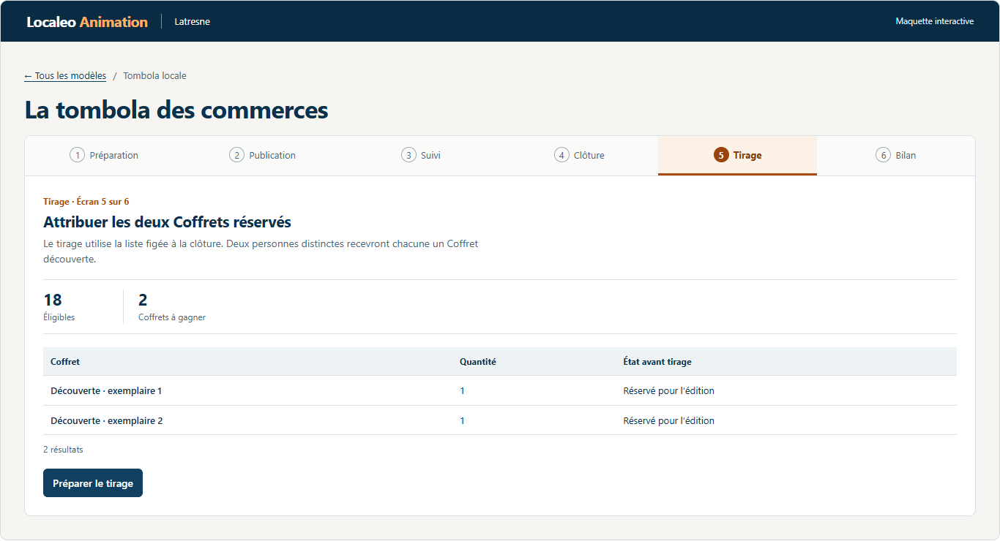
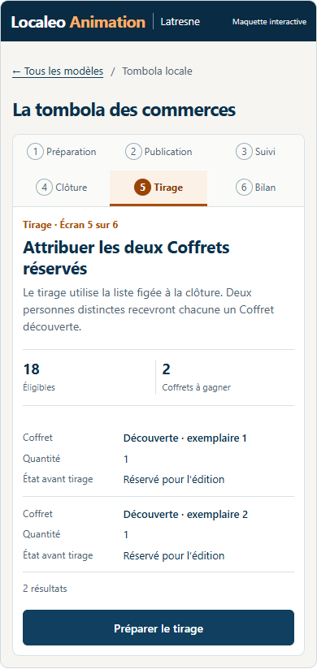

# EPIC 85 — Simplifier la gestion de chaque modèle d’animation

**En cours · Cadrage du 25 novembre 2026 · Localeo Animation**

[Roadmap commune](../README.md) · [Spécification de l’epic](../../specifications/epic-85-parcours-organisateur/README.md) · [Maquette des parcours par modèle](../../../livrables/design/animation/epic-85-parcours-organisateur/parcours.html) · [Maquette détaillée de la fiche](../../../livrables/design/animation/epic-85-parcours-organisateur/fiche.html)

## Principe directeur de la refonte

**Le gestionnaire doit pouvoir piloter chaque animation dans un parcours continu, de sa création à sa publication, puis pendant son déroulement, jusqu’à sa clôture et à la gestion du tirage au sort lorsqu’il s’applique.** Le résultat du tirage mène aux gains à traiter.

Au quotidien, le gestionnaire peut avoir une édition à publier, une autre avec un incident en cours et une troisième prête au tirage. Depuis le tableau de bord ou la liste, il doit reconnaître celle qui appelle son intervention, comprendre pourquoi et ouvrir directement le dossier concerné. Après son action, il voit le résultat, ce qui reste à faire et peut revenir à ses autres animations en conservant ses filtres.

Les modèles partagent les mêmes repères d’étape, les mêmes verbes pour un même geste et les mêmes conventions de tableaux, filtres, pagination et métriques. Le contenu s’adapte au jeu et à son état. Chaque choix de conception se juge sur une tâche concrète : aide-t-il le gestionnaire à décider, à agir ou à reprendre son travail avec moins de détours ?

## Problème et résultat attendu

Un gestionnaire ouvre une animation clôturée et choisit « Lancer le tirage ». Il arrive dans « Résultats », avec « Tirage » sélectionné dans une liste. Il doit encore déterminer si le tirage a eu lieu, où agir et quel bouton « Actualiser » utiliser. Ce parcours a été signalé par l’utilisateur. Le portail comporte bien une action de ce nom qui sélectionne la rubrique, ainsi que quatre groupes de navigation et des raccourcis variables selon l’état de l’édition. [Navigation actuelle](../../../../localeo-animation/src/app/components/AnimationDetailNavigation.tsx) · [Fiche et commande de tirage](../../../../localeo-animation/src/app/App.tsx)

À l’ouverture de la fiche, le gestionnaire doit pouvoir répondre à trois questions : **où en est mon édition, quel geste puis-je faire maintenant, et comment saurai-je qu’il a abouti ?** Pour une tombola clôturée, « Préparer le tirage » ouvre directement les éligibles et les lots. « Confirmer le tirage » déclenche l’attribution. Le résultat confirmé mène aux gains et aux remises. Pour une chasse en préparation, le même emplacement conduit à la mission commerçante en attente ou à la revue de publication. La préparation des QR des lieux publics reste accessible indépendamment de cette revue.

Le parcours commence par le choix du modèle dans le catalogue. Une création ou une demande accompagnée mène à la fiche de l’édition, également accessible depuis le tableau de bord ou les listes. Les gestionnaires en lecture seule, les responsables de publication et les personnes habilitées au tirage doivent chacun y retrouver leurs gestes. E85 reprend les exigences de productivité et de continuité d’E73 et porte la refonte transversale de la navigation. Les règles du jeu, les droits, l’offre commerciale et l’activation des modèles relèvent de leurs epics respectives. [Création commune E73](../../specifications/epic-73-animation-et-ou-coffrets/perimetres-parcours-saas.md) · [Parcours organisateur E73](../../specifications/epic-73-animation-et-ou-coffrets/parcours-organisateur.md) · [Productivité et atelier UX](../../specifications/epic-73-animation-et-ou-coffrets/ux-productivite-organisateur.md)

## Maquettes à parcourir

| Pour examiner… | Ouvrir et essayer |
| --- | --- |
| Le travail après publication | [Accès direct au déroulement, à la clôture, au tirage et aux dossiers de gains](../../../livrables/design/animation/epic-85-parcours-organisateur/creation-cloture/exploitation.html). Choisir un modèle et ouvrir l’une des quatre vues. Pour comparer les parcours sur papier ou à l’écran, consulter les [planches par modèle](../../../livrables/design/animation/epic-85-parcours-organisateur/creation-cloture/planches/index.html). |
| La création d’une édition jusqu’à sa clôture | [Neuf maquettes détaillées, une par modèle](../../../livrables/design/animation/epic-85-parcours-organisateur/creation-cloture/index.html). Saisir le nom et la période, définir la présentation, traiter les préparatifs du modèle, publier, suivre la participation, vérifier la population de fin et confirmer la clôture applicable. Les situations alternatives s’explorent dans l’étape concernée. |
| L’enchaînement pour un modèle | [Parcours interactifs](../../../livrables/design/animation/epic-85-parcours-organisateur/parcours.html). Ouvrir « Tombola locale », puis « Tirage ». Préparer, annuler, confirmer et suivre la fin après résolution des dossiers. Faire ensuite le même trajet sur un autre modèle. |
| Le travail quotidien dans la fiche large | [Fiche interactive](../../../livrables/design/animation/epic-85-parcours-organisateur/fiche.html). Ouvrir « Passeport commerçant », filtrer les participants, consulter un dossier et revenir à la liste. Passer au format téléphone et retrouver l’étape en cours. |

**Le tirage sur ordinateur**

**Le même tirage sur téléphone**

Les fichiers HTML s’ouvrent localement dans un navigateur. Les éditions, les chiffres et les écritures y sont simulés. Les huit vues détaillées sont consultables dès l’ouverture. Ouvrir directement une vue à venir charge un exemple indépendant. Les boutons de suite permettent de suivre une même édition et de conserver son résultat d’un écran au suivant. Les planches illustrent la création jusqu’à la clôture, puis le déroulement jusqu’au bilan. Dans le portail, la situation réelle de l’édition détermine les actions autorisées.

### Après la publication · E85-EVO-DEROULEMENT-TIRAGE · 25 novembre 2026

Lors de la première revue, le suivi présentait quelques compteurs et la simulation détaillée revenait au catalogue après la clôture. La proposition relie désormais quatre tâches dans la même fiche. Le statut de l’édition reste visible quand le gestionnaire consulte une autre rubrique.

| Travail du gestionnaire | Ce que présente la fiche | Prochain geste |
| --- | --- | --- |
| Piloter pendant la période ouverte | Un indicateur du modèle, la liste qu’il explique et un point à traiter. Par exemple, une chasse peut compter davantage de récits terminés que de joueurs qualifiés lorsqu’une preuve de passage manque. | Filtrer l’extrait, ouvrir le dossier, lire la preuve ou l’incident et revenir à sa page. Dans le Jeu des vitrines, consulter le nouveau contrôle puis confirmer la reprise pendant la période autorisée. |
| Contrôler et clôturer à l’échéance | Les éligibles, les situations hors tirage et la règle appliquée. Un retour au déroulement permet d’examiner une situation avant de décider. | Confirmer ou annuler la clôture. Le reçu indique ce qui est figé et ouvre le tirage applicable. Les gains sont attribués lors d’une confirmation distincte. |
| Préparer et confirmer le tirage | La population figée, les exemplaires disponibles, le nombre d’attributions possibles et les restrictions liées à la dotation. | Confirmer le tirage. Si la réponse est incertaine, relire l’opération en cours. Une confirmation retrouvée ouvre la liste des attributions et leurs dossiers. |
| Traiter les gains puis terminer | Pour chaque exemplaire, le bénéficiaire, la preuve attendue et la situation du dossier. Une réception de Coffret, une remise de lot externe et une consommation de bon requièrent des preuves différentes. | Traiter les dossiers ou justifier les unités restées sans gagnant. Une fois les dossiers résolus, « Terminer l’animation » demande une décision explicite et donne accès au bilan final. |

**Deux parcours de revue.** Dans la Tombola locale, partir de 27 passages et 18 personnes qualifiées, ouvrir un dossier avec plusieurs achats, clôturer sur les 18 personnes, puis tirer deux Coffrets et examiner leur réception. Dans la Tombola publique, distinguer les 21 inscriptions qualifiées des trois anciennes demandes en attente, puis suivre les deux bons numériques jusqu’au retrait. Les issues « population insuffisante » et « aucun éligible » dépendent de la nature des lots.

Le Calendrier de l’Avent conserve une population et un résultat **par journée**. La revue globale intervient au niveau du calendrier parent, avec les envois encore à traiter. Dans l’Escape Game en projet, le résultat est la réussite narrative de la mission. Le mode de récompense relève de l’arbitrage E79-ARB-07. Les vues de ces projets servent à examiner le parcours avant décision produit. [Calendrier E54](../a-faire/epic-54-calendrier-avent-local-backlog.md) · [Escape Game E79](../a-faire/epic-79-escape-game-assiste-ia-backlog.md)

Cette évolution précise les critères E85-CA-02 à 06, 09 et 10. L’interface organisateur présente les capacités et les résultats du domaine. À la livraison applicative, la recette devra vérifier les véritables refus, reçus, retraits dans Pro et droits de fin. Les commandes de tirage et de remise des maquettes utilisent uniquement des données fictives. [Gestion des lots E73](../../specifications/epic-73-animation-et-ou-coffrets/gestion-lots-remises.md) · [Fin et résolution des dossiers](../../specifications/epic-73-animation-et-ou-coffrets/fin-animation-archives.md)

### Accès direct aux maquettes de création à clôture

Dans la Chasse au trésor, l’organisateur commence par une demande accompagnée puis retrouve le récit et les missions commerçantes. [Aperçu de la préparation sur ordinateur](../../../livrables/design/animation/epic-85-parcours-organisateur/creation-cloture/chasse-preparation-bureau.png) · [Même étape sur téléphone](../../../livrables/design/animation/epic-85-parcours-organisateur/creation-cloture/chasse-preparation-mobile.png)

| Modèle | Situation que le gestionnaire peut examiner |
| --- | --- |
| [Passeport commerçant](../../../livrables/design/animation/epic-85-parcours-organisateur/creation-cloture/passeport.html) | Seuil, condition d’achat, accords et décompte des commerces distincts à la clôture. |
| [Tombola locale](../../../livrables/design/animation/epic-85-parcours-organisateur/creation-cloture/tombola-locale.html) | Consigne de caisse, financement des Coffrets, première validation qualifiante et population figée. |
| [Tombola publique](../../../livrables/design/animation/epic-85-parcours-organisateur/creation-cloture/tombola-publique.html) | Inscription sur place, support et code du jour, gestion des anciennes demandes et fermeture du formulaire. |
| [Chasse au trésor commerçante](../../../livrables/design/animation/epic-85-parcours-organisateur/creation-cloture/chasse.html) | Demande accompagnée, récit à relire, missions acceptées, supports publics facultatifs et preuves de passage à la clôture. |
| [Juste Prix Local](../../../livrables/design/animation/epic-85-parcours-organisateur/creation-cloture/prix.html) | Produits proposés, références acceptées, tolérance, passages, qualification et ouverture du corrigé. |
| [Jeu des vitrines](../../../livrables/design/animation/epic-85-parcours-organisateur/creation-cloture/vitrines.html) | Défis approuvés, installations contrôlées, suspension, reprise en période et traitement du cas encore suspendu à l’échéance. |
| [Mots croisés assistés par l’IA](../../../livrables/design/animation/epic-85-parcours-organisateur/creation-cloture/mots-croises.html) | Projet E75. Brief, version de grille, fiches commerçants et double condition de qualification avant fermeture. |
| [Calendrier de l’Avent local](../../../livrables/design/animation/epic-85-parcours-organisateur/creation-cloture/avent.html) | Projet E54. Programmation des cases, suivi du jour puis revue du calendrier entier après la dernière case. La règle de clôture de l’édition parente reste à préciser. |
| [Escape Game assisté par l’IA](../../../livrables/design/animation/epic-85-parcours-organisateur/creation-cloture/escape-game.html) | Projet E79. Brief, contrôle du scénario et des énigmes, suivi des parties et revue des réussites à l’échéance. Les conséquences sur les récompenses restent à arbitrer. |

## Organisation de la fiche et de ses onglets

La fiche utilise la largeur disponible. Son en-tête garde le nom de l’édition, la commune, l’état métier et le prochain geste autorisé. Une seule barre permet de passer d’une étape à l’autre et distingue l’étape en cours de la rubrique consultée. Le menu Actions regroupe les gestes secondaires de l’édition. Ainsi, lire une fiche participant pendant une édition ouverte conserve le repère « En cours ». Une action qui conduit à une autre rubrique ouvre directement sa destination.

| Destination ou tâche | Contenu regroupé | Geste facilité |
| --- | --- | --- |
| Préparation | Assistant, configuration, invitations et préparation terrain selon le modèle | Reprendre le dernier point bloquant, identifier qui doit intervenir et revenir à la revue. |
| Publication | Conditions, contrôles, aperçu et blocages | Corriger l’élément concerné, revenir à la revue, puis publier explicitement. |
| Participation | Tableau des participants, qualifications, validations et incidents applicables | Passer d’un indicateur à la liste correspondante puis au dossier, en conservant les critères au retour. |
| Communication, accessible pendant le travail | Communication, messages habitants, actualités, flyer, liens et QR de diffusion | Accéder au support ou à la conversation dans la même édition, selon les droits. |
| Clôture et fin | Fermeture des participations, population figée, dossiers à résoudre, fin et archivage | Distinguer « Clôturer », « Terminer » et « Archiver ». Reprendre un dossier depuis le contrôle qui le signale. |
| Tirage et gains | Aperçu du tirage applicable, confirmation, résultat, gains et remise selon la dotation | Consulter les effets avant confirmation puis ouvrir la prochaine action sur un gain. |
| Bilan et historique | Indicateurs autorisés à la phase courante, bilan final, comparaison et audit | Comprendre les chiffres et leur périmètre, puis retrouver le détail ou l’archive avec les droits requis. |

Cette table affecte une destination aux rubriques existantes. Sur téléphone, la proposition privilégie l’étape courante et les accès directs. La recette prévoit une comparaison avec le dispositif E73, qui propose jusqu’à trois raccourcis mobiles et un sélecteur complet. Le choix final doit permettre d’atteindre les rubriques secondaires au clavier et au toucher, sans imposer le détour onglet → liste déroulante pour l’action principale.

## Couverture des modèles

Les six modèles ci-dessous ont une stratégie implémentée. Leur ouverture dépend du catalogue et des droits de la commune. Chaque ligne fournit une situation de recette dans laquelle une interface trop générique ferait perdre une information métier.

| Modèle | Préparer et exploiter | Clôturer et vérifier |
| --- | --- | --- |
| Passeport commerçant | Inviter les commerces, annoncer le seuil et le choix « Achat requis » ou « Visite sans achat ». Suivre les tampons par commerce distinct. | Expliquer pourquoi deux visites au même commerce ne complètent pas un passeport, puis retrouver les qualifiés et leurs lots. |
| Tombola locale | Faire valider l’achat chez un commerce participant. Distinguer le nombre d’achats du nombre de personnes qualifiées. | Le premier achat validé donne une chance. Un deuxième achat du même participant conserve cette chance unique. |
| Tombola publique | Préparer le lien public ou le QR sur place et le code du jour quand il s’applique. Suivre les inscriptions directes et les anciennes demandes en attente. | Figer les inscriptions qualifiées. Un éventuel retrait de bon chez un commerçant intervient après le gain. |
| Chasse au trésor commerçante | Revoir la version du parcours, les missions acceptées, les étapes et les supports vérifiés sur place. | Un récit achevé avec une preuve requise manquante reste identifiable. Le tirage utilise les personnes effectivement éligibles. |
| Juste Prix Local | Approuver les produits et prix de référence. Annoncer la tolérance, le seuil de commerces distincts et les passages requis dans ces commerces. | À clôture confirmée, ouvrir le corrigé aux participants autorisés, même si le tirage est en attente. Présenter les agrégats autorisés dans le bilan. |
| Jeu des vitrines | Contrôler les installations. En cas de suspension, montrer les incidents, les nouveaux contrôles exigés et la possibilité de reprendre dans la période. | Si la suspension persiste à l’échéance, orienter vers l’annulation selon les droits. Sur une édition reprise puis clôturée, présenter les qualifiés et le corrigé autorisé. |

**Trois modèles en projet** éprouvent la capacité de la navigation à accueillir un nouveau jeu. Leur développement et leurs arbitrages restent dans leurs backlogs.

| Modèle prospectif | Ce que la maquette permet d’évaluer |
| --- | --- |
| [Calendrier de l’Avent local · E54](../a-faire/epic-54-calendrier-avent-local-backlog.md) | Identifier la case ouverte et les résultats d’une journée tout en gardant le calendrier ouvert. Relier les populations quotidiennes au bilan global. |
| [Mots croisés assistés par l’IA · E75](../a-faire/epic-75-mots-croises-assistes-ia-backlog.md) | Valider la version de la grille et les fiches indices. Reconnaître qu’une grille correcte et tous les passages requis sont nécessaires à la qualification. |
| [Escape Game assisté par l’IA · E79](../a-faire/epic-79-escape-game-assiste-ia-backlog.md) | Revoir le scénario importé puis le parcours terrain sur un téléphone. Distinguer la réussite de l’énigme finale d’une récompense éventuelle, dont E79 doit encore fixer le mode. |

## Plan de réalisation proposé

1. **Refondre la navigation sur une tranche complète.** Cartographier les liens existants, du tableau de bord aux dossiers. Traiter d’abord la Tombola locale, du bouton d’en-tête à la confirmation du tirage et à la première remise. Comparer le nombre de changements de rubrique avec le parcours actuel.
2. **Harmoniser le contenu des onglets.** Appliquer les composants de gestion aux listes, filtres, compteurs, états vides et erreurs. Étendre aux tâches transversales de communication, de fin et de bilan. Vérifier le retour d’une fiche détail vers sa page de résultats.
3. **Décliner les six modèles et éprouver les exceptions.** Exécuter les scénarios de la matrice sur ordinateur et téléphone. Examiner les trois parcours prospectifs en revue de conception. Actualiser les guides des gestes qui évolueront lors de la livraison.

## Critères d’acceptation

| Critère | Situation de recette | Résultat attendu |
| --- | --- | --- |
| E85-CA-01 | Ouvrir une édition depuis le tableau de bord, une liste ou un lien direct. | Nom, commune, étape métier et rubrique consultée sont identifiables. Le prochain geste autorisé conduit à la même destination depuis chaque entrée. |
| E85-CA-02 | Ouvrir une édition clôturée prête au tirage et choisir « Préparer le tirage ». | En une activation, le gestionnaire voit la population figée, les lots et les conditions. Aucun choix supplémentaire de rubrique et aucune attribution à l’ouverture. |
| E85-CA-03 | Annuler puis confirmer un tirage autorisé. Simuler un double clic et une réponse incertaine. | L’annulation préserve les lots. La confirmation rend le résultat ou l’état de traitement explicite. Une relecture ciblée retrouve l’opération, sans second tirage. |
| E85-CA-04 | Traiter une édition bloquée, déjà tirée, en lecture seule ou sans tirage applicable. | La fiche affiche la cause ou le résultat disponible et propose le geste permis. Une simple consultation et un changement d’onglet préservent l’état métier. |
| E85-CA-05 | Depuis « Suivi », comparer deux modèles puis ouvrir le détail d’un indicateur. | Même alignement et même ordre de lecture. Chaque métrique nomme l’unité, le périmètre ou la période utile. La liste ouverte reprend ce périmètre et distingue total de l’édition et total filtré. |
| E85-CA-06 | Rechercher, filtrer, changer de page, ouvrir un dossier puis revenir. | Les libellés et les commandes de pagination sont cohérents. Total filtré, page courante et bornes sont visibles. Changer un critère repart en première page. Au retour, critères, page et focus sont retrouvés. |
| E85-CA-07 | Une lecture locale échoue pendant une saisie ou après une commande réussie. | La navigation et la saisie restent en place. Un seul contrôle de relecture par résultat concerné permet de réessayer. L’interface distingue chargement, liste vide, absence de correspondance, refus et erreur. |
| E85-CA-08 | Retrouver Participants, Validations, Communication, Gains et Audit depuis une fiche et un ancien lien. | Chaque destination autorisée reste accessible et rattachée à l’édition. Le retour restaure le contexte. Un départ avec saisie en cours conserve la protection existante. |
| E85-CA-09 | Depuis le catalogue, créer une édition de chacun des six modèles, ou transmettre sa demande accompagnée. Après publication, examiner un dossier de participation ou un incident jusqu’à sa résolution applicable, contrôler la population à l’échéance et clôturer. | Le reçu de création est explicite. Les preuves de participation et la règle du jeu expliquent le décompte à la clôture. Le reçu de clôture conduit directement au tirage ou à la suite autorisée. Rejouer au moins un blocage pertinent par modèle. Les droits et la confidentialité sont préservés. |
| E85-CA-10 | Tester les dotations Coffrets, lots libres et bons numériques, puis une édition avec un dossier non résolu. | Les contrôles portent sur la dotation réelle. Après le tirage, la prochaine action concerne l’envoi, la remise ou le retrait approprié. Terminer puis archiver suit les conditions de fin existantes. |
| E85-CA-11 | Parcourir au clavier et au toucher la même fiche à 320 et 390 px, sur grand écran et avec texte agrandi à 200 %. | Étape et sélection ont un libellé lisible en plus de leur couleur. Les valeurs gardent leur en-tête sur mobile. Le gestionnaire peut atteindre chaque action autorisée et lire son retour sans défilement horizontal de la page. |
| E85-CA-12 | Revue d’usage avec plusieurs animations à des étapes différentes. Depuis la liste filtrée, repérer une publication en attente, traiter un incident sur une autre édition, puis retrouver une édition clôturée prête au tirage. | Pour chaque tâche, vérifier que le gestionnaire identifie l’édition, l’étape et le motif d’intervention, atteint l’action appropriée, comprend son résultat et retrouve sa liste filtrée. Comparer au trajet actuel les détours et les hésitations avant confirmation. Corriger les confusions d’étape ou de commande avant validation. |

## Impacts et passage à la spécification

| Sujet | Impact initial |
| --- | --- |
| Localeo Animation | Application concernée. Cartographier les 18 rubriques actuelles, les recommandations, les liens entrants, la protection de saisie et les composants de gestion réutilisables. [Conventions de recherche et d’actualisation](../../architecture/transverse/conventions-backoffice.md) |
| Backend, API et données | La recommandation serveur « Lancer le tirage » est consommée par plusieurs entrées. Vérifier son libellé et sa destination sur chacune. Le domaine décide des transitions, droits, éligibilités, tirages et remises. Examiner les états de commande disponibles pour chaque dotation. Aucune migration identifiée au cadrage. [Règles de recommandation](../../../../localeo-backend/app/domaine/animation_locale/services/recommandation_animation.py) |
| Localeo Pro, Live et ERP | Vérifier la continuité aux frontières concernées, notamment accord commerçant, validation de passage, accès au corrigé et remise du lot. L’interface à refondre est celle de l’organisateur. |
| Générateur et fixtures | Réutiliser les éditions de démonstration représentatives. Vérifier la disponibilité des cas suspendu, population vide, résultat incertain, dossier à résoudre et édition archivée. Compléter les fixtures nécessaires à la recette. |
| Documentation | Le [guide Animation](../../produit/formation/animation/guide-quotidien-animation.md) décrit les entrées de suivi et de tirage à réviser avec leurs captures et le PDF lors de la livraison. Le [guide Commerçant](../../produit/formation/commercant/guide-quotidien-commercant.md) décrit la validation et la remise dans Pro. Vérifier la cohérence de ces gestes et des libellés partagés. |
| Exploitation | Pas de changement d’environnement demandé pour le cadrage. À la livraison, vérifier liens directs, droits et accès aux archives sur la cible prévue. |

[Implémentation locale, couverture et recette restant à effectuer](../../specifications/epic-85-parcours-organisateur/verification-livraison.md)

**Choix mobile à éprouver.** La spécification propose un accès direct au geste principal et une entrée « Toutes les rubriques » pour les destinations secondaires. La comparaison avec la navigation E73 porte sur trois tâches : retrouver les messages habitants, reprendre un dossier de gain et revenir à la liste filtrée. [Spécification du parcours](../../specifications/epic-85-parcours-organisateur/README.md) · [Recette comparative](../../specifications/epic-85-parcours-organisateur/recette.md)
