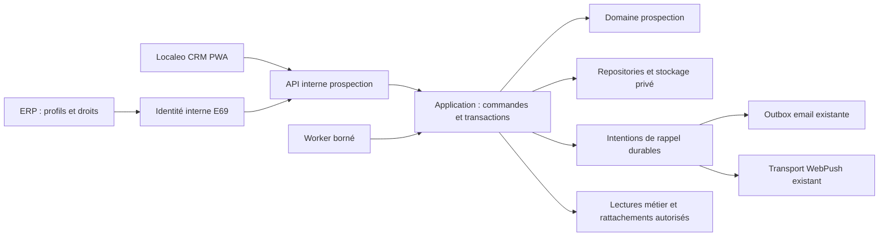

# E71 — Architecture de Localeo CRM

**E71-EVOL-10, 12 novembre 2026 — implémenté :** les
[contrats de productivité](ux-productivite.md#propriétaires-contrats-cibles-et-compatibilité)
ajoutent des projections lisibles bornées, une portée quotidienne explicite et la
réutilisation des lectures contacts/preuves/agenda/jobs. Les règles de domaine
ci-dessous restent propriétaires ; aucune mutation implicite depuis l’UI.
L’OpenAPI V1.6 est régénérée depuis les routes et DTO exécutables. Pas de migration.

- `GET /internal/prospection/aujourdhui` : `portee=MOI|EQUIPE`, trois pages de
  tâches bornées à 25 par défaut, compteurs par groupe, `instant_reference` UTC et
  `date_reference` Paris. `contexte_journee` signé conserve le même instant, même
  lors du retour à la première page ; les curseurs incluent portée, identité,
  groupe et limite. Les noms de prospects/responsables et prochaines actions
  sont des projections SQL de page, sans lecture par résultat. Aucune mutation.
- Tâches/dossiers : `prospect`, `responsable`, `prochaine_action` ; historique :
  `texte_affiche`, `auteur_nom`. Le texte d’audit original reste conservé.
  Téléphone utilisable : `sollicitation_telephone_autorisee` traduit la politique
  de domaine avec les oppositions, sans se limiter à la première page de contacts.
- Références et rattachements : `libelle`, `reference`, `statut`, `cible_nom`,
  `eligible`. Le gain revalide la preuve dans sa transaction ; l’état affiché
  n’autorise aucune transition à lui seul. Recherche SQL filtrée et pages bornées.
- Lectures de disponibilités : `rendez_vous_id` facultatif exclut seulement
  l’occupation autorisée à reporter. Le curseur est lié au rendez-vous et à sa
  version ; la commande revalide collision, responsable, droits et version.
- Les unités de calcul exposent `organisation_nom` par jointure de page. Le lot
  d’import expose source lisible/namespace sans révéler `authority_reference`.

Les modules de présentation ne conservent pas de résultats privés dans les
stockages du navigateur. Retour/page/position sont limités à l’historique de
l’onglet avec une portée mémoire, invalidée à la perte des droits. Un 403 limité
reste un refus métier uniquement après confirmation du contexte CRM courant ;
401 ou consultation retirée effacent la surface. Les assistances ne déclenchent
aucune écriture sans confirmation, ni nouveau canal de notification.

Conception V1.1 du 3 novembre 2026, étendue par **V1.2 du 4 novembre**. Implémentation locale et limites dans le bilan de vérification. [Périmètre](README.md), [parcours](parcours-regles.md), [import](import-carte.md), [preuves](verification-livraison.md). Application de l'[ADR domaine d'abord](../../architecture/decisions/ADR-2026-08-28-domaine-avant-services-applicatifs.md) et des [bornes de performance](../../architecture/transverse/performance-volumetrie.md).

## Existant au cadrage et implantation retenue

Constat historique de cadrage sur `2e896ae` : aucun domaine/API/table CRM à cette date. Le CRM et l’extension sont désormais implémentés dans le backend ; le tableau suivant décrit les briques réutilisées au cadrage.

| Source actuelle | Réutilisation et limite |
| --- | --- |
| [Identité interne](../../../../localeo-backend/app/domaine/identite_acces/acces_interne.py) | Profils LECTEUR/BACKOFFICE/FINANCE et combinaisons, portée globale, catalogue fermé d'autorisations et version d'habilitation ; pas de droits CRM actuels |
| [Comptes internes API](../../../../localeo-backend/app/api/comptes_internes_api.py) | DTO à autorisations fermées et limite actuelle de liste ; ajouter CRM exige modifier domaine, contrat et écran ERP ensemble |
| [Sécurité ERP](../../../../localeo-backend/app/security/erp.py), [commande interne](../../../../localeo-backend/app/security/commande_interne.py) | Session, CSRF et relecture transactionnelle des droits ; aucune identité CRM parallèle |
| [Registre routes](../../../../localeo-backend/app/security/capacites_routes.py), [menus](../../../../localeo-backend/app/infrastructure/erp/permissions.js) | Déclaration fermée des capacités et destinations ; une route inconnue n'est pas autorisée par défaut |
| [Coquille Atelier](../../../../localeo-backend/app/api/atelier_ui.py), [sécurité Atelier](../../../../localeo-backend/app/security/atelier.py) | Patron satellite avec session interne, ressources d'installation neutres et pages privées no-store ; à adapter pour CRM |
| [Cycle PWA](../../../../localeo-backend/app/infrastructure/pwa/lifecycle.py) | Versions et mises à jour communes ; ajouter identité/périmètre CRM, pas un mécanisme concurrent |
| [Email sortant](../../../../localeo-backend/app/domaine/exploitation/entities/email_sortant.py), [batch](../../../../localeo-backend/app/application/exploitation/use_cases/emails_batch.py), [rendu](../../../../localeo-backend/app/infrastructure/email/branding.py) | Outbox/planification/envoi et charte réutilisables ; garde de validité CRM nécessaire jusqu'à l'envoi |
| [Transport WebPush](../../../../localeo-backend/app/security/webpush.py), [adaptateur organisateur](../../../../localeo-backend/app/infrastructure/communication/webpush_organisateur.py) | Validation et résultats transport ; abonnements Live/commerçants non transférables à un utilisateur interne CRM |
| [Géographie](../../../../localeo-backend/app/infrastructure/integrations/geo_api_gouv.py) | Résolution nom/code postal/INSEE/position et centre communal ; pas de fond de carte ni géocodage établissement. API publique des villes insuffisante pour un référentiel CRM national ; aucun moteur cartographique existant trouvé |
| [Deltas import commerçant](../../../../localeo-backend/app/domaine/referencement/imports_commercants/deltas.py) | Principes de provenance, vide sans effacement et protection locale utiles ; ce producteur crée des commerçants, il ne doit pas importer les prospects |
| [OnBoard](../../../../localeo-backend/app/api/onboarding_commercant_api.py), [partenaire Animation](../../../../localeo-backend/app/application/animation_locale/use_cases/referencer_partenaire_animation.py) | Parcours métier avec leurs propres droits et effets : création d'accès/commande/checkout possibles pour partenaire ; jamais appelés automatiquement par le CRM |

**Implantation actualisée le 4 novembre 2026 :** satellite PWA servi par `localeo-backend` sous `/internal/crm/`, avec adresse dédiée `crm.localeo.city` et `test-crm.localeo.city`. `CRM_PUBLIC_ORIGIN` désigne une origine HTTPS exacte, sans chemin ni paramètres ; vide, elle conserve les accès backoffice historiques. La racine de cet hôte redirige vers `/internal/crm/` ; les autres hôtes gardent leur accueil. L'hôte est contrôlé par `LOCALEO_TRUSTED_HOSTS`, jamais déduit de `X-Forwarded-Host`. La navigation ERP consomme l'URL CRM publiée dans le contexte, après contrôle de ses droits sur le chemin interne.

Même compte interne et mêmes habilitations gérées dans ERP, mais **connexion distincte par domaine** : cookies host-only, CSRF et révocation conservés. Aucun cookie inter-domaines ni ajout CORS. Connexion, API, assets et PWA restent sur l'origine courante ; les retours de connexion n'acceptent que les destinations CRM fermées existantes. Le formulaire du domaine dédié porte l'identité CRM et l'administrateur historique retrouve aussi sa destination CRM. L'ancien domaine reste utilisable. PWA installées et abonnements WebPush restent attachés à leur origine : installation et activation volontaire sur le nouveau domaine nécessaires. Aucun déplacement de données ni migration de base.

## E71-EVOL-04 — extension de qualification implémentée

La [spécification V1.2](qualification-structuree.md) complète ce socle avec les
propriétaires des attributs d’identité/activité, observations de potentiel,
preuves terrain, relations EPCI/couverture, fiabilité des contacts et projets
Animation. Elle décrit les projections, versions/protections, index, migration
additive et CSV format 2 en coexistence avec le format 1. Cette évolution dispose de ses API, domaine, persistance v293, PWA et import 2 ; les résultats historiques ci-dessous
représentent le socle livré, pas la nouvelle extension.

## Domaine et invariants

Domaine **prospection**, enregistré dans les index/tags et contrôles. `app/domaine/prospection` décide ; `app/application/prospection` orchestre ; API, UI et workers présentent/adaptent. Pas d'ORM, fournisseur, session HTTP ou lecture d'environnement dans les règles pures.

| Propriétaire cible | Invariant et déclencheur | Entrées / preuve |
| --- | --- | --- |
| `OrganisationProspect` et contacts | Identités CRM indépendantes des comptes clients ; notes, opposition et protections locales jamais remplacées par import ; contact obsolète non réactivé implicitement | Saisie, import, archivage ; même résultat/refus quelle que soit l'entrée |
| `OpportuniteProspection` et `AttributionPreuveGain` | Périmètre/objectif, transitions et preuve canonique ; une preuve attribuée à un seul dossier, aucun paiement/activation créé par statut | Commande API, gain concurrent refusé atomiquement ; réouverture sans double gain |
| `EvenementProspection` | Auteur/date/provenance, correction reliée et contenu distinct de l'audit technique | Notes/appels et note initiale importée ; ajout idempotent, pas de réécriture silencieuse |
| `TacheProspection` | Responsable habilité, échéance, cycle et révision du rappel ; tâche terminale ne produit plus d'envoi | API, report et worker ; course terminer/envoyer, ancienne révision invalidée |
| `PolitiqueSollicitation` | Opposition/archivage bloquent les sollicitations sans empêcher note factuelle ; levée autorisée explicite | Saisie, import, rappel ; relecture atomique avec mutation |
| `LotImportProspection` et politique de complément | Clés stables, mode INIT/UPSERT, complément uniquement autorisé, résultat atomique par groupe et plan immuable | API/worker/reprise ; même lot ou clés ne doublent pas les objets |
| `IntentionRappelCRM` | Destinataire interne courant, préférence et droit actuels ; unicité par tâche/révision/canal/appareil | Ordonnanceur, expédition et retries ; aucun rappel vers prospect |

La liste, les compteurs et la prochaine action sont des projections. Une fiche n'hydrate pas toute sa chronologie. Le service applicatif charge faits et versions, vérifie autorité, appelle le domaine et persiste objet/événement/outbox dans la même transaction. L'UI ne décide ni du gain ni du remplacement d'un champ importé.

### Attribution d’une preuve de gain — ARB-04b confirmé

`AttributionPreuveGain` est une règle de Prospection, alimentée par les ports de
lecture des domaines canoniques. Clé typée unique : `(type_preuve, reference_id)`
où `type_preuve` distingue commande Coffrets, souscription Animation et acceptation
commerçant (référence du dossier OnBoard accepté, dont le commerce lié est vérifié).
La cible doit correspondre à l’organisation/rattachement et à l’objectif du dossier.
Une référence déclarée par le navigateur ne vaut jamais preuve de son état.

La validation de la preuve, l’attribution, la transition et l’événement sont une
même unité transactionnelle, avec contraintes SQL sur la clé typée et versions du
dossier. Verrouiller les faits canoniques nécessaires via leurs ports/UoW selon un
ordre commun documenté, sans écriture dans le domaine producteur : une annulation
concurrente doit soit précéder le refus du gain, soit suivre un gain déjà constaté.
Deux dossiers gagnant avec la même preuve : un seul commit, l’autre reçoit 409
`PREUVE_GAIN_DEJA_ATTRIBUEE`, sans transition ni effet partiel. Un rejeu sur le
même dossier retourne l’effet déjà confirmé ; une réouverture conserve l’attribution.
Les liens de consultation sont une relation distincte, sans cette exclusivité.

Aucune suppression d’attribution à l’archivage ni transfert automatique en V1.
Le compteur de gains utilise les clés de preuve distinctes, avec date de première
attribution dans la période, et ne double pas un gain après réouverture. Les états
financiers actuels restent consultés chez leur producteur, jamais recalculés en CRM.

## Droits distincts gérés dans l'ERP — CA-19/29

Codes cibles **`crm.consulter`**, **`crm.gerer`**, **`crm.importer`**, **`crm.administrer`**, à ajouter au catalogue E69 et ses projections. Attribution/révocation uniquement par l'administration des comptes internes existante. Posséder `crm.administrer` ne donne jamais le droit de s'attribuer des habilitations.

| Autorisation | Attribution proposée | Capacités |
| --- | --- | --- |
| Consulter CRM | Attribution explicite sur LECTEUR, BACKOFFICE ou FINANCE | Ouvrir PWA, listes et fiches ; lecture seule |
| Gérer CRM | Attribution explicite sur BACKOFFICE | Saisie, notes, tâches, opposition protectrice, dossiers et archivage ; inclut consulter |
| Importer CRM | Attribution explicite sur BACKOFFICE avec gérer | Fichier, aperçu, confirmation, reprise et rapports privés |
| Administrer CRM | Attribution explicite sur BACKOFFICE avec gérer | Levée d'opposition motivée et correction sensible de lien source ; pas de gestion des comptes ERP |
| Administrateur plateforme | Comportement administratif existant conservé | Toutes les capacités selon les contrôles administrateur actuels, audit inchangé |

Aucune attribution automatique aux comptes non administrateurs existants, même Backoffice ou Finance. L'ERP affiche une section « Localeo CRM » et ses cases de droits dépendantes ; refus serveur si combinaison incohérente. Le catalogue actuel `ROLES_AUTORISATIONS_DEDIEES` associe une autorisation à un seul rôle : la consultation CRM autorisée pour trois rôles requiert une relation vers un ensemble de rôles éligibles (ou une politique équivalente explicite). Conserver strictement les rôles éligibles des autorisations existantes ; tester cette cardinalité et la non-régression. Les listes fermées, limites DTO, catalogue, registre des routes, projection de session, menus et tests de profils évoluent ensemble. Ne pas utiliser `metier.consulter` comme substitut.

Les droits ERP déjà possédés par un profil restent les siens. Un utilisateur **exclusivement CRM sans aucun autre droit ERP** demanderait une évolution du modèle de rôles, hors demande actuelle. Les données CRM sont un portefeuille interne global ; « Mes dossiers » filtre par responsable, ce n'est pas une isolation par ville/tenant. Aucune donnée CRM n'est accessible aux comptes commerçants/partenaires/habitants.

Lectures vérifiées à chaque requête ; mutations et imports différés relisent l'autorité courante avec `authorization_version`. Révocation pendant traitement : suspendre les unités suivantes, ne pas annuler les groupes déjà validés. Une ancienne clé d'idempotence ne contourne pas la révocation. Rattachement et gain exigent aussi les droits de lecture/commande du domaine cible ; masquer un lien interdit ne remplace pas ce contrôle.

## PWA, session et confidentialité

Manifest propre, `id`, `start_url` et scope `/internal/crm/`, icônes et nom CRM ; service worker limité à ce chemin. Les fichiers d'installation sont neutres. Shell statique versionné seulement en cache ; toutes pages privées, API, notes, contacts, fichiers/rapports et réponses d'erreur privées sont `Cache-Control: no-store` et exclus du SW. Pas de persistance de fiche ou brouillon dans LocalStorage/IndexedDB. Purge des caches privés historiques éventuels à l'installation de la nouvelle version.

Reprendre le cycle de mise à jour PWA existant : proposer une mise à jour uniquement si une version nouvelle est disponible, préserver les saisies en cours avant rechargement. Déconnexion purge les données en mémoire et détache les abonnements CRM de cette session/appareil ; changement de compte ne réutilise aucun abonnement lié à l'ancien utilisateur. En compte révoqué, bloquer l'accès sans afficher une ancienne fiche.

Authentification interne et CSRF sur mutation ; destination de retour autorisée dans CRM uniquement, aucun redirect libre. Le clic sur un rappel passe par session puis contrôle d'accès courant. Pas de token de session, contact ou note dans un URL/payload push. Permissions navigateur WebPush demandées seulement après action explicite. Tester installation, routes profondes, rechargement, offline, refus de permission et retrait d'accès sur mobile/PC.

## Contrat API cible

### Totaux et repères de pagination — correctif du 4 novembre 2026

Les pages du portefeuille, enfants de fiche, qualifications, lots et groupes
d’import acceptent **`avec_total=true`**, facultatif et désactivé par défaut.
La réponse ajoute `total` (nombre exact selon les filtres avant curseur),
`position` (nombre de résultats précédant la page, base zéro) et
`total_calcule_le` (date UTC). Un total nul reste zéro. Sans cette option, les
métadonnées sont absentes et aucun comptage supplémentaire n’est effectué.
Les sélecteurs de candidats/preuves et les référentiels ne sont pas concernés.

Le comptage réutilise les prédicats SQL de la page et ses droits/périmètres ; les
relations enfants restent exprimées par `EXISTS` pour ne pas multiplier les
prospects. Un curseur invalide est refusé avant tout comptage. Le rang d’un
curseur ouvert directement est obtenu par agrégat sur la même sélection, sans
`OFFSET`. Les lignes restent sélectionnées par clé avec `limit+1`, limite 25
par défaut et maximum 100 ; aucun chargement intégral en mémoire.

La PWA demande le total uniquement au premier chargement d’une recherche, puis
conserve ce repère daté en mémoire pour les flèches. Une actualisation ou un
changement de filtres relance le calcul. La navigation reste vivante : une
modification concurrente peut rendre le total initial ancien ; aucun instantané
exhaustif du portefeuille n’est annoncé. L’historique de navigation ne progresse
qu’après une réponse réussie.

Le calcul dédié est limité à deux comptages concurrents par processus, attente
maximale cinq secondes et timeout SQL cinq secondes. Saturation : HTTP 503
`CRM_LECTURE_SATUREE`, sans données CRM dans l’erreur ni cache de réponse privé.
Le budget local de première recherche avec total est 1 s sur les jeux synthétiques
10 000/100 000 ; il ne remplace pas les réserves de capacité du socle ou une
mesure de trafic en hébergement. Aucune migration ni changement de droits.

Préfixe **`/internal/prospection`**, tags `internal` et `prospection`. Source canonique de conception : ce dossier ; générateur OpenAPI à maintenir dans le backend à l'implémentation, export documentaire contrôlé ici si consommé. Aucun endpoint ci-dessous annoncé existant. Consommateurs : PWA CRM, ERP pour habilitations/liens, worker de rappels/import. Les contrats publics Pro/Animation/Live ne changent pas.

| Famille | Commandes et lectures principales | Accès |
| --- | --- | --- |
| Prospects | GET/POST `/organisations`, GET/PATCH `/organisations/{id}` ; contacts paginés et PATCH ciblé ; archivage explicite | Consulter / gérer |
| Dossiers | GET/POST `/opportunites`, GET/PATCH cible, POST `/{id}/transitions` et `/{id}/rattachements` | Consulter pour GET / gérer pour mutation + droits métier si nécessaire |
| Chronologie | GET/POST `/organisations/{id}/evenements`, dossier optionnel vérifié ; correction référant événement/version | Consulter / gérer |
| Tâches | GET/POST `/taches`, POST `/taches/{id}/actions` (terminer/reporter/annuler/réaffecter), GET `/rappels` | Consulter / gérer ; cible et responsable autorisés |
| Oppositions | POST `/organisations/{id}/oppositions` (cible structure ou `contact_id` de cette structure), POST `/oppositions/{id}/levee` | Gérer pour protéger / administrer pour lever |
| Carte / communes | GET `/carte` (filtres, bbox/zoom, groupes bornés, coloration facultative PRIORITE ou RESPONSABLE), GET `/communes` (recherche bornée), POST `/organisations/{id}/localisation` (INSEE confirmé/version) | Consulter / gérer |
| Tableau | GET `/tableau-de-bord`, `/indicateurs`, `/responsables` | Consulter ; responsables éligibles seulement |
| Import | GET/POST `/sources-import` ; POST `/imports` multipart fichier + source/mode/format/responsable ; GET lot/aperçu/rapport ; POST décisions/confirmation/reprise/arrêt | Importer ; administration en plus pour changer un lien source existant |
| Notifications | GET/PATCH `/preferences-rappels/me`, POST `/abonnements-push`, DELETE `/abonnements-push/{id}` | Gérer ; propriétaire imposé par session, pas par corps |

Collections d’objets CRM (hors projection cartographique agrégée, plafonnée explicitement à 500 groupes) : `limit=25`, maximum 100, curseur keyset opaque lié à filtres/tri/version/autorité, `items`, `next_cursor`, `has_more`. Fiche = résumé et sous-listes paginées ; pas de tableau illimité de contacts/tâches/notes. Recherche nom/commune/email/téléphone normalisés ; index adaptés, champs libres exclus des logs. Prévoir tri `(updated_at DESC,id DESC)` avec navigation vivante annoncée ; rappels `(due_at,id)`. Un changement de filtre invalide le curseur ; aucun total exhaustif obligatoire à chaque page. Carte : projection agrégée `groups/truncated/bbox/zoom/generated_at` et totaux distincts, sans curseur ; son clic ouvre une liste de prospects keyset 25/100. Au-delà de 500 groupes, agréger ou signaler la troncature et demander zoom/filtre.

La [coloration E71-EVOL-09](import-carte.md#e71-evol-09--deux-axes-de-lecture-12-novembre-2026)
ajoute une répartition par groupe et une légende limitée aux communes affichées.
La route utilise des DTO fermés `CarteHistoriquePayload`/`CarteColoreePayload` ;
la PWA consomme directement ces projections, sans copie du contrat dans un autre
frontend. Les priorités réutilisent la projection de validité existante ; les
responsables viennent de la fiche prospect. Les 24 responsables détaillés et le
reliquat sont agrégés dans le même snapshot que les effectifs, en une lecture SQL.
Les palettes communes restent dans `crm-priorite.js`. Le serveur ne transmet
aucun code couleur arbitraire ni attribut personnel au fournisseur de tuiles.

Commandes POST/PATCH/DELETE métier : `Idempotency-Key` ; modification : `expected_version`. Clé liée à acteur/action/cible/empreinte, conflit si corps différent. `DELETE` abonnement contient version et conserve l'idempotence de révocation. Réponses de mutation : identifiant/version/effet confirmé. API stricte : champs inconnus refusés, IDs cross-prospect refusés, serveur décide auteur et destinataire. Tâche sollicitante : cible STRUCTURE ou contact_id du même prospect, canal explicite ; contrôler opposition globale, du contact et de la coordonnée normalisée réutilisée. Les lectures de rattachements ne révèlent que les résumés métier autorisés.

La lecture paginée des échanges expose `auteur_nom` (prénom et nom actuels,
nullable) en complément de `auteur_id`, conservé pour l'audit. Les identités
internes `interne:<UUID>` et les UUID historiques sont résolus côté serveur,
en une requête groupée sur les seuls auteurs de la page (100 échanges maximum),
après filtrage et pagination. Aucun parcours de l'annuaire complet, aucune
requête par échange, aucune coordonnée ou donnée de session exposée. Un auteur
introuvable ne retire pas l'échange. La PWA affiche le nom en texte échappé,
ou « Utilisateur indisponible », et conserve la présentation « Source » des imports.

Erreurs structurées avec code, message exploitable, champs si applicable et corrélation sans données personnelles : 401 session ; 403 droit ; 404 cible inexistante/inaccessible sans fuite ; 409 `VERSION_CONFLICT`, `IMPORT_PLAN_OBSOLETE`, `SOURCE_IDENTITY_CONFLICT`, `IDEMPOTENCY_CONFLICT` ; 413 fichier trop grand ; 422 format/transition/`PREUVE_GAIN_INSUFFISANTE`/opposition ; 429 saturation avec reprise ; 503 dépendance indisponible. L'UI conserve la saisie et propose une action de résolution adaptée.

### Contrats de travail de l’import — CA-08 à 12/28

Toutes les routes suivantes sont sous `/internal/prospection`. UUID, versions et
clés d’idempotence sont contrôlés côté serveur ; le navigateur ne choisit ni
l’auteur du lot ni les résultats d’application.

| Route cible | Entrée / sortie minimale et comportement |
| --- | --- |
| GET/POST `/sources-import` | Liste paginée ; création `{namespace, libelle}` normalisée. Même namespace = conflit explicite permettant de choisir la source existante ; aucune nouvelle source silencieuse. |
| POST `/imports` | Fichier + `source_id`, `mode=INIT\|UPSERT`, `format_version=1`, `responsable_id`. Réponse 202 avec `id`, `version`, `etat`, `status_url` ; staging privé, aucun prospect créé. |
| GET `/imports/{id}` | État/version, empreinte du fichier, révision du plan, groupes totaux/traités et compteurs de résultat. Aucun chargement du contenu entier. |
| GET `/imports/{id}/groupes` | Page 25/100 de références, lignes, effets proposés, champs conservés et anomalies. Les sous-listes de candidats/contacts restent bornées. |
| POST `/imports/{id}/decisions` | `expected_version`, groupe, objet source visé (type ORGANISATION/CONTACT/DOSSIER et référence) et choix `EXCLURE` le groupe, `RAPPROCHER` (UUID existant du bon type/parent) ou `CONFIRMER_DISTINCT` (candidats examinés). Aucun transfert d’une clé existante par ce parcours. Recalcule un nouveau plan d’aperçu, sans mutation CRM. |
| POST `/imports/{id}/confirmation` | `expected_version` + `plan_revision` ; sélection d’exclusions stockée dans le plan. Réponse 202 avec le même lot ; fichier/source/mode/destinataires/groupes/versions sont ensuite immuables. Rejeu du même plan retourne l’opération initiale. |
| POST `/imports/{id}/arret` et `/reprise` | Version attendue ; arrêt entre groupes puis `INTERROMPU`. Reprise du même plan avec les droits courants du confirmateur d’origine ; groupe déjà validé inchangé. Un administrateur ne remplace pas implicitement cet acteur : nouveau lot/aperçu s’il reprend le travail sous son identité. |
| GET `/imports/{id}/rapport` | Rapport privé borné/streamé, droits import actuels ; cellules neutralisées pour Excel sans modifier la donnée métier. |

Une décision d’aperçu ne crée pas encore de lien source. Le lien de rapprochement
est validé avec son groupe lors de l’application ; deux sources peuvent pointer
vers la même fiche explicitement, jamais par un rapprochement implicite.
Une erreur de lecture/modification conserve le fichier en staging et les décisions
valides ; un nouveau fichier crée un nouveau lot. Les états et bilans sont définis
par le contrat d’import, sans interprétation propre à la PWA.

## Rappels différés et concurrence

Tables dédiées aux abonnements **utilisateur interne/appareil CRM** ; ne pas réutiliser les FK participant/installation des rappels Live. Réutiliser validation de transport, gestion VAPID et charte email, avec adaptateur CRM. Endpoint WebPush validé contre SSRF selon le mécanisme existant ; URL d'abonnement et clés restent privées et absentes des logs.

**Adresse de rappel : fait d’Identité interne.** Ajouter une preuve
`email_verified_version` / `email_verified_at` portée par le compte interne,
indépendante de `ACTIF` et du mot de passe. La consommation valide d’une invitation
INITIALISATION ou REINITIALISATION établit ce fait pour l’`email_version` courante,
dans la transaction existante. Changer l’adresse l’invalide ; ni un administrateur
qui la saisit ni une connexion avec l’ancien mot de passe ne la vérifie.

Le port de lecture d’identité fournit au CRM l’adresse interne courante, sa
version et ce fait de vérification. L’opt-in e-mail CRM est associé à cette version ;
après changement d’adresse, réactiver volontairement l’option une fois la nouvelle
adresse vérifiée par le parcours interne existant. Le CRM ne déclenche pas de
réinitialisation de mot de passe et ne porte pas sa propre identité. La migration
initialise la preuve uniquement depuis une invitation consommée (`used_at`) de
même `email_version` et du même utilisateur ; sinon les champs restent absents.
Une preuve établie reste sur le compte après purge de l’invitation selon sa politique.
Tester la non-régression E69 d’initialisation/réinitialisation/modification d’adresse.

L’intention et l’email sortant référencent la version d’adresse, jamais une copie
considérée comme autorité. Avant revendication transport, identité active, droits,
version vérifiée et opt-in doivent encore correspondre ; sinon annuler l’intention.
La modification d’adresse après enqueue ne redirige donc pas un ancien rappel vers
la nouvelle adresse. La file interne reste disponible sans preuve d’adresse.

L'ordonnanceur capture au plus 100 tâches dues éligibles par lot ; insère une intention unique et la notification interne. Pour WebPush : unicité `(task_id,reminder_revision,user_id,subscription_id)` ; e-mail et interne : `(task_id,reminder_revision,user_id,channel)`. Report/réaffectation incrémentent la révision et annulent les anciennes intentions non remises. Paramètres et préférences sont relus avant création et avant expédition. Un responsable sans accès de gestion courant ne reçoit plus de relance ; la tâche devient « à réaffecter » visible à l'équipe autorisée.

Pour l'e-mail, ne pas se limiter à remplir aujourd'hui un e-mail sortant prévu dans un mois : enregistrer d'abord l'intention CRM, matérialiser l'outbox à échéance, puis appliquer une garde CRM au moment où le batch revendique l'envoi. Documenter/tester cette extension du port d'éligibilité pour ne pas envoyer un rappel annulé entre enqueue et livraison. Annulation avant revendication empêche l'envoi ; après début de remise au transport, un message peut encore arriver. Même frontière pour push. Aucun verrou DB pendant le réseau, baux courts et jetons de clôture empêchant un ancien worker de finaliser une nouvelle révision.

Transport : retries limités (proposition 3 avec attente croissante), timeout, expiration de rappel proposée 24 h après échéance ; les plus anciens restent visibles mais ne créent pas de rafale externe après panne. Statuts distincts en attente/remis au transport/échec certain/expiré/issue incertaine. Réponses push 404/410 désactivent l'abonnement. Une issue incertaine n'est pas rejouée aveuglément. Un nouvel appareil ne réexpédie pas les rappels déjà traités ; prochain rappel seulement. Activation d'un canal exclut les échéances antérieures à son activation.

Verrous métier dans un ordre commun : prospect → dossier éventuel → tâche ; contrôle d'opposition dans la même transaction que programmation/report. L'import applique ses groupes atomiques et marqueurs de protection selon le [contrat](import-carte.md). Aucun effet fournisseur pendant un import.

## Données, migrations et compatibilité

Schéma additif proposé : prospects, contacts, dossiers, événements/corrections, tâches/révisions, oppositions, liens métier et sources stables, protections par champ, lots/groupes/lignes de staging et résultats, préférences, abonnements, intentions/délivrances CRM et cache communal (INSEE, centre, source/date). FK et versions obligatoires ; unicités de source, idempotence et rappels. Index FK des sous-listes. Extension additive de la preuve de vérification d’adresse E69 et index de reprise des invitations `(utilisateur_id, email_version, used_at)` si nécessaire, avec reprise bornée et conservative. Séparer données privées de fichier en stockage privé, audit technique par IDs/codes seulement.

Numéro de migration à choisir à l'implémentation ; **aucune migration E71 exécutée ici**. Ne pas transformer toutes les organisations existantes en prospects ni migrer les abonnements push de Pro/Live. La migration ne donne aucun nouveau droit CRM aux profils existants. Mettre à jour simultanément le catalogue fermé des droits et le DTO avant toute attribution. Les fonctionnalités restent désactivées jusqu'à schéma/API/UI/worker cohérents.

Backend seul directement modifié à l'implémentation (domaine, ERP/profils, CRM, batchs/générateur). Les trois autres dépôts applicatifs gardent leurs API et données ; tests de non-régression des liens si les destinations changent. L'email sortant partagé nécessite des tests empêchant une garde CRM de bloquer les emails d'autres domaines.

## Performance : budgets de conception, non mesures

Jeu N : 10 000 prospects, 30 000 dossiers, 60 000 tâches, 100 000 événements ; 10N fait croître séparément fiches et historique. 10 utilisateurs concurrents, puis paliers 1/5/10/20, charge mixte lecture/notes/import/rappels sur cible jetable. Seuils à confirmer par E59 avant activation, pas garanties acquises.

| Chemin | Bornes / accès attendus | Budget initial et preuve prévue |
| --- | --- | --- |
| Liste/recherche/sous-listes | 25–100 racines en SQL, au plus 6 requêtes par page, enrichissements groupés ; index état/responsable/périmètre/étape + tri/ID, FK enfants, index de recherche adapté aux sous-chaînes | API p95 ≤ 1 s, p99 ≤ 2 s ; plans et lignes lues à N/10N, 25/100 résultats, page profonde, absence de N+1 |
| Fiche / ajout note / transition | Résumé et IDs ciblés, historique paginé ; transaction courte, autorité/version | p95 ≤ 1 s, p99 ≤ 2 s ; notes concurrentes, droits révoqués et attente verrous |
| Tableau / compteurs | Requête dédiée ou projection incrémentale datée ; aucun scan de journal à chaque visite | p95 ≤ 1 s ; cohérence après mutation et reconstruction bornée |
| Carte | Groupes communaux/cluster côté SQL, 500 éléments max ; filtre d’accès avant agrégation, index INSEE et coordonnées/emprise, aucune jointure des notes/contacts | p95 ≤ 2 s, p99 ≤ 3 s ; N/10N, zone dense, non-localisés, 500 puis dépassement, mémoire navigateur bornée |
| Import | 10 Mio/10 000 lignes, flux vers staging, groupe ≤ 100 lignes, un groupe/transaction, un import actif/source, 2 workers maximum | Accusé HTTP ≤ 1 s hors upload ; cible 10 000 lignes ≤ 120 s, mémoire additionnelle ≤ 128 Mio/worker ; panne/reprise, N/10N en lots |
| Rappels | Index partiel `(remind_at,id)` tâches ouvertes et `(status,next_attempt_at,id)` outbox ; 100 prises/lot, 2 workers, 4 transports concurrents maximum | Planification 1 min, 99 % intentions dues préparées ≤ 2 min hors panne ; backlog 10 000 traité ≤ 10 min hors fournisseur, mémoire ≤ 64 Mio/worker |
| PWA | 3 pages maximum retenues par liste, requêtes annulées si obsolètes, 1 rafraîchissement en vol ; aucun polling en arrière-plan | 360/390/1280 px ; interactions sans débordement, même requête bornée avec historique 10N |

À saturation : imports en file persistée (10 lots actifs/attente maximum, puis 429), affichage d'état, pas un worker par ligne. Timeouts SQL/verrous/réseau, âge de file et erreurs mesurés. Consigner p50/p95/p99, débit, RSS, pool, verrous, plans PostgreSQL et temps de retour à la normale. Ne pas assouplir les règles de droits/atomicité pour satisfaire les budgets.

## Exploitation, conservation et limites

Configuration cible à ajouter, pas variables actuelles annoncées : activation CRM, stockage privé, limites/worker, politique de conservation, activation canaux et identité expéditeur. Réutiliser les secrets de transport existants selon procédure ; aucun secret dans les documents. Politique CRM par catégorie reste à arbitrer (ARB-07) avant données réelles ; ce point ne bloque pas les tests synthétiques.

Le fournisseur cartographique, sa licence/attribution, couverture et quotas restent à choisir avant activation (ARB-06). Le port de géographie réutilise l'adaptateur `geo_api_gouv` derrière une façade de recherche CRM bornée ; aucun filtre de publication Marketplace. Le cache communal est indépendant des fiches Ville opérationnelles. Depuis le correctif du 4 novembre 2026, recherche et saisie sont limitées à la Nouvelle-Aquitaine. La recherche alimente le référentiel communal local avec les seules réponses serveur ; les mutations utilisent ce référentiel sans appel réseau dans leur transaction. Un INSEE inconnu exige de rechercher et sélectionner la commune avant enregistrement. Un échec du fond ou du référentiel n'empêche pas la lecture ni la modification du suivi ; la création reste possible avec une commune déjà référencée. Les imports contrôlent hors réseau le territoire déclaré, selon leur [contrat](import-carte.md#territoire-ouvert-à-la-prospection). La carte retourne groupes/prospects distincts et un état de couverture, sans transmettre les coordonnées professionnelles aux tiers.

ARB-04b est confirmé : appliquer l’unicité typée ci-dessus, y compris en concurrence et après réouverture. Livrer et tester le guide utilisateur, les runbooks et le jeu synthétique selon la [matrice](verification-livraison.md). Aucun simple build, plan ou contrôle de liens ne valide ces comportements.

## Articulation V1.3 — implémentation locale du 6 novembre

Les contrats d’[actualisation](actualisation-qualification.md) et de
[qualification commerciale](niveau-qualification.md) complètent les routes
existantes. `openapi.json` est l’export de l’implémentation actuelle : DTO,
export et PWA CRM, seul consommateur concerné, sont mis à jour ensemble.
Le raccordement local ne signifie pas que les fonctions sont activées sur TEST.

| Règle | Propriétaire et frontière |
| --- | --- |
| Identité certaine, comparaison et adoption des seuls changements choisis | Domaine CRM ; l’application vérifie droits, versions et transaction. Un connecteur ne modifie jamais directement un prospect |
| Lecture d’une source publique | Port applicatif et adaptateur borné ; aucun réseau dans une transaction d’adoption, aucune donnée commerciale privée transmise au fournisseur |
| Classement déterministe, axes distincts, niveau et explication | Domaine CRM pur, profil versionné et entrées datées ; ni SQL ni UI ne redéfinissent les seuils ou les départages |
| Capture de toute la recherche, file et reprise | Application et stockage durable ; appartenance figée et contrôle des versions avant résultat effectif |
| Résultat devenu obsolète | Validité par axe dans le domaine et les projections ; potentiel périmé retire la priorité courante, mais un contact/projet seul périmé neutralise le départage concerné sans retirer une priorité fondée sur un potentiel courant. Même restitution en fiche, liste et carte |
| Accès et opposition | Autorité courante contrôlée avant lecture, adoption et exécution ; le niveau commercial n’autorise aucune sollicitation |

Les deux évolutions sont découplées : adopter une information peut rendre un
calcul obsolète, sans lancer automatiquement un recalcul du portefeuille. Un
calcul ne lance ni fournisseur externe, ni rappel, ni campagne. Les commandes
de jobs, leurs compteurs et leur supervision restent distincts des imports et
de la livraison des rappels, même si elles utilisent l’ordonnanceur commun.

La capacité mixte doit être testée avec imports, rappels, actualisation et calcul
simultanés : les plafonds individuels ne prouvent pas la capacité globale.
La cible impose **deux unités lourdes au total**, via des leases partagés entre
processus : imports (plafond propre 2), actualisation et préparation des
référentiels (plafond propre 1), capture et calcul de qualification (plafond
propre 1). Une capture compte donc comme travail de qualification, pas comme
une troisième tâche hors quota. Le plafond historique de deux workers d’import
reste un maximum, et non deux places supplémentaires. Ce mécanisme commun est
à implémenter avec les extensions ; ne pas le présenter comme livré.

Les rappels conservent leur file et capacité réservées hors travaux lourds,
avec pool SQL global borné. Répartir les leases entre familles et acteurs en
attente à chaque paquet, sans famine ; aucune place lourde conservée pendant
une attente fournisseur. Attendre en file persistée à saturation. Les budgets
propres aux deux extensions sont détaillés dans leurs spécifications ; mesurer
pool SQL, RSS, âge de file et reprise avant activation.

Ordre de livraison : migrations additives désactivées → API et workers →
supervision → UI → tests complets → activation des seuls profils et sources
validés. Aucun numéro de migration futur n’est réservé ici. La restauration doit
conserver captures, révisions, résultats et idempotence, puis reprendre
explicitement les jobs éligibles ; elle ne doit pas recalculer silencieusement
une ancienne campagne avec le profil courant. La v294 du responsable prospect
ne met en œuvre aucune de ces deux extensions.

## Contrat implémenté — novembre 2026

Le [contrat OpenAPI CRM](openapi.json) est extrait des routes effectivement
assemblées, avec leurs DTO stricts et dépendances de sécurité. Le générateur
[generate_epic71_openapi.py](../../../../localeo-backend/scripts/documentation/generate_epic71_openapi.py)
réutilise l’export hors ligne : aucun secret opérateur ni démarrage de service.
La PWA backend consomme directement ces routes privées ; aucun contrat embarqué
Pro/Animation/Marketplace n’est modifié.

Précisions issues de la lecture des producteurs existants :

- `COMMANDE_COFFRETS.reference_id` désigne **achats_coffret.id** d’un achat
  professionnel payé, rattaché à son organisation professionnelle. Les commandes
  de dotations Animation ne constituent pas un achat entreprise/CSE.
- `ACCEPTATION_COMMERCANT` exige le dossier OnBoard accepté, le commerce actif et
  une activation **Coffrets** attestée (date, preuve et version de politique).
  Un dossier Animation seule clôturé ne fait pas gagner un partenariat Coffrets.
- Toute confirmation d’une fiche distincte transmet `confirmer_distinct` et
  `candidats_examines: [{id, version}]`. Le serveur compare l’ensemble courant
  sous la transaction SERIALIZABLE ; un candidat nouveau ou modifié exige un
  nouvel examen. Cela concerne également les contacts et dossiers.
- Les responsables sont cherchés par `GET /internal/prospection/responsables?q=…`
  avec pagination 25/100 et curseur lié à la recherche et à l’autorité. Seuls les
  comptes internes actifs habilités à gérer le CRM peuvent recevoir une action.
- L’administrateur historique conserve les commandes CRM ; ses imports gardent
  une référence privée à la session vérifiée, jamais un faux compte interne.
  Les préférences et abonnements personnels nécessitent un compte nominatif.

Les migrations additives sont v290 (portefeuille), v291 (staging/imports) et
v292 (droits, preuve d’adresse et rappels). Le guide de configuration et les
endpoints des workers sont dans l’[exploitation](exploitation.md). Tous les
transports et l’exposition CRM restent désactivés par défaut.

### Navigation et commandes d’import livrées

Le lot dispose d’une route profonde privée `/internal/crm/imports/{UUID}` conservée
après authentification. `GET /internal/prospection/imports` pagine l’historique et
`GET /internal/prospection/imports/{UUID}` expose `actions_autorisees` : liste fermée
parmi `confirmer`, `arret`, `reprise`, `annulation`. Le domaine calcule ces actions
avec les mêmes transitions et contrôles d’auteur/confirmateur que les commandes.
Le client ne déduit aucune permission de l’affichage ; les refus métier
`CONFIRMATEUR_DIFFERENT` / `AUTEUR_DIFFERENT` restent distincts d’une session révoquée.

Les choix d’une organisation dans un aperçu portent sa référence de groupe CSV,
les candidats observés et leurs versions. Les anomalies affichent code et lignes
concernées. Sources et responsables restent accessibles par pages bornées.

### Régulation des lectures agrégées

La carte autorise **deux calculs simultanés** et le tableau de bord **un calcul**,
dans des files distinctes par processus applicatif : le compteur court n’attend
pas derrière les cartes. Leur attente, comprise dans les mesures de latence,
est bornée à cinq secondes ; au-delà, la réponse est **503** avec le code
`CRM_LECTURE_SATUREE`. Le client conserve sa session et peut réessayer. Cette
limite ne remplace pas le dimensionnement du nombre de processus ou du pool SQL :
avec W processus, jusqu’à 3 × W agrégats peuvent s’exécuter. La connexion déjà
acquise pour le contrôle d’autorité reste occupée pendant l’attente ; aucune
connexion supplémentaire n’est ouverte pour cette file.
Les listes ordinaires ne passent pas dans cette file. Aucun résultat privé n’est
mis en cache par ce mécanisme et les droits restent contrôlés normalement.

La carte agrège d’abord par commune côté SQL, après les filtres communs. Pour les
deux agrégats, le parallélisme PostgreSQL est désactivé uniquement dans la
transaction en cours ; commit et rollback rétablissent le réglage de connexion.

## E71-EVOL-05/06/07 — raccordement local du 6 novembre

`actualisation.py` et `priorite.py` dans le domaine portent les décisions et les
axes. Les services homonymes orchestrent les transactions ; les repositories
persistent aperçus, baux, captures et projections. Les API privées ajoutent des
DTO fermés au routeur CRM et utilisent ses contrôles de droits avant le rejeu
idempotent. Les mots de passe/tokens de session ne sont jamais exposés par les DTO.

La PWA partage la coquille CRM, avec modules `crm-actualisations.js` et
`crm-priorite.js` inclus dans l’empreinte PWA. Les routes profondes restent
protégées et sans cache privé. Les imports CSV 1/2, les comptes ERP et les trois
applications publiques gardent leurs contrats ; aucun nouveau consommateur Pro,
Animation ou Marketplace. L’export OpenAPI canonique est régénéré depuis le code.

Les migrations v295–v298 sont additives. Le générateur de démonstration existant
continue à produire les faits structurés qui alimentent les calculs ; aucune
collecte, souscription ou priorité n’est activée automatiquement par génération.
Les fixtures synthétiques spécifiques couvrent les nouveaux aperçus et lots.

## Correctifs performance et sécurité du 6 novembre

Les lectures des rattachements enrichissent uniquement la page autorisée, par
lots des trois types de preuves ; leurs permissions courantes sont contrôlées
avant chargement. Les révisions de qualification (v299) remplacent les agrégats
sur tout l’historique lors de la signature des pages.

L’archivage et l’opposition utilisent la même politique déclarative de
sollicitation du domaine, interprétée en mémoire et traduite par l’adaptateur
en mise à jour SQL atomique. Les tâches concernées restent proportionnelles
aux effets nécessaires, sans hydratation ni lecture par contact. La projection
transactionnelle `crm_compteurs_dossiers` (v301) remplace l’agrégation globale
des dossiers sur les axes courants de la carte ; les autres axes sont filtrés
avant agrégation. Le coût d’écriture et les verrous restent à mesurer avec le
trafic cible, même si les lectures sont plus rapides.

V300 prépare l’ordre de lecture, contrôlé par générations et échéances, sans
modifier les résultats de domaine. V302 journalise une invalidation par cible :
une adoption ne parcourt plus toutes les anciennes propositions. Le premier
événement postérieur à leur création fournit l’état périmé, sa date et son
auteur ; une décision explicite antérieure conserve sa priorité. Les captures
et preuves sont immuables et les transactions restent tout ou rien.

L’autorité des travaux différés tient compte du journal de révocation de
session en plus du compte, des capacités et des versions. Les formes des DTO et
du CSV restent identiques, les empreintes privées restent côté serveur. La
recherche de priorités ajoute les refus documentés 429
`CLASSEMENT_EN_ACTUALISATION` et 503 `REGLE_REMPLACEE` ; l’ancienne signature de
curseur demande de relancer la recherche. Ce sont des impacts de contrat, repris
dans l’OpenAPI canonique. Le traitement générique des erreurs de la PWA reste
compatible. L’ERP héberge ces
adaptateurs et la PWA CRM ; Pro, Animation et Marketplace ne consomment pas ces
API. Migrations, reprise et dimensionnement du pool sont décrits dans
l’[exploitation](exploitation.md).
