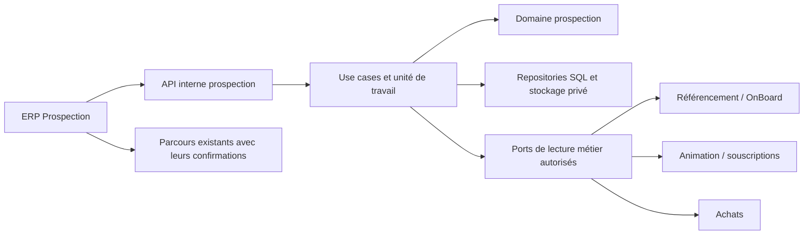

# E71 — Architecture et contrats

Références : [périmètre et arbitrages](README.md), [parcours](parcours-regles.md), [import/carte](import-carte.md), [ADR domaine d'abord](../../architecture/decisions/ADR-2026-08-28-domaine-avant-services-applicatifs.md). Conception du 9 octobre 2026, non implémentée.

## Existant vérifié

Lecture ciblée du backend au commit `1bdac0f`, sans chargement de configuration opérateur ni appel réseau/métier. Aucun domaine CRM ni pipeline générique d'import XLSX n'a été identifié dans les sources examinées. Les sources ci-dessous sont les producteurs actuels, pas les futurs endpoints CRM.

| Producteur / source | Faits réutilisables et limites |
| --- | --- |
| [Accès internes](../../../../localeo-backend/app/domaine/identite_acces/acces_interne.py), [adaptateur ERP](../../../../localeo-backend/app/security/erp.py) | Scopes globaux E69, CSRF, session et habilitations ; aucun scope CRM actuel ; ajouter explicitement les routes au [registre](../../../../localeo-backend/app/security/capacites_routes.py) et au [filtrage frontend](../../../../localeo-backend/app/infrastructure/erp/permissions.js) |
| [Création ERP](../../../../localeo-backend/app/api/erp_api.py), [ServiceAtelierErp](../../../../localeo-backend/app/application/commercialisation/services/atelier_erp.py) | `POST /internal/erp/api/commercants` crée commerçant BROUILLON et dossier OnBoard, audit, retourne `id/version/dossier` ; `nom`, `ville_id`, `type_commercant_id` requis ; pas d'email ni d'accès dans ce producteur |
| [ReferencerCommercant](../../../../localeo-backend/app/application/referencement/use_cases/referencer_commercant.py) | Producteur distinct : profil, ouverture du dossier et accès/email possibles, `initialiser_acces=True` par défaut ; ne pas le substituer à la création ERP sans analyser ces effets |
| [Référencer partenaire Animation](../../../../localeo-backend/app/application/animation_locale/use_cases/referencer_partenaire_animation.py) | Parcours `/admin/referencement-partenaire-animation` : partenaire, gestionnaire, habilitations, commande de souscriptions puis gratuité confirmée ou checkout ; ne pas appeler depuis l'import |
| [API souscriptions ERP](../../../../localeo-backend/app/api/souscriptions_animation_erp_api.py) | `/internal/erp/api/animation-commercial/{commandes,souscriptions}` ; actions checkout/email/activation gratuite/annulation explicites avec version et confirmation ; partenaire seul ≠ souscription active |
| [Crédit B2B](../../../../localeo-backend/app/application/conformite_fiscale_bum/service_credit_achat_b2b.py), [API](../../../../localeo-backend/app/api/credit_achat_b2b_api.py) | Enregistrer une organisation peut remplacer/révoquer son code actif et notifier ; ne jamais utiliser cet appel comme simple upsert CRM |
| [Initialisation paiement](../../../../localeo-backend/app/api/paiements_api.py), [Vision 360 achats](../../../../localeo-backend/app/api/vision_360_achats_api.py) | Initialiser un achat a des effets réels ; référence de lecture typée `COMMANDE:{UUID}` ou `ACHAT:{UUID}`, pas UUID seul ; certains écrans historiques sont réservés admin |
| [Géographie](../../../../localeo-backend/app/infrastructure/integrations/geo_api_gouv.py), [Ville](../../../../localeo-backend/app/domaine/referencement/entities/ville.py) | Recherche nom/code postal, résolution INSEE et centroïde réutilisables ; publication Marketplace requise pour la proximité actuelle ; création Ville publiée par défaut, donc interdite pour la seule localisation CRM |
| [Audit](../../../../localeo-backend/app/application/exploitation/services/service_audit.py), [uploads](../../../../localeo-backend/app/security/uploads.py) | Sanitisation de secrets et limite brute d'upload disponibles ; ni filtrage exhaustif de contacts/notes ni protection complète de l'expansion OOXML |

## Propriétaire et architecture cible

Introduire **`prospection`** comme domaine autonome : l'acquisition commerciale précède référencement, catalogue, support après-vente et achats. Ce choix évite de transformer le support en carnet commercial ou le catalogue en fichier de prospects. À l'implémentation, ajouter ce domaine aux index/tags et contrôles de [domaines fonctionnels](../../architecture/transverse/domaines-fonctionnels.md) ; il n'existe pas encore dans le code.

Organisation cible : `app/domaine/prospection` (règles pures et ports), `app/application/prospection` (use cases/UoW), adaptateurs SQL/stockage/géographie et API internes. Aucun import ORM, client HTTP ou configuration runtime dans le domaine. Aucune écriture SQLAdmin ou batch contournant les mêmes commandes.



### Agrégats et invariants

| Propriétaire cible | Règle et commandes | Entrées / preuve attendue |
| --- | --- | --- |
| `OrganisationProspect` + contacts | Identité CRM distincte des identités opérationnelles ; créer, modifier, rendre contact obsolète, archiver ; version optimiste | API manuelle/import ; même refus et absence d'effet métier implicite |
| `OppositionProspection` et politique pure | Évaluer portée organisation/contact + axe/canal, enregistrer/lever avec preuve, protéger réimport/réouverture | Planification, report et import reconsultent la politique ; test course opposition/tâche |
| `OpportuniteProspection` | Étape, pause/perte/réouverture, preuve de gain, rattachements typés ; pas de paiement ni activation | API et import appliquent mêmes transitions ; test sans ORM |
| `TacheProspection` | Réaliser/reporter/annuler/réaffecter ; responsable et échéance ; sollicitation compatible avec opposition | API/import ; événements uniques au rejeu |
| `LotImportProspection` | Mapping validé, lignes retenues, identité d'origine, reprise, conflit et bilan ; jamais conversion cachée | Assistant + worker, même règles métier que saisie |
| Valeurs `ReferenceMetier`, `LocalisationCommunale`, `MontantEstime` | Type/id vérifiés, géographie indépendante publication, devise et inconnus distincts de zéro | Adaptateurs traduisent, le domaine refuse états incohérents |

La prochaine action, les cartes, le tableau et les métriques sont des **projections de lecture** ; pas de second moteur de transitions dans l'ERP. Les use cases chargent les faits, contrôlent les droits et versions, appellent le domaine puis persistent mutation et événement dans la même transaction. L'horloge et les preuves métier sont injectées, jamais déduites d'un état frontend.

### Gain validé par l'utilisateur le 9 octobre

- **Commerçant** : référencement accepté et dossier OnBoard lié. Le serveur vérifie commerçant/dossier et leur relation ; l'acceptation commerciale est une décision explicite tracée, pas un nouveau statut fictif du commerçant. L'activation n'est pas exigée. Un simple BROUILLON sans acceptation ni dossier ne vaut pas gain.
- **Animation** : souscription activée, payée ou gratuite ; lire la preuve canonique d'activation et sa référence, jamais une note CRM ou un checkout. Un projet publié n'est pas requis par cette règle.
- **Pro** : commande payée ; lire la preuve de paiement du propriétaire Achats via référence typée, sans confondre estimation, compte de crédit disponible et règlement. Une commande en attente n'est pas gagnée.

Le port `LirePreuveGain` expose type, référence, faits pertinents, version/instant constaté et éligibilité, sans montant financier détaillé si le rôle ne peut pas le lire. L'adaptateur interprète les états des objets propriétaires ; le domaine CRM décide à partir des faits. Si deux systèmes ne partagent pas la transaction, l'instant constaté est conservé et les divergences ultérieures sont signalées ; ne pas promettre une cohérence distribuée forte inexistante.

## Matrice de droits cible — décision utilisateur du 9 octobre

Nouveaux scopes **proposés techniquement** : `prospection.consulter`, `prospection.gerer`, `prospection.importer`, `prospection.administrer`. La répartition fonctionnelle ci-dessous est validée. Les droits restent globaux, sans restriction par ville ni nouveau rôle Commercial.

| Action | Lecteur | Backoffice | Finance seul | Admin |
| --- | --- | --- | --- | --- |
| Lire organisations, contacts, notes, tâches et carte | Oui | Oui | Non | Oui |
| Modifier fiches/opportunités, consigner événements, gérer tâches | Non | Oui | Non | Oui |
| Aperçu, confirmation et rapport d'import | Non | Oui | Non | Oui |
| Corriger une note par ajout d'événement | Non | Oui | Non | Oui |
| Correction sensible de rapprochement, levée d'opposition, politique de conservation | Non | Non | Non | Oui |
| Rattacher / constater gain | Non | Gestion CRM + droits de la cible | Non sans autre rôle | Oui selon accès de la cible |

Backoffice + Finance = union des scopes explicites. Aucun scope CRM ne donne accès à SQLAdmin, aux factures ou aux exports financiers. Les corps, pièces et rapports d'import ne sont pas exposés à Lecteur par simple droit de lecture du portefeuille. La portée et l'enregistrement d'opposition sont détaillés dans les arbitrages ; ne pas réduire la restriction admin sur leur gestion par un endpoint générique d'édition.

Si un utilisateur CRM ne peut ouvrir l'écran métier historique, afficher une référence autorisée et l'action « Demander le rattachement à un administrateur » comme tâche interne ; ne pas générer un lien interdit. L'absence de droits métier produit un refus serveur même si la cible est connue.

## Contrat HTTP interne cible

Préfixe **`/internal/prospection`**, tags `internal` et `prospection`, selon les [conventions API](../../architecture/transverse/conventions-api-openapi.md). Il s'agit d'un nouveau contrat à implémenter, aucun de ces endpoints n'est annoncé disponible. Source de conception : ce document ; schémas et génération OpenAPI seront livrés avec le producteur backend, export canonique ici si un fichier est consommé. Pas de contrat embarqué à modifier dans les trois frontends publics.

Session interne E69, contrôle serveur à chaque lecture/commande et validation CSRF sur mutation. Tous les POST de commande portent `Idempotency-Key` ; toutes les modifications d'objets portent `expected_version`. Refuser les champs sensibles supplémentaires et les changements d'organisation d'un contact via un simple PATCH.

| Routes relatives proposées | Entrées / sortie principale | Scope |
| --- | --- | --- |
| `GET /organisations`, `GET /organisations/{id}` | Filtres bornés ; fiche, contacts, anomalies, version | consulter |
| `POST /organisations`, `PATCH /organisations/{id}` | Nom/type/provenance et champs explicitement présents ; UUID/version | gérer |
| `POST /organisations/{id}/contacts`, `PATCH /contacts/{id}` | Identité professionnelle/coordonnées, provenance, version | gérer |
| `POST /organisations/{id}/archivage` | `archive`, motif, version ; projection mise à jour | gérer |
| `GET /opportunites`, `GET /opportunites/{id}`, `POST /opportunites`, `PATCH /opportunites/{id}` | Champs non statutaires ; organisation/axe/objet requis à création | consulter / gérer |
| `POST /opportunites/{id}/transitions` | Étape cible, motif, date de réexamen ou référence de preuve, version | gérer + preuve autorisée |
| `GET /opportunites/{id}/evenements`, `POST /opportunites/{id}/evenements` | Type, `occurred_at`, texte, `corrige_evenement_id` et motif éventuels | consulter / gérer |
| `GET /taches`, `POST /opportunites/{id}/taches`, `POST /taches/{id}/actions` | Type/contact/canal/échéance/responsable ; terminer/reporter/annuler/réaffecter + version | consulter / gérer |
| `POST /organisations/{id}/oppositions`, `POST /oppositions/{id}/levee` | Portée, motif, origine/preuve, version | administrer selon matrice validée |
| `GET /cibles-metier`, `POST /opportunites/{id}/rattachements` | Type + ID canonique, motif/version, pas URL libre ; résumé autorisé | gérer + droits métier |
| `GET /indicateurs`, `GET /carte` | Même filtre normalisé ; compteurs distincts, points/groupes bornés | consulter |
| `GET /communes` | Recherche bornée nom/INSEE/code postal, candidats et provenance | consulter |
| `POST /imports`, `GET /imports/{id}`, `PUT /imports/{id}/mapping` | Upload privé, métadonnées, mapping versionné | importer |
| `POST /imports/{id}/apercus`, `POST /imports/{id}/confirmation`, `POST /imports/{id}/reprise` | Plan signé côté serveur/empreinte, choix des lignes, versions ; opération consultable | importer |
| `GET /imports/{id}/rapport`, `POST /imports/{id}/annulation` | Bilan paginé ; annulation avant écriture / arrêt des lignes non traitées | importer |
| `POST /imports/{id}/corrections` | Corrections administrées de rattachements, motif et versions ; jamais suppression globale | administrer |

Noms JSON en `snake_case` pour ce nouveau contrat, identifiants UUID hors références typées ; adaptateurs vers contrats existants camelCase explicites. `null` efface uniquement un champ facultatif autorisé ; champ absent = conserver. Limites techniques proposées : listes 50 par défaut / 200 maximum ; texte de note 4 000 caractères ; recherches maximum 200 caractères ; compteurs séparés des résultats paginés. L'API refuse limites excessives plutôt que charger tout le portefeuille.

Réponse de liste : `{items, page, page_size, total, filters, generated_at}`. `filters` est la représentation normalisée utilisée aussi par la carte ; les mutations concurrentes peuvent changer les totaux entre deux lectures, l'UI recharge alors les vues ensemble. Pas de promesse de snapshot persistant implicite.

Exemple de commande de tâche (UUID d'exemple synthétique) :

```json
{
  "action": "REPORTER",
  "expected_version": 3,
  "echeance": "2026-11-12T09:00:00+01:00",
  "fuseau": "Europe/Paris",
  "motif": "Créneau convenu avec l’interlocuteur"
}
```

Succès synchrone `200/201` avec objet et version ; import en file `202` avec ID d'opération et URL de suivi, pas succès métier prématuré. Erreur structurée `{code, message, correlation_id, field_errors?}` : `401` session, `403` habilitation, `404` absent/inaccessible selon contrat d'accès, `409` version/rejeu incompatible/opposition/transition, `413` volume fichier, `422` données ou mapping invalides, `429` quota technique, `503` dépendance indisponible. Ne pas exposer les coordonnées d'un doublon inaccessible dans une erreur.

## Concurrence et idempotence

Clé HTTP indexée par acteur, commande et ressource, avec empreinte du corps : même clé/même corps = résultat conservé ; même clé/autre corps = `409`. Réautoriser avant de rejouer une réponse ; une révocation ne doit pas permettre de récupérer contacts/rapports par ancienne clé. Transaction unique pour objet, événement et résultat de commande. Les champs de note ne sont pas placés en logs.

Version optimiste de chaque agrégat ; un conflit propose relecture/comparaison et ne remplace jamais la version serveur. Une note est un ajout indépendant avec son propre UUID, pas un écrasement de toute chronologie. Opposition et création/report de tâche sollicitante verrouillent la même racine organisation (ordre organisation → opportunité → tâche), puis relisent les oppositions dans la transaction ; un contrôle préalable dans l'UI ne suffit pas.

Une contrainte de lien porte `(opportunite_id, type_cible, cible_id)` et une contrainte protège le lien principal actif par type. Deux requêtes gagnantes sur la même opportunité ne créent pas deux événements. L'utilisation d'une même preuve de vente par plusieurs opportunités fait l'objet du complément ARB-04b : proposition d'une seule affaire gagnée par preuve, non acquise par la seule validation des trois règles de gain. Ne pas implémenter une contrainte globale ou un partage implicite avant cette décision. Le détail de reprise inter-domaines est celui des [parcours](parcours-regles.md), sans transaction distribuée inventée.

## Données et compatibilité

Tables additives proposées : organisations, contacts, opportunités, tâches, oppositions, événements, liens typés, lots/lignes d'import et résultats de commande ; cache communal séparé. Contraintes FK, versions non nulles, index sur axe/étape/responsable/échéance et identités de provenance. L'import peut créer plusieurs entités liées dans une transaction de ligne ; aucune ligne « réussie » avec un contact créé et une opportunité perdue.

Aucune migration automatique des commerçants, partenaires ou comptes de crédit existants en prospects. Numéro SQL attribué seulement à l'implémentation après inspection des migrations courantes. Déploiement additif et option désactivée ; retour arrière applicatif par désactivation, sans promettre de rollback destructif des données. Les API existantes et leurs consommateurs gardent leurs contrats ; seuls backend/ERP et générateur de démonstration ont des adaptations directes prévues.

## Complément E71-EVOL-01 — import mensuel différentiel

Le domaine `LotImportProspection`, avec une politique pure `ComparerDeltaSource`, porte la comparaison B/C/N et les protections décrites dans [Import mensuel](import-carte.md). L’ERP affiche les décisions ; il ne calcule pas seul les champs remplaçables.

Étendre le contrat cible avec `GET/POST /profils-import` et `PATCH /profils-import/{id}` (scope importer, version obligatoire à modification). Le dépôt d’un lot référence `profil_id`, `profil_version`, `periode_source` et la révision de source précédente. L’aperçu renvoie par champ `baseline_source`, `valeur_crm`, `nouvelle_source`, `protection_locale`, `classification`, `decision_proposee`, `expected_version` et un identifiant de delta. Ces valeurs personnelles restent dans les réponses autorisées, pas dans les logs.

La confirmation contient les IDs de deltas retenus et les décisions explicites ; les trois valeurs ne sont jamais acceptées comme preuve fournie par le navigateur. Le serveur les relit depuis son aperçu et la base. Les conflits exclus restent dans le rapport. Les endpoints existants mapping/aperçu/confirmation/reprise sont conservés, avec plan versionné et immuable après début.

Persistance cible additionnelle : profil de mapping versionné, période/ordre de source, état par champ (observé/reconnu/appliqué, protection locale, décision), liens stables de provenance et versions. Les mutations manuelles/imports partagent les marqueurs de provenance ; une modification d’un champ puis son retour à la valeur précédente ne retire pas automatiquement sa protection. Aucune migration SQL exécutée pendant cette spécification. La conservation doit couvrir ces références de comparaison ; si elles ont été purgées, imposer une nouvelle qualification plutôt qu’une mise à jour aveugle.

## Complément E71-EVOL-02 — enrichissement de fiche commune

Ajouter une entité métier `FicheCommuneProspection` référencée par INSEE et une section annuelle identifiée par `(fiche_commune_id, code_section=COFFRETS_ELUS, annee=2026)`. Cette fiche et ses données éditoriales sont distinctes du cache géographique technique : actualiser le cache ne remplace jamais la section. `SectionCommuneProspection` porte version, valeurs par clé de colonne stable, provenance, protections locales et décisions de delta. Ne pas ajouter ces contenus aux objets Ville publiés.

Étendre les routes cibles : `GET /communes/{code_insee}/fiche` (consulter), `PATCH /communes/{code_insee}/sections/coffrets-elus-2026` (gérer, version/CSRF/idempotence, uniquement contenu éditorial autorisé). L’import utilise les mêmes règles de section avec le scope importer ; la résolution/changement de rattachement relève de la correction sensible admin quand elle modifie une association déjà validée. Le modèle d’aperçu porte `destination=PROSPECT_PIPELINE|SECTION_COMMUNE`, l’INSEE confirmé, l’année, les deltas par champ et ses totaux séparés. Les en-têtes du classeur ne deviennent pas des noms de colonnes SQL arbitraires.

La fiche est accessible depuis la localisation d’une organisation, la carte ou une recherche de communes CRM ; navigation ERP et retour au contexte conservés. Lecteur et Backoffice consultent selon les droits CRM ; Finance seul n’accède pas aux contacts de cette section. Les 33 champs peuvent inclure données professionnelles de personnes : mêmes restrictions d’accès, stockage privé et exclusion des logs que les fiches CRM. Leur conservation/provenance/deltas entrent explicitement dans ARB-07, sans durée déduite de l’année du titre.

Persistance additive à prévoir pour fiches/sections communales et correspondances d’import, contraintes uniques et versions ; aucun changement d’API publique. Aucun chargement réel de ce contenu effectué pendant la spécification.
