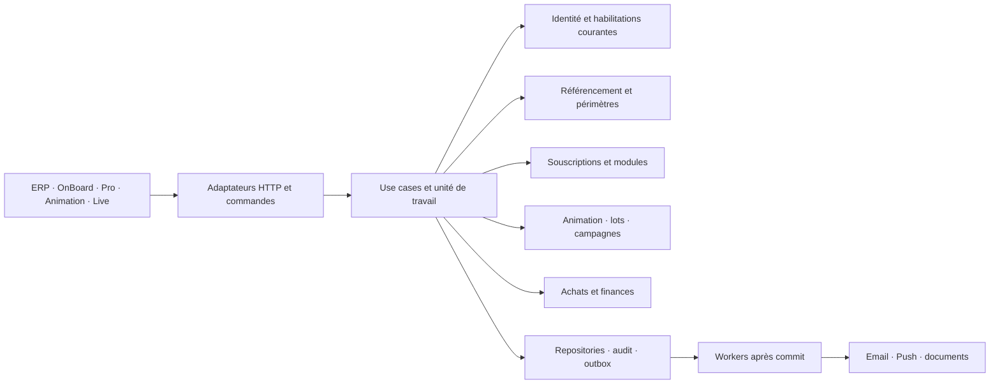

# E73 — Architecture et contrats transverses

Version de conception du **17 octobre 2026**, complétée par les réalisations locales consignées ci-dessous. [Dossier](README.md), [backlog et décisions](../../roadmap/en-cours/epic-73-animation-et-ou-coffrets-backlog.md). Les sections de conception décrivent la cible ; les contrats effectivement disponibles et leurs preuves suivent le [journal de réalisation](suivi-implementation.md). L’état produit est **En cours**, sans déploiement.

## 1. Propriété des règles

Appliquer l’[ADR domaine d’abord](../../architecture/decisions/ADR-2026-08-28-domaine-avant-services-applicatifs.md), les [conventions HTTP](../../architecture/transverse/conventions-api-openapi.md) et la [matrice de contrôles](../../architecture/transverse/controle-architecture.md). Ne pas transporter dans les nouveaux use cases les règles aujourd’hui dispersées dans des services ORM.

| Propriétaire | Agrégats ou concepts cibles | Invariants et entrées |
| --- | --- | --- |
| `animation_locale` | Animation, dotation, modèle/exemplaire de lot, gain, bon, tirage et suppléance | Choix et gel de dotation, disponibilité, attribution unique, validité/remise ; API organisateur, ERP, commandes terrain et batchs |
| `abonnements_plateforme` | Souscription, conditions figées, version catalogue, droit de module, consommation de quota | Droit effectif par partenaire/commune, origine et période, continuité commerciale, calcul des quotas ; portail, ERP, paiement confirmé, ordonnanceur |
| `referencement` | Commerce, périmètre produit, rattachement communal, fiche à vérifier et import | Périmètre demandé/actif/retiré, prérequis, identité métier et deltas ; ERP, import, projections OnBoard/Pro |
| `identite_acces` | Identité organisateur, appartenance organisation, habilitation, invitation/reset, sessions, PIN/jetons | Permissions courantes, délégation bornée, dernier responsable, secrets et révocations ; login, équipe, ERP, commandes différées |
| `animation_locale` et mécanismes de communication existants | Campagne organisateur, audience, dépôt logique Live, droit à contacter | Audience de participants, fenêtre, fréquence interanimations, état de campagne ; portail et worker. Transport/outbox restent des adaptateurs |
| `abonnements_plateforme`, ports de paiement et circuit documentaire financier | Commande de souscription/module, encaissement, remboursement, pièces | La racine `CommandeCommerciale` porte les faits d’encaissement confirmés, les réservations et confirmations de remboursement ; sa politique pure calcule le disponible. Les adaptateurs transmettent les confirmations fournisseur et le circuit documentaire émet les pièces. `gestion_achats` conserve les achats Coffrets, sans recevoir artificiellement les commandes de modules |
| `exploitation` | Audit, supervision, budgets/coûts projetés, commandes de terrain | Traçabilité et diagnostic ; la validation d’un bon appelle les règles de `animation_locale`, pas une seconde consommation définie dans la route |
| `support`, `documentaire`, `dam` | Demande support, documents/version, médias et export privé | Séparer conversation client/notes internes, droits de diffusion, stockage et rétention ; aucun droit métier accordé par l’existence d’un fichier |

L’organisation cliente réutilise le partenaire existant : pas de second tenant ni de copie des commerçants par organisation. Une commune n’est pas une identité et un commerçant participant n’est pas automatiquement un fournisseur de prestations Coffrets. Une catégorie commerciale n’est ni un moteur, ni un mode de dotation, ni une habilitation personnelle.

### Frontières des agrégats et échanges entre domaines

Un domaine fonctionnel peut contenir plusieurs agrégats ; il n’est pas un objet géant chargé avec toutes ses tables. Les racines ci-dessous sont des frontières de commande et de cohérence cibles, pas une exigence de renommage des classes historiques. Chaque racine contrôle ses transitions et sa version ; les relations entre racines utilisent des identifiants et des faits typés, jamais des objets ORM partagés.

| Racine / frontière cible | Contenu et responsabilité | Ce qui reste extérieur |
| --- | --- | --- |
| `Animation` | Configuration de dotation, mode, durée et ordre gelés, cycle de publication | Stock, bons, participants et campagnes ne sont pas des collections à charger intégralement pour modifier une animation |
| `ModeleLotLibre` / `ExemplaireLotLibre` | Racines distinctes : définition versionnée ; disponibilité et affectation d’un exemplaire | Le bon conserve les caractéristiques promises à l’attribution ; modifier un modèle ne réécrit pas un gain |
| `BonLot` | Validité, secret référencé, révocation, remise et corrections liées | Référence exemplaire/gain/commerce ; aucune vente ou prestation Coffrets artificielle |
| `TirageAnimation` | Résultat et ordre des gagnants/suppléants, unicité des attributions de l’animation | Bons et exemplaires restent distincts ; leur réservation/émission suit la transaction de confirmation définie dans le chapitre lots |
| `Souscription` | Conditions acquises, périodes et octrois de modules, décision de continuité | Catalogue versionné séparé, commande financière et ressources Animation distinctes ; aucun chargement de tout l’historique d’usage |
| `CompteUsage` par souscription/unité/fenêtre | Débit, correction et unicité de source ; compteur synchrone cohérent avec son journal | Une projection analytique asynchrone ne peut pas autoriser un usage. Le journal est paginé, pas incorporé intégralement dans la racine |
| `CommandeCommerciale` | Conditions acceptées, encaissements confirmés, réservations et remboursements ; disponible non négatif | Appels fournisseur et émission des pièces hors domaine ; activation des droits par orchestration explicite |
| `PerimetresCommercant` | États par produit, prérequis attestés et références d’engagements protégés | Consomme des faits OnBoard ; ne recopie pas le dossier ni les règles Animation/Coffrets |
| `EquipeOrganisation` | Appartenances et délégations de l’organisation, acceptation du transfert et maintien d’un responsable | Identité globale et secrets d’invitation/reset séparés ; une appartenance n’est pas une seconde racine concurrente du dernier responsable |
| `LotImport` / `LigneImport` | Racines distinctes : confirmation/version du lot ; décision et reprise par ligne | Fiche commerce mise à jour par son domaine ; suivi du lot agrégé depuis les lignes, sans réécrire toutes les lignes dans une transaction |
| `CampagneOrganisateur` / `SollicitationDestinataire` | Racines distinctes : démarrage et audience scellée ; fréquence pour une identité dans une commune | Audience et messages persistés par lots bornés ; pas de collection de tous les destinataires sous un verrou de souscription |

Les valeurs `ConditionsAcquises`, durée, montants/devise, mode de dotation et références de période sont immuables. Les politiques de prorata, éligibilité, rapprochement à trois valeurs et fréquence sont pures : temps courant, faits, résultat du tirage aléatoire et paramètres leur sont fournis. Elles ne lisent ni configuration globale, ni base, ni horloge système, ni fournisseur. Les repositories, horloge, aléa, paiement et transport sont des ports injectés dans l’application ; un événement métier ne contient pas de callback ni de session SQL.

La carte d’échanges est unidirectionnelle pour chaque décision : Identité fournit les habilitations courantes ; Référencement les périmètres/prérequis ; Souscriptions les conditions/décisions d’usage ; Animation porte ensuite sa transition propre. L’application compose ces faits dans le cas d’usage, avec leurs versions et leur contexte. Aucun domaine n’appelle le service applicatif d’un autre domaine ni n’importe ses modèles de persistance. Les adaptateurs traduisent les formats Stripe, SQL et HTTP en faits métier ; les frontends consomment des capacités projetées, jamais une seconde politique d’accès.

Les projections de bilan, coûts, écrans et progression peuvent être différées et annoncer leur date de calcul. L’autorisation, le stock, la consommation de quota et le disponible remboursable exigent au contraire un état courant cohérent. La réversibilité et la fermeture sont des processus applicatifs persistés qui coordonnent plusieurs domaines ; elles ne déplacent pas leurs invariants dans un agrégat « organisation » contenant tous les objets.

## 2. Invariants transverses

| ID | Règle toujours vraie | Preuve discriminante |
| --- | --- | --- |
| E73-INV-01 | Les trois branches `COFFRETS`, `LIBRE/EXTERNE`, `LIBRE/NUMERIQUE` sont exclusives ; le formulaire nouveau n’en déduit aucune par défaut | Publication libre réussie sans commande Coffrets ; publication Coffrets conserve tous ses contrôles |
| E73-INV-02 | Les effets d’une mutation appartiennent au domaine de sa cible | Remise de lot libre sans instance Coffret, vente, commission ou reversement fictif |
| E73-INV-03 | Toute commande intersecte identité active, organisation/commune/animation autorisées, capacité personnelle, droit commercial et état métier pertinent | Même refus par portail, URL directe, ERP et worker ; un droit module n’accorde pas une permission personnelle |
| E73-INV-04 | Expiration/retrait commercial ouvre seulement la continuité des opérations identifiées comme engagées ; une suspension administrative ou révocation personnelle n’est jamais contournée | Liste d’engagements figée au retrait, aucune nouvelle animation ni nouvel engagement ouvert par un rôle historique ; tirage/attributions des animations publiées encore permis dans leur continuité, sous les droits propres du commerce de remise. Après retrait du périmètre commerce, seuls les bons déjà attribués sont protégés |
| E73-INV-05 | Une même opération logique ne crée qu’un effet acquis | Rejeu après réponse perdue : mêmes IDs gain, consommation, commande, message ou consommation de quota |
| E73-INV-06 | Aucune quantité/consommation ne dépend d’un contrôle frontend ou d’une lecture préalable non verrouillée | Courses deux publications, deux affectations, scan/PIN et démarrages de campagne |
| E73-INV-07 | Catalogue mutable et conditions acquises sont distincts | Modifier prix/quota catalogue ne change pas une période de souscription déjà confirmée |
| E73-INV-08 | Une preuve historique n’est pas un accès actuel | QR remplacé, salarié révoqué, invitation rejouée et jeton d’une organisation retirée refusés malgré audit conservé |
| E73-INV-09 | Le résultat métier et l’intention de communication sont durables ensemble ; le fournisseur peut échouer séparément | Attribution conservée sans renvoi ni nouveau gagnant lorsque l’email échoue |
| E73-INV-10 | La reprise ne recrée ni identité ni droits supprimés | Migration, restore et transfert de responsable conservent les identifiants et réappliquent les révocations |
| E73-INV-11 | Un import ne remplace pas une donnée corrigée localement sans résolution du conflit ; ni cellule vide ni absence de ligne ne vaut suppression | Réimport avec versions différentes entre aperçu et confirmation refusé/reprévisualisé |
| E73-INV-12 | Messages organisateur, notifications automatiques et transport navigateur restent distincts | Sans module : événements automatiques existants conservés ; sans permission Push : message Live autorisé conservé |
| E73-INV-13 | Coût observé, estimation, quota et facture sont quatre notions différentes | Alerte à 100 % du budget sans débit, blocage ou nouveau droit |
| E73-INV-14 | Export, fermeture, purge et fin de souscription ne sont pas une même transition | Demande d’export ne ferme rien ; fermeture n’abandonne pas un gain ni les autres organisations |
| E73-INV-15 | Tout état affiché correspond à un fait serveur, avec limites explicites | Échec email ≠ remise ; acceptation Push fournisseur ≠ lecture ; résultat inconnu ≠ nouvelle validation autorisée |

## 3. Exécution, concurrence et effets

Chaque use case charge les faits courants via ports, construit les objets/valeurs du domaine, obtient une décision pure, puis persiste dans la même unité de travail : transition, version, consommation éventuelle, audit métier et intention d’effet externe. Aucun email, Stripe ou Push n’est appelé sous verrou métier. La publication d’un événement après commit ne remplace pas une outbox durable.

La règle par défaut est une transaction courte par commande de racine. Dans le backend à base commune, les exceptions de cohérence immédiate sont explicites : publication + débit, confirmation de tirage/remplacement + affectations/bons, remise + reçu/PIN, ligne d’import + fiche/provenance, premier message de campagne + débit/démarrage. L’application coordonne leurs repositories dans une UoW commune, sans fusionner leurs règles ni imbriquer des use cases qui commitent séparément. Un découpage futur en services distants nécessiterait un protocole de réservation/compensation spécifié : une suite d’appels HTTP ne remplace pas cette atomicité. Les effets externes et les traitements volumineux suivent des états persistés et des reprises idempotentes, pas une transaction englobant toute leur exécution.

Les nouveaux agrégats exposent une `version` monotone. Une commande interactive qui modifie un objet envoie `expected_version` ; une version périmée renvoie un conflit avec possibilité de relecture, jamais un écrasement automatique. La version du catalogue confirmée, la version d’aperçu d’import et la version du contexte PIN sont des versions distinctes ; ne pas utiliser une seule version globale pour des garanties différentes.

Le code des nouveaux conflits de version est `CONFLIT_VERSION` (HTTP 409), commun aux chapitres de ce dossier. Les codes historiques des routes conservées ne sont pas renommés sans adaptation explicite de leurs consommateurs.

Les nouvelles commandes créatrices ou à effet irréversible utilisent `Idempotency-Key`. Un registre associe clé, portée serveur (acteur/contexte/commande/cible), empreinte de requête et résultat durable. Même clé et même requête : retrouver le résultat après contrôle des droits courants ; même clé avec contenu différent : conflit sans mutation. L’idempotence ne remplace pas les contraintes métier : deux clés concurrentes doivent aussi être bornées par les unicités de domaine. Les marqueurs nécessaires à l’anti-rejeu restent liés à l’objet après nettoyage du corps technique.

Ordre général d’acquisition : contexte d’identité/habilitation puis périmètre commerce si concerné, souscription/compteur si consommé, animation/dotation, exemplaires et bons triés par ID, résultat métier/outbox. Pour E70, conserver l’ordre exact déjà requis par son verrou de protection PIN ; placer la cible bon au même rang que la cible Coffret/participant. Tous les chemins d’une même mutation utilisent cet ordre, y compris correction/remplacement/retrait, et les tests PostgreSQL vérifient les courses. Éviter de verrouiller tout un territoire pour un simple reçu.

Un claim de worker est un bail technique acquis et committé dans une transaction séparée avant la transaction métier ; il n’accorde aucun droit et ne consomme rien. Le jeton de bail est revérifié pour refuser un worker devenu obsolète. Pour une campagne : souscription/compteur → animation/campagne → garde de sollicitation du destinataire ; ne jamais conserver un verrou de campagne pendant l’acquisition inverse du compteur. Les traitements suivants prennent seulement les verrous nécessaires en respectant cet ordre relatif.

Un retrait attendu « dès la requête suivante » exige une lecture serveur de la révision de droits ou une invalidation cohérente du cache, pas seulement les claims d’un JWT ancien. Une tâche planifiée recontrôle l’identité initiatrice et les droits à son démarrage. Un traitement déjà commencé continue sous l’identité de service avec son engagement enregistré et ses bornes ; le collaborateur révoqué ne conserve aucun pouvoir de commande. Une suspension administrative arrête aussi ce qui doit être suspendu pour sécurité, avec reprise opérateur explicite.

Événements métier cibles : `PerimetreCommerceDemande/Active/Retire`, `DroitModuleAccorde/Retire`, `QuotaConsomme`, `LotAffecte`, `GainConfirme/Remplace`, `BonEmis/Consomme/ConsommationCorrigee/Revoque`, `CampagneDemarree/Suspendue`, `ImportConfirme/Termine`, `OrganisationFermetureDemandee/Fermee`. Ils portent ID, version, date serveur, organisation/commune/commerce utiles et corrélation ; aucun PIN, mot de passe, QR secret, lien personnel complet ni contenu intégral d’import dans l’événement. Les noms définitifs sont alignés à l’implémentation avec les conventions existantes, sans modifier la sémantique.

## 4. Contrats et compatibilité

Les opérations et DTO détaillés sont dans [lots](dotation-lots.md), [modules/import/communication](modules-souscriptions-import-communication.md) et [périmètres/SaaS](perimetres-parcours-saas.md). Ces documents sont la source de conception des extensions ; ils ne remplacent pas un OpenAPI généré depuis une implémentation.

| Producteur ou source actuelle vérifiée | Consommateurs et évolution |
| --- | --- |
| [Export hors ligne backend](../../../../localeo-backend/scripts/documentation/export_openapi_offline.py) ; [générateur E41](../../../../localeo-backend/scripts/documentation/generate_epic41_openapi.py) | Générer après implémentation, sans configuration opérateur ni réseau ; conserver [OpenAPI E41](../epic-41-api/openapi.json) et [E42](../epic-42-localeo-live/openapi.json) comme instantanés du code disponible, ne pas y annoncer aujourd’hui des routes fictives |
| [Contrat Pro embarqué](../../../../localeo-commercant/api/localeo-openapi.json), [export Pro](../../../../localeo-commercant/scripts/export-openapi.py) | Étendre le discriminant des cibles et reçus, puis régénérer et tester le scanner, le PIN et les historiques consommés par principal/salarié |
| [Contrats moteur Marketplace](../../../../localeo-marketplace/src/contracts/moteur-animation/manifest.json) | Préserver version/empreintes ; adapter les projections consommées du moteur sans réécrire les règles du moteur pour les lots libres |
| [Audit applicatif](../../../../localeo-backend/app/application/exploitation/services/service_audit.py) | Étendre les événements et allowlists par finalité ; les exports ERP/Ops/Support ne doivent pas divulguer les nouveaux secrets |

Règles communes des nouvelles routes : UUID opaques, montants en unités monétaires entières avec devise, timestamps ISO 8601 UTC ; affichage Europe/Paris selon la [convention dates](../../architecture/transverse/affichage-dates.md). Les listes privées utilisent filtres de périmètre serveur et pagination bornée, `limit` par défaut 25 et maximum 100, curseur opaque lié aux filtres ; aucun export massif par contournement de pagination. Les anciennes routes conservent leur pagination tant que leurs consommateurs n’ont pas été migrés.

La nouvelle enveloppe d’erreur reprend `code`, `detail`, `correlationId`, `request_id` ; détails techniques et identifiants d’autres tenants absents. `401` session absente/expirée, `403` capacité insuffisante dans un contexte connu, `404` ressource absente ou étrangère, `409` transition/version/idempotence/quota en conflit, `422` forme/données invalides, `429` limitation technique, `503` indisponibilité de capacité technique. Le code métier distingue quota commercial et rate limit. Les champs de correction `current_version` ne sont fournis qu’à un acteur autorisé à lire la cible. Les codes spécifiques sont définis dans les trois contrats métier.

Les chemins `internal` destinés à l’ERP exigent session interne, habilitation E69 et protection CSRF des mutations ; une API key technique ne tient pas lieu d’administrateur. Les commandes protégées d’un organisateur tirent l’organisation de son contexte validé et recoupent commune/souscription/animation ; un `organisation_id` dans le corps n’accorde aucun accès. Les routes publiques à jeton autorisent une cible et une finalité seulement, sans exposer le dossier complet du commerce ou les autres gains.

### Compatibilité de lecture et d’écriture

1. Introduire discriminants et nouveaux champs de lecture, livrer tous les lecteurs avant d’autoriser des enregistrements libres. Un lecteur qui exige `coffret_id` ne peut pas être réputé compatible parce que le JSON contient un champ supplémentaire.
2. Conserver les anciens objets Coffrets, leurs IDs, commandes, preuves, emails et chemins distribués ; une projection typée s’ajoute, pas une conversion silencieuse en lot libre.
3. Bloquer la création libre par une ancienne UI au niveau serveur ; le formulaire nouveau exige les choix explicites. La migration peut marquer les anciennes animations comme Coffrets sur preuve, mais ce remplissage historique n’est pas une valeur par défaut des nouvelles créations.
4. Les workers et consommateurs d’événements doivent reconnaître la nouvelle version avant activation ; messages inconnus isolés et visibles, jamais assimilés à une réussite. Aucun double worker ancien/nouveau ne doit délivrer deux fois un même effet.
5. Avec des données libres en usage, le retour à un backend ignorant ces types n’est pas un rollback sûr. Fermer les nouvelles écritures concernées, maintenir lectures/remises engagées et appliquer une correction compatible ; aucune suppression des nouvelles tables pour revenir en arrière.

## 5. Persistance et migrations coordonnées

Nouvelles familles, contraintes et cycles détaillés dans les contrats métier ; tables et colonnes définitives à matérialiser dans des migrations additives contrôlées. Ne pas réserver un numéro de migration dans ce dossier : il dépendra du HEAD backend à l’implémentation.

| Famille | Migration et contrainte de cohérence |
| --- | --- |
| Dotation / gain | Ajouter discriminants et références spécifiques ; exactement une branche de gain applicable, ancien `coffret_id` conservé pour Coffrets, nul interdit seulement dans sa branche ; unicités participant/animation libre et bon actif/exemplaire |
| Périmètre commerce | Enregistrements demandés/actifs/retirés, origine ERP, prérequis validés et engagements résiduels. État de migration `A_REVOIR` distinct d’un retrait ; aucune affectation automatique Animation+Coffrets |
| Identités organisateur | L’identité garde son ID ; appartenance organisation séparée du partenaire historique, autorisations par appartenance et commune, contexte de session validé. Reprendre les accès réels sans créer de doublon global d’email ni offrir des communes nouvelles |
| Souscription / modules | Instantané versionné des conditions acquises, octrois, ledger des consommations, commandes et renouvellements ; préserver paiements/pièces et consommation historique ; unicités des événements d’encaissement et des débits d’usage |
| Imports | Lot source privé, aperçu versionné, lignes/résolutions/états, valeurs de référence importées ; FK fiche/rattachement, pas d’email de login modifié par un import de contact |
| Campagnes / Live | Audience figée au début, tentative distincte par campagne/destinataire, dépôt Live dédupliqué et livraison transport séparée ; compteur interanimations stable malgré appareils multiples |
| SaaS / exploitation | Objectifs, sources d’inscription, satisfaction, délais de service, coûts et budget, demandes export/fermeture ; versions et traces, sans copie de toutes les données dans un journal |

Pour les droits historiques dont les conditions achetées ne sont pas reconstituables depuis offre, commande, facture et preuve administrative : produire un rapport d’IDs à traiter par Localeo, conserver les accès acquis et suspendre la conversion commerciale concernée. Ne pas prendre le tarif catalogue actuel comme preuve de prix payé. Une animation déjà publiée continue sous ses engagements historiques, sans débit rétroactif d’un quota chasse nouvellement créé.

La reprise des périmètres est **manuelle pour chaque commerce**, sans suggestion automatique (DEC-109). L’outil affiche uniquement les faits existants pour l’examen, conserve l’auteur/la décision et bloque la bascule d’une commune contenant un commerce non vérifié. La commune pilote confirmée le 18 octobre est **Martignas-sur-Jalle**, après validation UX interne par Localeo. Les écritures susceptibles de changer les faits entre contrôle et bascule sont verrouillées ou revérifiées ; une bascule partielle ne réduit pas silencieusement les droits des commerces non migrés.

## 6. Conservation, protection et restauration

Réutiliser le [rattachement accès/validations](../identite-acces/conservation-validations-acces.md) et le [registre moteur](../../juridique/interne/registre-interne-moteur-animation-2026-09-19.md). Il s’agit d’un classement par finalité, pas d’une nouvelle prescription juridique. Les classes existantes [conservation validations](../../../../localeo-backend/app/domaine/identite_acces/conservation_validations.py) et [conservation moteur](../../../../localeo-backend/app/domaine/animation_locale/moteurs/politique_conservation.py) montrent les échéances et les exclusions à étendre.

| Donnée E73 | Rattachement / comportement |
| --- | --- |
| Sources et rapports import | 30 jours après fin ou abandon ; effacer objet privé et copies gérées. Fiches et base des deltas suivent leur cycle propre ; abandon explicite possible pour éviter un import indéfiniment non terminal |
| Archive de réversibilité | 30 jours après mise à disposition ; retrait immédiat du téléchargement si le responsable n’a plus le droit, indépendamment de la présence du fichier |
| Habilitations organisateur / périmètres | Accès courant retiré immédiatement, preuves minimales d’habilitation selon catégorie T1 existante ; ne pas archiver les secrets avec la preuve |
| Essais PIN et journaux de sécurité | E70 et T8 existants, aucune durée allongée parce que la cible devient un bon ; SQL et segments JSONL à traiter ensemble |
| Lots, gains et preuves de remise | Catégories Animation de tirage/gain et archives probatoires de l’Annexe A ; ne pas baptiser le lot libre `PREUVE_CONSOMMATION_COFFRET` pour réutiliser un batch. Conserver identifiants/états minimaux, séparer coordonnées nécessaires et secret QR ; les bons prolongés ou attribués à un suppléant gardent leurs références valides sans maintenir toutes les coordonnées opérationnelles |
| Campagnes, Live et transports | Politique Live pour les messages/inbox, politique notifications pour l’envoi et T8 pour la sécurité ; seule preuve utile isolée. Les 24 h de fréquence ne définissent pas la conservation d’un message, et la fenêtre commerciale clôture +30 jours ne définit pas sa purge |
| Compteurs, sources d’inscription, satisfaction, coûts | Minimiser les dimensions identifiantes ; rattacher les identifiants participants à la politique Animation, les coûts/factures à leur catégorie propre. Aucun consentement publicitaire déduit d’une source QR ; pas de conservation illimitée d’un commentaire au motif de statistiques |

La migration de chaque famille consigne catégorie, date de départ source, dépendances actives, gel éventuel, date de réexamen et suppression attendue. Une catégorie non mappée ou une date requise absente est un écart de préparation à résoudre avant activation de la famille ; ne pas inventer de durée ni purger à une date supposée. Un gel limité ne rend jamais un bon ou jeton expiré à nouveau utilisable.

Rattachement de réalisation du lot 01 : les appartenances et décisions de responsabilité sont des preuves T1. Le journal minimal conserve les identifiants, rôles, statuts, communes et autorisations avant/après, la date d’effet et, pour une révocation de relation, sa date de fin. Une suspension ne devient pas une fin de relation. Les événements techniques de session, reset et invitation relèvent de T8 ; leurs dates serveur ne sont pas repoussées par consultation. Les empreintes des invitations de sept jours et resets d’une heure restent des secrets techniques, exclus de l’archive probatoire. Les corps d’email contenant un lien suivent le circuit de retrait des secrets, séparément de la preuve minimale d’envoi. La suppression effective de ces nouvelles familles et sa reprise après restauration doivent être raccordées et prouvées au lot 10 avant toute mise en service ; les contrôles d’expiration/rejeu du lot 01 ne prouvent pas cette purge.

Rattachement de réalisation du lot 02 : `historique_perimetres_commercants` et les décisions de revue communale sont les preuves T1 de la décision d’habilitation produit ; les instantanés restent limités aux états et références nécessaires. `engagements_proteges_commercants` conserve les références des obligations à honorer et suit la conservation de leur preuve métier (Animation ou Coffrets), sans copie du contenu financier ou du secret QR/PIN. `recus_perimetres_commercants` est un reçu technique d’idempotence distinct de l’historique probatoire ; il ne doit pas prolonger la conservation des données de la décision. Les dates serveur de retrait/décision servent de sources, jamais la dernière consultation. Le registre du générateur couvre les six tables du lot pour export/restauration synthétique ; le raccordement des purges à T1/T8 et aux gels des obligations reste à vérifier au lot 10 avant mise en service.

Rattachement de réalisation du lot 03 : les versions de catalogue et périodes
conservent la preuve des conditions acquises ; `historique_modules_plateforme`
porte les décisions motivées d'octroi, retrait et reprise historique (T1).
Les dossiers commerciaux, réservations et remboursements suivent la catégorie
financière existante de leur commande/facture/avoir, avec leur date d'émission
ou de décision comme origine ; une reprise technique ne repousse pas cette date.
Les reçus d'idempotence et effets d'outbox sont des traces techniques distinctes
de la preuve financière. Une opération incertaine conserve les éléments minimaux
nécessaires au rapprochement et le gel correspondant ; elle ne justifie pas de
conserver indéfiniment un payload fournisseur ou une URL de paiement.
`facturations_organisations_animation` est la coordonnée courante pour les futurs
documents, distincte des instantanés des documents émis. Les compteurs/consommations
sont des preuves d'usage rattachées à la période et à ses engagements, sans copie
des participants. Le registre de démonstration inclut les quatorze tables nouvelles,
y compris les fenêtres de compteur des essais, distinctes du journal d'usage.
Le lot 10 doit prouver les purges, gels et reprises après restauration de ces
familles avant mise en service ; les tests d'expiration des droits ne constituent
pas cette preuve de conservation.

Le RPO cible est **4 heures** et le RTO **8 heures**, avec réouverture des parcours essentiels après contrôles. Le [plan de vérification et livraison](verification-livraison.md) précise l’exercice et ses preuves. Une sauvegarde restaurée doit réappliquer suppressions/révocations plus récentes et rapprocher les opérations externes incertaines avant reprise des workers ; le RPO n’autorise pas une seconde remise de lot ou un second paiement.

Rattachement de réalisation du lot 04 : `configurations_dotation_animation`
et `lignes_lots_externes_animation` sont les paramètres de la dotation ; après
publication ils constituent des références de la preuve d'attribution.
`animation_tirages_libres`, `animation_candidats_tirage_libre`,
`animation_attributions_lots_externes` et `animation_suivis_lots_externes`
relèvent des preuves Animation de tirage, attribution et remise (circuit
probatoire existant de cinq ans). L'instant de confirmation et les dates
réelles d'attribution, déclaration ou correction sont les sources ; une
consultation n'en repousse pas l'échéance. Le gel et le besoin d'un suppléant
encore mobilisable sont réexaminés avant purge. La graine privée de préparation
est un secret technique, à retirer séparément dès disparition du besoin de
reprise ; elle n'est exposée ni dans les API ni dans l'audit.
`animation_envois_lots_externes` conserve le lien vers le transport et la
première réussite utile au délai de remplacement ; le corps et le lien
personnel suivent le retrait des secrets du transport existant.
`animation_recus_tirage_libre` est un reçu technique d'idempotence et ne
prolonge pas la conservation des coordonnées. `animation_acces_gains_externes`
ne conserve que l'empreinte de la capacité de consultation, sa référence de
gain, ses dates de création, expiration et révocation. Les 90 jours techniques
de validité du lien ne prolongent ni le jeu ni la conservation des données.
Les coordonnées courantes des
participants restent soumises à la fin effective +12 mois calendaires et à
l'archive restreinte de besoin, sans copie nominative dans le lot. Le carnet
local conserve un état minimal, jamais les consignes privées ou coordonnées
du responsable de remise. Le test PostgreSQL de conservation prouve que le
gain externe ouvert et sa réserve préservent l'archive d'identité nécessaire,
puis que la remise permet sa purge sans effacer les preuves minimales ni
réhydrater le participant anonymisé. La purge des autres familles nouvelles
et la reprise après restauration restent à vérifier au lot 10 avant mise en service.

## 7. ERP, CRM et autres consommateurs

CA-25 : les fiches, filtres et exports présentent séparément périmètres commerce, type de moteur, catégorie commerciale et dotation. Les agrégats financiers ne comptent que les commandes financières réelles ; une valeur descriptive de lot libre n’est pas un chiffre d’affaires Coffrets. Support peut consulter les faits autorisés sans obtenir les secrets PIN/QR ; Ops voit les erreurs et reprises, pas un bouton de mutation contournant le domaine.

La [spécification CRM E71](../epic-71-crm-prospection/README.md) reste à réaliser indépendamment : E73 fournit les projections de produits/modules et liens métier. La conversion garde ses preuves de gain validées (référencement accepté et dossier OnBoard lié, souscription activée payée/gratuite, commande Pro payée), sans activation depuis une étiquette CRM. L’import opérationnel E73 ne crée ni prospect ni opportunité et ne réutilise pas un rapprochement CRM comme autorisation territoriale.

Le [service Atelier ERP](../../../../localeo-backend/app/application/commercialisation/services/atelier_erp.py) liste aujourd’hui les commerçants et crée des fiches brouillon. Lors de la sélection d’un fournisseur, d’une prestation ou d’une nouvelle composition Coffrets, appliquer les faits du périmètre Coffrets actif ; un commerce Animation seul reste consultable pour ses parcours de participation mais n’est pas proposé comme fournisseur vendable. Préserver les compositions/ventes déjà engagées et leurs preuves. La vérification du périmètre appartient au domaine de l’engagement, pas seulement au filtre de la liste Atelier.

## 8. Performance et volumétrie — revue du 18 octobre 2026

Les règles [P01 à P08 transverses](../../architecture/transverse/performance-volumetrie.md) s’appliquent à E73 et à ses consommateurs. La pagination HTTP déjà prévue ne suffit pas : les filtres de tenant/droits, continuation et limite sont appliqués en base, avant hydratation ; aucun total global obligatoire ni collection enfant complète dans une fiche. Une nouvelle page utilise un curseur par clé et non un offset encodé. Les accès historiques conservés sont mesurés séparément et ne servent pas de modèle aux nouvelles lectures.

### Existant observé, sans mesure de capacité

Le [service Live](../../../../localeo-backend/app/application/animation_locale/services/notifications_localeo_live.py) charge les installations actives puis filtre leur commune en mémoire ; ses lectures de participations ne sont pas bornées. Le [service de souscriptions](../../../../localeo-backend/app/application/abonnements_plateforme/service_souscriptions.py) sélectionne les abonnements d’expiration avec `SKIP LOCKED` mais sans limite de lot, et recalcule l’usage depuis le journal. Le [service de bilans/exports](../../../../localeo-backend/app/application/animation_locale/services/bilans_exports_animation.py) hydrate participants, validations et gains ; le bilan simple comporte des lectures par gain et l’export CSV est assemblé en mémoire. Ce sont des constats de lecture du code local, pas des mesures de latence ni des tests échoués. Adapter les chemins réutilisés par E73 ; aucune refonte générale des fonctionnalités historiques n’est annoncée.

### Matrice d’accès cible

Les index ci-dessous sont des **formes logiques à matérialiser**, pas des index déjà livrés. Préfixer par le véritable périmètre de requête ; ne pas ajouter mécaniquement toutes les colonnes ou dupliquer un index existant. Valider avec plans, cardinalités et coûts d’écriture lors de la migration.

| Parcours | Accès et borne | Forme d’index / preuve attendue |
| --- | --- | --- |
| Animations, gains, bons, stock, historiques et messages | 25 racines par défaut, 100 maximum ; ordre stable date/ID ou rang/ID ; enrichir seulement les IDs de la page | Contexte autorisé (organisation/commune, animation, commerce ou destinataire selon la route), puis filtres réellement retenus et clés de tri. Comparer page initiale et curseur profond, sans N+1 |
| Scan/PIN et consultation d’un bon | Recherche par ID ou empreinte indexée du jeton ; attribution courante et consommation active ciblées ; pas d’historique intégral | PK/clé unique de jeton, référence bon/attribution, unicité de consommation active ; coût indépendant du nombre d’autres bons. Préserver protections et ordre E70 |
| Habilitation/périmètre courant | Appartenance de l’acteur et commune/capacité demandées, prérequis et engagement ciblés | Clés identité/organisation, appartenance/commune, commerce/produit et référence d’engagement ; aucune lecture de toute l’équipe ou de tous les engagements pour décider d’une action |
| Quota | Compte d’unité/fenêtre et droits applicables à cette souscription ; compteur synchrone | Unicité compte par portée/unité/fenêtre, unicité consommation par source ; journal paginé, reconstruction hors requête interactive. Indexer droits par souscription/module et dates/état utiles |
| Import | 100 lignes et 2 Mo maximum ; requêtes groupées sur emails normalisés, SIRET et IDs de la prévisualisation | Email normalisé indexé dans la portée de rapprochement, SIRET pour contrôle, unicité ligne/plan, provenance commerce/champ/source ; une correspondance étrangère ne divulgue pas une fiche. Pas de téléchargement de l’annuaire pour comparer |
| Campagnes et fréquence | Candidats d’une seule animation, capture scellée, traitement unitaire ; recherche des seules tentatives/messages des 24 h pertinentes | Participation par animation/ID et critères ciblés ; audience par campagne/position ; tentative unique campagne/destinataire ; garde commune/identité ; historique de fréquence par commune/identité/date. `EXISTS` ou lecture jusqu’au seuil quand seul le franchissement est requis |
| Expirations, outbox, imports, exports et purges | Lecture de 100 tâches/lignes par lot initial, réglable avec borne technique éprouvée ; bail court, reprise et équité | Index état/échéance/ID ou index partiel de travail actif, plus uniques d’idempotence ; accès global worker distinct de l’index tenant. `SKIP LOCKED` accompagné d’une limite effective |
| Bilans, satisfaction, coûts et tableaux Ops | Agrégations SQL bornées à la portée, ou projections incrémentales datées ; détails paginés | Index contexte/date sur faits, unicité des agrégats par dimensions/période ; nombre d’objets hydratés ne croît pas avec les participants d’un bilan. Éviter recalcul d’historique complet à chaque écran |
| Export organisation | Job durable, manifeste et capture cohérente, lecture CSV et médias en flux ; mémoire et stockage temporaire bornés | Parcours par clé dans la capture ; reprise par table/segment/objet avec unicité ; pas de transaction/verrou conservé pendant téléchargement des médias |
| Tirage et suppléants | Préparation depuis population figée, mémoire bornée, résultat préparé privé puis confirmation atomique ; détails paginés | Population/version/participant, suppléant tirage/rang, unité lot et participant/animation uniques ; coût total proportionnel à la population mesuré séparément du nombre de gains et du temps sous verrou |

Les recherches de sélecteurs (commerce, membre, lot) sont côté serveur avec page bornée. Les écrans ERP/Animation/Pro/Live ne doivent ni boucler sur toutes les pages au montage ni télécharger chaque détail pour afficher une liste. Les pages en mémoire, polling et appels concurrents sont bornés ; changement de contexte annule les requêtes et invalide le cache associé.

### Points de contention et activation

Une continuation de campagne après premier message n’acquiert pas le verrou exclusif souscription/compteur : aucun débit supplémentaire n’est à décider. Elle vérifie l’engagement et les suspensions courantes, puis ne prend que les verrous requis pour la campagne/opération destinataire et le garde communal. Le protocole de suspension doit rester cohérent avec le commit, par révision/contrôle transactionnel ; optimiser ne signifie pas supprimer le contrôle. Une requête sur une autre commune ne doit pas attendre ce compteur.

Fixer le parallélisme et les budgets de connexions des jobs, avec partage équitable entre communes ; réserver de la capacité aux scans/PIN et API interactives. Mesurer les verrous de campagne encore communs aux destinataires avant d’augmenter le nombre de workers. Plusieurs workers sur une même clé chaude peuvent réduire le débit ; ne pas lancer une promesse ou un worker par destinataire.

Les nombres cibles de participants, lots, communes et requêtes simultanées ne sont pas des plafonds commerciaux inventés. Les [preuves de capacité](verification-livraison.md) doivent déterminer l’enveloppe supportée et ses budgets avant activation, sur le matériel retenu ; la spécification ne garantit pas des latences constantes à trafic illimité. Les index réels, mécanismes de capture et plans sont des livrables d’implémentation, pas des acquis de cette revue.

Cible initiale du 18 octobre : **10 communes, 10 000 participants au total sur ces communes et 10 connexions simultanées**. Pour le scénario de charge, ces connexions sont modélisées par 10 utilisateurs actifs simultanés, pas par 10 connexions PostgreSQL ni 10 requêtes par seconde. Le rapport précise leurs parcours, cadence et débit obtenu. Tester aussi une répartition concentrée dans une commune et des paliers au-delà de cette cible ; aucune limite commerciale nouvelle n’en découle.

## 9. Limites de conception et preuves à produire

### Réalisation locale du lot 07

Le service de préparation accompagnée possède son propre état et son calendrier
de traitement, distincts des tentatives techniques de génération E55. Le domaine
calcule les cinq jours ouvrés sur un calendrier explicitement fourni et figé ;
l’application orchestre le suivi, les reçus et l’email ordinaire. Une erreur
transitoire avec reprise automatique ne place pas prématurément le service en
attente d’une intervention humaine. L’adaptateur des opérations stocke les
instants UTC dans les colonnes historiques sans fuseau et compare leurs
échéances dans cette même représentation.

`v274_preparation_accompagnee.sql` ajoute le suivi, ses événements et la preuve
terrain liée à l’animation, sa révision et son empreinte. Les opérations et
tentatives restent les sources techniques E55 ; leurs listes projettent les
seuls champs nécessaires à une page. Les tentatives ont une référence
`operation_id` contrôlée par rapport à leur prompt, pour une recherche indexée
sans parcourir tous les prompts. Les projections de commune des modèles et de
tenant des opérations viennent de leur animation d’origine. Un historique
ambigu ou incohérent fait échouer la migration atomiquement ; aucun rattachement
n’est inventé. Le rejeu conserve les données et les mêmes index.

Les listes du portail et de l’ERP utilisent des curseurs, 25 éléments par défaut
et 100 au maximum. Les sélecteurs de lieux, modèles et commerces recherchent par
préfixe normalisé avec index de portée ; la résolution des choix est limitée à
100 IDs. Les listes d’opérations n’hydratent ni réponses de génération ni contexte
volumineux. Les index de tenant/commune et ceux de la file globale répondent à
des requêtes distinctes. Les preuves PostgreSQL locales et leurs cardinalités
figurent dans le [suivi de réalisation](suivi-implementation.md).

Les événements de service et preuves terrain relèvent de la preuve minimale
Animation/T1 ; les reçus et erreurs techniques restent distincts en T8. Les
dates de qualification, transition et validation sont leurs sources, pas la
dernière lecture. Les emails utilisent la politique de l’outbox existante. Le
calendrier figé ne contient aucune coordonnée participante. Les purges, gels et
reprises après restauration de ces nouvelles familles sont à démontrer au lot 10
avant mise en service, avec les familles des lots précédents.

### Réalisation locale du lot 08

Le domaine Communication porte la campagne, sa fenêtre effective, l'audience,
les préférences et la décision de sollicitation. Les services orchestrent les
autorisations courantes, les transactions et les ports de dépôt/transport. Un
compte client possède l'autorisation dédiée Communication ; l'ERP requiert
`animation:sollicitation_gerer` pour régler ou clôturer une alerte, en plus de
son accès interne courant. Le reçu réautorise l'acteur dans la transaction.

Le claim du worker est commité avant la transaction métier. L'ordre commun est
identité/tenant, compteur si premier débit, animation/campagne, politique puis
destinataire. Le premier dépôt Live et l'engagement commercial sont atomiques.
La continuation prend une garde partagée de tenant compatible avec les lectures,
mais incompatible avec une suspension ; elle ne reprend pas le verrou exclusif
de débit pour chaque destinataire. Le dépôt et l'intention Push sont durables
avant tout transport externe. Les états acceptés ou en cours ne valent pas succès.

La capture SQL d'une animation est durable et cohérente ; ses membres sont
préparés par lots bornés avant scellement. Une campagne engagée conserve cette
audience, même si d'autres participants s'inscrivent. Les préférences, la fenêtre,
la fréquence et les suspensions sont revérifiées avant chaque dépôt. Les reçus
de commande, versions et clés stables empêchent de rejouer un débit ou un message.

L'identité de fréquence est communale et pseudonymisée par HMAC. Un registre
contrôle le trousseau et ses anciennes clés ; les alias d'une correction d'email
ne remettent pas la fréquence à zéro. Les tables de fréquence ne stockent pas
l'email. Les messages personnels Live restent accessibles aux consentants sans
installation Push ; leur liaison ultérieure exige une preuve de carnet valide.
Les notifications automatiques et leurs préférences restent indépendantes.

`v275_campagnes_organisateur.sql` ajoute les familles Communication, les index
des pages et des traitements, ainsi que les instants effectifs de publication
et de clôture. Le backfill exige des preuves d'opérations réussies et un gel de
population pour la clôture ; une ambiguïté reste `A_VERIFIER`, sans date inventée.
Une nouvelle permission ERP n'est pas attribuée aux comptes historiques.

Les listes utilisent 25 éléments par défaut, 100 au maximum, des curseurs stables
et des faits groupés. La messagerie fusionne deux pages bornées de sources Live,
sans charger tous les messages ; les alertes communales filtrent et recherchent
le curseur sur leur index communal, y compris en page profonde. Les agrégats de
rapport distinguent dépôt Live, transport Push, exclusion et erreur, sans exposer
l'identité des participants ni affirmer une lecture. Les preuves et cardinalités
mesurées sont dans le [suivi local](suivi-implementation.md).

Le contenu des messages suit la conservation Live existante. Préférences et
actions métier relèvent des preuves minimales T1 ; reçus, baux, captures et erreurs
techniques restent classés T8. Les alias pseudonymisés nécessaires au contrôle de
fréquence sont séparés des liens nominatifs supprimables. Le raccord complet aux
gels et purges de ces familles, puis leur reprise après restauration, reste une
obligation du lot 10 avant mise en service. La durée de vie de l'archive ou du
message ne constitue pas une durée nouvelle de conservation d'audit.

Les 147 décisions du backlog restent la référence produit. Les réalisations
locales et leurs preuves ne valent ni déploiement ni validation de capacité sur
l'hébergement cible. Les résultats et limites sont suivis lot par lot.

## Réalisation locale du lot 09 — parcours, support et valorisation

Le diagnostic de publication et l'assistant sont des lectures : aucune
synchronisation de statut ni validation intermédiaire de transaction. La commande
de publication reprend les contrôles courants dans sa transaction, y compris la
session et l'appartenance organisateur avant restitution d'un reçu. La composition
injecte la disponibilité commerciale ; le service applicatif n'importe pas la
configuration d'un adaptateur. Le refus de publication annule aussi le débit du
quota. Ces propriétés font l'objet de tests PostgreSQL indépendants du diagnostic UI.

Les nouvelles éditions, objectifs, sources et satisfactions appartiennent à
`animation_locale.valorisation`. Une édition conserve sa provenance et les
révalidations nécessaires, sans copier les participations ou les engagements.
Les lectures de bilans utilisent `lectures_bilans_animation` : agrégats SQL, pages
de commentaires/sources et mesures de progression explicites. La réconciliation
de mesures passe par une file et un worker borné ; un GET n'exécute pas ce travail.

La demande privée appartient à `DemandeSupportOrganisation`. Le stockage Contact
commun conserve ses messages ; les notes internes ont leur propre table et aucun
schéma client ne les contient. Les anciens points d'entrée Contact, dont les
exports SQLAdmin et compteurs, excluent ce canal. Autorisation courante, verrou
d'identité puis de dossier, version et reçu protègent les commandes. La réponse et
son intention email sont atomiques, leur succès et leur livraison sont distincts.
Le calendrier figé fixe la cible de première réponse humaine ; une note interne
ne satisfait pas cette cible.

`v276_e73_parcours_support_valorisation.sql` ajoute les huit tables des mesures,
éditions et demandes privées, leurs index, la file de reprise et la projection
normalisée de recherche. Les suggestions publiques utilisent B-tree et `pg_trgm`
avant leur limite. Le backfill est explicite et borné ; une projection publique
manquante donne une indisponibilité temporaire, jamais un catalogue tronqué présenté
comme complet. Les sélecteurs Coffrets paginent en SQL et résolvent les sélections
déjà connues par une liste d'identifiants bornée.

Satisfaction et acquisition restent rattachées aux participations ; les échanges
privés suivent la catégorie Support existante. Notes internes et reçus ne
deviennent pas des archives sans échéance. Leur raccordement aux purges et gels
est consolidé au lot 10. La migration locale, les plans mesurés et les limites
de vérification sont consignés dans le [suivi](suivi-implementation.md).

## Réalisation locale du lot 10 — exploitation et lectures

Le pilotage économique conserve des mesures versionnées et leurs valorisations.
Les projections mensuelles distinguent constaté, estimé et indisponible ; elles
ne deviennent jamais la source d'une facture ou d'un quota commercial. Les
seuils 80/100 produisent des alertes internes idempotentes. Les capacités dédiées
`pilotage_economique.consulter` et `pilotage_economique.gerer` restent internes,
avec portée globale explicitement requise. Leur absence interdit aussi la
lecture du résumé économique dans Ops.

La réversibilité appartient au domaine d'organisation. Ses commandes coordonnent
l'organisation avant les verrous d'identité, de reçu et d'engagement. Une
fermeture en cours bloque les nouveaux usages, tout en conservant les commandes
nécessaires aux engagements reconnus. Une reprise interne ne vaut transfert
que si le preneur a accepté et dispose effectivement des commandes de traitement.
La V1 implémentée permet cette reprise pour la préparation accompagnée ; les
autres engagements doivent être résolus avant la fermeture effective.

L'export privé capture un instantané cohérent en isolation `REPEATABLE READ`,
par segments bornés, puis assemble CSV, médias transmissibles et manifeste.
Les budgets de capture, mémoire temporaire et bail sont explicites ; un dépassement
échoue sans annoncer une archive complète. La disponibilité de trente jours
commence à la mise à disposition. Chaque téléchargement revérifie le responsable
courant ; aucune URL publique durable n'est créée.

Les migrations locales du lot portent sur les familles suivantes :

| Migration | Rôle |
| --- | --- |
| v277 | Mesures, valorisations, projections et budgets économiques |
| v278 | Exports privés, fermeture, engagements et reprise acceptée |
| v279 | Références de conservation, gels, preuves minimales, reprise et index de dépendances |
| v280 | Présence des cibles d'historique Pro, maintenue transactionnellement |
| v281 | Index des listes ERP/Support et filtres de produits commerçants |
| v282 | Index chronologiques des pages Participants et Validations |
| v283 | Compteurs de lecture participants/progression/validations et index de fraîcheur |

Ces compteurs de lecture sont des projections des faits, jamais une décision de
qualification ou d'éligibilité. Les transitions sources et leurs projections
sont atomiques ; annulation, correction, effacement et reconstruction doivent
préserver leur parité. Les mesures d'une ancienne configuration ou révision
restent inconnues, sans être présentées comme négatives. Les requêtes de page
appliquent la portée autorisée avant la limite et bornent l'enrichissement.
Le curseur est lié aux filtres. Les totaux ne sont pas calculés à partir de la
seule page affichée.

Les API internes `/internal/erp/api/suivi-animations` et
`/internal/support/api/animations` présentent distinctement moteur, catégorie
commerciale et dotation, puis attribution, bon et remise. Les droits et la portée
communale sont revérifiés dans chaque lecture. Les exports CSV sont nommés
« Exporter cette page » et ne contiennent ni secrets QR/PIN ni coordonnées
hors de cette portée. Les lots libres ne contribuent pas aux agrégats de vente
des Coffrets.

Le [guide d'exploitation](../../exploitation/exploitation/exploiter-saas-animation.md)
décrit conservation, journal indépendant et fermeture des capacités restaurées.
Les contrats générés, preuves locales et limites de capacité sont enregistrés
dans le suivi ; aucune migration ni activation distante n'est effectuée ici.
