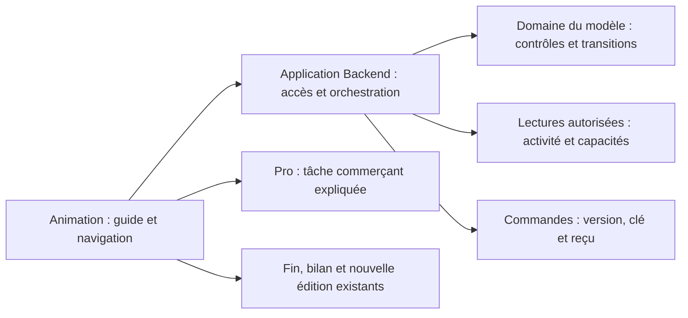

# Parcours organisateur : préparer, publier, suivre et réutiliser

**Arbitrage du 18 novembre 2026 — suites du workshop Animation :**
[E73-WA-DEC-01/02 et WA-13](../../roadmap/terminees/epic-73-animation-et-ou-coffrets-backlog.md#workshop-ux-20261118)
remplacent la destination de **PO-13** et de la décision **D2** ci-dessous.
Dans la fiche livrée par E85, une édition publiée ou en cours ouvre **Participation**. Bilan conserve son accès direct. Les anciens liens vers une rubrique précise retrouvent cette rubrique. La recette du nouveau parcours figure dans le [bilan de vérification E85](../epic-85-parcours-organisateur/verification-livraison.md).

## Évolution du 18 novembre 2026 — suivi Animation et Pro

**E73-EVO-SUIVI-ANIMATION** applique les cinq améliorations de l’[audit de
brainstorming du 17 novembre](../../audits/localeo-animation-pro-suivi-brainstorming-2026-11-17.md).
Le demandeur a explicitement sélectionné ce rapport le 18 novembre : **message
explicatif au scanner, sans nouvelle confirmation de sortie**. Le rapport
« décisions UX » et son complément passeport restent distincts ; leur nouveau
compteur de participations avec passage et la confirmation de sortie ne sont
pas adoptés. La préparation commerçante fait partie du présent lot, mais pas
la réorganisation du suivi des confirmations dans Animation.

L’évolution conserve la clôture historique d’E73 et les preuves PO antérieures.
Elle remplace seulement l’option expérimentale de filtre initial de fin (D7)
par l’ouverture ordinaire sur **À résoudre**, avec accès à tous les dossiers.
E56 reste propriétaire des décisions d’invitation et de préparation ; les
contrats du moteur restent propriétaires des validations et de la qualification.

### Critères et comportements SA

| Critère | Existant → cible observable et refus à préserver |
| --- | --- |
| SA-01 — Publication | Blocage générique et détour par Invitations → afficher les commerçants en attente, leur situation, échéance et actions autorisées auprès du blocage, avec lien vers le suivi complet. Relance disponible ou prochaine possibilité connue ; annulation secondaire avec conséquence et confirmation. Une relance ne vaut pas réponse ; les conditions de publication sont relues après l’action, sans publication automatique. |
| SA-02 — Invitations Pro | Entrée groupée → accès direct à chaque invitation présentée, avec nom de l’animation et échéance. Le lien n’accepte rien ; mission et décision restent dans le détail. Une liste importante reste navigable sans repousser le scanner, qui conserve sa priorité. |
| SA-03 — Préparation Pro | Invitation acceptée disparue des tâches → « Préparer mon commerce — [animation] » lorsque le suivi est actif, la préparation non confirmée et l’action autorisée. Télécharger un kit ne termine pas cette tâche. Une lecture fraîche retire une préparation confirmée ailleurs. Sans suivi, les consignes restent accessibles depuis Préparation, sans tâche de confirmation ni état terrain inventé. |
| SA-04 — Indicateurs | Libellés techniques seuls → questions et définitions courtes selon le modèle : inscriptions, parcours terminés/qualification, preuves ou passages. Ne pas renommer « Parcours commencés » en participations avec passage. Tombola : première validation effective qualifiante, validations ultérieures sans chance supplémentaire ; passeport : inscription distincte de fin ; Juste Prix : inscription distincte de réponse/qualification et passages configurables. Valeur absente = indisponible, jamais zéro ; date/source de chaque famille explicites. Aucun nouveau calcul métier. |
| SA-05 — Résultat incertain | « Validation non confirmée » → « Le passage reste à vérifier. Il a peut-être été enregistré. Vérifiez le résultat avant de recommencer. » Vérification principale ; si sa lecture échoue, le résultat reste inconnu. Expliquer que quitter n’annule pas une validation éventuellement enregistrée. **Aucune nouvelle confirmation de sortie**, aucun renvoi automatique, aucune récupération après fermeture promise. Conserver reçu, clé et renvoi conditionnel existants. |
| SA-06 — Fin | Ouverture ordinaire sur tous les dossiers → « À résoudre », sauf filtre/contexte explicite conservé. Lot et bénéficiaire identifient le dossier ; prochaine action disponible et acteur attendu seulement lorsque les données l’établissent. Responsable de remise connu pour lot externe, sinon acteur à confirmer. Information du gagnant, remise, réception et consommation du coffret restent distinctes. Clôturer un dossier conserve sa confirmation et ses conséquences. |
| SA-07 — Continuité | À chaque actualisation locale, préserver écran, filtres, saisies et focus ; ignorer les réponses obsolètes. Échec de lecture explicite avec réessai, aucun blocage disparu artificiellement. Révocation/session expirée retire les données privées. Clavier, mobile 390 px et texte 200 % sur les parcours modifiés. |

### Contrats, propriétaires et limites de coût

Les domaines backend décident des relances, annulations, déclarations de
préparation, validations et remises. Les nouvelles surfaces réutilisent les
commandes autorisées, sans commande groupée ni notification supplémentaire.

- **Publication :** réutiliser la liste paginée des demandes de participation,
  filtrée `EN_ATTENTE` ou `A_ENVOYER` selon le blocage serveur, 25 demandes par
  page, sans collecte exhaustive. Une invitation à envoyer renvoie vers le suivi
  complet ; elle ne propose pas une relance. Son
  contrôle d’accès organisateur reste requis. La projection expose les capacités
  `actions.relancer` / `actions.annuler` issues des règles existantes également
  pour Passeport/Tombola ; le motif d’indisponibilité et la prochaine relance
  restent expliqués. Aucun calcul de délai ni droit supplémentaire dans la vue.
- **Pro :** nom, échéance, suivi, `pret_at` et `actions.confirmer_pret` existent
  dans la projection. Réutiliser les lectures d’accueil sans enrichissement HTTP
  individuel ; borner la présentation et relire au retour visible. Le détail
  confirme encore les droits avant toute commande. Les requêtes existantes ne
  deviennent pas une nouvelle file exhaustive garantie.
- **Indicateurs :** conserver les valeurs et dates des projections d’exploitation
  existantes. Les agrégats différés ne sont pas présentés comme une lecture
  instantanée ; aucune comparaison de dates différentes sans explication.
- **Fin :** exposer dans le dossier autorisé le responsable de remise du lot
  externe déjà enregistré dans son snapshot ; ne pas déduire un destinataire
  à contacter de l’absence d’actions. Ce champ est additif et facultatif ; les
  consommateurs plus anciens continuent à fonctionner.

Aucune migration, index, cadence de polling ou écriture métier nouvelle n’est
prévue. Les enrichissements utilisent les faits déjà chargés ; vérifier leur
absence de N+1. Le nouveau bloc de publication charge au maximum une page à la
fois, à l’ouverture et après action explicite. Budget structurel : une lecture
HTTP paginée, nombre de requêtes SQL indépendant du nombre de lignes de la page,
aucun chargement exhaustif. Si les projections existantes provoquent des lectures
par demande, grouper ces lectures et mesurer N/10N avant de qualifier ce chemin.
Une limite non mesurée demeure visible au bilan, sans promesse de capacité.

### Lots, traçabilité et preuves prévues

| Lot / critères | Preuves attendues | Contrats, documentation, démonstration et livraison |
| --- | --- | --- |
| A — SA-02/03/05/07, Pro | Invitations multiples, préparation active/arrêtée, kit seul, confirmation ailleurs, accès restreint, réponses obsolètes ; validation incertaine et vérification encore indisponible, sortie directe. Tests Vitest puis navigateur mobile/clavier. | Guide commerçant et README applicatif ; fixtures synthétiques, aucun changement de générateur ou de donnée requis. Contrats existants suffisants. |
| B — SA-01/06/07, Backend et Animation | Relance autorisée/refusée, attente et réponse entre-temps, annulation confirmée ; droits, pages et coûts bornés ; fin filtrée, acteur connu/inconnu et action confirmée. Tests domaine/application/contrat puis parcours navigateur. | Projections additives, OpenAPI documentaire E41/E42 et contrats consommateurs à synchroniser selon leur portée. Guides organisateur/exploitation. Aucun changement de schéma ou scénario du générateur : fixtures couvrant les faits existants. Backend avant frontend pour les champs nouveaux. |
| C — SA-04/07, Animation | Tombola, passeport et Juste Prix : chiffres distincts, zéro réel, donnée absente, dates distinctes ; ordre lisible sur téléphone et texte agrandi. | Définitions dans la présente source et aide de suivi ; aucune modification de qualification, tirage ou agrégat. Données synthétiques uniquement. |

### Réalisation et bilan d’acceptation du 18 novembre 2026

Les sources de départ sont Projet `caa3bb0`, Backend `56464443`, Animation
`845d94a` et Pro `e60ce30`. Ces références et les contrôles locaux ne prouvent
pas une version déployée. Les cinq améliorations sont implémentées et vérifiées
localement, avec les limites de qualification d’usage ci-dessous.

| Critères | Réalisation et preuve locale | Limite |
| --- | --- | --- |
| SA-01 | Bloc partagé `PublicationInvitations` dans les parcours manuel, workflow, Chasse et assistant. Lecture paginée, capacités serveur, relance et annulation confirmée, relecture du contrôle. Pour les invitations classiques, une commande perdue suspend seulement les nouvelles actions de l’invitation concernée ; relire sa situation ne confirme pas la commande perdue. La Chasse conserve son protocole versionné et son reçu. | Tests PostgreSQL et navigateur réussis ; API navigateur simulée, aucune relance réelle. |
| SA-02/03 | Accès individuels, échéance sans heure artificielle, cinq tâches par page après le scanner. Une invitation non modifiable propose « Consulter ». Préparation fondée sur la capacité serveur ; consignes accessibles même sans suivi. | Lectures d’accueil existantes conservées, sans nouvelle garantie de file exhaustive. |
| SA-04 | Questions et définitions propres aux modèles dans Exploitation et Bilan ; dates/source, données absentes et zéro distingués. Les trois modèles sont exercés au navigateur, ainsi que l’actualisation et les erreurs d’Exploitation. | Aucun nouveau compteur « personnes ayant joué » ou « participation avec passage ». Compréhension réelle des chiffres à tester. |
| SA-05 | Message choisi, vérification principale et sortie directe. Les tests conservent le protocole de reçu et de renvoi conditionnel. | Aucune récupération après fermeture complète promise. |
| SA-06 | Ouverture sur À résoudre, dossier identifié par lot/bénéficiaire, responsable de remise externe issu du snapshot existant ; clôture dans un détail secondaire confirmé. Filtre explicite, réessai après refus et données privées retirées vérifiés au navigateur. | Responsable absent présenté comme inconnu. Aucun état de réception/consommation déduit d’une remise. |
| SA-07 | Générations de requêtes et contrôle de périmètre, erreurs avec réessai, retrait des données interdites, retour de focus lorsque son contrôle disparaît ou devient désactivé. | Recette synthétique et clavier ; essais physiques et compréhension utilisateur non réalisés. |

**Pro :** passage final de `tests/e2e/suivi-animation.spec.js`,
`attestations-moteur.spec.js`, `home-mobile.spec.js` et `animation-kit.spec.js` :
**13/13**, aucun skip ni flaky, sortie 0. Le rapport et les captures sont dans
`localeo-commercant/tmp/suivi-animation-4/`, avec `source-manifest.json` pour les
empreintes. Les cinq fichiers Vitest ciblés — accueil, kit, lectures Animation,
scan et contrats API — passent **60/60** ; journal
`tmp/suivi-animation-3/vitest.log`. Commandes : `npm test --` suivi de ces fichiers
et `npm run test:e2e --` suivi des quatre fichiers ci-dessus, `--workers=2`.
Les captures finales de l’accueil 390 px et du scanner à texte 200 % ont été
relues. L’émulation couvre aussi 1280 px, clavier, erreurs, révocation,
confirmation ailleurs et réponses obsolètes. Le passage navigateur 2 avait
échoué à **12/13** sur le focus du scanner, et Vitest à **59/60** sur le retrait
de la dernière tâche : ces défauts ont été corrigés puis retestés. Les rapports
antérieurs sont conservés, sans additionner leurs succès au passage final.
Le commit Pro est `333b760`. Après régénération du contrat avec le SHA backend
final, les **31 tests de contrats** ont été rejoués avec succès. Les empreintes
confirment que seules les métadonnées `info.version` ont changé depuis la recette
navigateur ; les sources applicatives et scénarios sont identiques. Cette
vérification est consignée dans `tmp/suivi-animation-final-contract/verification.json`.

**Animation (`80c4280`) :** `pnpm typecheck`, `pnpm lint` et les **382 tests** de `pnpm test`
réussissent, sans skip. Build PWA final synthétique réussi, sans configuration
opérateur, journal `tmp/suivi-animation-build-stable.log`. Les **31 tests de
contrats ciblés** passent encore après régénération de `info.version`.
Les recettes existantes Fin (**28 scénarios**, `tmp/fin-animation-captures-Dzlwyx/report.json`)
et productivité (**20 scénarios**, `tmp/productivity-operations-report-SR43Ou/results.json`)
réussissent après adaptation de l’accès secondaire à la clôture.

`node tests/browser/suivi-animation.mjs` vérifie les composants réels et le client
HTTP avec une API synthétique : **32/32 scénarios**, aucun skip, dans
`tmp/suivi-animation-2026-11-18T06-59-32.126Z/report.json`. Publication manuelle,
workflow, Chasse, assistant, pagination, permissions, refus, relecture échouée,
réponse obsolète, focus, indicateurs des trois modèles et dossiers Fin sont
couverts à 390/1280 px, avec passages à texte 200 %. La Chasse exige désormais
dans le mock la version attendue et un reçu conforme ; refus `VERSION_OBSOLETE`,
réponse perdue, reçu indisponible et disparition du blocage avant confirmation
sont vérifiés. Le test Fin reproduit puis vérifie le réessai après un refus 403.

Ce passage final utilise l’empreinte
`79448d6b1c34fed8d5faa4be4feab0670d7ce7eb646c68a27b346c855d5f7ec8`.
Il intègre le contrat à version backend finale, la largeur des alertes Chasse
à texte 200 % et la suppression du nom mémorisé dans un retour d’incertitude
après révocation d’accès. Les passages antérieurs de 32 puis cinq scénarios
ciblés sont conservés, sans additionner leurs succès au passage final. Les
captures publication, Chasse à 200 %, dossiers Fin et Bilan passeport ont été
relues. Les tentatives antérieures, dont le sélecteur de pagination incorrect,
restent disponibles avec leurs erreurs et leur contexte.
À la préparation du commit, seules les fins de ligne CRLF du nouveau helper
`followupMetrics.ts` ont été normalisées en LF pour satisfaire le contrôle Git,
sans modification de texte ni de comportement. L’empreinte après normalisation
est `21655b8bf5b83d4f9cf76376aea0c711406edb90dade74be891d6566226d77b2` ;
`line-ending-normalization.json` accompagne le rapport navigateur.

**Contrats :** ajout de `motif_relance_interdite`, des capacités classiques
`relancer`/`annuler` et du champ nullable `responsable_remise`. Le backend garde
l’autorité des commandes. E41/E42 et les contrats embarqués Animation/Pro sont
régénérés depuis le producteur. Cette synchronisation rattrape aussi des écarts
du générateur : consolidation de huit paires de schémas Input/Output en formes
équivalentes après normalisation des références, sans ajout/retrait de route.
L’exporteur Pro accepte désormais l’argument `plugins` du lanceur isolé backend ;
les garde-fous de ce lanceur restent actifs. Livrer le backend avant les nouvelles
interfaces ; un ancien producteur ne fournit pas les nouvelles capacités et
laisse le responsable inconnu.

**Backend (`20ae4539`) :** le passage final isolé réussit **912/912** tests,
dont **169** tests domaine/application/API ciblés et **743** contrôles
d’architecture, sans échec ni skip. Il couvre les capacités et leurs refus,
la préparation, les politiques de publication, les dossiers Fin et les API
Chasse. Lanceur : `.artifacts/python-e70/runtime/python.exe
scripts/validation/test_isolated.py`. Journaux et JUnit :
`.artifacts/e73-suivi-animation-final-03.{log,xml}` ; détail des commandes dans
`.artifacts/e73-suivi-animation-bilan.md` du backend. Deux avertissements de
dépréciation Starlette/httpx/anyio restent visibles, sans changement de dépendance.

La recette PostgreSQL isolée de
`tests/security/test_suivi_animation_lectures_postgres.py`,
`test_fin_animation_lectures_postgres.py` et `test_fin_animation_postgres.py`
passe **35/35**, sans skip. Elle couvre notamment droits, responsable connu ou
absent, clôture/reçus, rollback, concurrence, coffret distinct de consommation
et pagination sur 1 000 dossiers. Ce passage précède le dernier resserrement
Publication ; le code Fin est inchangé depuis. Rapport
`.artifacts/e73-suivi-animation-pg-tests-01.{log,xml}`.

Le passage final Publication (`test_suivi_animation_lectures_postgres.py -k
publication`) passe **3/3**, sans skip ; trois cas Fin sont explicitement
désélectionnés car déjà vérifiés sur le même code. Rapport
`.artifacts/e73-suivi-animation-pg-publication-02.{log,xml}` et plans
`EXPLAIN (ANALYZE, BUFFERS)` dans `tmp/e73-suivi-animation-pg-publication-02/`.

| Lecture locale | Volumes et pages | Résultat structurel |
| --- | --- | --- |
| Publication finale | 100 puis 1 000 demandes en attente ; ajout de 1 000 acceptées ; pages de 25 et 100 | **7 SELECT** dans chaque cas, aucune lecture de cohorte acceptée, racines hydratées au plus égales à la page ; réponses d’environ 31,1/124,4 ko. |
| Fin | 10 puis 100 dossiers, pages de 1 et 10 ; régression existante à 1 000 dossiers, pages 1/10/50 | **11 SELECT** constants, racines au plus égales à la limite + 1. |

La première mesure Publication comptait neuf SELECT mais conservait deux
lectures inutiles des commerces acceptés : elle ne qualifie pas la version
finale. Les temps locaux varient avec Windows/OneDrive et ne sont ni un SLA
ni une preuve de débit hébergé. Aucun essai de charge mixte ou de trafic soutenu
n’a été exécuté. La liste Pro multi-animations acceptées garde son chargement
historique ; ce lot ne lui attribue pas le budget du nouveau bloc Publication.
Le cluster PostgreSQL temporaire a été arrêté et cet arrêt vérifié.

**Revue indépendante :** la frontière backend/contrats est relue sans écart
bloquant. La revue a révélé l’absence de version dans la première intégration
Chasse et une heure artificielle sur l’échéance civile. Le raccordement au
protocole Chasse et l’affichage date seule sont corrigés, relus indépendamment
et vérifiés au navigateur. Les doubles lectures, pertes de focus
et états de réessai relevés pendant la recette restent tracés avec leurs essais.

**Impacts :** guides commerçant/organisateur, catalogue de recette Animation,
liens E56/Fin, roadmap et spécification actualisés. Aucune migration, nouveau
paramètre de configuration ou activation Juste Prix. Le générateur de démonstration
reste inchangé : les nouveaux affichages utilisent des faits existants, exercés
par des fixtures synthétiques. Aucun nouvel envoi, polling, calcul métier ou
commande en masse ; aucune campagne de débit soutenu justifiée par ce lot.

Contrôles documentaires finaux : `python scripts/check_guidance.py` — **99 guides,
1 344 liens, aucune erreur ni avertissement** ;
`python scripts/sync_documentation.py --check-sources` — **151 documents vérifiés**.
Les vérifications Git des quatre dépôts modifiés ne signalent plus d’erreur
d’espacement. Les autres travaux documentaires présents avant ce lot sont
conservés séparément.

Les essais avec associations/commerçants et appareils physiques du rapport
restent distincts des tests automatisés et ne sont pas réputés exécutés.
Marketplace/Live, ERP et batchs ne reçoivent aucun nouveau comportement ; les
effets acquis des lots et participations sont préservés. Aucun déploiement demandé.

## Réalisation historique du 17 novembre 2026 — parcours organisateur

Version du **17 novembre 2026** — **E73-EVO-PARCOURS-ORGANISATEUR**.

**Implémentation locale du 17 novembre 2026 réalisée.** Les six lots de cette
extension sont réalisés ; le bilan de réalisation et les limites de recette
figurent en fin de document. L'état historique de l'EPIC 73 reste conservé.

Spécification des **six améliorations** demandées après l'[audit initial](../../audits/animation/localeo-animation-utilisabilite-pilotage-2026-11-17.md) et sa [contre-expertise indépendante](../../audits/animation/localeo-animation-contre-expertise-ux-2026-11-17.md). La demande de spécification adopte les orientations et les propositions d'arbitrage décrites ici ; la demande suivante autorise leur implémentation. Les constats et limites de preuve des rapports restent distincts des comportements cibles.

Suivi : [backlog E73](../../roadmap/terminees/epic-73-animation-et-ou-coffrets-backlog.md) et [roadmap commune](../../roadmap/README.md). La clôture historique de l'EPIC 73 et les réserves des extensions antérieures sont conservées. **PO-01 à PO-30** complètent les critères existants ; les six **CU-01 à CU-06** restent la référence de création homogène, sans seconde définition ni nouvelle numérotation.

## 1. Résultat attendu et périmètre

Une association de commerçants ou une collectivité, avec une aisance numérique variable, peut comprendre ce qui manque, agir ou identifier l'acteur attendu, publier après confirmation effective, retrouver son activité, terminer une édition et préparer la suivante sans perdre son travail.

Six lots fonctionnels, sur ordinateur, tablette et téléphone :

| Lot | Amélioration | Critères propres | Références conservées |
| --- | --- | --- | --- |
| L1 | Aller jusqu'à la publication avec des corrections compréhensibles | PO-01 à PO-06 | AP-01, AP-12 à AP-17 ; parcours métier de chaque modèle |
| L2 | Protéger la saisie, reprendre au bon endroit et distinguer les résultats incertains | PO-07 à PO-11 | AP-03 à AP-06 ; protocoles de commandes existants |
| L3 | Atteindre directement l'activité et les résultats | PO-12 à PO-17 | AP-01/02/07, AP-11 ; mesures et alertes existantes |
| L4 | Partager les conventions de création entre les modèles | PO-18/19 et CU-01 à CU-06 | [Création homogène](perimetres-parcours-saas.md#règle-du-17-novembre-2026--création-homogène-des-animations) |
| L5 | Garder une interface utilisable sur petit écran et à fort zoom | PO-20 à PO-24 | AP-11, CU-06 ; règles de gestion accessibles |
| L6 | Enchaîner fin d'édition, bilan et réutilisation prévisible | PO-25 à PO-30 | AP-18 à AP-20, FA-01 à FA-09, CL-01 à CL-12 |

Applications : **Animation** présente et orchestre ; **Backend** reste propriétaire des droits, contrôles, transitions, capacités de réemploi et reçus ; **Projet** porte cette spécification et les contrats documentaires. **Pro** reste le point d'intervention commerçant ; **Live/Marketplace** reste l'application habitant. Coffrets, bons et lots externes gardent leurs règles propres. Aucune action organisateur ne simule une validation commerçant, une participation, une remise ou une consommation.

Hors périmètre : nouveau tableau de bord ou file globale exhaustive, nouvelle métrique métier, copie de sections de scénario non supportées, reconduction d'accords, changement de règles de publication/fin, envoi de notifications supplémentaire et implémentation de la clôture automatique CAF déjà spécifiée séparément.

## 2. Arbitrages retenus

| Décision | Comportement retenu et limite |
| --- | --- |
| D1 — Arrivée selon la phase | L'ouverture ordinaire dépend de la phase fournie par le serveur. Un lien de tâche explicite, un retour valide ou une reprise explicite prime. Aucun changement automatique d'écran après une mise à jour de phase. La mémorisation implicite du dernier groupe reste une idée à tester. |
| D2 — Accès au suivi et aux chiffres (remplacée le 18 novembre) | Selon E73-WA-DEC-02, **Consulter le suivi** ouvre **Suivi de l’animation**, opérationnel ; **Bilan** dispose d’un accès séparé explicite pour les chiffres. La décision du 17 novembre visant Bilan depuis Consulter le suivi est remplacée. La destination indépendante de Résultats vers Bilan et l’accès séparé à Fin et archivage sont conservés. |
| D3 — Interventions | Réutiliser d'abord alertes, messages, validations, lots/remises et dossiers de fin existants, avec liens contextuels et habilitations. Inventorier les manques avant toute file supplémentaire ; une page de statistiques ne devient pas une file complète. |
| D4 — Promesse de durée | Mesurer **créer et publier**, selon modèle et prérequis, jusqu'à publication confirmée. Séparer temps actif, préparatifs et attente externe. La Chasse accompagnée conserve son objectif de préparation de cinq jours ouvrés et ses règles propres. Une demande acceptée ou un brouillon créé n'est pas une publication. Aucun délai universel validé à ce jour. |
| D5 — Réemploi | Annoncer avant confirmation les sections réellement disponibles pour la source et ses variantes. Nouvelle dotation, nouvelles dates, nouveaux accords et validations obligatoires selon les règles existantes. Une section indisponible expliquée ne constitue pas un défaut de clonage. |
| D6 — Homogénéité | Appliquer CU-01 à CU-06 à tous les modèles disponibles ; conserver leurs étapes métier utiles. Une action « Suivant » ne crée, ne paie et ne publie pas implicitement. |
| D7 — Expérimentations limitées | En-têtes mobiles plus compacts, mémoire de groupe, filtre initial « À résoudre », comparatif enrichi de modèles et aide à l'invitation restent des essais. Aucun n'est nécessaire pour corriger une perte de saisie, un refus illisible ou un recouvrement à fort zoom. |

Ces décisions précisent les règles antérieures : D2 remplace, pour **Résultats pendant une édition active uniquement**, l'ouverture systématique de la première rubrique du groupe décidée le 31 octobre. PO-13 précise la destination de la recommandation AP-01 ; son calcul et son autorité restent côté serveur. Les autres comportements AP, CL, FA et CU restent applicables.

## 3. Existant vérifié et écarts à traiter

Lecture ciblée des dépôts locaux du 17 novembre, complétée par les preuves du build TEST consignées dans la contre-expertise. Les commits locaux ne prouvent pas la version déployée. Aucun appel métier ou test applicatif n'a été exécuté pendant cette spécification.

| Constat vérifié | Conséquence pour la conception |
| --- | --- |
| L'entrée `/animations/:id` ouvre actuellement `workflow`. Les liens `onglet`/`tab` et plusieurs alias existent. Un changement d'onglet perd les paramètres de préparation ; les étapes Chasse ne mettent pas l'URL à jour. | Modifier le choix d'arrivée et rendre la sous-étape adressable, sans supprimer les liens historiques ni les retours autorisés. |
| L'assistant fournit étape, acteur et action ; les contrôles Chasse utilisent des messages et un `chemin` non typé ; la vérification de publication expose aussi des chaînes. Il n'existe pas de motif–acteur–correction exact universel. | Corriger les libellés connus dès L1 ; structurer les seules destinations/attributions manquantes avant de promettre une correction exacte de chaque blocage. Ne pas router un message libre. |
| La configuration manuelle et plusieurs éditeurs sont gardés ; `ExploitationParameters` et la configuration commune Chasse ne raccordent pas toute leur saisie à la garde globale. | Raccorder ces formulaires au mécanisme commun et vérifier l'inventaire des autres formulaires ; une seule invite de sortie par navigation. |
| Les familles création manuelle, préparation Chasse et clonage ont des rapprochements de commandes différents. Le clonage distingue mieux absence explicite, refus d'accès et expiration. | Exiger une même compréhension du résultat, sans annoncer une garantie de reprise tant que le contrat de la famille ne la prouve pas. |
| Phase serveur, recommandation, actions autorisées et Bilan en phase active existent. Le suivi Juste Prix observé ne donne pas les chiffres immédiatement. | Réutiliser les projections et le Bilan, sans nouvel agrégateur ni calcul temporel dans le navigateur. |
| Fin possède déjà un guide, des filtres serveur et des lectures ciblées de dossier. La préparation du clonage expose les capacités de trois sections avant commande. | Raccorder ces parcours ; ne pas reconstruire un second guide de fin ni charger les capacités détaillées de chaque ligne de liste. |
| Le cumul d'éléments fixes rend le guide illisible à 400 % ; des confirmations tactiles ont une cible trop petite. Les appareils physiques restent à recetter. | Corriger les recouvrements et les zones activables, puis valider sur plusieurs supports ; ne pas déduire une conformité globale de quelques écrans. |

## 4. Comportements et critères d'acceptation

### L1 — Préparer jusqu'à la publication

Acteur : organisateur autorisé à lire l'animation ; seules les actions permises par ses droits sont exécutables. Préconditions : commune active et animation accessibles, données de contrôle chargées ou indisponibilité affichée.

| ID | Action, résultat observable et refus significatif |
| --- | --- |
| PO-01 | Chaque blocage de publication affiche un texte métier, ce qui manque, l'acteur attendu et l'action possible à proximité. Couvrir notamment `VITRINES_NON_PREPAREES` et expliquer aussi l'avertissement `AUCUN_ASSET_PERSONNALISE`, sans le transformer en refus. Un code technique n'est jamais l'explication principale ; il peut rester dans un détail de diagnostic. Code inconnu ou acteur non attribuable : refus et **responsable à confirmer**, avec réessai/assistance adaptés, sans acteur ni correction inventés. |
| PO-02 | Un organisateur autorisé à corriger ouvre le **champ, la section ou l'objet exact** signalé : présentation, calendrier, dotation, règlement, parcours, terrain, vitrines ou produits selon le modèle. Le retour rejoint le contrôle d'origine. Une tâche commerçant indique l'attente dans **Localeo Pro** ; une tâche Localeo indique l'attente de préparation. Aucun bouton organisateur ne donne accès à une interface d'un autre acteur ni ne valide à sa place. Un lecteur voit le motif et l'acteur, sans commande interdite. |
| PO-03 | Enregistrer une correction confirmée relit le contrôle concerné et la disponibilité de publication sans reconstruire les autres éditeurs. L'échec de relecture affiche « vérification indisponible », conserve les données et n'affiche aucune coche de validation périmée comme actuelle. Une réponse antérieure à la correction est ignorée. Une publication ultérieure refait ses contrôles serveur. |
| PO-04 | À l'entrée ordinaire de préparation, le guide propose le prochain contrôle utile selon sa progression serveur ; une étape explicitement demandée reste prioritaire. Le parcours manuel et la Chasse utilisent les mêmes conventions de correction/retour. Une étape déjà validée reste consultable. Aucun saut n'efface une saisie ni ne masque un blocage d'un autre acteur. |
| PO-05 | Une publication affiche distinctement **en cours**, **confirmée**, **refusée** ou **résultat à vérifier**. Le succès suit un résultat serveur compatible ou un reçu rapproché ; une URL de retour de paiement, une absence d'erreur ou une statistique ne le prouve pas. Après confirmation, statut mis à jour et liens explicites **Voir le bilan**, **Préparer la communication** et accès existant au pilotage sont présentés selon droits. Aucune nouvelle commande n'est lancée automatiquement. |
| PO-06 | Une commande indisponible expose son motif dans le contenu accessible, sans dépendre d'un survol ou du seul attribut `title`. Une lecture de clôture vide, ancienne ou échouée n'active jamais la commande : seule une capacité explicite actuelle le permet. Les verbes décrivent l'effet réel : **Modifier les dates**, **Ouvrir le flyer** pour une navigation, **Télécharger** seulement pour un téléchargement effectif. |

### L2 — Protection et reprise du travail

Acteurs : organisateur éditeur et lecteur lorsque celui-ci utilise un filtre ou un retour de lecture. Toute reprise est liée à la session, à la commune et à l'animation autorisées.

| ID | Action, résultat observable et refus significatif |
| --- | --- |
| PO-07 | Une modification non enregistrée des paramètres d'exploitation ou de la configuration commune Chasse déclenche la garde commune, comme les formulaires déjà protégés : rubrique, menu, lien, Retour/Avancer, changement de commune/organisation et départ vers un autre parcours. **Continuer la saisie** garde valeurs, URL, sous-étape et focus ; **Quitter sans enregistrer** effectue le départ demandé. Formulaire intact : aucune invite. Rechargement/fermeture utilise la protection native disponible ; aucune récupération après crash n'est promise. |
| PO-08 | Une sous-étape Chasse et une section de paramètres sont adressables par une URL validée ; l'URL suit une navigation acceptée, jamais une navigation refusée. Retour/Avancer restaure l'étape correspondante sans écriture métier. Garder les alias et retours de paiement existants, ainsi que les retours internes autorisés ; une valeur inconnue revient à une rubrique autorisée expliquée, sans écran vide ni URL externe acceptée. |
| PO-09 | Une correction, une fiche, un dossier de fin ou un clonage ouvert depuis une liste revient à cette liste avec filtres, page/curseur encore valable, position et déclencheur. Une reprise d'éditeur garde sa sous-étape valide pendant la session ; le rechargement ne restaure que les données enregistrées et l'étape adressable. Si cible ou droits ont disparu, expliquer puis proposer le retour autorisé. Aucun brouillon privé n'est enregistré dans le stockage durable du navigateur. |
| PO-10 | Une actualisation locale conserve formulaire, filtres, ouverture des panneaux, navigation et focus ; elle ne remplace pas une saisie modifiée avec une donnée relue. Annuler/ignorer les réponses obsolètes. Changement de périmètre accepté ou session révoquée : invalider les anciennes lectures/caches et ne transférer aucun brouillon à une autre commune. Les résultats ne sont jamais remplacés par une réponse de l'ancien périmètre. |
| PO-11 | Pour création manuelle, préparation Chasse, paramètres, publication et clonage : une commande en cours ou incertaine conserve son intention et ses restrictions. Après réponse perdue, proposer la vérification du résultat ; renvoyer la même intention seulement après **absence explicitement établie par le protocole de cette commande**, avec même clé et même corps. Un simple 404, une expiration de reçu, un refus d'accès ou un résultat incompatible ne prouvent pas l'absence. Résultat confirmé : un seul objet/effet et poursuite explicite ; conflit : relire puis faire confirmer une nouvelle intention. Pour la création manuelle, une clé sans reçu retrouvable reste indéterminée et bloque le renvoi, selon §6.3 ; aucune récupération complète n'est promise pour ce cas. Ne pas réduire cette garantie à la stabilité d'une clé. |

### L3 — Activité et résultats immédiatement accessibles

Le choix de destination est une présentation de faits serveur, pas une nouvelle politique de transition.

| Phase serveur / situation | Ouverture ordinaire sans intention explicite | Entrée dans le groupe Résultats |
| --- | --- | --- |
| Préparation : `BROUILLON`, `CONFIGUREE`, `PRETE_A_PUBLIER` | Assistant / préparation utile, selon modèle et PO-04 | Première rubrique autorisée, selon la règle actuelle ; Bilan accessible directement si autorisé |
| `PUBLIEE`, `EN_COURS` | Bilan, pour voir l'activité ; accès clair au pilotage existant | Bilan |
| `CLOTUREE` | Fin et archivage : prochaines opérations autorisées | Fin et archivage |
| `TERMINEE`, `ARCHIVEE`, `ANNULEE` | Bilan ; consultation et clonage selon capacités | Première rubrique autorisée, selon la règle actuelle ; cliquer le groupe déjà actif conserve Bilan lorsqu'il est ouvert |
| Phase absente/inconnue ou lecture indisponible | Vue générale de l'animation et état indisponible ; aucun état/action inventé | Rubrique autorisée explicite ou état de lecture indisponible |

Une sous-phase serveur de tirage/gains peut préciser le lien de prochaine action. Atteindre une date dans le navigateur ne suffit pas à changer de phase. Un lien explicite vers tirage, dossier, configuration, suivi ou une autre rubrique autorisée prime sur ce tableau. L'arrivée à un état terminal ne confère aucun droit de modification ; le clonage reste une commande distincte sur une nouvelle édition.

| ID | Action, résultat observable et refus significatif |
| --- | --- |
| PO-12 | Appliquer le tableau à l'ouverture ordinaire après lecture de la cible autorisée. Priorité : lien de tâche explicite ; retour/reprise explicites valides ; défaut de phase. Une mise à jour de statut ou de recommandation après ouverture ne déplace pas l'utilisateur ; elle peut actualiser une action visible. Les groupes déduisent leur état actif de la rubrique réellement ouverte. |
| PO-13 | **Cible révisée le 18 novembre selon E73-WA-DEC-02 / E73-WA-13 :** l’action serveur **Consulter le suivi**, lorsqu’elle signifie consultation ordinaire sans tâche particulière, cible **Suivi de l’animation**, opérationnel, pour les modèles couverts. La décision antérieure visant Bilan est remplacée ; **Bilan** conserve un accès distinct et explicite aux chiffres. Ajuster la politique commune sans règle concurrente par écran ; conserver droits, contexte/retour et définitions. **Localeo Live** désigne uniquement l’application habitant. Les preuves du 17 novembre restent historiques et doivent être renouvelées sur la nouvelle destination. |
| PO-14 | Pendant une édition active, cliquer **Résultats** ouvre Bilan, sauf intention explicite contraire ou clic sur le groupe déjà actif, qui conserve la rubrique courante. Fin/archivage, tirage et gains restent des destinations visibles selon droits. Une action de lecture ne lance ni clôture, ni tirage, ni envoi de gain. La décision remplace uniquement le défaut concerné du 31 octobre. |
| PO-15 | Les chiffres conservent leurs populations et définitions : inscrits, parcours terminés, éligibles, gagnants, lots remis/consommés ne sont pas fusionnés. Présenter période, périmètre et date disponibles là où ils sont nécessaires ; différencier date de lecture et date de calcul. Zéro est affiché seulement pour un résultat calculé disponible. Chargement, indisponibilité et absence d'activité sont distincts. Réutiliser le Bilan et les exports existants sans nouvelle fréquence de polling. |
| PO-16 | Depuis le suivi/Bilan, une situation actionnable renvoie vers la validation, le message habitant, le lot/remise ou le dossier de fin **existant et autorisé**. Inventorier pour chaque lien source, signification, portée, fraîcheur et droit. Une statistique seule ne devient pas une alerte. Si une référence manque ou n'est pas autorisée, expliquer et proposer la liste filtrée existante sans fabriquer de référence. Aucune somme de pages partielles ne devient un compteur global. |
| PO-17 | Les libellés de console utilisent des termes d'organisateur cohérents entre accueil, liste, fiche et guide. Retirer le jargon d'implémentation exposé (`MVP`, moteur, identifiant `poi`) au profit de son sens métier, sans modifier les codes internes, événements ou définitions des mesures. L'utilisateur distingue une tâche pour lui, une attente commerçant dans Pro et une consultation de résultats. |

### L4 — Création homogène, contenu adapté

Les [CU-01 à CU-06](perimetres-parcours-saas.md#règle-du-17-novembre-2026--création-homogène-des-animations) portent déjà cadre, actions, contenu, refus, reprise et supports. L4 réalise leurs écarts et produit leur recette comparative ; il ne crée pas un nouveau wizard identique pour tous.

| ID | Action, résultat observable et refus significatif |
| --- | --- |
| PO-18 | Les entrées liste et catalogue conduisent au même parcours canonique par modèle/variante, avec cadre et conventions CU communs. Couvrir au minimum les modèles disponibles : tombola locale, tombola publique, passeport, Chasse, Juste Prix et Jeu des vitrines, selon leurs variantes réellement exposées. Étapes commerces/terrain, demande accompagnée et dotation ne sont présentées que si utiles. Le passage à une autre option conserve les données compatibles et explique celles qui doivent être ressaisies. Le clonage conserve son identité de nouvelle édition, avec les mêmes conventions d'interaction. |
| PO-19 | Pour chaque famille de création, la revue permet la correction ciblée puis le retour ; l'action finale nomme son résultat réel : **Créer le brouillon**, **Demander la préparation** ou publication distincte. Un retour confirmé mène à la suite utile. Évaluer la promesse de durée sur cas préparés jusqu'à publication confirmée, en séparant création seule, attente et travail hors outil. Un résultat Chasse accompagné n'est jamais présenté comme une animation publiée en quelques minutes. |

### L5 — Petit écran, zoom et accessibilité

| ID | Action, résultat observable et refus significatif |
| --- | --- |
| PO-20 | Le guide de préparation reste lisible et utilisable à **400 %** sur un viewport de référence de 1 280 × 1 024 px avant zoom, ainsi qu'à faible hauteur. Chaque étape, champ, erreur et action reste atteignable par défilement et clavier. Les couches fixes ne recouvrent ni contenu utile ni focus ; une barre peut devenir non fixe lorsque la hauteur l'exige. Aucun besoin de réduction manuelle du zoom pour terminer. |
| PO-21 | À **320 CSS px**, téléphone/tablette portrait et paysage, et texte agrandi **200 %**, absence de défilement horizontal global pour les parcours couverts. Clavier virtuel ouvert : champ actif, message d'erreur et commande restent accessibles. Rotation, retour d'arrière-plan et verrouillage ne perdent pas une saisie encore en mémoire ; une session expirée suit les règles d'accès, sans faux succès. Les tableaux réellement bidimensionnels peuvent avoir un défilement local annoncé et utilisable. |
| PO-22 | Les confirmations de clôture/retrait et leurs labels ont une zone activable d'au moins **44 × 44 CSS px**, conformément à la convention produit, sans changer leur effet métier. Mesurer la surface cliquable réelle en portrait, paysage et tablette, pas uniquement l'icône. Cette exigence interne ne vaut pas certification globale de conformité. |
| PO-23 | Toutes les tâches L1 à L6 sont réalisables au clavier, avec ordre logique, nom accessible, focus visible/non masqué, erreur associée au champ et état annoncé sans dépendre d'une couleur. Chargement et actualisation locale sont annoncés sans voler systématiquement le focus. Dialogue de garde/confirmation : focus contenu puis retour à l'élément pertinent ; lien profond vers section : repère annoncé et focus adapté à la tâche. |
| PO-24 | Recette sur appareils physiques iOS/Android et tablette, plus clavier physique et lecteur d'écran de référence. Conserver contexte et bornes des listes dans des jeux réalistes. Comparer tout en-tête mobile compact avec la version corrigée avant adoption : tous les repères et actions nécessaires restent trouvables. Les résultats synthétiques, émulations et essais physiques sont consignés séparément avec leurs limites. |

### L6 — Fin et réutilisation prévisibles

Acteur : organisateur autorisé ; le lecteur consulte les résultats et explications sans recevoir de commande. Les règles de [fin et archives](fin-animation-archives.md), [gestion des lots](gestion-lots-remises.md) et [clonage](clonage-animation.md) restent propriétaires de leurs décisions.

| ID | Action, résultat observable et refus significatif |
| --- | --- |
| PO-25 | Après clôture ou tirage confirmé, proposer la prochaine étape réellement applicable du guide de fin : attendre une opération, traiter les gains/dossiers, terminer puis archiver selon capacités. Pas de séquence universelle imposant un tirage à un modèle qui n'en a pas. Publication, clôture, fin et archivage gardent leurs effets distincts ; l'échec d'une lecture ne rend pas une étape disponible. |
| PO-26 | Ouvrir depuis un gain le dossier de fin référencé par le serveur, sans parcourir toutes les pages ; revenir au gain et à son contexte. Dossier absent/inaccessible expliqué. Décision sur dossier : version, motif, confirmation et idempotence existants ; conflit impose relecture/reconfirmation. Compteurs distincts dossiers/unités/opérations. Les filtres **À résoudre / Tous** restent serveur ; leur défaut actuel est conservé tant que l'essai ne justifie pas un changement. Après fin/archivage, conserver le gel et sa seule exception existante de retrait forcé d'un lot externe explicitement clôturé, lorsque le serveur expose `FORCER_RETRAIT`, avec versions, motif et confirmation ; aucune autre remise n'est réouverte. |
| PO-27 | Depuis fin/archives ou Bilan, **Cloner l'animation** ouvre le mécanisme existant sans dépendre d'un calcul statistique. Avant confirmation, afficher source, commune, moteur/modèle, sections disponibles et leurs motifs d'indisponibilité ; distinguer contenu réutilisé et travail restant. La sélection des sections reste explicite. Aucun chargement de capacité détaillée pour toutes les lignes de liste. |
| PO-28 | Produire et vérifier la matrice modèle × variante × section (`TEXTES`, `VISUELS`, `SCENARIO_PARAMETRES`) à partir des préparations serveur et de fixtures. Les quatre moteurs historiques peuvent reprendre un scénario compatible ; Juste Prix et Jeu des vitrines sont actuellement non supportés pour cette section. Une restriction liée aux visuels ou à une variante est expliquée. Une section attendue compatible mais perdue/refusée est un correctif ; élargir les copies supportées exige une évolution métier séparée. |
| PO-29 | Le récapitulatif du clone rend explicites nouvelles dates, nouvelle dotation, nouvelle sélection/accords commerçants et revalidations terrain/règlement selon le modèle. Aucun participant, QR personnel, consentement, paiement, stock engagé, tirage, gain, remise, compteur ou état exécuté n'est repris. La commande contrôle droits, version/empreinte source, disponibilité/provenance des médias et crée atomiquement un **nouveau brouillon** de la même commune et du même moteur. Source inchangée ; reçu et résultat identifient la cible. |
| PO-30 | Après création confirmée du clone, ouvrir sa préparation utile et indiquer ce qui reste à faire avant publication. Réponse perdue/conflit suit PO-11, sans seconde édition créée. Sur les mêmes cas préparés, relever le travail effectivement évité et le temps jusqu'à nouvelle publication ; ne pas assimiler une copie de textes à une reprise de scénario complète. Les limites de couverture sont visibles avant l'engagement, sans promettre un pourcentage de gain non mesuré. |

## 5. Responsabilités, invariants et flux

Les domaines existants restent propriétaires ; cette évolution ne crée ni agrégat parallèle, ni état métier « UX », ni file de priorisation locale.

| Règle qui reste vraie | Propriétaire et entrées | Succès, refus et répétition à prouver |
| --- | --- | --- |
| Les contrôles de publication et droits sont courants au moment de la commande | Domaine Animation et règles du modèle ; application charge, autorise et orchestre ; API/ERP/batch existants | Un indicateur lu ou une correction côté console n'autorise pas la publication ; contrôle refusé → aucun changement d'état. |
| Une recommandation décrit une action, sans l'exécuter ni lui donner de droit | [Politique de recommandation](../../../../localeo-backend/app/domaine/animation_locale/services/recommandation_animation.py), projection de productivité | Faits/droits identiques → même code/motif/destination dans accueil, liste, fiche, workflow ; destination de consultation modifiée conformément à PO-13. |
| Une intention journalisée ne crée qu'un effet ; une réponse perdue n'est pas un échec certain | Services applicatifs de commande, stockage des clés/reçus et transactions ; adaptateurs HTTP traduisent sans inventer d'absence | Double clic, concurrence et reprise après commit conservent un seul effet pour les preuves conservées ; accès retiré ou reçu expiré n'autorise pas une nouvelle intention automatique. Anciennes clés déjà purgées : résultat indéterminé et limite de l'ancien POST direct selon §6.3, sans garantie rétroactive. |
| Fin, remise, consommation et archivage ne sont pas interchangeables | Domaine fin d'animation, gains, Coffrets et lots ; API/ERP/batch passent par leurs règles | Message envoyé, coffret expédié ou compteur ne vaut pas remise ; version obsolète refuse, relecture puis confirmation. |
| Un clone est une édition indépendante dans le périmètre autorisé | [NouvelleEdition](../../../../localeo-backend/app/domaine/animation_locale/valorisation/regles.py) et [service d'éditions](../../../../localeo-backend/app/application/animation_locale/services/editions_animation.py) | Liste blanche, provenance, source/version/empreinte et médias contrôlés à confirmation ; copie interdite → refus atomique, source inchangée, aucun brouillon partiel. |
| Une lecture locale ne perd pas le travail ni ne mélange les périmètres | Animation : garde commune, routage, contexte de lecture et clés de cache ; serveur : autorisation à chaque lecture | Réponse ancienne ignorée, sortie refusée conserve tout, commune acceptée invalide le contexte ; absence de droit purge la surface privée concernée. |



L1 relie **contrôle → correction exacte → enregistrement confirmé → relecture du contrôle → publication confirmée → suite explicite**. L2 protège chacun de ces passages. L3 utilise les lectures existantes ; L6 réemploie leurs références ciblées. Aucun changement d'écran, groupe ou URL ne produit d'écriture métier.

## 6. Contrats et compatibilité

### 6.1 Lectures et navigation réutilisées

Réutiliser `AnimationSummaryPayload.workflow`, `statut`, `modele_code`, `recommandation` et les actions/capacités déjà exposées. Les phases et sous-phases du schéma consommé priment sur une enum de présentation ; ne pas recalculer l'échéance effective dans le navigateur. Une table phase → destination ordinaire suffit à PO-12, sans nouveau champ API. **PO-13** modifie la destination de consultation dans la politique serveur et les attentes de ses consommateurs ; il ne change ni l'ensemble des transitions ni la portée de `a_traiter`.

La vérification de publication fournit actuellement `valide`, `erreurs`, `avertissements` et `actions_requises`. L'assistant fournit déjà `acteur` et action `NAV_*` ; la progression Chasse expose des `code/message/chemin`. Consommer les informations déjà suffisantes ; étendre uniquement les réponses qui ne permettent pas d'identifier correctement le destinataire de la correction.

### 6.2 Contrôles structurés manquants : extension additive cible

Les schémas de préparation sont déjà fermés (`additionalProperties:false`) : **ne pas remplacer** leur tableau `controles` par un autre format. La cible précise les deux emplacements :

| Réponse existante / route | Extension cible |
| --- | --- |
| `ValidationPublicationAnimationPayload`, `GET /protected/animation-locale/animations/{animation_id}/validation-publication` et homologue `/internal/...` | Ajouter à la **racine** `controles_publication`, collection optionnelle de `ControlePublicationOrganisateurPayload`. Conserver `valide`, `erreurs`, `avertissements` et `actions_requises` avec leur sémantique historique. |
| `AvancementPreparationPayload`, `GET /protected/animation-locale/animations/{animation_id}/preparation/avancement` et homologue `/internal/...` | Enrichir le type **`ActionAvancementPreparation`**, présent dans **`rubriques[].controles[].actions[]` et `blocages[]`**, par `acteur` et `correction` optionnels. Conserver `code`, `message`, `chemin`. Le contrôle agrégateur `ControleAvancementPreparation` garde ses champs requis `id`, `libelle`, `statut`, `actions` ; aucune substitution de tableau. |

Ajouter sur ces lectures un paramètre optionnel **`guidage=structure_v1`**. Absent : sérialisation historique inchangée, sans champs supplémentaires ; présent : champs enrichis selon le schéma généré. Valeur inconnue refusée selon la validation API. Ce choix évite d'imposer des champs inattendus à un ancien lecteur qui valide strictement les objets. Le nouveau client sait fonctionner sans l'enrichissement ; ne pas envoyer ce paramètre à un ancien producteur avant livraison de son support.

`ControlePublicationOrganisateurPayload` porte `code`, `etat`, `message`, `acteur` et `correction`. Pour la préparation, chaque action/blocage garde `code/message/chemin` et reçoit les deux mêmes champs enrichis ; le statut reste celui du contrôle parent lorsqu'il existe. Un blocage racine n'acquiert pas un statut déduit de son texte. La lecture terrain `/preparation/verifications` (`DossierVerificationsPayload`) reste distincte et conserve son schéma.

| Champ cible | Sémantique |
| --- | --- |
| `code` | Code stable du contrôle de publication ou code existant de l'action de préparation, distinct du message ; inconnu pris en charge par le repli sûr. |
| `etat` (publication) | `VALIDE`, `A_FAIRE` ou `A_VERIFIER` ; lecture technique indisponible affichée séparément et jamais assimilée à `VALIDE`. Le `statut` existant du contrôle de préparation est inchangé. |
| `message` | Explication métier issue du contrôle ou message existant de l'action, sans donnée privée non autorisée. |
| `acteur` | `ORGANISATEUR`, `COMMERCANTS`, `LOCALEO` ou `null` ; `null` affiche **responsable à confirmer**, sans attribution déduite du texte. |
| `correction` | Objet nullable ; lorsqu'il existe, ses cinq champs sont présents : `action` réutilise un `NAV_*` autorisé ; `section` est une valeur typée par cible ; `objet_ref` est une référence opaque autorisée ou `null` ; `disponible` est un booléen de présentation des droits courants ; `motif_indisponibilite` est non vide lorsque `disponible=false`, sinon `null`. Aucun chemin libre ou URL externe. Une référence n'accorde aucun accès. |

Sections : `presentation`, `calendrier`, `lots`, `reglement`, `parcours`, `commerces`, `terrain`, `publication`, `vitrines`, `produits`, validées avec l'action correspondante. Lorsque le contrôle désigne un objet unique, `objet_ref` est **obligatoire** pour promettre une correction de cet objet. Un contrôle collectif cible la section/liste filtrée concernée ; ne pas l'annoncer comme une correction d'un objet précis. Le producteur ne déroule pas une collection d'objets non bornée pour produire ces contrôles : réutiliser les contrôles de rubrique et des lectures ciblées/paginées pour leurs objets.

Exemple cible d'un blocage corrigeable par l'organisateur :

```json
{
  "code": "AUCUN_ASSET_PERSONNALISE",
  "etat": "A_FAIRE",
  "message": "Ajoutez le contenu personnalisé nécessaire avant de publier.",
  "acteur": "ORGANISATEUR",
  "correction": {
    "action": "NAV_PREPARATION",
    "section": "parcours",
    "objet_ref": null,
    "disponible": true,
    "motif_indisponibilite": null
  }
}
```

Exemple de forme, pas attribution universelle de ce code : l'acteur et la section sont déterminés par le modèle et les faits serveur. Pour une attente commerçant ou Localeo, `correction` peut être `null` et le message indique le travail attendu. Le domaine produit le constat ; l'application le traduit vers une destination autorisée, sans routes React dans le domaine.

Ancien producteur : texte métier/repli et accès général autorisé, sans prétendre à une correction exacte indisponible. Nouveau producteur : PO-02 doit être prouvé sur chaque contrôle couvert avant activation du parcours complet. Les tests de contrat vérifient les réponses avec/sans `guidage`, les schémas fermés, les codes/actions inconnus et les liens d'objet interdits. Ne pas modifier un JSON généré pour simuler l'implémentation.

### 6.3 Résultats et reçus

Le client présente un vocabulaire commun : **en cours / confirmé / refusé / à vérifier / absence explicitement établie** ; cela ne crée pas un nouvel état du domaine Animation. Chaque famille conserve son protocole d'intention et son reçu. Identifier le résultat avec la cible, la clé et le type d'opération attendus ; résultat incompatible → à vérifier, même si le transport répond 200. Un callback de validation qui rejette le résultat doit rétablir l'intention incertaine et ses restrictions.

**Préparation et paramètres : correction du consommateur, contrats serveur existants.**

Préfixe des routes : `/protected/animation-locale`. Réutiliser :

| Mutation existante | Lecture de reçu existante |
| --- | --- |
| `PUT /animations/{id}/preparation` | `GET /animations/{id}/preparation/commandes/{cle}` |
| `PUT /animations/{id}/preparation/parametres` | `GET /animations/{id}/preparation/parametres/commandes/{cle}` |
| `POST /animations/{id}/exploitation/parametres` | `GET /animations/{id}/exploitation/parametres/commandes/{cle}` |

Clé de 8 à 128 caractères, même corps/clé lors d'un renvoi ; les versions conservent leur propriétaire : révision de préparation pour son contenu, version animation pour ses paramètres. Ne pas substituer ces versions entre elles. Les reçus de ces routes sont actuellement sans expiration (`retention=None`) ; aucune durée arbitraire ajoutée.

Le serveur distingue déjà **200** `{"status":"CONFIRMEE","result":...}`, **202** `{"status":"EN_COURS"}`, **404** avec `code=COMMANDE_NON_ENREGISTREE` après autorisation et vérification du verrou, **404** `RESSOURCE_INTROUVABLE`, **403** `PERMISSION_INSUFFISANTE`, et **409** `COMMANDE_EXPIREE`. Seul le premier code 404 permet un renvoi exact. Corriger `usePreparationCommand.reconcile`, qui assimile actuellement tous les 404 à une absence. Toute autre réponse conserve le résultat à vérifier ou explique le refus d'accès, sans permettre un renvoi.

**Création manuelle : extension de lecture ciblée, sans nouvelle émission d'intention.**

Existant : `POST /animations` répond **201** `AnimationDetailPayload`, avec `Idempotency-Key` de 8 à 128 caractères ; il ne crée pas d'`operation_id`. Le reçu est atomique, identifié par acteur, clé et route `POST:/protected/animation-locale/animations`, avec empreinte du corps. Le rejeu exact fonctionne ; la stabilité d'une clé ne suffit pas à retrouver une réponse initiale entièrement perdue.

Cible : ajouter **`GET /animations/commandes/{cle}?commune_id={uuid}`**, déclaré avant la route variable `/{animation_id}`. L'application vérifie session, acteur, organisation/commune autorisée et accès à l'animation résultante ; un autre acteur ou périmètre ne reçoit aucun résultat. La lecture utilise la même identité de commande et le même verrou de concurrence que le POST, sans lancer de création.

| Situation de création | Réponse cible et comportement client |
| --- | --- |
| Reçu conservé et non expiré, résultat autorisé | **200** `{"status":"CONFIRMEE","result":AnimationDetailPayload}` ; vérifier la cible/commune et ouvrir le brouillon confirmé. |
| Transaction de la même intention encore verrouillée | **202** `{"status":"EN_COURS"}` ; conserver l'intention et proposer une vérification ultérieure, sans nouveau POST. |
| Reçu expiré ou preuve minimisée | **409**, `code=COMMANDE_EXPIREE` ; expliquer que le résultat ne peut plus être rapproché par ce reçu, ne pas renvoyer. |
| Aucun reçu retrouvé, y compris une ancienne clé potentiellement purgée | **409**, nouveau code `COMMANDE_INDETERMINEE` ; résultat non établi, aucun bouton de renvoi/nouvelle clé pour contourner l'incertitude. Proposer le diagnostic autorisé et la liste existante comme aide de recherche, sans déclarer l'absence à partir d'une liste. |
| Session/droit/périmètre retiré ou cible inaccessible | Refus selon la convention d'accès existante ; aucune révélation de résultat ni assimilation à une absence de commande. |

Cette option est volontairement limitée : **aucune réponse « commande absente » certaine pour une création manuelle sans preuve conservée**. Elle retrouve une création confirmée dont la réponse est perdue et empêche les duplications après disparition d'un reçu ; elle ne permet pas de débloquer automatiquement une requête qui n'aurait jamais atteint le serveur. Une émission d'intention enregistrée ou signée par le serveur serait nécessaire pour promettre cette reprise complète ; elle reste hors périmètre. Une date cliente ou un préfixe de clé ne constitue pas cette preuve.

**Conservation et compatibilité des reçus de création.** Le reçu manuel expire actuellement selon `ANIMATION_OPERATION_RETENTION_DAYS` (défaut existant : 30 jours), et un chemin de purge peut effacer une ligne expirée. Inclure explicitement la route de création dans la conservation/minimisation commune ; préserver clé, empreinte, dates et unicité après expiration, remplacer la réponse par la tombstone existante `{"conservation":"EXPIREE"}`. Empêcher sa suppression par la purge des expirés. Le GET et le POST contrôlent l'expiration/tombstone **avant** retour de résultat ou rejeu ; une preuve expirée répond 409, sans nouvel effet. Le GET ne crée ni reçu ni animation et ne transforme pas une absence de ligne en preuve d'absence.

Reconnaître les deux formats stockés : historique `reponse=AnimationDetailPayload` et enveloppe commune `reponse={version:1,resultat:...}` ; le contrat HTTP conserve `result`. Ne pas réécrire les reçus historiques pour les lire. Les reçus déjà purgés avant livraison ne sont pas reconstructibles : leur résultat reste indéterminé. Les anciens POST restent acceptés ; le refus d'un rejeu expiré durcit explicitement la protection contre un second effet et doit être testé sur l'ancien client.

**Borne de garantie :** la protection par preuve conservée couvre les intentions journalisées après activation et les anciens reçus encore présents. Un ancien client qui appelle directement POST avec une ancienne clé **déjà purgée** est indiscernable d'une première intention : cette extension ne peut pas garantir sa déduplication. Le nouveau client bloque ce renvoi après GET indéterminé ; ne pas annoncer une protection rétroactive universelle du POST. Pour la garantir entre tous les anciens clients, une intention émise/versionnée côté serveur et une migration de protocole seraient nécessaires, hors périmètre retenu. Publication et clonage conservent leurs mécanismes existants, à vérifier pour PO-11, sans leur appliquer une nouvelle route générique.

### 6.4 Chaîne documentaire et lecteurs

Producteur : Backend, schémas/sérialiseurs des services concernés. Générateur : `localeo-backend/scripts/documentation/generate_epic41_openapi.py`. Source documentaire canonique : [OpenAPI E41](../epic-41-api/openapi.json). Consommateur direct : `localeo-animation/src/imports/openapi.json`, types de parcours et clients API. **ERP** reste lecteur/entrée de gestion via les contrats et services existants ; une destination enrichie ne lui impose aucune navigation React.

Avant extension, inventorier les schémas et appels réellement affectés, puis générer/contrôler le contrat et ses types embarqués. **Live/Marketplace et Pro/Commerçant** ne consomment pas les nouvelles destinations de console : aucun changement de leur API prévu ; leurs contrôles et validations restent des dépendances métier à tester. La préparation guidée Vitrines déjà spécifiée dans [E78](../epic-78-jeu-des-vitrines/parcours-regles.md#évolution-du-17-novembre-2026--préparation-guidée) fournit ses étapes, sans second modèle de préparation.

Ordre : producteur et tests de compatibilité → contrat généré canonique et provenance → contrat embarqué/types → consommateur Animation → recette. Pour les changements de présentation seuls, livraison Animation indépendante. Pour PO-13 révisé le 18 novembre, vérifier que la destination opérationnelle et son alias effectif sont reconnus par le consommateur Animation actif et la version précédente supportée ; le seul support de `bilan` ne prouve plus cette compatibilité. Réutiliser l’accès existant au suivi après inventaire du contrat ; si nécessaire livrer le consommateur compatible avant d’activer la nouvelle destination serveur. Aucun contrat OpenAPI n’est modifié par ce cadrage.

## 7. Données, sécurité et exploitation

Pas de nouveau stockage métier nécessaire pour les libellés, gardes, navigation, défauts d'arrivée, accessibilité, liaisons de fin et présentation du réemploi. Pas de migration de contenu, reconstruction de statistiques ni modification des animations existantes. Les paramètres de reprise restent des identifiants techniques validés, sans brouillon, message ou coordonnée en URL.

L'extension de contrôle est une projection des règles existantes. Le rapprochement de création adapte la lecture des reçus et leur conservation selon §6.3 ; les colonnes/contraintes existantes permettent déjà la tombstone, sans nouvelle table prescrite. Vérifier le schéma réellement utilisé avant de conclure à l'absence de migration DDL. Adapter la minimisation/purge existante et tester les reçus historiques, expirés et déjà purgés ; aucune reconstitution de résultat impossible n'est annoncée. Les autres commandes gardent leurs versions et conservation. Une interruption après commit ne doit pas laisser l'interface proposer un second effet.

Permissions relues à chaque cible et commande ; version d'animation/dossier/source, confirmations, motifs et idempotence existants conservés. Aucun accès croisé entre communes. Logs de diagnostic limités au code, famille de commande et références techniques autorisées, sans contenu de formulaire ni coordonnées ; la console peut afficher une référence d'assistance disponible. Aucun envoi externe ou effet secondaire supplémentaire prévu.

Exploitation : pas de nouvelle variable d'environnement ni de cadence d'actualisation prescrite. Le traitement existant de conservation doit couvrir les reçus de création sans effacer leur preuve minimisée ; aucun nouveau job imposé. Pour tout reçu modifié, documenter conservation, codes d'absence/expiration/indétermination, diagnostic d'une commande incertaine et procédure de reprise ; ne jamais conseiller de changer de clé tant que le résultat précédent reste incertain. Déployer cette protection avant le nouveau GET/client ; un retour arrière ne doit pas réintroduire une purge des preuves désormais conservées. Restaurer un frontend ne défait pas une commande confirmée.

Le générateur de démonstration reste dans Backend ; adapter ses scénarios seulement si les données actuelles ne couvrent pas les cas de la matrice ci-dessous. Ne pas générer sur un environnement réel dans cette phase.

## 8. Performance et volumétrie

Appliquer la [convention transverse](../../architecture/transverse/performance-volumetrie.md). Les pages et projections existantes gardent leurs bornes ; cette évolution n'autorise aucun parcours exhaustif pour choisir un écran ou produire une alerte.

| Famille / propriétaire | Borne et coût de conception | Preuve attendue avant activation |
| --- | --- | --- |
| Arrivée, recommandation, contrôle / Backend + Animation | Une lecture ciblée autorisée de l'animation et les lectures du panneau ouvert ; pas d'appel par animation de liste. Réutiliser le détail chargé et la progression. Une actualisation explicite par panneau, annulation/ignorance des lectures obsolètes ; aucune boucle de polling ajoutée. | Réseau rendu : nombre de lectures borné pour une cible, absence de doublon de montage ; même cible à N/10N et tenants étrangers pour toute requête modifiée. |
| Listes, dossiers et retours / Backend | Conserver filtre serveur, curseur et limite existants ; nouvelles lectures éventuelles : 25 par défaut, maximum 100, filtrage des droits avant limite. Dossier par sa référence autorisée ; aucune collecte de toutes les pages pour retour ou comptage. | Première/page profonde, 25/100 éléments, filtres et cible absente ; requêtes, lignes hydratées et mémoire bornées, sans N+1. |
| Bilan / Backend | Réutiliser le calcul/projection, période et fraîcheur existants. Le changement d'arrivée augmente les consultations : pas de recalcul exhaustif ajouté ni de préchargement des exports. | Comparer activité de consultation à froid/chaud et concurrence représentative ; p95/p99, erreurs, coût SQL et mémoire selon E59 ; date de calcul correcte. |
| Préparation clone / Backend | Une préparation ciblée à l'ouverture du clone ; trois sections de capacité, recontrôlées à la commande. Aucune matrice complète chargée sur chaque ligne. Transaction de copie existante, médias référencés selon provenance. | Mêmes sections à N/10N historique/tenants étrangers, source modifiée et double clic ; conserver et réexaminer les réserves CL-11, sans les déclarer résolues ici. |
| Rapprochement / Backend + Animation | Une intention active par formulaire ; une vérification à la demande hors suivi borné existant d'une opération ; concurrence de lecture bornée. Pas de retry automatique sans limite ni nouvel effet après délai. Index d'unicité et accès cible/intention à vérifier si modifiés. | Réponse initiale perdue, reçu en cours, absent explicite, expiré, refusé ; charge mixte et attente de verrous/pool si stockage modifié. |

Budgets de référence : reprendre les seuils chiffrés [E59](../epic-59-tests-performance-api/conception-technique.md) et ceux des parcours AP/CL/GL déjà documentés, avec environnement, volumes et comparaison avant/après. Les budgets p95/p99, débit, mémoire et taux d'erreur du périmètre effectivement modifié doivent être consignés **avant activation** ; ils ne sont pas mesurés par cette spécification. Les réserves AP-22, CL-11 et GL-16 restent visibles et ne deviennent pas des succès par changement d'interface.

## 9. Preuves prévues et traçabilité

Plan de preuve établi pendant la **spécification** : les mentions « non exécuté » ci-dessous décrivent cette phase historique. Les exécutions de l'implémentation et leurs limites figurent au §12. Un build ou un contrôle documentaire ne prouve ni PO-11 ni le délai commercial.

| Critères / comportement et propriétaire | Preuve prévue et résultat actuel | Documentation / contrat | Démonstration / fixtures | Exploitation / livraison |
| --- | --- | --- | --- | --- |
| PO-01 à PO-06 — contrôle, correction, publication ; domaine du modèle + application + Animation | Tests des codes/attributions/destinations autorisées puis `assistant-navigation.test.mjs`, `preparation-workflow.test.mjs`, `preparation-guide.test.mjs` et navigateur `hunt-guided-workflow.mjs` à étendre ; manuel + Chasse + Vitrines/Juste Prix. **Non exécuté.** | Cette source et aides préparation/publication ; enrichissement `acteur/correction` et ajout de `controles_publication` selon §6.2, contrat généré et types. | Deux refus observés ; attente Pro/Localeo ; lecteur ; contrôle indisponible ; capacité clôture absente. | Producteur avant consommateur pour correction structurée ; aucune transition supplémentaire. |
| PO-07 à PO-10 — garde, sous-étape et contexte ; Animation | `navigation-command-guard.test.mjs`, `parametres-exploitation.test.mjs` et navigateurs `animation-workspace-ux.mjs`/`hunt-guided-workflow.mjs` à étendre : menu, historique, périmètre, URL, refus/acceptation, réponse ancienne. **Non exécuté.** | Cette source, instructions de reprise ; pas de contrat métier neuf pour l'URL et la garde. | Formulaires sales/intacts ; étape terrain ; filtres/pages/focus ; droit retiré et session expirée. | Pas de migration ; ne pas stocker de brouillons privés durablement. |
| PO-11 et CU-04 — résultat incertain ; services de commandes et Animation | Backend `test_animation_creation_atomicity.py`, `test_clonage_reconciliation.py`, `test_conservation_saas_dedicated.py` et `test_parametres_exploitation_api_t6.py` à étendre : après commit sans réponse, GET sans ID reçu, formats de reçus, expiration/tombstone/purge, absence indéterminée manuelle, absence explicite préparation et droits retirés. Frontend `creation-idempotency.test.mjs`, `generation-preparation.test.mjs`, `animation-cloning.test.mjs` et navigateurs à compléter, avec résultat incompatible. **Non exécuté ; stabilité de clé seule insuffisante.** | Contrat ciblé GET création et erreurs, codes existants de préparation et conservation §6.3 ; génération/types/provenance. | Intention identique/corps différent, doublon concurrent, reçu en cours, expiré/déjà purgé, autorisation retirée ; ancien POST direct avec clé purgée consigné comme limite. | Conservation puis producteur/contrat avant client ; schéma à vérifier ; reprise limitée explicitée sans nouvelle émission d'intention. |
| PO-12 à PO-17 — activité, bilan et interventions ; recommandation domaine + lectures + Animation | `test_recommandation_productivite.py` domaine et preuves service/API de productivité ; navigation navigateur phase × modèle × rôle, lien profond et mise à jour en cours de saisie ; contrôles de définitions/indisponibilité. **Non exécuté.** | Cette source précise AP-01 et la règle de navigation ; aides console ; pas de nouvelle métrique ni file. | Six modèles, états prépublication/actif/clôturé/terminal, lecteur, lien de tâche et manque de référence. | Destination `bilan` connue des anciens lecteurs à vérifier ; nouvelle charge d'arrivée Bilan à mesurer. |
| CU-01 à CU-06, PO-18/19 — création commune ; Animation et services existants | Comparaison liste/catalogue, modèles/variantes et trois dotations ; revue/correction, action finale, garde, conflit et réponse perdue ; tests de création existants puis essais organisateurs. **Non exécuté.** | CU reste canonique ; cette source ajoute le protocole de durée sans promettre le résultat. | Coffrets / Libre externe / Libre numérique quand supportés ; cas simple préparé, dépendance commerçants et Chasse accompagnée. | Contrats métier conservés hors rapprochement PO-11 ; aucun raccourci de paiement/accord/publication. |
| PO-20 à PO-24 — accessibilité ; Animation | Recette 400 %, 320 CSS px, texte 200 %, faible hauteur, clavier/lecteur d'écran ; mesures 44 px ; iOS/Android/tablette et rotations. **Non exécuté ; défaut 400 % déjà observé dans l'audit.** | Règles de gestion et CU-06 ; matrice de supports et limites dans le bilan du lot. | Guide long, erreur/confirmation, listes réalistes, clavier virtuel, retour d'arrière-plan. | Pas de schéma/migration ; pas de certification globale déduite de cette recette. |
| PO-25/26 — fin et dossiers ; domaine fin/gains + Animation | Domaine/API fin existants et navigateur `productivity-operations` à étendre : opération en cours, dossier ciblé, refus/conflit, retour filtré, gel terminal et seule exception `FORCER_RETRAIT` autorisée par le serveur. **Non exécuté.** | FA/AP restent canoniques ; liens et aide de fin à actualiser. | Tirage requis/non requis, gain sans dossier, droits retirés, filtres À résoudre/Tous. | Aucune activation implicite CAF ; versions et confirmations conservées. |
| PO-27 à PO-30 — réemploi ; NouvelleEdition + application + Animation | Tests domaine `test_valorisation_animation_dedicated.py`, application `test_editions_reemploi_autorisations.py`, API `test_valorisation_animation.py` et `animation-cloning.test.mjs`/navigateur à compléter : matrice de sections, provenance, médias révoqués, source modifiée et résultat perdu. **Non exécuté.** | CL reste canonique ; capacités réelles et revalidations expliquées ; pas de copie étendue. | Chaque moteur/variante exposé, textes seuls, scénario compatible/refusé, visuels contrôlés/non réutilisables. | Pas de migration de copie prévue ; conserver réserves CL-11 ; une extension du support nécessite sa propre conception. |

Règles de gestion applicables : **ERP-UX-01/02** pour guide, fiche et identité de cible ; **03/07** pour actions/refus/résultats ; **04/11** pour listes, chiffres et bornes ; **05/06/08** pour édition, saisie et retour ; **09/10** pour états locaux et accessibilité ; **12** pour recette et documentation. Utiliser la [checklist canonique](../../architecture/transverse/conventions-backoffice.md#ux-des-pages-de-gestion-erp) sur chaque parcours effectivement modifié.

### Protocole d'usage et validation des bénéfices

Recruter des organisateurs réels novices et habitués, associations et collectivités ; une simulation par un agent ne remplace pas ces personnes. Fixer mêmes données, rôle, modèle, support et point de départ ; consigner assistance, erreurs, changements de rubrique, ressaisie, réussite, temps actif et temps d'attente. Établir une référence avant le changement, puis comparer ; ne pas inventer de résultat ni déduire une représentativité statistique d'un petit groupe.

Cas communs : corriger un refus avec attente Pro ; publier un cas préparé ; quitter/refuser puis reprendre une saisie ; répondre à « combien ont participé ? » sur Juste Prix ; traiter le dossier de fin d'un gain ; cloner et dire ce qui reste à préparer. Validation fonctionnelle : chaque tâche s'achève sans perte, faux succès ou commande interdite. Validation d'usage : l'organisateur trouve la destination et explique l'acteur attendu et le résultat obtenu sans guidage. Relever les échecs plutôt que les moyenner avec les réussites.

Pour la promesse 5–10 minutes : départ = choix d'une animation depuis le catalogue/liste avec prérequis explicités ; arrivée = publication **confirmée**, pas l'enregistrement du brouillon. Rapporter par famille la médiane, la dispersion et le nombre de cas terminés/non terminés ; aucune promesse générale avant résultats. Chasse accompagnée : mesurer la demande jusqu'à acceptation séparément, puis le délai de préparation/publication réel selon son contrat de service. Réemploi : même suivi jusqu'à nouvelle publication, en identifiant textes/scénario/visuels effectivement repris.

### Idées à tester, sans adoption implicite

| Essai | Comparaison / décision possible | Portée qui reste indépendante |
| --- | --- | --- |
| Mémoire du dernier groupe | Retour ciblé + défaut de phase contre mémoire éphémère ; observer arrivée inattendue et tâche trouvée. | PO-08/09 et D1 s'appliquent déjà ; pas de mémoire durable ajoutée. |
| En-tête mobile compact | Version corrigée sans recouvrement contre version réduite ; vérifier repères, prochaine action, clavier et accessibilité. | PO-20 à PO-23 sont obligatoires, sans attendre l'essai. |
| Fin ouverte sur « À résoudre » | Comparer tâches de résolution et de consultation complète ; aucune modification de compteurs ni condition de fin. | PO-25/26 et filtre serveur existant conservés. |
| Aide choix de modèle / invitation | Comparatif court des préparatifs ; première connexion et invitation valide/expirée observées séparément. | Ne bloque ni CU, ni PO-19, ni les corrections justifiées. Pas d'évolution des droits. |
| Nouvelle synthèse d'interventions | Inventaire des sources, exhaustivité, droits, coût et tâche réellement manquante ; nouvelle conception seulement si manque prouvé. | PO-16 livre les liens existants ; pas de compteur global fabriqué. |

## 10. Backlog unique, dépendances et préparation

Les items B de la contre-expertise restent des références d'origine ; ils ne deviennent pas un second backlog d'exécution. Les six lots de ce document portent les critères et preuves, avec cette répartition sans doublon :

| Origine | Propriétaire d'exécution |
| --- | --- |
| B01, B05, B06 | L1 ; L2 fournit les primitives de continuité utilisées par B05. |
| B03 | L2. |
| B04, B10, B11, B12 | L3 ; B11 est traité une seule fois dans l'inventaire de libellés PO-06/17 ; B12 est limité aux liens/inventaire PO-16. |
| B07 | L4, avec CU existants. |
| B02, B08, B13 | L5 ; ses recettes couvrent les autres lots, leurs défauts restent chez leur propriétaire. |
| B09, B17 | L6 ; B17 qualifie les capacités et leur présentation, sans étendre le réemploi métier. |
| B14, B15, B16 | Essais ci-dessus ; protocole de durée porté par L4/PO-19, mesure du réemploi par L6/PO-30. |

Ordre conseillé : corrections ciblées **PO-01/06, PO-07 et PO-20/22** en premier ; socle L2 pour les liens de reprise L1/L6 ; L3 et accessibilité L5 parallélisables ; L4 réutilise L2 et les conventions CU ; L6 s'appuie sur les dossiers/clonage déjà présents. Le contrat structuré de L1 précède les destinations impossibles à établir avec les réponses actuelles. La branche de rapprochement PO-11 précède la recette des réponses perdues de sa famille, sans bloquer les autres corrections.

| Lot | Préparation / limite avant réalisation | Effort indicatif et risque principal |
| --- | --- | --- |
| L1 | Libellés et capacités : prêt à implémenter ; destination/acteur manquants : sous-lot producteur + contrat avant consommateur. | M, L si extension commune à plusieurs modèles ; correction erronée ou autorisation déduite du contrôle. |
| L2 | Gardes, URL et discrimination des 404 préparation : prêts à implémenter ; création manuelle : conservation + GET défini en §6.3 avant le client, avec vérification du schéma et preuve de compatibilité. Absence manuelle sans reçu explicitement indéterminée. | M pour gardes/reprise, M/L pour reçus ; perte de saisie, second effet ou faux succès. |
| L3 | Décisions D1/D2 retenues, projections existantes suffisantes ; tests de destination serveur et compatibilité requis. | M ; détour persistant, confusion de populations ou changement d'écran imposé pendant la saisie. |
| L4 | CU déjà spécifiés, écarts de réalisation et matrice à traiter ; recette de commande dépend de PO-11. | M/L selon écarts par variante ; uniformisation des étapes métier ou résultat mal nommé. |
| L5 | Corrections observées prêtes ; recette physique à organiser, compactage éventuel reste un essai. | M ; focus ou action encore masqué sur autre support. |
| L6 | Raccordement aux dossiers/capacités existants prêt ; couverture par variante à vérifier par fixtures, sans ajouter de copie non supportée. | M ; promesse de réemploi excessive, référence périmée ou transition de fin erronée. |

Estimations qualitatives, sans engagement de jours ; à affiner dans chaque dépôt. Aucun lot ne requiert une réouverture de l'EPIC historique. Une impossibilité contractuelle découverte est consignée avec sa portée avant d'implémenter la branche concernée, sans réouvrir les décisions déjà prises.

### Cinq changements à livrer en priorité

| Priorité | Bénéfice attendu | Critère concret |
| --- | --- | --- |
| 1 — Refus compréhensibles (PO-01/02/06) | Savoir corriger ou identifier qui doit agir. | Les deux codes observés deviennent une explication et une destination autorisée ou une attente Pro/Localeo explicite ; l'organisateur sait dire quoi faire sans survol. |
| 2 — Guide lisible à fort zoom (PO-20/23) | Poursuivre la préparation avec texte agrandi. | Même guide à 400 % : chaque champ, erreur et commande atteint au clavier/défilement, focus visible sans recouvrement. |
| 3 — Saisie protégée (PO-07/10/11) | Éviter ressaisie et confusion après interruption. | Sortie par rubrique/historique/commune : refus conserve les valeurs et la cible ; acceptation abandonne explicitement ; résultat incertain n'autorise aucune duplication. |
| 4 — Chiffres directement trouvables (PO-12 à PO-15) | Répondre rapidement à « combien ont participé ? ». | Juste Prix : « Consulter le suivi » et entrée Résultats active ouvrent Bilan, sans détour par Fin ; données indisponibles jamais affichées comme zéro. |
| 5 — Publication et reprise continues (PO-02 à PO-05/08) | Terminer la préparation sans rechercher les écrans. | Manuel + Chasse : contrôle → correction exacte → contrôle relu → publication confirmée → suite explicite, avec reprise de sous-étape et garde intacte. |

## 11. Bilan de la spécification — historique

**Phase réalisée ici : spécification uniquement.** Lot courant : conception des six améliorations, intégration des arbitrages et contrôles documentaires. Aucun changement de code, contrat généré, donnée métier, migration, générateur, configuration, commit, push ou déploiement.

Processus applicatif démarré pour cette phase : aucun. Deux explorations producteur/consommateur et une revue indépendante des contrats ont été menées en lecture seule. Les corrections de revue sont intégrées : enrichissement au niveau de chaque action de préparation, compatibilité des objets fermés, conservation des reçus et limite des anciennes clés purgées, exception terminale de retrait forcé. Les résultats de recette de l'audit sont des éléments de diagnostic, pas une validation des PO nouvellement définis.

Contrôles documentaires exécutés :

- `py scripts/check_guidance.py --changed --all-markdown` : succès, 10 documents, 550 liens locaux, zéro erreur et avertissement ; les ancres et liens externes ne sont pas contrôlés par ce script.
- `py scripts/sync_documentation.py --check-sources` : succès, 151 sources vérifiées ; périmètre des exports conservé, aucun contrat généré modifié pendant cette phase.
- `git diff --check` : succès. Contrôle de structure : six lots, PO-01 à PO-30 uniques et continus, aucun compte de test recopié. Les six fichiers existants enrichis ont été comparés à leur état en début de tâche : uniquement des insertions, contenu antérieur conservé.
- Les quatre dépôts applicatifs ne présentent aucune modification suivie ; le dépôt **Projet** seul est modifié par cette spécification et ses liens de suivi. Aucun test applicatif ni mesure de capacité ou d'usage n'a été exécuté.

Prochain geste lors d'une demande d'implémentation : relever les versions/états Git des dépôts, choisir le premier lot prêt et son banc isolé, réaliser les éventuels prérequis producteur/conservation définis ici, puis relier chaque résultat réel aux critères de ce document. Conserver ici les lots restants et réserves ; aucun test prévu ne devient réussi par défaut.

## 12. Réalisation du 17 novembre 2026 — bilan et reprise

**Six lots réalisés localement ; qualification complète encore ouverte.**
La clôture historique E73 ne change pas. Les essais du §9 ne sont pas adoptés
implicitement. Les commits et push font l'objet d'une demande distincte, reçue
après la réalisation locale. Aucun déploiement ou changement d'environnement
réel n'a été effectué par cette réalisation.

Arbres initialement propres, bases : Projet `bb320d0`, Backend `20ec49c`,
Animation `74a45f2`. Les preuves portent sur leurs modifications locales.
Marketplace et Commerçant sont inchangés. Node 24 sous Windows ; API navigateur
entièrement synthétique. PostgreSQL 18 jetable local pour les preuves Backend,
arrêté après recette. Aucune commande sur le compte ou le build TEST réel.

### Comportements réalisés et traçabilité

| Critères | Réalisation et preuve | Portée restant à qualifier |
| --- | --- | --- |
| PO-01/02/06 | Contrôles typés, message/acteur/correction autorisée, avertissement distinct ; droits propres à chaque éditeur ; refus de clôture visibles sans survol. Tests Backend guidage + navigateur `po-guidage` et `po-produits-permissions`. | Attribution collective non déterminable conservée comme « responsable à confirmer ». Pas de publication déduite d'un indicateur. |
| PO-03/04/05 | Relecture ciblée après enregistrement, rejet des réponses anciennes, sous-étape utile et suite explicite ; reçu de publication confirmé rend immédiatement le guide consultatif même si la phase tarde. `po-guidage`. | La compréhension sans assistance exige des organisateurs réels. |
| PO-07/10 | Gardes communes exploitation/configuration, refus/acceptation et historique ; abandon effectif du draft, sauvegarde libérant la garde avant navigation. `po-continuite`, génération et paramètres navigateur. | Reprise après crash non promise. Tests physiques de suspension et clavier virtuel à faire. |
| PO-08 | URL validée des étapes/paramètres et objets autorisés ; navigation refusée ne modifie pas l'URL, retour garde la sous-étape ; objet absent expliqué. `po-guidage`, génération et tests `assistant-navigation`/`organizer-navigation`. | Aucun contenu privé persistant ni URL externe de correction. |
| PO-09/26 | Dossier ciblé depuis le gain, page/curseur relus, détail et déclencheur restaurés ; retour parent autorisé conservé. `po-organisateur`, 1280/390 px, seconde page de gains. | Cible disparue expliquée ; la liste est relue, pas restaurée depuis une copie de données privées. |
| PO-11, CU-04 | GET création sans effet, verrou/acteur/commune/accès et expiration ; tombstone conservé, formats de reçus compatibles. Client sans second POST après perte ; préparation ne traite que le 404 explicite comme absence ; clonage conservé. Tests PG/API, `po-continuite`, création navigateur et clonage. | Anciennes clés déjà purgées indéterminées ; limite de l'ancien POST direct en §6.3 conservée. |
| PO-12/13/14 | Défaut selon phase, intention explicite prioritaire puis figée ; `CONSULTER_SUIVI` serveur vers Bilan ; Résultats actif ouvre Bilan, groupe déjà actif stable. Domaine + `organizer-navigation` + `po-organisateur`. | Cas navigateur détaillés Juste Prix ; politique commune aux six modèles testée au domaine. Pas de changement de phase au seul passage d'une date. |
| PO-15/16 | Mesures et valeurs absentes conservées, indisponibilité distincte ; accès existants après les chiffres, sans total d'interventions fabriqué. `po-organisateur`, tests résultats et contrats embarqués. | Charge de la nouvelle arrivée Bilan à mesurer en environnement représentatif ; réserves AP-22 inchangées. |
| PO-17 | « Suivi de l'animation », « Modèle », noms des lieux et actions réelles ; retrait des termes MVP et moteur des parcours touchés. Recettes guidage/réemploi et tests de navigation. | Ne constitue pas un inventaire lexical exhaustif de tous les écrans historiques. |
| CU-01/02/03/05/06, PO-18/19 | Cadre commun existant complété : correction et retour au récapitulatif, contrôles cohérents avec la commande finale, champs compatibles conservés et changement de modèle expliqué ; « Créer le brouillon » / « Demander la préparation ». Création publique/locale, Chasse, tests formulaires/modèles. | Matrice comparative complète des six modèles × dotations réellement disponibles à achever. Délai jusqu'à publication et bénéfice réel non mesurés. |
| PO-20/21/23 | Faible hauteur : les couches du shell deviennent défilantes ; guide à 320×256 CSS et texte 200 % avec champ, erreur, confirmation et commandes atteignables au clavier ; Bilan dans l'App entière sans débordement global. `po-guidage`, `po-organisateur`. | Reflow CSS équivalent, pas zoom natif du navigateur. Le guide isolé ne comprend pas le chrome App ; les deux portées de preuve sont distinctes. Lecteur d'écran et clavier virtuel physiques à faire. |
| PO-22 | Labels réellement cliquables ≥44×44 CSS px : confirmation terrain, retrait terminal en 1280×1000, 320×1000, 768×1024 et 844×390. Banque `fin-animation`, mesure DOM. | Confirmation de clôture à compléter dans la recette physique ; aucune certification globale. |
| PO-24 | Protocole et limites des émulations documentés ; aucun compactage de l'en-tête ajouté sans essai. | **Non exécuté sur appareils physiques iOS/Android/tablette et lecteur d'écran.** |
| PO-25 | Accès explicite aux dossiers après clôture ; guide/capacités serveur existants, aucune séquence universelle ni tirage imposé. Régression du retrait `FORCER_RETRAIT` après fin/archivage : 8 cas. | Opérations de fin existantes conservées ; pas d'activation implicite CAF. |
| PO-27/28/29/30 | Capacités avant commande, modèle lisible, sections indisponibles expliquées, nouvelles dates/dotation/accords et revalidations explicites. 31 cas navigateur clonage, 27 tests domaine/application/API et 10 de reprise des préparations. | Temps économisé jusqu'à nouvelle publication non mesuré ; réserve CL-11 conservée. |

### Inventaire des accès depuis Bilan — PO-16

Tous ces liens sont des lectures de l'animation courante, sous session et commune
autorisées. Ils n'annoncent pas un nombre ni une urgence et ne relancent aucune
commande. La destination relit ses données et applique ses droits actuels ; les
informations privées ne sont pas copiées dans Bilan.

| Accès | Source et portée | Fraîcheur et limite |
| --- | --- | --- |
| Participants | Liste existante, même animation ; `animation:lire`. | Lecture paginée à l'ouverture, aucune somme des pages. |
| Validations | Liste existante, hors tombola publique ; `animation:lire`. | Validation n'est pas participant unique ; disponibilité selon phase. |
| Messages habitants | Boîte existante de l'animation ; lecture autorisée, réponse selon ses capacités. | Aucun compteur non lu reconstruit ici. |
| Gains et remises | Liste existante coffrets/lots, selon dotation et capacités. | Email envoyé, gain attribué et remise restent distincts. |
| Dossiers de fin | Guide/liste serveur existants ; références de gains conservées. | Filtres À résoudre/Tous et compteurs existants inchangés. |
| Suivi de l'animation | Ancien lien `live`, consultation/pilotage selon modèle ; retiré de ce bloc pour les éditions figées. | Aucun droit de clôture déduit de ce lien. |

### Matrice de réemploi conservée — PO-28

| Modèle | TEXTES | VISUELS | SCENARIO_PARAMETRES |
| --- | --- | --- | --- |
| Tombola locale | Disponible selon préparation autorisée | Conditionnel : médias contrôlés et réutilisables | Variante compatible uniquement |
| Tombola publique | Idem | Idem | Variante compatible uniquement |
| Passeport commerçant | Idem | Idem | Préparation/version reconnue uniquement |
| Chasse commerçante | Idem | Idem | Positions/missions/continuité reconnues ; revalidation terrain nécessaire |
| Juste Prix Local | Idem | Idem | Non supporté actuellement, motif affiché |
| Jeu des vitrines | Idem | Idem | Non supporté actuellement, motif affiché |

Cette table reflète les préparations et la liste blanche de
`verifier_reemploi_scenario`, pas une nouvelle capacité du client. Une extension
ou version inconnue est refusée. Les préparations absentes/partielles et médias
révoqués restent soumis aux contrôles existants ; les fixtures du clonage
couvrent les refus et réponses perdues. Aucun participant, consentement, accord,
QR personnel, stock, paiement ou résultat exécuté n'est copié.

### Preuves exécutées et tentatives conservées

Les répertoires `tmp/` ci-dessous sont des artefacts locaux ignorés, dans leur
dépôt applicatif ; les scripts et tests sont versionnés. Les passages ne sont
pas additionnés comme s'ils provenaient d'une recette finale unique.

- **Backend** : lanceur `py scripts/validation/test_isolated.py`, PostgreSQL local
  jetable. `tmp/e73-po-backend-pg-159fcdfaf1314bacabe7be64e15f3de7/validated.xml` :
  850 succès avant ajustements finaux ; puis `final-targeted.xml` : 103 succès et
  `final-conservation.xml` : 6 succès après resserrement de la route de purge.
  Après revue, `review-corrections.xml` : **146 succès**, puis
  `review-minimum-metier.xml` : **1 succès** ; aucun échec/skip. Les empreintes du
  code de ces derniers passages sont dans `review-source-proof.json`. Les deux
  derniers correctifs concernent projection et OpenAPI, sans changement de
  persistance par rapport aux preuves PG.
- **Backend réemploi** : `tmp/e73-po-reemploi-regression.xml` : **27 succès**
  (domaine, application, API), puis `tmp/e73-po-reemploi-preparation.xml` :
  **10 succès** ; aucun échec/skip. Pas de nouvelle mesure N/10N.
- **Animation, socle** : `pnpm check` **réussi**, typage, lint, **379 tests
  réussis, aucun échec/skip**, puis build. Journal `tmp/po-final-check-2.log`.
  Avertissement de taille du chunk principal conservé, seuil non relevé.
  Empreintes des sources contrôlées : `tmp/po-final-source-proof.json`.
  Premier passage :
  typecheck/lint réussis, 373/374 tests ; attente d'URL de préparation corrigée
  pour inclure exactement `?guidage=structure_v1`, sans relâcher l'assertion.
- **Guidage** : 22 tests unitaires ciblés ; dernier
  `node tests/browser/po-guidage.mjs` : **102 assertions réussies**, artefacts
  `tmp/po-guidage-ze9mm4/`. Portée des composants réels et isolés décrite dans
  `report.json` ; 76 assertions du passage précédent conservées séparément.
- **Continuité** : 21 tests unitaires ciblés ; génération navigateur **96
  contrôles**, paramètres sur **2 supports**. Journaux
  `tmp/po-continuite-generation-8.log` et `tmp/po-continuite-parametres-5.log`.
- **Création** : `po-creation-continuite.mjs`, dernier rapport
  `tmp/po-creation-continuite-review-1/report.json` : **6 cas réussis**,
  1280/390 px. Revue/correction des dates, réponse perdue, gardes, reçu en cours
  puis confirmé/indéterminé, aucune seconde création. Rapport précédent à 4 cas
  conservé. 21 tests HTTP/session après suppression des toasts doublons : succès.
- **Droit spécialisé Juste Prix** : `po-produits-permissions.mjs`, **4 cas
  réussis**, `tmp/po-produits-permissions-UPbKo3/` : correction, approbation et
  demande de correction avec droit spécialisé ; lecteur sans commande.
- **Navigation et retours** : `po-organisateur.mjs`, **19 cas réussis**,
  `tmp/po-organisateur-UjcwVd/` ; premières tentatives conservées dans leurs
  répertoires. Deux corrections de banc : nom réel du titre Fin et comparaison
  du curseur indépendamment de l'ordre des paramètres ; comportement produit
  inchangé pour ces corrections de preuve.
- **Clonage** : `node tests/browser/animation-cloning.mjs`, **31 cas réussis**,
  `tmp/clonage-browser-report-CGJ7IX/`, sans mutation réelle.
- **Fin terminale et tailles** : `fin-animation.mjs retrait-terminee
  retrait-archivee`, `PO_EXTENDED_VIEWPORTS=1`, **8 cas réussis**,
  `tmp/fin-animation-captures-hfQZZo/confirmation-targets.json` ; build synthétique
  `tmp/po-organisateur-UjcwVd/dist`. Première recette à 4 cas conservée.
- **Banque historique workspace** : première tentative interrompue sur une
  fixture dashboard utilisant `animations_a_action` alors que le client HEAD
  attend déjà `actions_a_traiter.items` et `recommandation` ; journal
  `tmp/po-workspace-ux-1.log`. Fixtures/labels exacts et garde réelle alignés,
  sans modification du produit : reprise complète **40 parcours réussis**,
  `tmp/po-workspace-ux-full-d90ddd4a0a8b4349a9a4df9320f24bf0/report.json` ;
  passages distincts navigation **8 profils**, Bilan **4 profils**, dashboard
  **8 profils**, répertoires `tmp/po-workspace-ux-{navigation,bilan,dashboard}-*/`.
  Dernier passage navigation avec D1/D2 explicites :
  `tmp/po-workspace-ux-navigation-final-af147633d16347f5b7c6548382a45de9/report.json`,
  **8 profils réussis**, remplaçant le passage navigation précédent pour ces cas.
  Build synthétique `UjcwVd` lu sans modification ; ces passages ne couvrent
  pas les changements de transport HTTP testés séparément après ce build.

### Revue indépendante et impacts

Deux relectures distinctes, contrats et UX, ont suivi les implémentations.
Corrections intégrées : droit Juste Prix spécifique, minimum Chasse invalide
vers le champ du parcours, authentification OpenAPI du nouveau GET, doublon
du retour au contrôle, récapitulatif cohérent avec les gardes, ordre des chiffres
sur mobile, retour parent et focus au gain, erreurs locales sans toast doublon.
Le `401` métier continue de révoquer la session. La seconde lecture des contrats
ne retrouve aucun écart sur les trois points initiaux. Les revues ne remplacent
pas les tests.

| Impact | Résultat |
| --- | --- |
| Contrats/consommateurs | E41 régénéré depuis Backend, copie Animation identique ; SHA256 `f378f8823fd4d4e20b673865889968c61a47b19146eebab1b1df519a65b42bf9`. Anciens lecteurs sans opt-in conservés. E42 non concerné : aucune route habitant modifiée. |
| Données/migration | Aucune migration DDL : reçu, verrou, colonnes et unicité existants. Minimisation/purge adaptées sans réécriture rétroactive des anciennes clés absentes. |
| Exploitation | [Ordre de livraison et conservation](../../exploitation/technique/configurer-epic-73.md#parcours-organisateur--réalisation-locale-du-17-novembre-2026) ; aucun nouveau flag, secret, fournisseur ou job. Retour arrière conservant les tombstones. |
| Démonstration | Pas de nouveau champ persistant ni de règle de génération : générateur inchangé. Fixtures navigateur enrichies pour permissions, corrections, reçus et capacités ; génération réelle non exécutée. |
| ERP/Pro/Live/Coffrets | Aucun comportement consommateur modifié ; responsabilités et attentes Pro/Localeo expliquées, sans action à leur place. Pas de paiement ou de publication implicite. |
| Performance | Pas de nouveau polling, agrégateur global ou balayage de listes. Nouvelle lecture de reçu bornée par clé ; arrivée Bilan réutilisant ses lectures. Mesures N/10N et hébergées nouvelles non exécutées ; AP-22/CL-11/GL-16 conservées. |

### Reste à qualifier et prochain geste

Les corrections fonctionnelles sont présentes et recettées sur les cas indiqués.
Les critères humains/physiques et mesures ne sont pas déclarés terminés :

1. Comparaison des six modèles et variantes/dotations exposées, puis tâches du
   §9 avec organisateurs réels novices/habitués, mêmes données et référence avant
   changement ; compréhension des acteurs, réussite et pertes de saisie.
2. Guide complet dans le chrome App à zoom natif 400 %, texte 200 %, clavier
   virtuel, rotation/suspension ; iOS, Android, tablette et lecteur d'écran ;
   confirmation de clôture/retrait avec surfaces réelles et focus visible.
3. Durée jusqu'à publication confirmée et réemploi, attente séparée ; aucune
   promesse 5–10 minutes ni pourcentage de gain déduit des tests synthétiques.
4. Charge représentative de Bilan et du rapprochement, sans lever les réserves
   antérieures par les seuls passages locaux.

Contrôles documentaires : `py scripts/check_guidance.py --changed --all-markdown`
réussi (8 guides, 496 liens locaux, aucune erreur/alerte), puis
`py scripts/sync_documentation.py --check-sources` réussi (151 documents).
Ces contrôles ne valident pas les appareils physiques ni le délai commercial.

Serveurs/browser propres aux bancs et PostgreSQL jetable arrêtés à leur fin ;
aucun processus métier partagé interrompu. Prochaine action : préparer cette
qualification, puis une livraison distincte lorsqu'elle est demandée.

## Guide utilisateur Animation - 21 novembre 2026

Un [guide didactique illustré](../../../livrables/formation/animation/guide-quotidien-localeo-animation.pdf)
accompagne le fonctionnement de la plateforme pour les organisateurs :
repères d’accueil, création, commerçants et préparation, dotation, publication,
communication, suivi, clôture, tirage, remise des lots, résultats et compte.
Les actions conditionnelles sont présentées selon les rôles et modules.
La [source éditable](../../produit/formation/animation/guide-quotidien-animation.md)
et les illustrations sont canoniques dans Projet ; le générateur reste dans
Animation et produit une copie PDF embarquée dans son frontend.

Le guide est accessible depuis **Aide et support** et le **menu du compte**,
au clavier comme sur mobile et ordinateur. Il s’ouvre dans un nouvel onglet
annoncé, avec possibilité d’enregistrement ou d’impression par le lecteur.
Son lien reste visible si le contexte ou la messagerie d’assistance échoue.
Le fichier `/guides/guide-quotidien-localeo-animation.pdf` est servi comme un
PDF réel ; son absence renvoie 404, sans HTML de repli SPA. Il ne contient ni
identifiant d’accès ni QR exploitable et ne requiert aucune API métier.
Ce support public n’ajoute pas de garantie de lecture hors ligne.

La [maintenance commune](../../organisation/maintenance-guides-utilisateurs.md)
impose de vérifier les guides Commerçant et Animation à chaque évolution,
puis d’actualiser les parcours affectés avec captures, PDF relu, copie
embarquée synchronisée et preuve d’accès depuis l’application.
