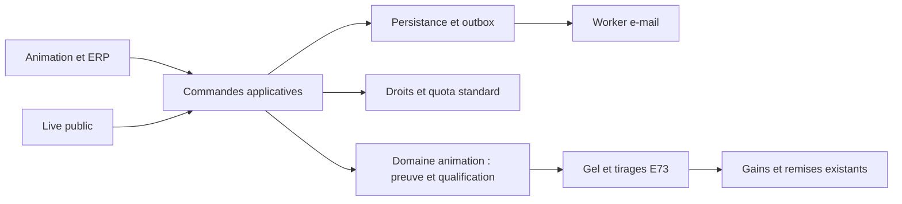

# E74 — Architecture et contrats cibles

Version du 3 novembre 2026. [Périmètre et décisions](README.md), [preuves prévues](verification.md), [état produit](../../roadmap/README.md). **Les routes et champs marqués cibles ci-dessous ne sont pas encore implémentés.**

## Existant vérifié et responsabilités

Les chemins de code suivants sont relatifs au dépôt indiqué. Ils décrivent l'existant examiné, pas une preuve de fonctionnement d'E74.

| Producteur ou lecteur | Existant et écart à traiter |
| --- | --- |
| Backend : `app/domaine/animation_locale/services/strategie_tombola_locale.py`, `moteurs/registre.py`, `moteurs/execution.py` | Trois moteurs ; tombola locale qualifiée par achat. L'exécution de tout moteur hors chasse suppose actuellement une mécanique commerçante. Ajouter un enum seul est incorrect. |
| Backend : `moteurs/compilation_classique.py`, `moteurs/validation.py`, application `services/publication_animation.py` | Compilation et publication exigent des commerces. `participants_figes` doit distinguer snapshot absent et liste vide légitime. |
| Backend : application `services/participants_animation.py`, API `animation_locale_api.py` | Nom, prénom, e-mail, téléphone obligatoires ; réponse immédiate `CONFIRMEE` avec token, sans preuve d'e-mail. Unicité animation/e-mail ; reçus idempotents de 24 h ; récupération par e-mail neutre. |
| Backend : `services/exploitation_animation.py`, domaine `moteurs/politique_exploitation.py` | Gel depuis faits et provenance ; aucune preuve d'e-mail dans `FaitsExecutionMoteur`. La liste actuelle recalcule et filtre tous les participants en mémoire avant pagination. |
| Backend : domaine `abonnements_plateforme/catalogue_modules.py`, application `service_souscriptions.py` | STANDARD = passeport et tombola locale. Quota `ANIMATION`/`PUBLICATION_ANIMATION`, conditions acquises, consommation idempotente par souscription/animation. |
| Animation : `src/app/animationEngineRegistry.ts`, `App.tsx`, `components/AssistantAnimationWorkspace.tsx` | Registre fermé, création avec étapes commerçants/mission et minimum implicite de deux commerces pour un type inconnu ; assistant sait présenter `NON_APPLICABLE`. |
| Animation : `components/FlyerWorkspace.tsx`, `ResultsWorkspace.tsx`, `api.ts` | Chiffre commerçants systématique et types fermés ; certains helpers `All` collectent toutes les pages. Ne pas les utiliser pour la liste E74. |
| Marketplace/Live : `src/components/AnimationRegistrationForm.jsx`, `src/pages/AnimationPublicPage.jsx`, `src/live/LiveApp.jsx` | Parcours attend immédiatement un token puis ajoute la participation. Absence de token actuellement traitée comme résultat incertain. Créer une branche d'attente explicite. |
| Marketplace/Live : `src/live/animationEngineRegistry.mjs`, `LiveAnimationGame.jsx` | Registre fermé ; renderer tombola parle d'achat et de QR commerçant. Nouveau renderer autonome requis. |
| Marketplace/Live : `src/live/liveLibrary.js`, `followedCommunes.mjs`, `liveInstallation.js` | Bibliothèque personnelle, communes locales et installation appareil réutilisables ; installation et token de bibliothèque ne prouvent pas une adresse. |

Références communes : [domaine d'abord](../../architecture/decisions/ADR-2026-08-28-domaine-avant-services-applicatifs.md), [contrôles d'architecture](../../architecture/transverse/controle-architecture.md), [E53](../epic-53-tombola-locale/README.md), [dotation E73](../epic-73-animation-et-ou-coffrets/dotation-lots.md), [tirage libre](../epic-73-animation-et-ou-coffrets/tirage-libre-protocole.md), [modules et conditions](../epic-73-animation-et-ou-coffrets/modules-souscriptions-import-communication.md).

## Domaine : invariants et frontières

| Invariant | Propriétaire et entrées |
| --- | --- |
| I01 — Un seul participant et une chance par `(animation, e-mail normalisé)` | `ParticipantAnimation`, stratégie pure `TOMBOLA_PUBLIQUE`, contrainte SQL existante. Toutes commandes publiques, ERP, imports et reprises. |
| I02 — Qualification = inscription explicite + règlement accepté + preuve d'adresse confirmée dans la fenêtre autorisée | Nouveau objet de preuve et stratégie de domaine ; intégration dans `FaitsExecutionMoteur`, provenance et politique d'exploitation. Ni token d'accès ni statut seul ne constitue la preuve. |
| I03 — Aucun commerce requis pour qualifier ou publier avec lots externes | Politiques de publication et compilation du nouveau moteur. Missions, consentement commerce, minimum et délais de réponse non applicables. Les contrôles de dotation restent dans E73. |
| I04 — Date/état vérifiés au moment de confirmer ; population figée stable | Agrégat `Animation`, politique de confirmation et gel existant. API, ERP, batch utilisent la même barrière exclusive. |
| I05 — Une consommation standard, droits acquis inchangés | Domaine abonnements, commande de publication existante. Nouveau modèle classé STANDARD ; ni réécriture des instantanés commerciaux ni augmentation de quota. |
| I06 — Aucun accès personnel avant preuve ; aucun accès à un tiers par connaissance d'un e-mail | Politique de vérification et de récupération. Ancienne inscription, récupération et routes administratives ne fournissent pas de contournement. |
| I07 — Gains uniques et population/provenance cohérentes | Moteurs de tirage E73, sans moteur parallèle ; replay, remplacement et remise conservent leurs contrats. |
| I08 — Suivre une commune reste facultatif et ne crée aucun droit d'envoi | Domaine des préférences existantes et présentation Live ; aucun événement d'inscription ne transforme un participant en prospect ou consentement marketing. |

L'application charge les agrégats, vérifie le périmètre d'accès, pilote l'horloge, la transaction, les ports et l'outbox. Le domaine décide qualification, refus, quota et transitions. Les routes, templates ERP, frontend et workers ne recodent pas ces décisions.

## Données et transactions

### Extension additive

- Conserver `animation_participants`, identifiant et unicité existants. Ajouter une politique d'identité discriminée `COMPLETE` / `PRENOM_EMAIL_VERIFIE`, déterminée par le modèle serveur. Valeur par défaut `COMPLETE` pour l'existant ; nom/téléphone réellement absents autorisés uniquement pour la nouvelle politique. Contraintes, constructeurs, DTO et lecteurs adaptés ; aucune valeur fictive ni assouplissement des inscriptions historiques.
- Conserver `INSCRIT` tant que l'adresse n'est pas confirmée. Une projection E74 `verification_email=EN_ATTENTE|CONFIRMEE` distingue l'attente, et la stratégie produit l'éligibilité depuis les faits. Ajouter preuve persistée : participant, animation, adresse normalisée liée, date de confirmation, version du règlement accepté, référence de la commande explicite. Ne jamais convertir les anciennes adresses en « vérifiées ».
- Challenge de vérification séparé des tokens `ACCES_PARTICIPANT` : identifiant, empreinte unique du secret opaque, participant/animation, émission, expiration, révocation et consommation. Secret aléatoire d'au moins 256 bits, persisté sous empreinte ; délai cible 30 minutes, borné par la fin d'inscription. Au plus un challenge actif par participant. Un renvoi effectif invalide le précédent ; un rejeu idempotent ne le remplace pas.
- Indexer participant/animation/politique/état/ordre stable pour les pages, empreinte du challenge pour la recherche, expiration pour purge, preuve unique par participant. Une projection indexée de qualification E74 et ses compteurs sont mis à jour dans la même transaction que la preuve. Le gel revalide les faits et leur provenance, pas seulement ce cache.
- Enregistrer l'acceptation du règlement au dépôt et la confirmation explicite ; si sa version change avant confirmation, redemander l'acceptation de la version courante. Source de diffusion facultative et bornée, issue du référentiel autorisé ; ce n'est ni une preuve de présence ni un facteur de qualification.

### Atomicité et concurrence

Toutes les mutations E74 d'une animation acquièrent d'abord la barrière exclusive de l'animation utilisée par le gel, puis le participant et son challenge. La publication garde l'ordre de verrouillage commercial existant ; elle ne prend pas de verrou challenge. Les reçus de commande suivent le mécanisme d'idempotence existant, avec un ordre identique entre commandes concurrentes de même famille. Vérifier cet ordre en intégration PostgreSQL, notamment confirmation/renvoi/clôture/anonymisation.

Dans une même unité de travail : participant en attente + challenge + reçu + message outbox + audit. Une panne annule l'ensemble ; l'envoi externe n'a jamais lieu dans la transaction. Le worker peut relivrer un e-mail, sans produire une deuxième qualification.

Confirmation : vérifier le secret et sa portée, verrouiller, recontrôler statut, fenêtre et version du règlement, consommer la preuve, qualifier, mettre à jour projections, produire l'accès personnel et le reçu. Une course clôture/confirmation a deux issues valides : confirmation commise avant gel et incluse, ou gel acquis d'abord et confirmation refusée. Aucun succès à demi enregistré.

Pour la fin, intervalle serveur `[début, fin[` en UTC ; les interfaces affichent `Europe/Paris` avec la mention « heure de Paris », conformément à la [convention des dates](../../architecture/transverse/affichage-dates.md). `PUBLIEE` ou `EN_COURS` selon le cycle existant ne dispense pas du contrôle des dates. Après fermeture, une première confirmation échoue ; un reçu de succès déjà enregistré peut être relu sans modifier la population, sous réserve d'accès non révoqué. Les anonymisés restent exclus des nouvelles populations ; les corrections après gel suivent le protocole existant, sans régénération silencieuse.

## Contrats HTTP cibles

Ces ajouts seront exportés depuis les modèles et routes du backend lors de l'implémentation. Ne pas modifier aujourd'hui un OpenAPI pour faire croire qu'ils sont disponibles.

### Catalogue et capacités

Ajouter `TOMBOLA_PUBLIQUE` version `1.0` aux contrats moteur discriminés, à sa stratégie et à ses schémas. Exposer des capacités explicites : `commercants_requis=false`, `parcours_inscription=TOMBOLA_PUBLIQUE_EMAIL`, `qualification=EMAIL_CONFIRMEE`, `presence_requise=false`, modes de dotation autorisés par le catalogue. Nom des champs à conserver identique entre DTO, export et consommateurs. Les champs additionnels sont optionnels pour les modèles historiques ; leur absence conserve leur ancien parcours, jamais celui d'E74. Un type/version inconnu reste refusé explicitement.

Le contrat d'assistant déclare les étapes commerçants non applicables. Snapshot de commerces vide signifie « aucun requis » pour E74 ; `null` signifie « snapshot absent ». Aucun test de vérité sur `[]` ne doit recalculer une sélection vivante.

La fiche publique E74 expose également `reglement_version`, `inscriptions_ouvertes` et le motif d'indisponibilité éventuel ; le formulaire reprend la version réellement présentée. Ces projections aident l'interface mais la commande recontrôle toujours les conditions serveur. Les lecteurs de coordonnées personnelles, e-mails transactionnels, gains, exports et vues ERP acceptent nom/téléphone absents pour cette politique d'identité ; aucune concaténation « null » ni champ obligatoire hérité ne doit bloquer le parcours.

#### Compatibilité des lecteurs et anciennes PWA

Paramètre de lecture cible `moteurs_supportes`, liste de couples `CODE:version` séparés par des virgules, au plus 16 couples et 512 caractères. Un client E74 déclare ses quatre moteurs, dont `TOMBOLA_PUBLIQUE:1.0`. L'absence du paramètre signifie les trois moteurs historiques en version `1.0`, jamais « tout accepter ». Un format invalide renvoie 422 ; les capacités inconnues du serveur sont ignorées. Cette déclaration ne confère aucun droit métier.

Appliquer la négociation aux catalogues de modèles, listes et recherches publiques/protégées d'animations, découverte Live, listes mixtes de participations et projections de jeux. Filtrer les types incompatibles **avant pagination et total**. Les listes de gains dont le DTO est indépendant du moteur restent lisibles ; si elles embarquent une projection de jeu, celle-ci respecte aussi la négociation. Les lecteurs ERP rendus par le backend déclarent les capacités du backend ; les clients API historiques sans paramètre gardent leur contrat.

Sur une lecture directe d'animation ou de participation E74 par un lecteur incompatible : 409 `CLIENT_ANIMATION_INCOMPATIBLE`, message « Une mise à jour de l'application est nécessaire », `modele_requis` et `version_requise`, sans projection de jeu ni données personnelles supplémentaires. Les écrans capables de traiter ce refus proposent la mise à jour et préservent les accès locaux ; une ancienne version peut n'afficher que son erreur générique, mais ne reçoit pas un DTO qu'elle interpréterait en passeport. Les nouvelles commandes E74 restent soumises à la validation du modèle serveur même si la déclaration du client est falsifiée.

Inclure le paramètre dans les clés de cache HTTP/applicatif/service worker ; ne pas mutualiser catalogue historique et catalogue E74. Pas de nouvel en-tête CORS requis pour cette négociation. Tester une même URL de liste, avec et sans paramètre, contenant anciens modèles et E74, puis les accès directs et les anciennes participations. Le paramètre et les refus seront documentés dans les exports réels et les clients avant activation.

### Liste des participants et compteurs gestionnaire

Deux routes cibles additionnelles sous `/protected/animation-locale`, avec droit `LIRE` et périmètres organisation/commune appliqués avant toute lecture. Déclarer les chemins statiques avant les routes dynamiques de détail.

| Route cible | Paramètres | Réponse et refus |
| --- | --- | --- |
| `GET /animations/{animation_id}/participants-page` | `limit` 25 par défaut, 1–100 ; `cursor?` ; `etat=EN_ATTENTE|QUALIFIE|GAGNANT` facultatif ; `moteurs_supportes` ; `avec_total=false` par défaut | `{items:[{participant_id,inscription_id,prenom,email,verification_email,qualifie,statut,date_inscription}],pagination:{limit,next_cursor,has_more,total?},observe_le}`. `total` exact pour le filtre uniquement si demandé. Les coordonnées ne sont disponibles qu'aux lecteurs autorisés. |
| `GET /animations/{animation_id}/participants-compteurs` | Même capacité et mêmes contrôles d'accès | `{en_attente,qualifies_total,gagnants,observe_le}` : attentes non vérifiées ; qualifiés incluant gagnants ; gagnants sous-ensemble. Ne pas additionner ces deux derniers compteurs. Aucun passage marchand inventé. |

Tri immuable `(date_inscription DESC, participant_id DESC)`. Curseur opaque signé contenant animation, filtres, taille, dernière clé et borne haute initiale ; validité 30 minutes. Les nouveaux inscrits après cette borne apparaissent au rafraîchissement. Modification de filtre impose un nouveau départ. Curseur mal formé, expiré ou d'une autre animation/filtre → 400 `CURSEUR_INVALIDE`, aucune donnée retournée. Limite hors bornes ou filtre inconnu → 422. Une animation hors périmètre reçoit le refus d'accès usuel, jamais un compteur global.

La navigation est une vue courante, pas un export figé : une qualification peut changer entre deux pages. Les identifiants permettent la déduplication visuelle ; un rafraîchissement repart de la première page. Chaque page et son total éventuel sont lus sous un même instantané transactionnel ; `observe_le` situe cette observation et n'affirme pas une stabilité entre requêtes. Le total n'est pas recalculé à chaque déplacement par défaut. Les compteurs exacts proviennent de projections transactionnelles, vérifiées contre SQL en recette. Le gel du tirage reste une opération distincte.

Les routes historiques `/animations/{id}/participants` et `/participants` conservent leurs paramètres `page/page_size`, enveloppes et comportement pour les anciens moteurs. Animation/ERP migrent explicitement les listes E74 vers ces routes bornées ; aucune collecte `All`. Les listes globales historiques sans capacité E74 l'excluent ; un client compatible peut afficher les accès aux tombolas puis ouvrir leur liste dédiée. L'export CSV E74 doit parcourir des lots bornés avec les mêmes droits et politique de preuve, sans appeler le lecteur historique en mémoire ; l'export n'est pas un contournement de la pagination.

### Participation

Préfixe cible : `/public/animation-locale/animations/{animation_id}`. Toutes commandes exigent `Idempotency-Key`, empreinte du corps et reçus de 24 h. Les erreurs suivent l'enveloppe existante `code`, `detail`, `correlationId`/`request_id` ; jamais de secret dans les logs.

| Commande cible | Entrées et réponse | Refus et compatibilité |
| --- | --- | --- |
| `POST /inscriptions/demander-verification` | `{prenom,email,reglement_accepte,reglement_version,source_diffusion_code?}` ; 202 générique `{statut:"DEMANDE_PRISE_EN_COMPTE",renvoi_apres_secondes:300}` ; aucun token, identifiant participant ou indication d'existence | 422 données/règlement invalides, 409 période ou état non ouvert, 429 limite. Même réponse pour adresse nouvelle, en attente ou déjà confirmée. |
| `POST /inscriptions/renvoyer-verification` | `{email}` ; même 202 neutre. En attente : renouveler après cinq minutes ; déjà confirmé : récupération d'accès par e-mail existante ; absent : aucun participant créé | Aucun accès restitué au navigateur. Même réponse si délai individuel non écoulé. |
| `POST /inscriptions/confirmer-email` | `{secret,prenom?,reglement_version,reglement_accepte:true}` ; 200 `{statut:"CONFIRMEE",qualification:"ELIGIBLE",inscription_id,participant_id,token,url_acces}` au seul détenteur de preuve valide | 400 lien invalide, 410 expiré/remplacé, 409 inscriptions fermées ou règlement modifié ; aucune chance ni accès lors du refus. Un secret d'une autre animation est invalide. |

L'ancienne route `POST /inscriptions` conserve son contrat pour les trois moteurs historiques ; E74 y répond 409 `VERIFICATION_EMAIL_REQUISE`, sans créer ni qualifier. L'ancienne récupération `.../inscriptions/renvoyer-lien` délègue à la politique : attente E74 → lien de vérification uniquement ; confirmé → récupération existante. Les lectures personnelles et commandes ERP ne délivrent pas un accès en attente.

Même clé et corps différents → 409 `IDEMPOTENCY_KEY_REUTILISEE`. Même e-mail et clés différentes → réponse 202 neutre, unicité conservée, aucune fuite du token du participant. Une demande publique ne remplace pas le prénom d'un participant confirmé. À la confirmation, le détenteur du lien peut confirmer/corriger le prénom en attente.

La demande initiale pour une adresse déjà connue applique la même politique de livraison que le renvoi : vérification si en attente, récupération si confirmée, respect des délais. Elle ne change ni l'état confirmé ni son identité et ne divulgue pas cette distinction dans la réponse publique. Pour la confirmation, les identifiants de corrélation et champs d'accès utilisent les mêmes types et durées que le contrat personnel existant ; seul le succès vérifié autorise leur restitution.

Le reçu de confirmation doit permettre de reprendre une réponse perdue sans créer un nouveau participant ou gain. Réutiliser le mécanisme de `infrastructure/securite/token_reprise_inscription.py` : le reçu conserve des identifiants (`participant_id`, `key_id`), le token est reconstruit par HMAC avec une finalité E74 distincte, l'animation et la clé d'idempotence, puis son empreinte et sa validité sont vérifiées en base. Aucun token brut dans le reçu. Le secret de confirmation consommé reste requis pour relire ce succès durant les 24 h du reçu ; la clé seule n'est pas une autorisation. Ce rejeu ne prolonge pas la validité du token personnel. Une nouvelle clé sur un challenge déjà consommé refuse la mutation et oriente vers la récupération, sans nouvelle qualification. Après expiration du reçu, employer la récupération par e-mail. Une révocation/anonymisation interdit de restituer un accès même depuis un ancien reçu.

Ne pas confondre rotation du challenge et récupération d'accès : le renvoi de vérification remplace son challenge actif ; la récupération personnelle existante crée un nouvel accès sans révoquer automatiquement les précédents. E74 conserve ce dernier comportement.

### Consommation Live

Route SPA cible : `/live/animations/:animationId/confirmation-email#secret=…`. Le lien ne contient pas d'adresse. Lire le secret en mémoire puis nettoyer le fragment avant instrumentation ; aucun POST automatique au montage, préchargement ou scan d'e-mail. Réponse et page sensibles `no-store`, `Referrer-Policy: no-referrer`, hors cache service worker ; aucune persistance du secret ni file de synchronisation différée. Si la page est actualisée après nettoyage, inviter à rouvrir le lien reçu.

Après demande : contexte temporaire distinct de la bibliothèque, par exemple `sessionStorage` sous `localeo-live:inscription-en-attente:<animationId>`, sans e-mail ni secret ni token participant. Ne jamais utiliser `type:'participation'` ou `registrationConfirmed` pour l'attente. Nettoyer à confirmation, expiration ou abandon ; un stockage indisponible ne bloque pas la vérification.

Après confirmation 200 : valider l'accès avec le pipeline existant `AddAnimation`/`saveLiveParticipation`, puis afficher la qualification serveur. Le lien fonctionne sans état local, donc sur un autre appareil. La fermeture reste lisible sans faire passer une participation confirmée pour annulée. « Mes lots » et tirages à venir consomment les projections existantes `COFFRET`, `BON_NUMERIQUE` et lots libres, sans nouveau carnet.

## Sécurité et exploitation des e-mails

Réutiliser fournisseur, outbox, domaines d'envoi et récupération existants. L'inscription ne nécessite pas de nouvelle clé métier ni un nouveau compte habitant. Ne pas assimiler un e-mail envoyé à un e-mail reçu ou une personne physique identifiée.

Protections cibles : plafond par adresse normalisée empreintée et animation (un renvoi par cinq minutes, cinq envois par heure), taille et validation des entrées, limite de tentatives par IP/animation et par secret empreinté, limite de débit de service. Les réponses 429 portent `Retry-After` et ne confirment pas l'existence d'une adresse. Pour un stand, ne pas réutiliser un plafond de 30 inscriptions globales par animation : des habitants distincts partagent un QR et parfois une IP. Calibrage initial à tester : 300 demandes/minute/IP et 20 requêtes/seconde/animation avec rafale de 50 ; quotas d'e-mail par destinataire restent indépendants. Pas de CAPTCHA obligatoire ajouté à la V1 ; durcissement révisable selon mesures d'abus, sans contourner les preuves.

Logs : événements demande, confirmation, refus par code, expiration, renvoi, gel et tirage avec corrélation et identifiants techniques autorisés ; aucune adresse, corps de formulaire, secret ou URL personnelle. Compteurs sans identifiant personnel en label. Les périmètres organisation/commune s'appliquent aux listes, exports, corrections et lots ; les réponses publiques n'exposent jamais les listes nominatives.

Purger par lots les secrets/challenges et reçus après leur durée utile, sans effacer la preuve minimale utilisée par la provenance du tirage. Garder l'empreinte du challenge consommé pendant les 24 h de son reçu pour permettre le rejeu autorisé, puis la purger ; cette conservation ne permet aucune nouvelle confirmation. Les preuves personnelles suivent la politique de conservation des participations existantes ; la preuve ne devient pas un stockage perpétuel. Expiration de challenge ≠ suppression automatique d'un participant/gain. Adapter anonymisation, suppression et restauration aux nouvelles clés étrangères, sans violer le gel ni les règles de retrait. Outbox et reçus contenant des capacités suivent les protections et purges des accès existants.

## Performance : bornes et mesures à produire

Appliquer la [convention transverse](../../architecture/transverse/performance-volumetrie.md). Chiffres ci-dessous = **budgets de conception à vérifier**, aucune mesure actuelle d'E74.

| Parcours / propriétaire | Population et trafic de recette | Borne, projection et accès | Transaction/mémoire et preuve |
| --- | --- | --- | --- |
| Demande/confirmation, backend | N=1 000 puis 10N=10 000 participants dans une animation, données d'autres organisations ; 50 clients concurrents, pic 20 req/s | Recherche indexée animation/e-mail ou hash ; nombre de lectures borné par commande, aucun balayage des participants | Verrou court, aucun réseau dans la transaction ; cible p95 < 500 ms et p99 < 1 s hors livraison e-mail ; débit et contention mesurés. |
| Liste gestionnaire, backend + Animation | N/10N, filtres attente/qualifié/gagnant ; lecture pendant confirmations | 25 par défaut, 100 maximum, tri stable date/id et curseur lié aux filtres/animation ; index composite ; total exact SQL ou compteur transactionnel, jamais `All` frontend | Une page de DTO en mémoire ; expliquer les plans SQL et lignes lues. Si COUNT proportionnel, coût mesuré séparément, pas caché derrière LIMIT. Cible p95 < 500 ms. |
| Détail public et compteurs | Lectures simultanées aux confirmations | Projection publique bornée, compteur qualifiés transactionnel ; pas de liste nominative ; cache court invalidé sans servir de vérité à la qualification | Cible p95 < 300 ms ; vérifier cohérence après mutation et absence d'inflation par attentes. |
| Gel, tirage et outbox | 10 000 candidats, gel concurrent aux confirmations, worker redémarré | Parcours O(N) assumé, lots de 500, projection/snapshot/version et reprise durables ; protocole asynchrone E73 pour tirage libre | Pas de recalcul complet dans chaque page. Barrière gel cohérente ; si gel par lots, fermeture atomique préalable et snapshot stable, pas de déverrouillage sur population mutable. Cible gel 10N < 10 s à mesurer, mémoire ne croissant pas par chargement d'objets complets. |
| Purge, backend worker | Historique multi-organisations | Index expiration, lots de 500, transactions courtes et reprise par curseur | Preuve d'absence de suppression de preuves encore requises, absence d'impact sur gains et restauration. |

Le rapport de capacité devra préciser matériel, versions, durée, volumétrie, requêtes SQL/lignes, p95/p99, RSS, contention et erreurs. Les limites ne sont pas considérées tenues par un test de contrat ou un build. Une capacité insuffisante bloque l'activation, avec optimisation ou révision explicite du budget, jamais un skip du scénario.

## Producteurs, consommateurs et livraison

| Dépôt | Travaux d'implémentation et contrats |
| --- | --- |
| Backend | Domaine, application, API, ERP/Support/Ops, politiques de publication et quota, catalogue, identité/preuve, gel, listes et e-mails. Générateurs existants : `scripts/documentation/generate_epic41_openapi.py`, `generate_epic42_openapi.py`, `export_moteur_animation_contracts.py`, `export_openapi_offline.py`. Les exports documentaires restent canoniques dans localeo-projet. |
| Animation | Registre/version, capacités, création/assistant/configuration, flyer, participants/bilan et affichage des refus de tirage. Actualiser `src/imports/openapi.json` et `src/imports/moteur-animation/` depuis leurs producteurs. |
| Marketplace/Live | Contrats moteur `src/contracts/moteur-animation/`, inscription/attente/confirmation/reprise, renderer, découverte et filtres, préférences de commune. Coffrets et redirections historiques restent compatibles. |
| Commerçant/Pro | Aucun rôle dans la qualification E74 ; vérifier absence de chemin de validation merchant/PIN applicable. Remise optionnelle de bons réutilisée ; adapter un registre consommé s'il refuse le nouveau type sur ce parcours. |
| Projet | Backlog, cette spécification, contrats générés lors du développement, guides fonctionnels, règlement/notice et procédures de livraison. Aucun outil exécutable ni secret migré dans ce dépôt. |

Ordre prévu : migration additive et backend acceptant les anciens clients → contrats régénérés et consommateurs compatibles → tests de bout en bout → activation explicite du modèle. Le modèle est initialisé désactivé, sans convertir d'ancienne animation. Séparer le droit de créer/publier de la capacité à lire et terminer une tombola déjà publiée. Une désactivation commerciale ne casse pas les confirmations et gains existants ; une fermeture d'urgence des inscriptions est une action distincte et auditée.

Migration : réserver le prochain numéro libre lors de l'implémentation ; tester montée depuis une base représentative et restauration isolée comprenant défis, outbox et gains. Les colonnes historiques gardent leurs valeurs ; aucune reprise rétroactive d'e-mails vérifiés. La suppression de colonnes et le rollback vers une application ignorant E74 ne sont pas sûrs après création de données : privilégier arrêt des nouvelles créations et correctif vers l'avant. Préserver les données, les capacités de lecture, les confirmations déjà ouvertes et les remises.

Démonstration : étendre dans le backend `scripts/demonstration/animations.py`, `verification_animations.py`, `reprise_animations.py`, `dotations_animation.py`. Créer par les commandes métier une organisation sans commerce à lots externes, des variantes Coffrets/numérique et des états attente/confirmé/expiré. Capturer les e-mails avec un transport de test isolé pour confirmer ; jamais de marquage SQL direct « vérifié » ni d'envoi réel.

Avant activation : vérifier base migrée, transport e-mail, URL Live et fallback, purges, observabilité, version de tous les consommateurs/PWA et budgets mesurés. Les anciens clients aux registres fermés ne sont **pas** compatibles avec E74 : conserver le modèle invisible pour eux, avec négociation de capacité de lecture sur le catalogue et refus explicite/mise à jour requise à l'ouverture directe. Une purge du cache seule ne prouve pas leur disparition.

Pas de modification DNS, tarif, clé fournisseur ou nouveau module commercial requis par cette conception. La source exportable des contrats sera mise à jour depuis le code durant l'implémentation ; cette spécification n'ajoute pas de bundle documentaire d'exécution puisqu'aucun lecteur applicatif ne la consomme aujourd'hui.
