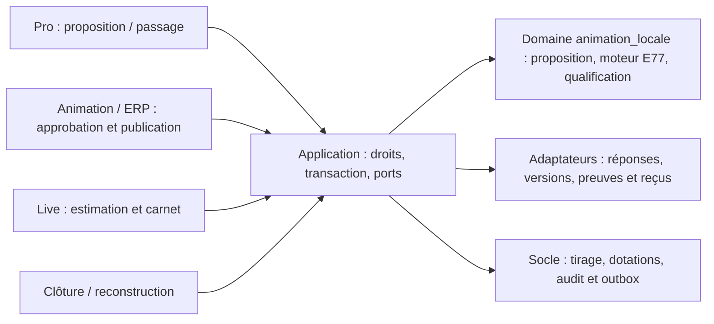

# E77 — Architecture et contrats

Conception V1 du 13 novembre 2026, issue du
[modèle transverse](../../architecture/templates/epic-architecture-template.md).
Voir les [parcours](parcours-regles.md) et [preuves attendues](verification-livraison.md).
Les objets et champs E77 décrits ci-dessous sont **cibles**, pas des API existantes.

## Existant vérifié en lecture

Les cinq arbres Git étaient propres au début de cette phase. Les chemins suivants
ont été lus, sans bootstrap backend, connexion à une base ni génération de contrat.

| Producteur/consommateur réel | Constat et conséquence E77 |
| --- | --- |
| [Registre domaine](../../../../localeo-backend/app/domaine/animation_locale/moteurs/registre.py) | Quatre moteurs 1.0 : Passeport, Tombola locale/publique et Chasse. Couple inconnu refusé ; ajouter E77 explicitement |
| [Stratégie Passeport](../../../../localeo-backend/app/domaine/animation_locale/services/strategie_passeport_commercant.py) | Qualification fondée sur les visites distinctes ; ne suffit pas à vérifier prix ET visite E77 |
| [Politique de jeu](../../../../localeo-backend/app/domaine/animation_locale/moteurs/politique_jeu.py) | Période `[startsAt, endsAt[` et statuts PUBLIEE/EN_COURS ; branche d'attestation non-Chasse fondée sur merchantIds à spécialiser pour l'option E77 |
| [Service de jeu](../../../../localeo-backend/app/application/animation_locale/services/jeu_animation.py) | Charge définition privée, faits, exécution et qualification ; réconciliation et projection de qualification comportent des branches Chasse à compléter explicitement |
| [Adaptateurs moteur](../../../../localeo-backend/app/infrastructure/persistence/repositories/moteur_animation_repositories.py) | Coordination partagée/exclusive sans upgrade, exécution verrouillée par participant ; préserver ce protocole |
| [Route Live](../../../../localeo-backend/app/api/jeu_animation_api.py) | Bearer personnel, commande avec Idempotency-Key, lecture de reçu 200/202/404, contrôle moteurs_supportes, corps de 16 Kio |
| [Commandes](../../../../localeo-backend/app/application/animation_locale/contrats_moteur/commandes.py), [définition](../../../../localeo-backend/app/application/animation_locale/contrats_moteur/definition.py), [attestations](../../../../localeo-backend/app/application/animation_locale/contrats_moteur/attestations.py) | Unions fermées sans montant monétaire ; enveloppes de versions existantes à conserver, pas d'encodage du prix en TEXT_INPUT |
| [Registre Animation](../../../../localeo-animation/src/app/animationEngineRegistry.ts), [registre Live](../../../../localeo-marketplace/src/live/animationEngineRegistry.mjs), [registre Pro](../../../../localeo-commercant/src/features/animations/engineRegistry.js) | Sélection fermée et manifestes à empreintes ; Pro n'enregistre pas la Tombola publique. Ajouter E77 auprès de chaque consommateur effectif |
| [Transport Live](../../../../localeo-marketplace/src/live/gameProtocol.mjs) | Versions et clé figées, contrôle de contexte ; libellé ANSWER_INCORRECT invite à réessayer, donc inadapté à l'essai unique |

Ces constats ne prouvent pas le fonctionnement déployé. E75 est spécifié, absent
du registre observé ; sa conception peut éclairer un choix, sans dépendance à
une implémentation supposée. Aucun moteur E77 existant n'est réutilisé implicitement.

## Domaine propriétaire et responsabilités

Le domaine `animation_locale` possède les règles, conformément à l'
[ADR domaine d'abord](../../architecture/decisions/ADR-2026-08-28-domaine-avant-services-applicatifs.md).
L'application charge les faits et les droits, orchestre UoW/ports/audit ; API,
ERP et batch utilisent les mêmes opérations. Aucun calcul de réussite dans les
routes, le SQL de projection ou les composants.

| Objet cible | Opérations et invariant possédé |
| --- | --- |
| `MontantJeu` objet-valeur | Centimes entiers, EUR/TTC, non négatif, borné ; comparaison exacte, aucun flottant |
| `PropositionProduitJustePrix` racine | Une proposition courante par animation/commerce, révision monotone, proposer/corriger/approuver ; approbation liée au contenu exact |
| `ConfigurationJustePrix` valeur de la configuration publiée | N commerces distincts approuvés, seuil 1..N, tolérance commune, booléen passage explicite, un produit par commerce, immutabilité après publication |
| `ReponseJustePrix` entité de l'exécution participant | Confirmer une fois pour un commerce de la version jouée ; conserver montant et résultat exact, succès ou échec |
| Politique pure `QualificationJustePrix` du moteur E77 | Compter réponses correctes distinctes, intersectées avec les passages si requis ; seuil et chance unique |
| `Animation` et coordination existantes | Publier, suspendre, reprendre identique, clôturer, annuler ; pas de modification des règles jouées |

L'exécution protège la participation ; les réponses sont persistées séparément
pour unicité, lecture ciblée et volumétrie. La politique reçoit des faits bornés
ou des compteurs cohérents issus des décisions, pas un accès ORM. Les agrégats
de proposition et publication sont coordonnés dans une transaction ; leurs
révisions contrôlées empêchent la validation d'un ancien contenu.

L'offre standard E73 autorise le modèle et consomme son quota existant à la
publication selon son protocole ; ne pas créer une seconde réserve E77. La
préparation produit ne déclenche ni génération IA ni facture. Le domaine de lots
conserve attribution/remise ; celui d'identité conserve accès/récupération et
révocation des salariés. Un effet d'estimation ne déclenche aucune communication
commerciale. Les notifications système déjà autorisées passent par l'outbox.

## Contrats cibles et frontières de confidentialité

Ajouter `JUSTE_PRIX_LOCAL:1.0` au registre, à la validation de définition et aux
capacités déclarées des trois interfaces. Le numéro de contrat est propre au
couple type/version ; les moteurs 1.0 existants gardent leur sémantique.
Les DTO restent fermés, avec validation stricte des entiers/booléens.

| Contrat cible | Champs et droits |
| --- | --- |
| Configuration privée E77 | `merchantIds`, `products` avec stepId/merchantId/productRevision/name/description/unit/referencePriceCents/assetId facultatif, `toleranceCents`, `requiredDistinctMerchants`, `merchantProofRequired` ; seulement organisateur/ERP autorisé |
| Proposition Pro | Même produit pour le seul commerce courant, état, révision, commentaire de correction ; prix propre autorisé, pas de prix d'autrui |
| Projection publique | Type/version, contenu produit approuvé, commerces, tolérance, seuil, mode, dates/règlement/dotation ; jamais referencePriceCents ou configuration privée |
| Projection participant | Versions existantes, estimation personnelle confirmée, résultat, passage et commerce comptabilisé distincts, X/seuil, qualification serveur, actions autorisées ; prix révélé seulement après clôture métier confirmée |
| Réponse monétaire | `answer.type = MONEY_ESTIMATE`, `amountCents` entier strict et stepId via SUBMIT_ANSWER ; aucune référence/tolérance/réussite fournie par le joueur |
| Reçu E77 | Outcomes dédiés `PRICE_FOUND` / `PRICE_NOT_FOUND`, replayed et versions ; succès signifie enregistrement définitif, même pour un prix non trouvé. Ne pas réutiliser le libellé autorisant un nouvel essai |
| Suivi organisateur | Agrégats horodatés et listes filtrées, sans accès personnel/QR ni estimations nominatives dans les bilans et exports ; aucun droit de diagnostic supplémentaire accordé par E77 |

Bornes structurelles de conception : 1..100 commerces par édition ; nom produit
1..160 caractères, description 1..2000 et unité 1..120 ; texte simple échappé,
pas de HTML. Référence/estimation/tolérance : 0..99 999 999 centimes, booléens et
nombres flottants refusés. En UI, conversion exacte des euros textuels, au plus
deux décimales, sans `parseFloat * 100` comme autorité. Aucune contrainte
T <= P : si T dépasse P, les estimations restent non négatives. Une sélection
supérieure à 100 est refusée avant proposition/publication, jamais tronquée.

Réutiliser les routes Live observées :
`GET /localeo-live/participations/{id}`,
`POST /localeo-live/participations/{id}/commandes`,
`GET /localeo-live/participations/{id}/commandes/{cle}` et lecture de résultat.
Les listes de produits et réponses sont des sous-listes paginées ; l'enveloppe
de participation ne transporte pas l'historique complet. Ajouter une route de
sous-liste E77 dans la même frontière Live, documentée par le générateur E42.

Routes implémentées localement, sous les préfixes privés existants `/protected/animation-locale` et `/internal/animation-locale` pour les actions organisateur :

| Méthode / suffixe cible | Contrat |
| --- | --- |
| GET/PUT `/commercants/me/animations/{id}/juste-prix/produit` | Lecture/enregistrement du seul produit propre ; PUT contient expectedRevision et contenu, retour de la révision courante |
| POST `/commercants/me/animations/{id}/juste-prix/produit/proposer` | expectedRevision ; passe à Proposé si complet |
| GET `/animations/{id}/juste-prix/produits` | État facultatif, limit/cursor ; propositions privées autorisées paginées |
| POST `/animations/{id}/juste-prix/produits/{commerce_id}/approuver` | expectedRevision ; approbation de la révision exacte |
| POST `/animations/{id}/juste-prix/produits/{commerce_id}/demander-correction` | expectedRevision, motif de 1..1000 caractères ; état À corriger |
| PUT `/commercants/me/animations/{id}/juste-prix/produit/image` | Session principale ; JPEG/PNG/WebP brut, 5 Mio maximum, expectedRevision ; image fournie via DAM |
| GET `/animations/{id}/juste-prix/participants` | limit/cursor, référence exacte, qualification ; compteurs datés sans estimations |
| GET `/animations/{id}/juste-prix/exploitation` | Phase, motif, nombre traité et révision |
| POST `/animations/{id}/juste-prix/exploitation/{action}` | suspendre/reprendre/cloturer/annuler, expectedRevision et motif ; reçu durable |
| POST `/animations/{id}/juste-prix/cloture/poursuivre` | Droit de clôture ; un lot atomique de 100 maximum |

La sous-liste personnelle cible est
`GET /localeo-live/participations/{id}/juste-prix/produits`, avec limit/cursor et
contrôle d'accès/capacités identique à l'enveloppe personnelle. Elle joint les
seules réponses propres de la page, sans renvoyer la configuration privée.

Les mutations de produit et les commandes d’exploitation exigent Idempotency-Key et rendent la ressource avec sa révision. Les reçus produit sont lus sous `/produit/commandes/{cle}` côté Pro ou `/produits/{commerce_id}/commandes/{cle}` côté organisateur, avec l’action dans la requête. Les interfaces d’exploitation vérifient l’état serveur après un résultat incertain. Poursuivre la clôture est reprenable par checkpoint ; il ne crée pas de nouvelle intention métier. Ces routes sont générées dans les contrats locaux, sans preuve de déploiement. Utiliser les
engagements E56 pour autoriser le commerce, sans surcharger une acceptation E56
en approbation de prix. Les mutations organisateur gardent cookie/CSRF Animation ;
celles de Pro gardent sa session et son périmètre principal.
La publication réutilise la commande existante. Scan/PIN conservent leurs
entrées authentifiées et versions E70 ; aucune commande joueur ne crée de passage.

Erreurs à couvrir dans le contrat HTTP : 401/410 accès absent ou expiré,
403 droit insuffisant, 404 cible hors périmètre, 409 révision obsolète/jeu fermé/
réponse déjà définitive/clé réutilisée avec contenu différent, 422 montant ou
configuration invalide, 413 corps trop volumineux, 429 avec Retry-After et 503
transaction indisponible. Une mauvaise estimation valide est un reçu métier,
**pas** une erreur 422. Les messages/violations n'incluent jamais la référence
privée ni un écho de corps/credentials. Inscrire les nouveaux codes 409 dans
la traduction RouteMoteurAnimation, sans repli générique trompeur.

## Répétition, concurrence et clôture

1. Authentifier et autoriser la cible avant lecture sensible ou recherche de reçu.
   Résoudre d'abord un reçu de même clé et même empreinte : après clôture aussi,
   une réponse déjà confirmée se relit sans nouvelle évaluation, sous accès valide.
2. Pour une nouvelle commande, prendre coordination partagée puis verrouiller
   le participant/exécution avant les réponses/preuves ; création initiale sous
   verrou du participant existant, sans compter sur un verrou de ligne absente.
   Respecter les révisions de définition, progression et exploitation. Aucune
   montée de verrou partagé vers exclusif.
3. Vérifier période/statut avec horloge serveur **après acquisition du verrou**,
   exiger l'absence de réponse, décider dans le domaine, écrire réponse,
   progression/qualification, reçu et audit dans la même transaction.
4. Réponse et attestation concurrentes sérialisent le même participant et
   réappliquent la même qualification. Contrainte unique sur le couple
   participant/commerce de l'édition, y compris deux clés distinctes. Un deuxième
   corps ne remplace jamais la réponse ; après conflit relire la projection.
5. Clôture/suspension/publication prennent coordination exclusive, puis le
   même ordre de ressources. Une estimation concurrente est entièrement avant
   ou après la fermeture ; rien de partiellement enregistré. Le contrôle de
   date interdit aussi les écritures en attente dont l'heure a dépassé la fin.

La clé est liée à l'acteur autorisé, à la participation, à la famille de commande
et à son intention. L'empreinte utilise un JSON canonique validé (ordre des clés
neutralisé, entiers stricts), avec versions/action/cible/montant inclus ; ne pas
comparer le texte JSON brut. Un reçu initial reste consultable après suspension
ou clôture tant que l'accès personnel et la politique de conservation le
permettent. Après expiration du reçu, la réponse persistée conserve l'interdiction
d'un nouvel essai ; renvoyer le code d'expiration existant et relire la participation.

La clôture marque d'abord l'interdiction de toute nouvelle écriture, puis prépare
l'audience en lots durables à partir des réponses/preuves figées, avec version,
progression et reprise. Audience intermédiaire invisible au tirage ; bascule
atomique d'un identifiant d'instantané complet, puis clôture confirmée. Une panne
ne rouvre pas le jeu ni ne révèle prématurément les prix. Vérifier et adapter le
protocole existant plutôt que faire un scan synchrone de tous les participants.
Le tirage consomme cette audience une seule fois suivant ses garanties existantes.
Le checkpoint inclut animation/configuration et révision de fermeture ; une
reprise sur une autre version est refusée. Aucun lot de clôture ne peut modifier
les réponses, passages ou critères de qualification de cette audience.

## Persistance et migrations cibles

- Proposition : animation_id, commerce_id, contenu privé, état, révision,
  approved_revision, acteurs et dates. Unicité `(animation_id, commerce_id)`.
- Réponse : participant_id, animation_id, configuration_id, commerce_id, step_id,
  montant centimes, résultat, command_id, confirmed_at. Unicité
  `(participant_id, commerce_id)` ; rattachement à la configuration de sa
  participation, pas de deuxième réponse après changement de version.
- Référence jouée : copie de la proposition approuvée dans la configuration
  privée immuable ; aucune lecture du prix courant du commerce pendant le jeu.
- Qualification : compteurs cohérents actualisés dans la transaction de commande
  et preuve ; projection organisateur éventuellement différée/datée. Le compteur
  d'autorité se reconstruit depuis les faits figés, jamais depuis le cache UI.

Contraintes CHECK des montants, révisions et FK cohérentes ; index pour
`(animation_id, state, commerce_id)` des propositions, unicité de réponse, et
`(animation_id, confirmed_at, id)` des réponses de suivi. Les prédicats réels
et plans PostgreSQL justifient tout index additionnel. Conserver les index
d'attestation du socle et vérifier l'accès participant/commerce/édition.

Migration additive **v318**, sans renuméroter les SQL existants. Le détail de réalisation et les limites de recette sont dans le [bilan](bilan-realisation.md). Aucune conversion d'ancienne animation, réponse ni preuve. Les
nouvelles tables sont initialement vides, le modèle désactivé. Le retour à une
ancienne application après données E77 exige de masquer E77 et préserver ses
données ; un rollback par suppression n'est pas déclaré sûr.

Adapter ensemble génération et restauration de démonstration : dépendances,
remappage d'identifiants, versions figées, propositions, réponses, preuves,
qualification et reçus. Respecter anonymisation/conservation E55/E73 ; la
rétention des réponses suit leur participation, sans inventer une nouvelle durée.
Étendre suppression/export/anonymisation et audit aux nouvelles tables avant
activation. Aucun export de démonstration ou accès privé dans ce dépôt.

## Sources, générateurs et compatibilité

Le producteur est le backend : schémas Pydantic fermés + validation domaine,
puis générateurs hors ligne
[E41](../../../../localeo-backend/scripts/documentation/generate_epic41_openapi.py),
[E42](../../../../localeo-backend/scripts/documentation/generate_epic42_openapi.py)
et [contrats moteur](../../../../localeo-backend/scripts/documentation/export_moteur_animation_contracts.py).
Les OpenAPI documentaires canoniques restent
[E41](../epic-41-api/openapi.json) et [E42](../epic-42-localeo-live/openapi.json).
Ils ne sont pas modifiés à la main pour prétendre qu'E77 existe dans cette phase.

À la réalisation, régénérer `localeo-animation/src/imports/openapi.json` et
`src/imports/moteur-animation/`, `localeo-marketplace/src/contracts/moteur-animation/`,
`localeo-commercant/api/localeo-openapi.json` par son `scripts/export-openapi.py`
et `api/moteur-animation/`, avec leurs manifestes SHA256. Ajouter explicitement
E77 aux filtres d'export Pro. Étendre l'exporteur aux DTO E77, tester les schémas
réellement importés et ne pas supposer qu'une régénération ajoute un renderer.

Les anciennes PWA ne connaissent pas E77 : elles reçoivent le refus de couple
non supporté et une demande de mise à jour, jamais un passeport/chasse de repli.
Les capacités de lecture empêchent l'envoi du jeu à un client incompatible ;
les listes publiques peuvent afficher une fiche générique et l'invitation à
mettre à jour sans commande de jeu. Tester aussi l'absence de capacités.
Ajouter E77 à `MOTEURS_SERVEUR` dans
[capacites_lecture.py](../../../../localeo-backend/app/application/animation_locale/services/capacites_lecture.py),
en conservant `MOTEURS_HISTORIQUES` sans E77 : une déclaration absente ne doit
jamais autoriser ce nouveau jeu. Préserver l'erreur observable
`CLIENT_ANIMATION_INCOMPATIBLE` et la traduction HTTP existante, à tester aussi
sur la nouvelle sous-liste et les résultats. Les commandes vérifient elles-mêmes
type/version/action contre la définition, indépendamment de cette déclaration.
Les unions enrichies ne sont pas présumées compatibles avec un client ancien.
Livrer le backend inactif puis les trois interfaces et contrats avant activation
standard. Les moteurs existants, PIN, salariés et dotations gardent leurs tests.
