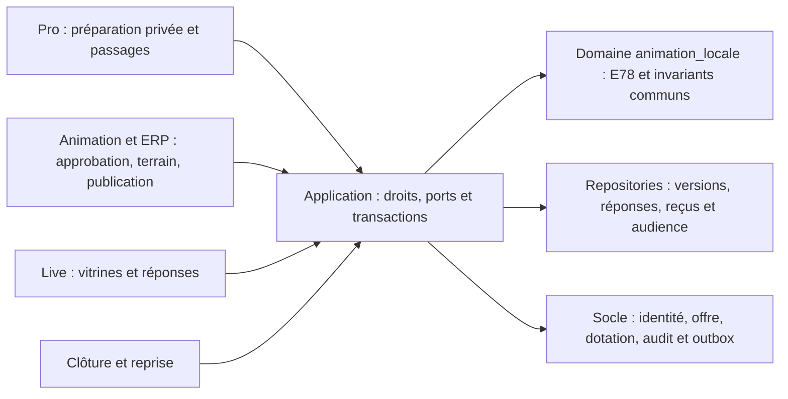

# E78 — Architecture et contrats

L'[évolution des essais limités du 22 novembre](../epic-77-juste-prix-local/architecture-contrats.md#contrat-des-essais-limités--22-novembre-2026)
complète les contrats V1 ci-dessous. La nouvelle `answerPolicy` est
`LIMITED_WRONG_ANSWERS` avec `maxWrongAnswers` ; l'ancienne politique
`ONE_CONFIRMED_ANSWER` conserve son sens. Les projections de solde et invalidité
et la qualification au seuil suivent la même règle que Juste Prix.

Conception du 15 novembre 2026 selon le
[modèle transverse](../../architecture/templates/epic-architecture-template.md).
Lire les [parcours](parcours-regles.md) et les [preuves prévues](verification-livraison.md).
Cette architecture a cadré les contrats, objets et migrations E78 le 15 novembre.
L’[implémentation locale du 16 novembre](bilan-realisation.md) renseigne les fichiers
et preuves livrés ; les constats « existant » ci-dessous décrivent la base antérieure.
Ils traduisent les [décisions utilisateur](README.md#décisions-acquises),
notamment la reprise explicite des conditions de qualification du Juste Prix local.

## 1. Existant vérifié en lecture

Arbres propres au début de cette phase : projet `1759c67`, backend `b417e631`,
Animation `9e81844d`, Pro `8453252c`, Marketplace `59c69bd6`. Aucun moteur E78
trouvé dans le code, les migrations ou les tests explorés. Aucun bootstrap,
serveur, test applicatif, base opérateur ou fournisseur externe exécuté.

| Source réelle | Constat utile et conséquence |
| --- | --- |
| [Registre domaine](../../../../localeo-backend/app/domaine/animation_locale/moteurs/registre.py), [stratégies de configuration](../../../../localeo-backend/app/domaine/animation_locale/services/registre_strategies_modeles_animation.py) | Couplages type/version explicites ; E78 demande un moteur et une stratégie dédiés, pas une conversion d'une chasse |
| [Moteur E77](../../../../localeo-backend/app/domaine/animation_locale/moteurs/juste_prix.py), [correcteur](../../../../localeo-backend/app/domaine/animation_locale/moteurs/execution.py) | Parcours libre et propositions versionnées disponibles ; correcteur pur SINGLE_CHOICE réutilisable, sans la progression/aide de Chasse |
| [Participation E56](../../../../localeo-backend/app/domaine/animation_locale/services/politique_participation_publication.py), [suivi matériel actuel](../../../../localeo-backend/app/domaine/animation_locale/services/politique_suivi_preparation.py) | Accord et snapshot des commerces autoritaires ; suivi « prêt » facultatif et forçable, insuffisant pour certifier la révision de l'intrus E78 |
| [Publication](../../../../localeo-backend/app/application/animation_locale/services/publication_animation.py) | Compilation E77 explicite, contrôles et définition figée ; ajouter la compilation et la préparation matérielle E78 dans ce flux |
| [Jeu](../../../../localeo-backend/app/application/animation_locale/services/jeu_animation.py), [idempotence](../../../../localeo-backend/app/application/animation_locale/services/commandes_idempotentes.py) | Coordination, verrou du participant, versions, domaine, effet et reçu atomiques ; les branches moteur et projections doivent connaître E78 |
| [Modèles SQL E77](../../../../localeo-backend/app/infrastructure/persistence/models_juste_prix.py), [repository](../../../../localeo-backend/app/infrastructure/persistence/repositories/juste_prix_repository.py) | Propositions/réponses/progression/compteurs/clôture séparés ; pagination par clé et contraintes d'unicité, sans charger tous les participants |
| [Clôture E77](../../../../localeo-backend/app/application/animation_locale/services/exploitation_juste_prix.py), [tirage](../../../../localeo-backend/app/application/animation_locale/services/tirages_animation.py) | Clôture reprenable par lots et garde de population gelée ; extension E78 explicite nécessaire avant tirage |
| [Catalogue commercial](../../../../localeo-backend/app/domaine/abonnements_plateforme/catalogue_modules.py), [accès création](../../../../localeo-backend/app/application/animation_locale/services/acces_creation_animation.py) | E77 est explicitement standard ; déclarer E78 dans l'offre ANIMATION standard conformément à ARB-07, sans se reposer sur le repli non-Chasse |
| [Préparation Animation](../../../../localeo-animation/src/app/components/JustePrixProducts.tsx), [API](../../../../localeo-animation/src/app/api.ts) | Listes paginées, approbation versionnée et correction ; raccordements supplémentaires dans App et les règles de création |
| [Pro](../../../../localeo-commercant/src/features/animations/components/JustePrixProduct.jsx), [kit](../../../../localeo-commercant/src/features/animations/components/AnimationKitSection.jsx) | Enregistrer/proposer et kit distinct ; le bouton « Je suis prêt » facultatif ne devient pas une preuve matérielle E78 par simple réemploi |
| [Renderer Live E77](../../../../localeo-marketplace/src/live/JustePrixGame.jsx), [QCM Chasse](../../../../localeo-marketplace/src/live/GameActivities.jsx) | Liste libre/confirmation d'un côté, étape courante/soumission directe de l'autre : concevoir un renderer vitrines avec confirmation définitive |
| [Registre Live](../../../../localeo-marketplace/src/live/animationEngineRegistry.mjs), [Animation](../../../../localeo-animation/src/app/animationEngineRegistry.ts), [Pro](../../../../localeo-commercant/src/features/animations/engineRegistry.js) | Types/versions, manifestes et empreintes fermés ; déclarer E78 chez chaque lecteur effectif |

Ces constats décrivent les sources locales, pas un service déployé. E77 sert
de précédent technique. Les conditions de qualification E77 sont reprises à la
demande de l'utilisateur ; les autres choix E78 sont consignés séparément.

## 2. Domaine propriétaire et invariants

Le domaine `animation_locale` porte les règles conformément à l'
[ADR domaine d'abord](../../architecture/decisions/ADR-2026-08-28-domaine-avant-services-applicatifs.md).
Les noms E78 suivants sont des choix de conception à créer, pas des classes
déjà disponibles. Aucune règle de correction ou d'éligibilité dans les routes,
composants, SQL de projection ou tâches.

| Propriétaire cible | Invariant et opérations |
| --- | --- |
| `PropositionVitrine` racine | Contenu du commerce autorisé ; révision monotone ; enregistrer/proposer/demander correction/approuver ; approbation liée à la version exacte |
| `ControleMaterielVitrine` fait versionné | Installation et contrôle liés à la proposition précise, acteurs/date/emplacement ; une mutation invalide la préparation correspondante ; ne pas réutiliser un simple `pret_at` sans révision |
| `ConfigurationVitrines` valeur publiée | Un défi par commerce, contenu approuvé et préparation vérifiée ; seuil entier 1..N et booléen passages requis explicites ; définition immuable et aucune solution dans sa projection publique |
| `ReponseVitrine` et exécution participant | Choix appartenant au défi de la définition jouée ; corriger dans le domaine ; toute réponse valide consomme l'unique essai, correcte ou non |
| Politique pure `QualificationVitrines` | Compter les commerces distincts dont la réponse est correcte, intersectés avec les passages valides si requis ; ordre indifférent, une chance au seuil |
| Preuve de passage du socle | Participation/configuration/étape/commerce et auteur habilité ; admissible seulement en période jouable, ni QR public ni donnée libre envoyée par le joueur |
| Incident et constat de rétablissement | Incident/révision, vitrines affectées, configuration publiée et identifiant stable du cycle de suspension ; nouveau contrôle organisateur postérieur à l'incident pour toutes les vitrines concernées ; un contrôle de publication ne permet pas la reprise |
| `Animation`, exploitation et clôture | Statuts/périodes autoritaires ; suspendre/reprendre à l'identique ou annuler ; audience figée complète avant tirage, sans modification rétroactive des réponses |

L'application charge les droits et faits dans leur périmètre, ouvre la
transaction, appelle le domaine, persiste et émet l'audit/outbox. Les repositories
portent ciblage, index et pagination, sans décider qu'une réponse est correcte.
Identité, sessions et récupération restent dans leur domaine ; lots/remises et
offre commerciale restent dans leurs propriétaires existants.

## 3. Contrats cibles et confidentialité

Déclarer `JEU_VITRINES:1.0`, en conservant la sémantique des contrats existants.
Les unions de type, définition, commande et projection restent fermées.
Les règles actives et le nombre d'essais ne sont jamais déduits d'une option
frontend ou d'un champ absent. La configuration expose explicitement essai unique,
résultat immédiat, révélation après clôture, seuil et passages requis ou non.

| Contrat cible | Champs / exposition / condition |
| --- | --- |
| Proposition privée | `animationId`, `merchantId`, `revision`, `state`, `instruction`, `intruderDescription`, contenu de défi, `placementInstructions`, `windowLocation`, `approvedRevision` et métadonnées ; lecture propre commerce ou gestionnaire autorisé, écriture de contenu par le principal |
| Défi QCM | `type: SINGLE_CHOICE`, `choices[{id,text}]`, `correctChoiceId` privé ; exactement un choix correct parmi 2..6, IDs opaques, pas d'indice/aide obligatoire hérité de Chasse |
| Contrôle matériel privé | `contentRevision`, `installationRevision`, attestation commerçante puis contrôle organisateur, auteur/date serveur, localisation et observations, preuve DAM privée facultative ; l'acteur courant est serveur, pas un acteur libre fourni dans le corps |
| Configuration privée figée | `windows[{stepId,merchantId,contentRevision,...}]`, `answerPolicy`, `feedbackPolicy`, `qualificationPolicy`, `requiredDistinctWindows`, `merchantProofRequired` ; faits de préparation exacts ; lecture interne autorisée seulement |
| Projection publique de l'édition | Type/version, thème/consigne, dates/statut, règles/conditions, commerces et informations pratiques, dotation ; liste paginée ; aucun marqueur de solution ni contrôle privé |
| Page personnelle de vitrines | Identité, consigne/choix autorisés, réponse propre confirmée, résultat immédiat, passage confirmé/manquant, commerce comptabilisé, X/K, qualification, état, actions autorisées ; versions définition/progression/exploitation et curseur ; pas de configuration privée complète |
| Commande joueur | Enveloppe `SUBMIT_ANSWER`, `stepId`, `answer: {type:SINGLE_CHOICE, choiceId}`, versions existantes ; le joueur ne fournit ni résultat, ni compteur, ni qualification |
| Reçu joueur | Outcomes cibles `INTRUDER_FOUND` / `INTRUDER_NOT_FOUND`, identité de commande, versions et rejeu ; un échec de recherche est une réponse définitive enregistrée, pas le libellé générique « réessayez » |
| Bilan gestionnaire | Compteurs exacts ou explicitement datés, listes autorisées paginées ; pas de jeton/QR personnel, de solution dans l'export public ni de réponses nominatives dans une synthèse générale |

La sélection positive de champs doit couvrir aussi erreurs, traces, exports,
assets, noms de fichiers, attributs HTML et caches. Une solution déjà présente
dans un JSON téléchargé reste divulguée même si l'interface la cache.
Une URL DAM publique ne peut pas protéger une preuve photo privée.
La révélation après clôture dépend du **fait de clôture effectif**,
pas du seul dépassement de la date de fin ; avant ce fait, ni corrigé général
ni solution d'une autre vitrine dans un reçu. Les droits restent nécessaires.

Bornes techniques V1 pour l'implémentation : 1..100 vitrines par
édition, 1..160 caractères pour un titre, 1..2000 pour consigne/localisation,
1..120 par option, 1..1000 pour description de l'intrus, placement et motif de
correction/incident ; taille totale
des projections Live au plus 256 000 octets selon le socle. Refuser un dépassement
avec erreur de champ, ne jamais tronquer une sélection ou un texte de jeu.
La configuration privée bornée à 100 vitrines n'est pas l'enveloppe Live : cette
dernière contient un résumé et des liens de sous-listes. Une page peut contenir
moins de `limit` éléments pour respecter le plafond d'octets ; elle rend alors
un curseur après le dernier élément retourné et `has_more`, sans saut d'élément.
Chaque élément de détail doit lui-même tenir dans le plafond ; ses champs sont
validés avant publication. La réponse personnelle n'embarque jamais tout le jeu.
Pour les commandes joueur, conserver le plafond existant de 16 Kio.
Les images utilisent le DAM et ses limites, sans données binaires dans la réponse
de liste ; aucun upload public de photo n'est une réponse E78.

### Routes proposées et reprise

Les routes suivantes sont des **cibles à ajouter**, sous les préfixes existants
`/protected/animation-locale` et, pour les opérations gestionnaire habilitées,
`/internal/animation-locale`. Les schémas machine seront produits avec l'implémentation.
Ne pas donner au commerçant l'accès à une route organisateur par simple substitution d'ID.

| Méthode / suffixe cible | Acteur et résultat |
| --- | --- |
| GET/PUT `/commercants/me/animations/{id}/vitrines/proposition` | Principal accepté E56 : lire/enregistrer son contenu avec `expectedRevision` |
| POST `/commercants/me/animations/{id}/vitrines/proposition/proposer` | Même acteur ; proposition complète et révision exacte |
| POST `/commercants/me/animations/{id}/vitrines/installation` | Principal du commerce ; attestation d'installation pour `contentRevision` et version d'installation attendue |
| GET `/animations/{id}/vitrines` | Gestionnaire autorisé ; propositions et préparation paginées, filtres/curseur |
| POST `/animations/{id}/vitrines/{merchantId}/approuver` ou `/demander-correction` | Gestionnaire ; `expectedRevision`, motif si correction ; retour état/révision |
| POST `/animations/{id}/vitrines/{merchantId}/controle-materiel` | Organisateur ; version du contenu et de l'installation constatée |
| GET `/animations/{id}/vitrines/participants` | Gestionnaire ; compteurs et page, recherche par référence exacte autorisée |
| GET `/animations/{id}/vitrines/exploitation` | État et diagnostic autorisés, sans dump de configuration privée |
| POST `/animations/{id}/vitrines/exploitation/{action}` | Suspendre/reprendre/annuler/**cloturer** ; version d'exploitation, motif, reçu durable ; une nouvelle suspension demandée pendant `SUSPENDU` ajoute un incident au même cycle/configuration (10 incidents maximum par cycle, borne technique du dossier), sans réutiliser les anciens constats pour cet incident ; `cloturer` exige le droit de clôture et initialise le checkpoint en fermant les écritures |
| POST `/animations/{id}/vitrines/incidents/{incidentId}/controle-retablissement` | Organisateur habilité à modifier ; versions d'incident/exploitation attendues, cycle de suspension, configuration, vitrines affectées et constats de terrain ; disponible pendant suspension, sans réécriture du contrôle de publication |
| POST `/animations/{id}/vitrines/cloture/poursuivre` | Droit de clôture ; checkpoint et lot borné, jamais une nouvelle intention de clôturer |

Réutiliser les endpoints réels
`/public/localeo-live/participations/{participation_id}/commandes` et
`/public/localeo-live/participations/{participation_id}/commandes/{cle}` du
[transport de jeu](../../../../localeo-backend/app/api/jeu_animation_api.py).
Ajouter une sous-liste personnelle `/public/localeo-live/participations/{id}/vitrines`,
avec Bearer personnel, négociation de moteur et contrôle de périmètre comme
l'enveloppe. Le QR public porte l'édition et la cible, jamais le Bearer personnel.

### Passage : canaux existants à étendre à E78

| Canal | Route existante / adaptation |
| --- | --- |
| Résolution QR personnel Pro | POST `/protected/animation-locale/commercants/me/participants/resoudre` ; moteur E78 et étape attestable du commerce courant |
| Confirmation Pro | POST `/protected/animation-locale/validations` ; attestation commune, mêmes versions et cible, qualification E78 dans la transaction |
| Reçu Pro | GET `/protected/animation-locale/commercants/me/participants/{participant_id}/attestations/commandes/{cle}` ; propre acteur et cible |
| Demande PIN | POST `/protected/exploitation/validations-pin/animations/demandes` ; participant, étape et versions, seulement si passage requis |
| Confirmation / reprise PIN | POST `/protected/exploitation/validations-pin/demandes/{id}/confirmer` et GET `/protected/exploitation/validations-pin/demandes/{id}` ; expiration/révocation et reçus communs |

Les [attestations](../../../../localeo-backend/app/application/animation_locale/contrats_moteur/attestations.py)
transportent les versions, le QR personnel et l'étape, sans solution QCM.
Raccorder E78 à `etape_attestable` dans
[politique_jeu](../../../../localeo-backend/app/domaine/animation_locale/moteurs/politique_jeu.py),
au filtrage des preuves et aux actions PIN dans `services/jeu_animation.py`,
au refus lorsque le passage n'est pas requis et à la réconciliation dans
[validations_animation](../../../../localeo-backend/app/application/animation_locale/services/validations_animation.py).
La résolution Pro et le service PIN utilisent ce cœur, sans deuxième règle.
Une confirmation PIN qui retrouve une attestation obtenue entre-temps par scan
ne l'attribue pas faussement au PIN. Une session salariée `commercant:validation`
garde les contrôles E72 de révocation, epoch, expiration et commerce ; elle
n'acquiert ni préparation de contenu ni gestion du PIN.

### Reçus et refus

Toutes les mutations privées exigent une clé d'idempotence et une version.
Prévoir la lecture des reçus sous la ressource `commandes/{cle}`, avec action
et cible liées au reçu : propre proposition côté Pro, vitrine/édition côté
organisateur. Lecture 200 confirmé, 202 en cours ou 404 absent selon le protocole
commun ; ne jamais exposer le reçu d'un autre acteur ou commerce.
Après perte de réponse, relire reçu puis état ; un renvoi explicite conserve
la commande originale, sans clé nouvelle automatique.

Erreurs attendues : accès absent/expiré 401/410 selon le socle, droits 403,
cible inexistante ou hors périmètre 404, versions/conflit/jeu fermé/essai
consommé 409, contenu ou choix invalide 422, corps 413, débit 429 avec
`Retry-After`, indisponibilité technique 503. Les erreurs n'incluent ni
solution, ni corps privé, ni jeton. Une bonne réponse ne contourne pas un jeu fermé.

## 4. Transactions, concurrence et persistance

1. Autoriser l'acteur et la cible, puis rechercher un reçu de même clé et même
   empreinte canonique. Une intention déjà confirmée se relit sous accès valide
   même après fermeture ; elle ne recalcule pas son résultat.
2. Pour une nouvelle réponse : coordination partagée de l'animation, verrou du
   participant puis de l'exécution et de ses faits. Pour une première exécution,
   verrouiller la ligne participant existante, pas une ligne de réponse absente.
3. Relire les versions et l'heure serveur **après acquisition du verrou**,
   contrôler statut/période/défi/essai dans le domaine, puis persister réponse,
   progression, qualification, reçu et audit dans la même transaction.
4. Publication, mutations de préparation et exploitation utilisent la coordination
   exclusive selon le protocole existant, puis un ordre commun de ressources.
   Pas de montée d'un verrou partagé vers exclusif ni d'appel réseau sous verrou.
5. Une clôture concurrente est entièrement avant ou après la réponse ; un formulaire
   ouvert avant la fin ne crée aucun droit d'écrire après. Un reçu perdu après
   commit ne provoque pas une deuxième réponse ou une deuxième chance.

Deux clés distinctes pour la même vitrine restent
bornées par l'unicité participant/défi. Une clé identique avec autre contenu
est un conflit. Expirer un reçu ne libère pas l'essai : la réponse figée reste
autoritaire. Les commandes scan/PIN de passage prennent la même coordination
et le même verrou participant que la réponse, puis recalculent la qualification
depuis les faits. Réponse et passage concurrents ne perdent aucun incrément et
ne créent qu'une chance. La clôture interdit les nouvelles écritures des deux flux.

| Persistance cible | Clés et garanties |
| --- | --- |
| Proposition | `(animation_id, merchant_id)` unique ; révision, approbation exacte et état contrôlés ; aucune table « prix » détournée |
| Installation/contrôle | Références proposition/révision, acteurs, dates, versions, observations et média privé facultatif ; état courant et historique séparés |
| Définition jouée | Copie privée immuable des défis et politiques, configuration et empreinte ; aucune lecture de la proposition courante pour corriger une réponse |
| Réponse | FK cohérentes animation/participant/configuration/défi/commerce ; choix, résultat, instant, command_id ; unicité `(participant_id, step_id)` et command_id ; un stepId stable et unique par commerce publié |
| Passage | Preuve du socle reliée à la même configuration, participation, étape et commerce ; dédoublonnage effectif conservé entre scan et PIN |
| Progression | Compteurs de réponses, bonnes réponses, passages et commerces comptabilisés séparés ; qualification dans la même transaction ; reconstruction depuis les faits figés, jamais depuis le cache client |
| Exploitation / clôture | Révision, phase, checkpoint lié à la configuration et à la fermeture, audience en construction invisible puis pointeur d'audience complète |
| Incident / rétablissement | Incident et révision, commerces affectés bornés par la définition, état bloquant/résolu ; constat organisateur lié à cette révision, à la configuration et au cycle stable de suspension courant, auteur/instant/observations |

Migration additive à numéro disponible au moment de l'implémentation ; aucune
réservation de numéro ni modification d'une migration appliquée. Vérifier FK,
unicités, CHECK et index sur des données réelles jetables. Les autres moteurs
et leurs réponses ne sont ni convertis ni recalculés.

La commande initiale `cloturer` interdit d'abord les nouvelles écritures et crée
le checkpoint durable ; le job ou `cloture/poursuivre` prépare ensuite l'audience
par lots d'au plus 100, puis rend l'instantané complet disponible atomiquement.
Interruption entre lots : reprise du même checkpoint, aucune audience partielle
au tirage ni révélation prématurée. Refuser un checkpoint d'autre configuration.
Le batch cible reprend les bornes du socle E77 comme limite initiale : 25 éditions,
250 lots et 30 secondes par passage, à mesurer. Un garde E78 au tirage interdit
de contourner cette clôture. `cloturer` est refusé en phase suspendue, comme
dans le socle E77 ; l'annulation ne produit pas d'audience tirable.

Le contrôle de rétablissement est une opération d'exploitation distincte de
la préparation avant publication. Sous la coordination exclusive, `reprendre`
exige un constat pour tous les incidents bloquants de la suspension courante,
avec leurs versions exactes, puis les marque résolus atomiquement avec la
transition. Un ancien contrôle, un incident modifié ou une définition différente
entraîne un conflit 409. Aucun constat ne réécrit les réponses, passages ou règles publiés.
La référence du cycle de suspension est créée à son entrée et reste stable pendant
les constats. Elle est distincte de `expectedExploitationRevision`, qui contrôle
chaque mutation concurrente : enregistrer le second constat ne périme pas le
premier. Une nouvelle suspension crée une nouvelle référence et ne réutilise
aucun constat ancien. `reprendre` exige aussi l'heure serveur dans `[début, fin[` ;
après expiration, refuser la réouverture et orienter l'édition restée suspendue
vers l'annulation/nouvelle édition. Un report passe par son workflow avant expiration.

## 5. Compatibilité et consommateurs

Le changement est additif pour les autres couples type/version ; un client qui
ne déclare pas E78 reçoit une incompatibilité explicite, jamais un faux Passeport
ou une liste partielle présentée comme un jeu complet. La négociation et les
registres doivent évoluer ensemble. Ne pas annoncer l'activation avant livraison
des consommateurs ; le rattachement au forfait ANIMATION standard est explicite
et séparé de la disponibilité technique du moteur.

| Consommateur | Adaptations prévues |
| --- | --- |
| Backend/ERP | Types fermés, compilation/publication, capacités, moteur/réponses/qualification, projections publiques/privées, clôture/tirage, autorisations, kit, offre explicitement décidée |
| Animation | Registre et négociation HTTP, assistant et règles explicites, propositions/contrôle matériel, exploitation/bilan, nouvelle édition et affichage des résultats ; ne pas retomber sur règles Passeport |
| Pro | Registre et filtre des exports moteur, route d'invitation acceptée, proposition propre/installation/kit, droits principal/salarié ; scan/PIN lorsque le mode publié exige les passages |
| Marketplace/Live | Registre et renderer vitrines, liste paginée, confirmation, états et reçus, liens ciblés, carnet/type de défi, filtres des brouillons ; aucune solution dans bibliothèque locale ou cache PWA |

Le [protocole Live](../../../../localeo-marketplace/src/live/gameProtocol.mjs)
et les [brouillons](../../../../localeo-marketplace/src/live/gameDrafts.mjs)
doivent gérer plusieurs vitrines indépendantes et leurs commandes incertaines,
sans collision de cible lors d'un retour/clic rapide. Les versions reçues doivent
correspondre à la participation affichée. Un changement d'identité ou d'édition
purge les brouillons privés et ne réaffiche pas une ancienne réponse tardive.

### Producteurs et artefacts à synchroniser lors de l'implémentation

| Source / générateur exécutable | Contrat canonique ou consommateur |
| --- | --- |
| Backend `app/application/animation_locale/contrats_moteur/`, `scripts/documentation/export_moteur_animation_contracts.py --output …` | Animation `src/imports/moteur-animation/`, Pro `api/moteur-animation/`, Live `src/contracts/moteur-animation/` ; schémas, manifestes et SHA256 cohérents |
| Backend `scripts/documentation/generate_epic41_openapi.py`, chargeur `export_openapi_offline.py` | [OpenAPI complet E41](../epic-41-api/openapi.json), source documentaire canonique |
| Backend `scripts/documentation/generate_epic42_openapi.py` | [OpenAPI Live E42](../epic-42-localeo-live/openapi.json), filtre des routes Live à étendre |
| Backend `scripts/documentation/export_openapi_offline.py`, destination explicite | Animation `src/imports/openapi.json` |
| Pro `scripts/export-openapi.py`, via le lanceur backend isolé | Pro `api/localeo-openapi.json` |

Étendre `CONTRATS`, le registre exporté et le filtre Pro (qui ne reprend pas
automatiquement tous les moteurs). Live ne possède pas d'OpenAPI complet embarqué
à inventer. Le dossier documentaire `moteur-animation/contrats/` n'est pas le
producteur des manifestes de production. Cette phase ne génère ni ne modifie un
contrat machine annonçant des routes E78 inexistantes.

## 6. Frontières documentaires et exploitation

Les permissions organisateur, commune active, session Pro, CSRF,
Bearer participant, débit et audit utilisent les socles existants.

| Opération E78 | Autorisation serveur cible |
| --- | --- |
| Créer / modifier les règles | `animation:creer` / `animation:modifier`, organisation et commune actives |
| Lire les propositions / approuver, demander correction, contrôler le terrain | `animation:lire` / `animation:modifier`, dans le périmètre organisateur ; une lecture ERP ne donne aucun droit d'écriture |
| Gérer les accords E56 / publier | `animation:gerer_participations_commercants` / `animation:publier`, contrôles de domaine inchangés |
| Lire l'exploitation / suspendre, contrôler le rétablissement, reprendre, annuler | `animation:exploitation_lire` ou repli existant `animation:lire` / `animation:modifier`, portée exacte et version d'exploitation |
| Clôturer / tirer | `animation:cloturer` / `animation:tirer` et garde d'audience complète |
| Préparer, proposer, attester l'installation dans Pro | `commercant:animation`, principal du commerce accepté E56, périmètre E73 `ANIMATION` ; aucun accès au commerce voisin |
| Valider un passage | Mécanismes scan/PIN E70, principal ou salarié effectivement habilité E72 ; mode passages requis et cible publiée exacte |
| Répondre / lire un reçu personnel | Accès personnel valide à cette participation, moteur supporté et cible de la définition jouée |

Ces permissions communes existent dans les
[contrats applicatifs](../../../../localeo-backend/app/application/animation_locale/contracts.py).
Le mapping ERP est explicite dans
[autorisations_moteur](../../../../localeo-backend/app/application/animation_locale/services/autorisations_moteur.py) :
l'étendre pour E78, sans inventer des droits existants `animation:preparer`,
`animation:approuver` ou `animation:suspendre`. Aucun alias E77 ne vaut droit E78.
L'inclusion commerciale standard, les permissions utilisateur et le périmètre
commerce `ANIMATION` sont trois contrôles distincts. Un lot Coffrets n'impose
pas le périmètre marchand `COFFRETS` aux commerces participants.

Les audits portent type d'action, acteur, organisation/commune, édition, commerce,
révisions attendue/obtenue, résultat/refus et corrélation, sans corps privé ni PIN.
Tracer proposition, approbation/correction, installation/contrôle, publication,
réponse, passage, incident, clôture et accès sensible aux preuves. Les notifications
utilisent l'outbox et les canaux/consentements existants,
sans campagne commerciale ni accès nominatif nouveau induit par ce jeu.

La réponse définitive suit la conservation de sa participation, comme
[E77](../epic-77-juste-prix-local/architecture-contrats.md), avec séparation des
coordonnées et des preuves prévue dans la
[conception du moteur](../moteur-animation/conception-technique.md).
Ne pas assimiler automatiquement cette réponse à un détail d'essai Chasse
purgeable à 90 jours. Ajouter explicitement tables, fichiers privés, gels,
anonymisation et exports autorisés à la politique commune, sans nouveau délai E78
ni conservation indéfinie des photos par omission. Étendre au nouveau type le
garde qui empêche la conservation concurrente d'une clôture E77 ; une purge ne
doit ni faire perdre un lot de clôture ni laisser une FK invalide.
L'adaptation des démonstrations, les budgets et l'ordre de livraison sont
détaillés dans la [matrice de vérification](verification-livraison.md).
