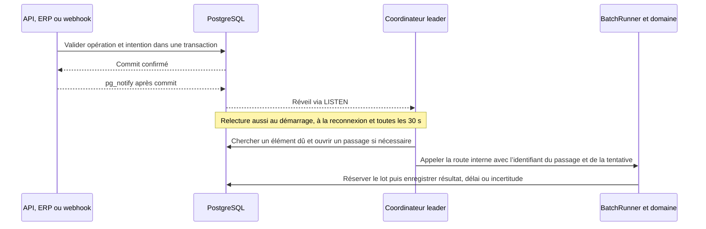
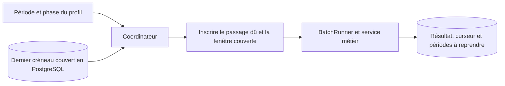
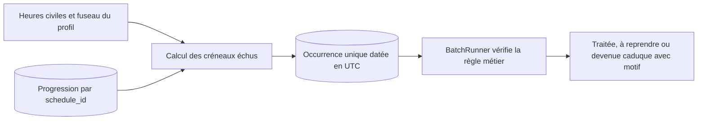

# EPIC 87 — Ordonnancement PostgreSQL et supervision des batchs dans Localeo Ops

**À faire · Spécification du 27 novembre 2026.** Le backend conserve le travail confirmé dans PostgreSQL. Un coordinateur hébergé dans FastAPI détecte les éléments éligibles et les échéances. Localeo Ops expose l’activité de chaque batch dans la journée, le résultat de chaque élément et le stock restant par type et par état. L’administrateur peut demander une reprise ciblée. [Backlog et critères E87-CA-01 à E87-CA-13](../../roadmap/a-faire/epic-87-ordonnancement-postgresql-supervision-batchs-backlog.md) · [Matrice de migration de chaque batch](migration-par-batch.md)

## Existant et périmètre

Le catalogue backend compte 38 batchs et 39 planifications. Le plan cible PROD représente environ 21 963 déclenchements par jour, hors interventions et reprises. Ce chiffre estime le nombre de créneaux configurés. Les volumes de travail et les activations réelles doivent être relevés sur chaque environnement. La matrice affecte 15 batchs au mode file, 11 au mode intervalle et 12 au mode calendrier. Ces 12 derniers représentent 13 planifications, dont deux pour le rapprochement des reversements. Huit traitements ou variantes documentés hors du catalogue complètent l’inventaire. [Catalogue backend](../../../../localeo-backend/app/application/exploitation/services/batchs.py) · [Plan cible PROD](../../exploitation/technique/planifier-et-superviser-batchs.md)

L’EPIC 23 a introduit le runner, le verrou par code et l’historique. L’EPIC 48 a placé APScheduler dans le service web, avec un leader et des appels HTTP protégés. Aujourd’hui, la date de la dernière exécution par code peut inclure un lancement manuel ou l’autre profil Stripe. La présence d’un job APScheduler et sa prochaine date servent à l’affichage. Pour la migration, l’admission d’un passage et sa progression devront être retrouvables par planification. [Socle d’exploitation](../../roadmap/terminees/epic-23-gestion-batchs-ordonnancement-backlog.md) · [Arbitrages de l’ordonnanceur](../epic-48-apscheduler-ordonnancement-batchs/registre-arbitrages.md) · [Persistance actuelle de l’ordonnanceur](../../../../localeo-backend/app/infrastructure/scheduler/repository.py)

**Garantie de reprise.** Après confirmation au producteur, PostgreSQL conserve l’intention et son identité. Une panne applicative ou d’un worker laisse de quoi retrouver un effet terminé, le travail restant ou une issue à rapprocher. Une acceptation fournisseur et une livraison au destinataire sont deux observations distinctes. La perte du primaire PostgreSQL relève du plan de reprise de l’infrastructure. Les règles d’éligibilité, de consentement, de confirmation, de quota et de rétention restent sous la responsabilité du domaine qui produit l’effet.

## Architecture cible

La vue d’ensemble situe les producteurs, le coordinateur FastAPI, le BatchRunner, PostgreSQL et la console Ops. Le dossier de conception illustre aussi les trois modes, la traçabilité par élément, la reprise après panne, les indicateurs du jour et la bascule en production. [Consulter les schémas d’architecture](schemas-architecture.md)

## Les trois modes de déclenchement

### File — réagir à un travail enregistré

Lorsqu’un organisateur confirme une campagne, le backend persiste dans la même transaction la confirmation et l’intention de diffusion. Après le commit, le producteur tente un `pg_notify('localeo_batch_work', code_batch)` dans une transaction courte et indépendante. Le signal transporte uniquement un code du catalogue. Une erreur d’émission est comptée et laisse la confirmation acquise. Le coordinateur sonde la file métier avant d’admettre un passage. [LISTEN](https://www.postgresql.org/docs/current/sql-listen.html) · [NOTIFY et conditions de commit](https://www.postgresql.org/docs/current/sql-notify.html)

Le leader utilise une connexion Psycopg dédiée, en autocommit, directe ou via un pool en **mode session**. Il valide d’abord `LISTEN`, puis inspecte le travail dans une nouvelle transaction. Il répète cet ordre à chaque reconnexion. Plusieurs notifications identiques peuvent déclencher une seule vérification. Une écriture en SQL direct, un signal perdu ou une date d’éligibilité franchie sans nouvelle écriture sont couverts par le balayage. La connexion d’écoute ne porte aucun traitement métier. [Compatibilité des modes de pooling PgBouncer](https://www.pgbouncer.org/features.html)

### Intervalle — relire une situation qui peut changer sans écriture locale

Le coordinateur calcule le prochain créneau à partir d’une période et d’une phase fixes. Les statuts SMS passent aux minutes paires et les emails aux minutes impaires. Après un arrêt, une lecture de l’état courant peut couvrir plusieurs créneaux manqués. Le passage conserve le premier et le dernier créneau couverts. Si le service crée du travail par période métier, comme les collectes de coûts SaaS, son propre curseur parcourt les périodes attendues.

### Calendrier — respecter une échéance civile

L’heure locale et le fuseau IANA définissent le calendrier. Le couple `(schedule_id, créneau_utc)` identifie l’occurrence. L’heure UTC distingue les deux occurrences d’une heure civile répétée. Une indisponibilité conserve les fenêtres d’origine et applique la politique de rattrapage propre au profil. Pour deux créneaux Stripe, l’historique est distinct et le verrou d’exécution reste commun par `batch_code`.

À Paris, la purge de sessions de 02 h 45 passe à 03 h 45 le 28 mars 2027. Le 31 octobre 2027, ses deux passages de 02 h 45 ont des instants UTC distincts. Au printemps, le référentiel aux heures paires passe à 03 h puis à 04 h. Le profil Stripe 14 jours garde ses heures civiles 00 h 05, 06 h 05, 12 h 05 et 18 h 05. Ces cas reproduisent le calendrier effectif d’APScheduler 3.11.3 et servent d’oracle de non-régression.

## Persistance et exécution d’un passage

Un **élément** est le travail métier, par exemple une diffusion à une destination. Une **occurrence** représente un passage automatique pour un profil donné. Une **tentative** est une exécution admise de cette occurrence. Un passage peut consommer plusieurs éléments et un élément peut demander plusieurs tentatives. La console distingue ces unités.

| Support | Évolution cible |
| --- | --- |
| Tables métier et outbox | Conserver la clé de l’intention, la date d’éligibilité, le point d’avancement, les délais, la réservation et l’issue. Pour une diffusion à plusieurs destinations, persister le résultat de chaque destination déjà engagée. Les données métier ne sont pas recopiées dans une file générique. |
| Preuves d’activité par élément | Réutiliser l’historique métier lorsqu’il conserve l’élément, l’étape, le batch et les dates nécessaires. Pour les branches qui ne conservent qu’un total ou qui suppriment l’objet, inscrire un reçu technique minimal en PostgreSQL. Relier référence opaque de l’unité, type, étape, batch, exécution automatique ou manuelle, tentative, jalon attendu, dates de prise en charge et d’issue, résultat et motif codé. Une retransmission de la même décision de tentative retrouve son reçu. Deux passages réels sur un élément conservent chacun leur lien. Ces preuves servent à la lecture Ops et suivent la rétention du domaine. |
| `planifications_batch` | Par `schedule_id`, conserver le mode et ses paramètres typés, le fuseau, la version, la source automatique active et le curseur des créneaux matérialisés. Distinguer dernier contrôle, dernière occurrence réussie, prochaine vérification et prochaine échéance métier. |
| `occurrences_batch` (nouvelle table) | Identifiant stable, planification, créneau ou fenêtre couverte, disponibilité, état, numéro de tentative, détenteur et échéance du bail, version, corrélation, motif de fin. Unicité par profil et créneau UTC pour le temps. Un seul passage de file ouvert par profil regroupe les réveils. L’insertion de l’occurrence et l’avancement du curseur de planification forment une transaction. |
| `executions_batch`, `verrous_batch`, bail du leader | L’admission vérifie la génération du leader. Dans une transaction, le runner acquiert le verrou par code et inscrit le début de tentative avec une contrainte d’unicité sur `(occurrence_id, tentative)` pour les exécutions automatiques. Le manuel conserve son acteur et partage le verrou. La progression et la fin vérifient le jeton de réservation du détenteur. |
| Audit des reprises Ops | Conserver référence de l’élément, acteur dérivé de la session, version examinée, motif, clé d’idempotence et résultat de la décision. La transition acceptée et le reçu d’audit sont atomiques. Appliquer les politiques de conservation du domaine et garder les preuves nécessaires aux dossiers ouverts. |

**Preuve d’une décision métier.** Pour une modification ou une purge SQL, écrire les références effectivement affectées et leur résultat dans la transaction qui applique l’effet, par lot. Une transaction annulée annule aussi ses reçus de succès. Une erreur individuelle attestée se rattache à la tentative de l’élément. Si l’arrêt interrompt une page avant l’examen de certaines unités, elles conservent leur état antérieur. Pour un fichier privé ou un fournisseur, conserver l’engagement avant l’action et confirmer le résultat sur preuve. Un résultat incertain reste à rapprocher. Un gel, une simulation ou une exclusion portent leur motif propre. Après effacement, le reçu permet de lire le type, l’heure et l’issue avec une référence technique dont la conservation est autorisée. Les contenus supprimés, PIN, jetons, adresses et références externes brutes restent exclus. La purge actuelle des activités locales, qui renvoie un nombre de lignes supprimées, illustre une branche à instrumenter. [Purge des activités locales](../../../../localeo-backend/app/application/exploitation/use_cases/purger_activites_locales.py)

**Admission HTTP.** Le backend conserve les routes et use cases existants, ainsi que leur clé serveur `internal:batch`. Le coordinateur envoie l’identifiant d’occurrence, la tentative, le jeton et la corrélation. Le serveur vérifie la concordance du profil, du code et des paramètres enregistrés avant l’admission. Une retransmission de la même tentative retrouve son reçu. Si la réponse HTTP se perd, le coordinateur consulte PostgreSQL avant toute décision de reprise. Une réponse au transport, l’acquisition d’un verrou et la réussite métier ont des preuves distinctes. [Client HTTP actuel](../../../../localeo-backend/app/infrastructure/scheduler/http_client.py) · [Verrou et exécutions](../../../../localeo-backend/app/application/exploitation/services/batchs.py)

**Capacité et équité.** Reprendre le plafond initial de quatre exécutions simultanées, le bail du leader de 90 s, son renouvellement toutes les 30 s et la recherche de successeur toutes les 15 s. Le temps PostgreSQL arbitre les échéances et les expirations. Le coordinateur attend le prochain réveil, la première échéance connue ou le balayage de sécurité de 30 s. Les sondes de file utilisent des index sur les états et dates admissibles. Les exclusions interviennent avant la limite du lot. Après un lot plein, le coordinateur sert les autres files éligibles puis revient au reliquat. Une simulation, un gel, un flag désactivé ou une dépendance indisponible dispose d’une prochaine vérification espacée. Le serveur conserve les budgets, limites et phases indiqués dans la matrice. [Paramètres du coordinateur](../../../../localeo-backend/app/config.py) · [Verrouillage de lignes PostgreSQL](https://www.postgresql.org/docs/current/sql-select.html#SQL-FOR-UPDATE-SHARE)

| Interruption | Résultat attendu |
| --- | --- |
| Arrêt avant ou après commit, notification perdue, répétée ou fusionnée | Un rollback laisse l’opération et l’intention annulées ensemble. Après commit, l’inspection initiale, le réveil ou le balayage retrouve la même intention. |
| Transfert de leadership, exécution longue, départ d’une instance | L’ancien leader cesse d’admettre. La tentative admise renouvelle son propre bail. Après réattribution, les écritures d’un détenteur périmé sont refusées. Un arrêt contrôlé suspend les nouvelles admissions et laisse finir ou expirer les réservations engagées. |
| Arrêt avant remise, juste après acceptation ou entre deux destinations | Distinguer la simple réservation de la remise effectivement engagée. Relire l’état par destination. Un refus temporaire certain suit son délai. Une acceptation prouvée termine la remise. Une issue inconnue passe à **À rapprocher**, y compris pour le Web Push ordinaire. Un ancien lot sans détail fiable est affiché **Issue historique inconnue**. |
| Opération financière partiellement exécutée | Réutiliser la clé d’idempotence de l’effet, ses pièces et ses dépendances. Après expiration de la garantie fournisseur, rapprocher la référence avant toute nouvelle action. [Idempotence Stripe](https://docs.stripe.com/api/idempotent_requests) |
| Arrêt de plusieurs jours | Reprendre les fenêtres par pages ordonnées et enregistrer les échéances caduques. Pour les coffrets, conserver la cohorte d’origine, exclure les relances déjà enregistrées avant la limite et revalider la fenêtre au moment de l’envoi. Motif terminal `HORS_FENETRE` lorsque le préavis est dépassé. |
| Restauration de base | Isoler les écrivains, le coordinateur et les workers avant restauration. Appliquer le garde de réouverture, réconcilier les travaux et reprendre l’écoute puis la lecture initiale. Les conservations PIN et accès salariés s’exécutent dans un contexte autorisé à la base et aux mêmes segments d’audit. [Procédure de restauration SaaS](../../exploitation/exploitation/exploiter-saas-animation.md) |

## Console « File de traitement » dans Localeo Ops

L’administrateur ouvre la console depuis l’accueil `/internal/ops/` ou depuis une alerte qui préfiltre la liste. La nouvelle surface hérite de la garde serveur des administrateurs ERP historiques. Elle indique la cible et la portée **Tous les territoires**, y compris quand une ville est sélectionnée sur l’accueil Ops. Le retour restitue le contexte précédent. Les lancements manuels autorisés et leur historique restent accessibles dans **Batchs exploitation** de l’ERP. Localeo Control est l’un des producteurs de Web Push supervisés. [Parcours Ops existant](../../exploitation/exploitation/localeo-ops.md) · [Garde ADMIN](../../../../localeo-backend/app/security/backoffice.py) · [Conventions de gestion](../../architecture/transverse/conventions-backoffice.md)

| Vue | Question à laquelle elle répond |
| --- | --- |
| Synthèse | **Qu’a fait ce batch aujourd’hui et que reste-t-il à traiter ?** Ouvrir sur **Aujourd’hui**, afficher la date de Paris, le filtre **Batch** et une ligne par type et unité. Présenter le total du jour et les compteurs de succès, de travail ouvert, d’erreurs et de retard. Chaque compteur ouvre ses éléments. Indiquer l’âge du plus ancien élément dû, l’heure et la couverture de la mesure. **Toutes dates** permet de consulter le stock au-delà de la journée. |
| Planifications | **L’automatisation progresse-t-elle ?** Présenter leader, dernier heartbeat et balayage réussi, état de l’écoute, mode, activation, simulation éventuelle, dernier progrès et prochaine échéance. La santé, le retard et la criticité de chaque profil, notamment Stripe, portent sur ses passages. La perte de l’écoute avec balayage sain indique un fonctionnement dégradé. La perte d’admission ou un travail dû au-delà du seuil du profil motive une alerte. |
| Liste filtrée | **Quels sont les éléments de ce batch ?** Combiner période, **Batch**, **Type d’élément**, état et retard. Présenter le batch, le type en toutes lettres, l’étape, la référence opaque, l’état, l’échéance, l’heure de traitement ou le dernier progrès, le retard et le motif. Depuis un passage, **Voir les éléments** ouvre la sélection de cette exécution, y compris ceux déjà traités. |
| Détail | **Que s’est-il passé pour cet élément ?** Indiquer les dates métier et leur sens, la première prise en charge connue, les batchs et passages intervenus, les tentatives, le résultat, le retard éventuel au moment du résultat et la prochaine action autorisée. Rattacher une remise au résultat fournisseur ou à la procédure de rapprochement. Indiquer la profondeur d’historique disponible. |

### Journée de traitement dans Ops

**Période.** La journée va de minuit inclus au minuit suivant exclu en `Europe/Paris`. Le serveur convertit chaque borne en UTC, y compris les jours de 23 ou 25 heures. La date affichée et l’instant de mesure sont communs au tableau et à la liste lors d’une même lecture. La période des batchs configurés en UTC garde son horaire d’exécution propre.

**Éléments du jour.** Réunir par référence distincte les unités prévues ou dues dans la journée, le travail antérieur encore ouvert à minuit et déjà dû ou engagé, et les unités ayant eu une activité de batch attestée ce jour. Cette dernière catégorie inclut une tentative d’élément en cours sur la période ou une décision horodatée du batch, même en l’absence d’échéance initiale. Un report soldé aujourd’hui reste consultable. Une unité déjà soldée avant minuit et sans nouvelle activité du batch ce jour reste dans l’historique antérieur. Un email nouvellement enregistré pour demain, sans activité du batch ce jour, apparaît dans **Toutes dates**. Le filtre **Avec activité du batch** isole les unités effectivement examinées ou prises en charge. Les simples lignes parcourues par une requête technique n’entrent pas dans cette mesure.

| Indicateur cliquable | Ce que mesure le nombre d’éléments distincts |
| --- | --- |
| **Total du jour** | Toutes les références du périmètre ci-dessus, pour le batch, le type, l’unité et l’étape sélectionnés. La liste précise le batch responsable d’un travail prévu et les exécutions attestées d’un travail engagé. |
| **Traités aujourd’hui** | Références ayant atteint avec succès le résultat attendu de l’étape dans la journée, par exemple un email accepté, une ligne effectivement purgée ou un virement vérifié. Une synchronisation de livraison aujourd’hui reste rattachée à son étape, même si le message a été envoyé hier. |
| **À traiter**, **En cours**, **En erreur**, **À rapprocher** | État à l’heure affichée. Un élément qui échoue puis réussit ce jour quitte **En erreur**, compte une seule fois dans **Traités aujourd’hui** et conserve la tentative échouée dans son détail. Les éléments **Planifiés**, **En attente** et **Clos sans effet** ont également leur liste. |
| **En retard** | Jalon encore ouvert dont la date limite est dépassée à l’instant de mesure. La liste affiche le délai dépassé et le plus ancien retard. |
| **Traités en retard aujourd’hui** | Sous-ensemble des succès du jour dont le jalon a été atteint après sa limite attestée. La durée de dépassement demeure lisible après la réussite. |

Un élément compte une fois dans un indicateur pour son unité et son étape, même après trois tentatives ou deux passages. Pour l’ensemble des batchs, dédupliquer la référence dans son unité avant le comptage et la pagination. Si deux batchs ont agi sur le même objet, chaque filtre de batch retrouve sa contribution effective. Le contexte identifie aussi un passage lancé depuis l’ERP ou un CLI. Pour les résultats du jour, utiliser la date du résultat attesté de l’étape. Un retour fournisseur dont seule la date de constat est connue est identifié comme tel. Le total toutes étapes d’une même unité déduplique les références. Les indicateurs de retard recoupent les états. Les simulations disposent d’un filtre et de résultats identifiés séparément des effets réels.

**Exemple à 00 h 06, heure de Paris.** Pour l’envoi d’emails, A est dû depuis hier et en retard. B est en cours depuis 23 h 59 et dans son délai. C, dû hier, a échoué à 00 h 01 puis a été accepté à 00 h 04 pour une limite à 00 h 03. D est prévu aujourd’hui à 18 h. E est prévu demain. F a échoué à 00 h 05, sans réessai prévu, avant sa limite de 00 h 30. La synthèse du jour donne **5 éléments** (A, B, C, D, F), **3 avec activité du batch** (B, C, F), **1 traité** (C), **1 en erreur** (F) et **1 en retard actuellement** (A). Le compteur **Traités en retard aujourd’hui** ouvre C et indique une minute de dépassement.

### Types d’éléments et unités

Le libellé décrit le travail visible pour l’administrateur. Chaque profil de la matrice expose toutes les unités sur lesquelles il prend une décision, y compris chaque objet de purge ou de conservation et chaque virement examiné. Un passage vide reste visible dans **Planifications** avec zéro élément si sa source a été parcourue intégralement. Si un fournisseur interrompt la lecture d’une page, Ops affiche les éléments connus et la couverture partielle de la fenêtre. Les compteurs gardent une unité homogène. Par exemple, une notification adressée à trois appareils peut être associée à trois remises distinctes. Additionner la notification et ses remises donnerait un total trompeur. [Matrice par batch](migration-par-batch.md)

| Type | Ce que l’administrateur peut retrouver |
| --- | --- |
| Envoi d’email (`EMAIL`) et envoi de SMS (`SMS`) | Un message sortant conserve sa référence entre les étapes **Envoi** et **Suivi de livraison**. L’acceptation par le fournisseur clôt l’envoi. Le statut de livraison, lorsqu’il est connu, figure sur le même message. Filtrer les **envois à traiter** exclut les messages déjà acceptés, même si leur livraison reste à confirmer. [États email](../../../../localeo-backend/app/domaine/exploitation/entities/email_sortant.py) · [États SMS](../../../../localeo-backend/app/domaine/exploitation/entities/sms_sortant.py) |
| Notification Web Push (`WEB_PUSH`) | Avant résolution des destinations, compter les notifications logiques. Une fois les remises par destination identifiables, les présenter dans leur propre unité. Une seule destination peut rester **À rapprocher** pendant que les autres aboutissent. Un ancien lot sans détail fiable indique **Issue historique inconnue** au niveau connu. |
| Coffret arrivant à expiration (`COFFRET_EXPIRATION`) | Une instance de coffret à son échéance connue. Afficher la date d’expiration et l’état du traitement d’expiration. Un coffret encore valide apparaît dans les échéances à venir du périmètre demandé. |
| Relance avant expiration d’un coffret (`COFFRET_RELANCE_EXPIRATION`) | Une relance identifiée par le coffret, son échéance, le type de relance et le préavis. Afficher la fenêtre utile, la préparation de la relance et, le cas échéant, la référence opaque de l’email créé. Un préavis dépassé se clôt avec le motif `HORS_FENETRE`. [Expiration et relances](../../../../localeo-backend/app/application/gestion_achats/use_cases/expiration_coffrets.py) |

**Observer un élément avant le passage du batch.** Les lectures interrogent les dépôts propriétaires avec les mêmes règles d’éligibilité que le traitement. Les coffrets et les relances identifiables sont donc visibles même si le coordinateur est arrêté. Avant le passage de relance de 07 h 30 à Paris, calculer la fenêtre prévue à partir de ce créneau et de son préavis configuré. Dès que le passage est enregistré, reprendre ses bornes persistées, début inclus et fin exclue. La même candidature conserve sa référence opaque avant et après le passage. Pour une échéance modifiée ou un ancien lot, indiquer la couverture que les preuves permettent d’établir. L’email créé dispose de sa propre référence liée. La consultation est en lecture seule.

### États et calcul du retard

Chaque élément porte **un état courant pour l’étape affichée**. Le domaine propriétaire fournit les faits qui le justifient. Le backend applique les mêmes règles à la synthèse, à la liste et au détail.

| État affiché | Règle de lecture |
| --- | --- |
| **Planifié** ou **En attente** | L’échéance est future ou un prérequis identifié diffère le travail. Indiquer la date ou le motif, par exemple une dépendance ou un gel. |
| **À traiter** | Le travail est éligible et peut être pris en charge. Un réessai redevenu admissible y figure avec la trace de son erreur précédente. Une saturation des workers conserve la date d’éligibilité. |
| **En cours** | Une prise en charge valide existe. Un bail échu impose de relire la preuve de progrès ou de remise avant de classer l’élément. |
| **En erreur · À réessayer** | L’échec temporaire est certain et un nouvel essai est prévu. Afficher sa date et le motif. |
| **En erreur · Sans réessai prévu** | Un échec est établi et aucune prochaine tentative automatique n’est prévue. Afficher le motif connu et l’action permise par le domaine. |
| **À rapprocher** | Le résultat d’un effet déjà engagé est incertain ou l’historique ne permet pas de l’établir. L’élément reste visible avec le motif. |
| **Traité** ou **Clos sans effet** | Le domaine atteste le résultat attendu ou une fin légitime et motivée, par exemple une échéance remplacée, une annulation ou un préavis dépassé. |

**Non traités** regroupe les références dont le traitement reste ouvert, de **Planifié** à **À rapprocher**, y compris **En erreur**. Les vues **À traiter** et **En erreur** en sont des sous-ensembles. Le filtre **En erreur** réunit les deux situations de réessai du tableau. Le filtre complémentaire **Jamais pris en charge** isole les éléments ouverts sans première tentative attestée lorsque l’historique est complet.

**En retard** se combine avec l’état. Le backend compare l’heure de mesure PostgreSQL à la date limite du jalon attendu, par exemple une prise en charge ou une fin de traitement. Pour chaque type et étape surveillés, préciser le jalon et la borne utilisée avant bascule. Le domaine fournit la limite métier ou le profil fixe le délai admissible à partir de l’éligibilité. Tant que le jalon reste ouvert après cette limite, afficher le retard et sa durée. Une date de réessai conserve la trace d’une échéance métier déjà dépassée. Un envoi prévu demain reste **Planifié**. Le temps écoulé depuis sa création ou le retard d’un passage du batch ne suffisent pas à le qualifier en retard. Si la preuve manque, afficher **Retard indéterminé**. Si aucune limite ne s’applique, indiquer **Sans objet**.

**Exemple dans Toutes dates.** À 10 h, deux emails sont à envoyer. Le premier devait être pris en charge avant 9 h 45, le second avant 10 h 15. Un troisième email est prévu demain. La ligne **Envoi d’email** indique **3 non traités**, **2 à traiter** et **1 en retard**. Le clic sur **1 en retard** ouvre le premier email, avec **À traiter** et **15 min de retard**. Dans **Aujourd’hui**, seuls les deux premiers relèvent de la journée.

### Interfaces privées

| Interface cible | Contrat |
| --- | --- |
| `GET /internal/ops/file-traitement` | Page HTML sous session ADMIN, accessible directement et par navigation. Enregistrer sa route avant le chemin générique des fichiers statiques Ops. |
| `GET /internal/ops/file-traitement/synthese` | Accepter `vue=JOUR` (par défaut) ou `TOUTES_DATES`. Renvoyer date de Paris, bornes UTC, instant de mesure, cible, portée, début et qualité de couverture par profil. Par type, unité et étape, fournir le total du périmètre, les effectifs par état et les indicateurs quotidiens. Un total exact provient de la sélection dédupliquée sur la source autorisée. Une source indisponible ou partielle porte sa qualification. |
| `GET /internal/ops/file-traitement/elements` | Appliquer les mêmes filtres que la synthèse, dont vue et jour civil de référence, `batch_code`, `schedule_id`, `execution_id`, type, unité, étape, état, indicateur, mode et référence. Les indicateurs incluent `AVEC_ACTIVITE_BATCH`, `TRAITES_DU_JOUR`, `EN_RETARD` et `TRAITES_EN_RETARD_DU_JOUR`. Garder les filtres de stock non traité, première prise en charge et échéance. Chaque ligne indique les batchs concernés, la référence, le type, l’heure d’activité ou d’échéance, l’état et le résultat. Pages de 50, curseur serveur stable pour la sélection et accès à toutes les pages autorisées. |
| `GET /internal/ops/file-traitement/elements/{ref}` | Reprendre la même référence et la même qualification. Présenter les événements datés des étapes, leurs exécutions, la dernière issue, la date limite applicable, le retard actuel ou constaté à la fin. Ajouter version, prochaine tentative éventuelle, motif, couverture et action autorisée. Après purge, le détail technique résout la référence pendant sa période autorisée. Adresses, numéros, contenus, pièces jointes, secrets et erreurs brutes de fournisseur restent dans les systèmes propriétaires. |
| `POST /internal/ops/file-traitement/elements/{ref}/reprises` | Reçoit `version_attendue` et `motif`, avec `X-CSRF-Token` et `Idempotency-Key`. Le serveur authentifie l’administrateur, retrouve le reçu d’une demande identique, puis, pour toute nouvelle demande, relit la cible sous verrou et revalide sa capacité de reprise. L’admission répond `202` avec la référence du reçu. |

**Reprise ciblée.** L’administrateur choisit **Demander la reprise**, vérifie la cible, indique le motif et confirme. Le domaine ne rouvre que l’élément sélectionné quand son état et les preuves d’effet le permettent. Identité, nombre de tentatives, dépendances, délais fournisseur et garde-fous métier sont conservés. Une requête identique répétée renvoie le même reçu, même si la première réponse a été perdue. Une même clé avec un contenu différent, une version périmée, un bail actif, un délai non écoulé ou un effet incertain provoquent un conflit `409` motivé. Session absente ou expirée, accès refusé, jeton CSRF invalide et cible inconnue sont distingués côté serveur. L’écran différencie **Reprise demandée**, **Traitement repris** et **Traitement terminé**. [Précédent pour une commande Ops protégée](../../../../localeo-backend/app/api/ops_passkeys_api.py)

**Du compteur au détail.** Transmettre à la liste les filtres du compteur, y compris le jour civil résolu, le batch, l’unité, l’étape et le jalon. Le clic à minuit conserve la date du compteur ouvert. Dans **Toutes dates**, les travaux ouverts restent consultables sur tout l’historique couvert. Le total exact correspond aux références distinctes de toutes les pages à données et instant de qualification identiques. La pagination des décisions utilise une borne de lecture conservée dans le curseur et un ordre stable départagé par la référence. Une actualisation ouvre une nouvelle mesure et date ensemble la liste et son total. Une mesure provisoirement bornée le signale et laisse parcourir les résultats suivants. Le seul franchissement d’une échéance peut faire entrer un élément dans **En retard**. Le retour au tableau conserve la sélection. Les états et le retard sont lisibles en texte.

**Actualisation et confidentialité.** La page active actualise les seuls résultats visibles toutes les 15 s. Une lecture ciblée conserve saisie, filtres, pagination, sélection et focus. Les réponses arrivées après un changement de filtre sont ignorées. En cas d’erreur transitoire en ligne, dater le dernier résultat confirmé et proposer **Réessayer**. Hors connexion, afficher l’état réseau de la PWA. À expiration de session, effacer les données opérationnelles affichées. Servir les réponses avec `Cache-Control: no-store` et intégrer les nouveaux fichiers d’interface à l’empreinte de version PWA.

## Contrats existants et bascule par profil

La séquence ci-dessous décrit la stratégie par vagues. Une variante à arbitrer prévoit une bascule unique des profils actifs après répétition sur TEST et DEMO. L’étude compare les deux stratégies, décrit la suspension des admissions et précise les conditions d’un retour arrière après un premier effet métier. [Étude de bascule unique et revue de résilience](etude-bascule-unique.md)

Présenter le plan et son résultat attendu par environnement. Le registre backend versionné définit les profils, leurs modes et paramètres admis. La configuration TARGET peut surcharger les réglages autorisés dans `LOCALEO_BATCH_TRIGGERS_JSON` (période, phase, heures civiles, fuseau, délai de vérification). Valider la cohérence de l’ensemble avant admission. Les URLs de handlers, commandes système, SQL, droits de purge et règles de simulation ne sont pas des réglages de cette interface.

1. **Installer la version de transition.** Ajouter les colonnes, contraintes et index nécessaires sur PostgreSQL. La V1 de l’inventaire impose actuellement `cron_expression` en chaîne en SQL et dans l’API. Avant d’inscrire de nouveaux profils, limiter explicitement les planifications sérialisées en V1 aux 39 identifiants historiques et conserver leur expression dépréciée. Déployer les lecteurs compatibles et la migration autorisant une valeur absente pour les nouveaux profils. Sous `/protected/exploitation/maintenance/v2/batchs`, exposer l’inventaire complet et ses sous-ressources `executions` et `health` avec le scope `internal:batch`. La V2 restitue les paramètres typés de chaque profil. L’ERP indique le mode effectif. La PWA Ops utilise sa session et accède aux services de lecture côté serveur. [Schémas actuels](../../../../localeo-backend/app/api/schemas.py) · [Migration initiale des planifications](../../../../localeo-backend/sql/v174_epic48_apscheduler_ordonnancement.sql)
2. **Observer avant de déclencher.** Relever les cadences effectives et les appelants externes sur TEST, DEMO et PROD. Comparer, en lecture seule, éligibilité et créneaux projetés à l’ancien moteur, y compris les fenêtres de rattrapage et les changements d’heure. Préparer en premier la lecture Ops. Une simulation métier peut enregistrer un rapport et ne sert pas à cette comparaison.
3. **Initialiser depuis des preuves.** Pour chaque file, relire les lignes existantes, y compris les baux expirés. Pour un profil temporel, partir de sa date de bascule et du dernier succès automatique qui lui est attribuable. En l’absence de preuve, exécuter la réconciliation bornée du profil ou tracer la fenêtre manquée selon sa politique. Produire un reçu pour tout passage matérialisé. Une simulation, une exécution manuelle ou le succès de l’autre profil Stripe ne solde pas le travail dû.
4. **Basculer par vagues sur TEST puis DEMO et PROD.** Drainer les anciennes instances incapables de vérifier la source active. À la bascule, recueillir le dernier passage du déclencheur sortant, l’arrêter, enregistrer le changement de source et reprendre les éléments dus. Commencer par `animations.generer` et les deux clôtures explicites. Suivent les transports après qualification des remises incertaines, les autres files, les profils temporels puis les traitements complémentaires. Chaque profil dispose d’une seule source automatique. Un nouveau profil sans activation attestée est livré désactivé.
5. **Exercer le retour arrière.** Sur la version de transition, arrêter les nouvelles admissions du profil, attendre ou rapprocher ses travaux en cours, enregistrer le curseur, rendre l’admission au moteur précédent et contrôler le même stock de travail. Conserver occurrences, reçus et incidents ouverts. Après recette de toutes les cibles, retirer les déclencheurs externes correspondants, `CronTrigger` et les 39 réglages `LOCALEO_SCHEDULER_CRON_*`. Le TARGET fusionne les clés présentes, l’omission d’une ancienne clé ne l’efface pas. [Configuration de livraison](../../../../localeo-deploiement/executor/validation.py)

## Recette, impacts et preuves

Les cas ci-dessous déclinent les treize critères du backlog. Chaque ligne de la matrice fournit en plus un scénario propre à son batch. Les tests de concurrence et de notification doivent utiliser un vrai PostgreSQL jetable. Simuler les fournisseurs et injecter les arrêts autour des commits, des appels externes et de la réponse HTTP. Les mesures de performance utilisent les mêmes données et la même capacité pour les deux moteurs.

| Critères | Preuves à produire à l’implémentation |
| --- | --- |
| E87-CA-01, E87-CA-11 · Couverture et bascule | Comparer les ensembles de codes et de profils au registre et les cadences au TARGET. Rapprocher aussi les appels extérieurs par environnement. Exercices aller-retour avec travaux dus, versions mixtes et profils inactifs. Inscrire un profil sans cron et vérifier que l’inventaire V1 restitue toujours ses 39 planifications avec une chaîne valide. Vérifier que l’inventaire et la santé V2 incluent le nouveau profil. |
| E87-CA-02, E87-CA-03 · Arrêt et concurrence | Tester commit jamais atteint, arrêt entre commit et signal, notification dupliquée, reconnexion, deux leaders, perte de réponse après admission et mort après effet. Vérifier le reçu, l’état de chaque élément et le refus d’acquittement de l’ancien détenteur. Faire entrer un lancement ERP manuel concurrent par son point d’entrée normal. |
| E87-CA-04, E87-CA-05 · Invariants et fournisseurs | Campagne avec audience figée et quota unique, clôture sur décision explicite, simulation sans effet externe, gel, révocation et paiement idempotent. Simuler deux destinations Web Push et interrompre après acceptation de la première. L’issue incertaine est visible et exclue de la reprise automatique. |
| E87-CA-06 · Temps métier | Vérifier minutes paires et impaires, phases CRM, calendriers Paris et UTC, dates de changement d’heure en 2027, indépendance Stripe 14/90 jours. Reprendre après trois jours d’arrêt sur 1 001 coffrets, contrôler les cohortes, la déduplication avant pagination et le sort des relances hors fenêtre. |
| E87-CA-07 à E87-CA-09 · Ops | Couvrir ADMIN, profils refusés, accès direct, CSRF, répétition après réponse perdue, conflit de version et refus des éléments incertains. Contrôler filtres, pagination, navigation retour, lecture sans écriture, bureau, 390 et 320 px, texte à 200 %, clavier, réseau absent et session expirée. |
| E87-CA-12 · Stock par type et par état | Vérifier les compteurs de l’exemple des emails et leurs références à 10 h. Avancer l’horloge au-delà de 10 h 15 sans écriture et retrouver deux emails en retard. Accepter ensuite le premier email et vérifier qu’il quitte les envois à traiter. Filtrer deux SMS en erreur, l’un à réessayer et l’autre sans réessai, puis deux destinations Web Push dont une seule incertaine. À 07 h 15, consulter les coffrets placés aux deux bornes de la fenêtre de relance de 07 h 30. Avant et après inscription du passage, à données métier égales, retrouver la même cohorte et les mêmes références. Contrôler une échéance future, un préavis clos `HORS_FENETRE`, une mesure indisponible, plusieurs pages et une actualisation concurrente. |
| E87-CA-13 · Journée complète et traçabilité individuelle | Vérifier les références et les compteurs de l’exemple de 00 h 06, au passage de minuit et lors des deux changements d’heure. Ajouter une livraison suivie aujourd’hui pour un email envoyé hier. Purger 101 anciennes activités locales déjà passées au backoffice. Depuis l’exécution, retrouver leurs 101 références après suppression, sur trois pages de 50, 50 et 1. Annuler la transaction dans un second essai et vérifier l’absence de succès enregistré. Sur Stripe, rapprocher le même virement avec les deux profils puis interrompre une page fournisseur. Contrôler le décompte par profil, l’unicité dans la vue commune et la couverture partielle annoncée. Pour chaque ligne de la matrice, comparer les références issues des décisions effectives du batch à celles de la liste. Tester aussi le passage vide, la simulation et l’absence de contenus, de coordonnées et de secrets dans les reçus. |
| E87-CA-10 · Capacité et délai utilisateur | En charge nominale, pour les files à admission immédiate dont la fenêtre est ouverte et la capacité disponible au commit, viser un p95 inférieur à 5 s du commit à la réservation. Pour l’actualisation CRM, mesurer séparément l’attente jusqu’à la phase d’admission de 5 min et le délai de réservation une fois celle-ci ouverte. Avec écoute coupée et leader sain, vérifier la détection au prochain balayage de 30 s. À N puis 10N et sous charge mixte, comparer appels HTTP à vide, débit, âge du premier travail dû, latences applicatives, requêtes et plans SQL, connexions, contentions et coût des consultations Ops. Distinguer attente métier, délai du moteur et temps fournisseur. [Convention de performance](../../architecture/transverse/performance-volumetrie.md) |

**Contrats, données et démonstration.** Le backend produit la lecture privée d’Ops à partir des preuves des domaines, des reçus par élément et des occurrences. Vérifier les index et les plans pour la journée, l’état, l’échéance et l’exécution. Mesurer le coût d’écriture par lot et celui d’une consultation avec plusieurs pages. À la migration, établir pour chaque profil l’heure de début de couverture et reprendre uniquement les preuves datées fiables. Une matinée ancienne connue seulement par ses totaux apparaît **Historique partiel** avec la période concernée. Après activation de la traçabilité, contrôler le décompte individuel sur toutes les branches du profil. Régénérer les OpenAPI documentaires et vérifier les contrats embarqués concernés. Le jeu de démonstration couvre les CA-12 et CA-13, avec une file vide, un report, un succès après erreur et des références purgées encore consultables. Les travailleurs restent isolés pendant le transfert. [Exports et lecteurs](../../exploitation/deploiement/reference-documentation-centralisee.md)

**Guides.** Documenter à la livraison la vue du jour et le passage d’un compteur au détail dans le guide Ops, et la vérification du stock dans le runbook de bascule. Les filtres et libellés des CA-12 et CA-13 se trouvent dans la console ADMIN. Les gestes décrits dans les guides Commerçant et Animation restent ceux de leurs applications. La recette de l’epic vérifie côté Commerçant les états de notification et côté Animation les gestes **Actualiser cet import** et **Poursuivre le traitement**. Adapter les guides utilisateur et leurs PDF si la réalisation change ces parcours. [Exploitation de Localeo Ops](../../exploitation/exploitation/localeo-ops.md) · [Guide Commerçant](../../produit/formation/commercant/guide-quotidien-commercant.md) · [Guide Animation](../../produit/formation/animation/guide-quotidien-animation.md)

Le cadrage et le classement du catalogue sont établis sur les sources locales au 27 novembre 2026. Les valeurs effectives des cibles, les résultats de reprise et les objectifs de charge sont à consigner avec l’environnement, la version et la mesure au cours de la réalisation.
