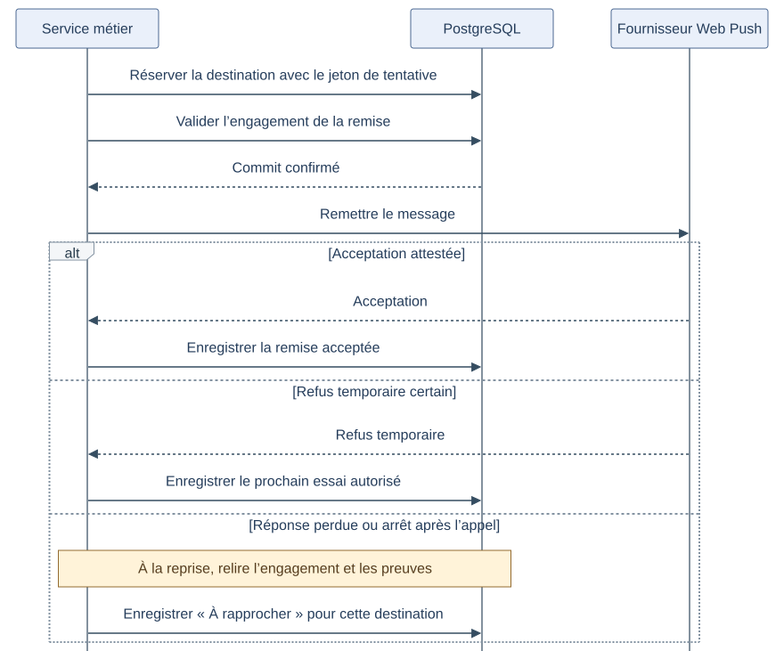

# EPIC 87 — Schémas d’architecture des traitements par batch

Ces schémas décrivent l’architecture cible de Localeo, depuis la confirmation d’un travail jusqu’à son résultat dans Ops. Chaque figure est disponible en SVG et accompagnée de sa source Mermaid modifiable. [Spécification technique](README.md) · [Matrice de migration par batch](migration-par-batch.md)

## Vue d’ensemble

Le producteur valide ensemble l’opération métier et son intention de traitement dans PostgreSQL. Le backend FastAPI héberge le coordinateur et le lanceur existant. Le coordinateur élu décide quand ouvrir un passage. Le service métier décide quels éléments il peut traiter et quel effet produire. La configuration initiale autorise quatre exécutions simultanées.

[Ouvrir la vue d’ensemble en grand](schemas/composants.svg) · [Source Mermaid](schemas/composants.mmd)

## Trois modes de déclenchement

Les 39 planifications du catalogue se répartissent entre 15 profils de file, 11 d’intervalle et 13 de calendrier. Les sources de réveil diffèrent. Toutes conduisent à une occurrence enregistrée avant la prise en charge par le runner.

**File.** Le producteur valide l’opération et l’intention dans une première transaction. Il tente ensuite `pg_notify` dans une transaction distincte. Au démarrage et après reconnexion, le leader valide `LISTEN` avant de relire la base. Le balayage de sécurité toutes les 30 secondes retrouve aussi un travail dont le signal a été perdu.

**Intervalle.** Le profil conserve période et phase. Une lecture de l’état courant peut couvrir plusieurs passages manqués. Lorsqu’une période produit elle-même du travail, le curseur métier permet de parcourir les périodes dues.

**Calendrier.** L’heure civile et le fuseau fixent le créneau. Son identité en UTC permet de retrouver les passages à reprendre, y compris lors d’un changement d’heure. [Détail de chaque mode](README.md#les-trois-modes-de-déclenchement) · [Ouvrir le schéma en grand](schemas/declenchements.svg) · [Source Mermaid](schemas/declenchements.mmd)

## Du passage à la preuve par élément

Un passage peut se terminer avec zéro élément ou traiter un lot entier. Un même élément peut traverser plusieurs passages avant d’aboutir. Le schéma montre les liens logiques conservés dans l’historique métier ou, si nécessaire, dans un reçu minimal. Une purge SQL valide la suppression et le reçu de l’élément dans la même transaction.

Les profils Stripe à 14 et 90 jours illustrent la différence entre planification et batch. Chacun garde son curseur et ses occurrences. Le verrou sur leur code batch commun sérialise leurs exécutions. Si la réponse HTTP du runner se perd, le coordinateur consulte le reçu de la tentative avant de décider d’une reprise. [Persistance et admission](README.md#persistance-et-exécution-dun-passage) · [Ouvrir le schéma en grand](schemas/tracabilite.svg) · [Source Mermaid](schemas/tracabilite.mmd)

## Reprise après une panne pendant un envoi

L’exemple suit une remise Web Push à une destination. Avant l’appel externe, le service valide en base que la remise est engagée. Après l’appel, la preuve disponible détermine si l’envoi est accepté, si une nouvelle tentative est permise ou si un rapprochement est nécessaire.

Si le service s’arrête avant l’engagement, son successeur relit la réservation et l’éligibilité. Après un engagement à l’issue inconnue, la destination reste **À rapprocher**. Les autres destinations éligibles peuvent progresser. Le jeton de tentative protège les écritures et la libération du verrou après réattribution. La garantie de reprise applicative suppose que PostgreSQL conserve les transactions confirmées. [Ouvrir la séquence en grand](schemas/reprise-fournisseur.svg) · [Source Mermaid](schemas/reprise-fournisseur.mmd)

## Du résultat à la vue « Aujourd’hui » dans Localeo Ops

La lecture ADMIN réunit trois populations dans la journée civile de Paris. Elle prend les éléments prévus ou dus, les reports déjà dus ou en cours à minuit et les éléments dont une activité de batch est attestée. Un reçu minimal permet de retrouver un objet déjà purgé. La couverture indique jusqu’où l’historique individuel est fiable.

Un SMS échoue à 9 h, puis le fournisseur l’accepte à 9 h 06 pour une échéance à 9 h 05. Il compte une fois parmi les **Traités aujourd’hui** et figure aussi parmi les **Traités en retard aujourd’hui**. Son détail conserve l’échec initial et la minute de dépassement. Depuis le détail, une reprise autorisée passe par une commande distincte, motivée, protégée par CSRF et auditée. [Définition des indicateurs](README.md#journée-de-traitement-dans-ops) · [Ouvrir le schéma en grand](schemas/supervision-quotidienne.svg) · [Source Mermaid](schemas/supervision-quotidienne.mmd)

## Bascule en production

La stratégie de référence bascule les profils par vagues. La bascule unique reste une variante à arbitrer après répétition sur TEST et DEMO. Dans les deux cas, le transfert porte sur un périmètre où une seule source automatique peut admettre du travail. Pour la bascule unique, les confirmations métier continuent à produire un reçu pendant la suspension des départs de lots.

Avant la première admission PostgreSQL, l’ancien moteur compatible peut reprendre après vérification des créneaux manqués. Après une admission, le retour exige de préserver les occurrences ouvertes, les curseurs et les remises incertaines. Si l’ancien moteur ne sait pas les reprendre, les intentions restent en base pendant la correction du coordinateur. [Étude de bascule et de retour arrière](etude-bascule-unique.md) · [Ouvrir le schéma en grand](schemas/bascule-production.svg) · [Source Mermaid](schemas/bascule-production.mmd)
